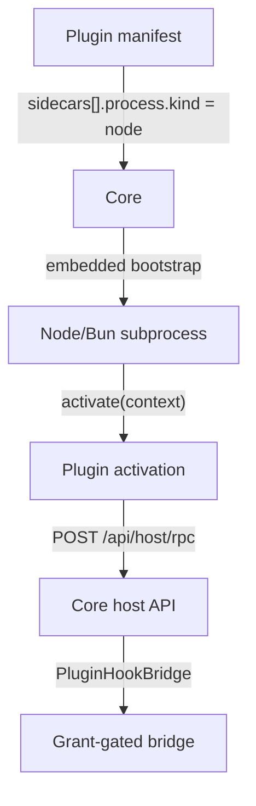

The Extension Host v1 runs a plugin's own JavaScript backend as a managed Node or Bun process. It
is a `kind: "node"` sidecar (`SidecarProcess::Node` in
`crates/core/kernel-contracts/src/schema.rs`). It is off by default and every host call is
grant-gated.

<Callout type="warn">
The Extension Host is experimental and **off by default**. Core refuses to spawn a `kind: "node"`
sidecar until `RYU_EXPERIMENTAL_PLUGIN_RUNTIME` is set to `1`, `true`, or `on` (or the matching
Core preference is on). Community-tier plugins also need the `sidecar:process` grant.
</Callout>

## How it works



1. The plugin declares a sidecar with `"process": { "kind": "node", "entry": "..." }` in its
   `manifest.json`.
2. If the manifest carries a `backend_code` payload, Core writes it to `entry`. If it does not,
   the file must already exist at `entry`, or the spawn fails. When the manifest declares
   `backend_sha256`, Core hashes the entry file and refuses the spawn on a mismatch
   (`prepare_node_backend` in `apps/core/src/sidecar/manifest_sidecar.rs`).
3. Core spawns its embedded bootstrap under `bun` (preferred) or `node`. Set `runtime` to
   `"bun"` or `"node"` to pick one.
4. The bootstrap imports the entry module and calls its exported `activate(context)`.
5. The plugin calls Core through `context.host.call(method, args)`, which posts to
   `POST /api/host/rpc`. Core dispatches the call through `PluginHookBridge` with grant enforcement.
6. Requests to `/api/ext/<plugin id>/*` are proxied to the handler the plugin registers with
   `context.http.onRequest`.

## The activate() lifecycle

The bootstrap (`apps/core/src/sidecar/assets/plugin_host_bootstrap.mjs`) passes a `context` object with these fields:

| Field | Purpose |
|---|---|
| `context.manifest` | `{ id, version }` of the owning plugin |
| `context.hostApiVersion` | The host API version Core reports |
| `context.host.call(method, args)` | Call a host API method through `POST /api/host/rpc`; resolves to the method's `result` |
| `context.http.onRequest(handler)` | Register the handler for proxied `/api/ext/<plugin id>/*` requests |

```js
// dist/activate.js - loaded by the extension host bootstrap
export async function activate(context) {
  context.http.onRequest(async (req) => {
    if (req.method === "POST" && req.path === "/analyze") {
      const { data = "" } = JSON.parse(req.body || "{}");
      const result = await context.host.call("model.complete", {
        prompt: `Analyze: ${data}`,
      });
      await context.host.call("storage.set", { key: "last", value: String(result) });
      return { json: { analysis: result } };
    }
    return { status: 404, json: { error: "not found" } };
  });
}

export async function deactivate() {}
```

The handler receives `{ method, path, headers, body }`, where `body` is the raw request body as a
string. It returns `{ status?, headers?, body? }`, `{ status?, json }`, `{ status?, headers?, stream }`,
or a bare value (sent as JSON 200). Returning `null` or `undefined` answers 404. With no handler, the bootstrap answers 404 on every
path except the health check.

| Lifecycle phase | What happens |
|---|---|
| **Spawn** | Core starts the bootstrap with the plugin's entry module |
| **activate()** | The plugin registers its request handler. A missing `activate` export or a throw stops the process |
| **Running** | The plugin serves proxied requests and makes host calls |
| **Idle stop** | Core can stop an idle sidecar under the managed sidecar lifecycle |
| **Wake on demand** | A lazy sidecar starts again on the next request |

`deactivate()` is optional. It runs only when the process gets a catchable signal (`SIGTERM` or
`SIGINT`).

## Host API

`method` must be a row in the host API contract
(`crates/core/kernel-contracts/schemas/host-api.json`). Common calls:

| Method | Grant required | Purpose |
|---|---|---|
| `model.complete` | `hook:side-model` | Gateway-routed model completion |
| `storage.get`, `storage.set`, `storage.delete`, `storage.keys`, `storage.compareAndSet` | `storage:kv` | Plugin KV storage |
| `crypto.seal`, `crypto.open` | `crypto:seal` | Encrypt your own stored data |
| `crypto.status` | `crypto:seal` | How this node holds the encryption key |
| `spaces.queryDatabase` | `spaces:database` | Bounded read-only SQL over a native Space database |
| `preferences.get` | `preferences:read` | Read a Core preference |

Kernel capabilities that Core implements itself are not host API rows. A sidecar reaches them with
`POST /api/host/capability/<cap>`. For capabilities that other apps provide, see
[Capability Broker](/docs/extend/develop/extensions/capability-broker).

### Encrypting your own data

Values written with `storage.set` are stored as given. To store something sensitive, seal it
first:

```js
const sealed = await context.host.call("crypto.seal", { value: JSON.stringify(secrets) });
await context.host.call("storage.set", { key: "secrets", value: sealed });

const raw = await context.host.call("storage.get", { key: "secrets" });
const secrets = JSON.parse(await context.host.call("crypto.open", { value: raw }));
```

What sealing gives you, and what it does not:

- **Core derives a per-plugin key.** Your code never receives it, and no call returns it. Another
  plugin holds a different key, so its attempt to open your value fails.
- **`open` passes through values that were never sealed.** An existing store can adopt sealing
  without a migration step. Old values keep reading, and each one becomes sealed the next time you
  write it.
- **It protects data at rest**, meaning a copy of the disk or the data folder. It does not hide
  anything from the running node, which holds the key.

`crypto.status` reports the key custody on this node. Check `key_beside_data` before you store
anything sensitive. When it is `true`, the key is in a file next to the data it protects, and
sealing protects much less than when the key is in the OS keychain.

## Grant gating

A host call succeeds only when its grant is in all three places:

1. The manifest's `permission_grants`.
2. The sidecar's `host_api.grants`.
3. The Gateway-approved grant set for the enabled plugin.

```json
{
  "permission_grants": ["sidecar:process", "hook:side-model", "storage:kv", "crypto:seal"],
  "sidecars": [
    {
      "name": "backend",
      "process": { "kind": "node", "entry": "dist/activate.js" },
      "port": 8310,
      "host_api": { "grants": ["hook:side-model", "storage:kv", "crypto:seal"] }
    }
  ]
}
```

A call whose grant is missing returns HTTP `403` with `capability not granted`, and
`context.host.call` throws. An unknown method returns `400`, a disabled plugin returns `404`, and
a host call that fails returns `502`.

## Security model

| Property | Guarantee |
|---|---|
| **Integrity-checked backend** | When `backend_sha256` is declared, the entry file is checked against it at spawn; a mismatch fails closed |
| **Grant-gated** | Every host call needs a declared, Gateway-approved grant |
| **Authenticated callbacks** | Host calls carry the plugin id and a per-plugin minted token; Core verifies both |
| **Separate process** | The backend runs in its own process, not inside Core |
| **Fail-closed start** | A missing `activate` export or a throwing `activate()` exits the process |

## Build an extension host plugin

### 1. Declare the sidecar in manifest.json

```json
{
  "id": "com.example.my-plugin",
  "name": "My Plugin",
  "version": "1.0.0",
  "sidecars": [
    {
      "name": "backend",
      "process": { "kind": "node", "entry": "dist/activate.js" },
      "port": 8310,
      "http": { "routes": [{ "path": "/analyze", "method": "POST" }] },
      "host_api": { "grants": ["hook:side-model", "storage:kv"] }
    }
  ],
  "permission_grants": ["sidecar:process", "hook:side-model", "storage:kv"]
}
```

`port` is required. Core does not allocate ports, and it refuses to start a sidecar whose port is
already in use. See [Sidecar Ports](/docs/extend/develop/extensions/sidecar-ports).

### 2. Implement activate()

Export `activate(context)` from the entry module, as in the
[lifecycle example](#the-activate-lifecycle).

### 3. Pack and install

```bash
bunx ryu pack .
bunx ryu install . --enable
```

`bunx ryu pack` inlines `code_file` bodies and the sandboxed UI, but it does not inline the node
backend (`packages/sdk/src/cli.ts`). Put the built entry module in the manifest's `backend_code`
field, and its SHA-256 hex digest in `backend_sha256`, before you pack.

`bunx ryu install` posts `dist/plugin.bundle.json` to the node's authenticated
`POST /api/plugins/install-bundle`, then enables it. The equivalent requests carry the node's bearer
token:

```bash
curl -X POST http://localhost:7980/api/plugins/install-bundle \
  -H "Authorization: Bearer $RYU_CORE_TOKEN" \
  -H 'content-type: application/json' \
  --data @dist/plugin.bundle.json
curl -X POST http://localhost:7980/api/plugins/com.example.my-plugin/enable \
  -H "Authorization: Bearer $RYU_CORE_TOKEN"
```

To install a manifest you host instead, send `{"url": "https://…/manifest.json"}` to
`POST /api/plugins/install`.

## Related

<Cards>
  <DocCard href="/docs/extend/develop/extensions/plugin-runtime" />
  <DocCard href="/docs/extend/develop/extensions/hooks-lifecycle" />
  <DocCard href="/docs/extend/develop/extensions/plugin-json-manifest" />
  <DocCard href="/docs/extend/develop/sdk/plugin-api" />
</Cards>
