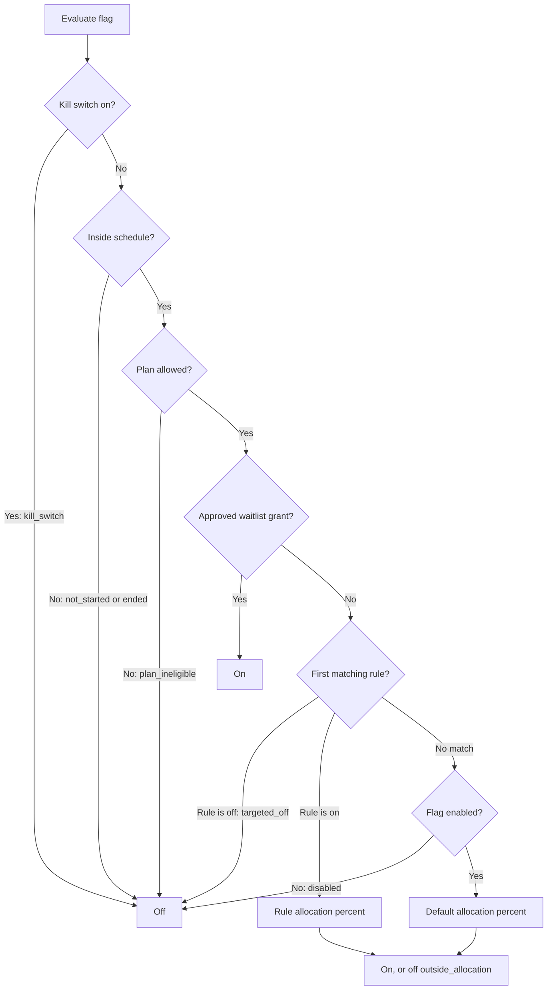

Ryu has two flag scopes:

- **Platform rollout flags** - Ryu administrators manage these.
- **App flags** - an organization manages these for the apps it publishes in Marketplace.

Each flag can have an optional waitlist form, a kill switch, percentage allocation, targeting
rules, and a schedule.



## Platform rollout flags

Ryu administrators change a platform flag in **Admin → Feature flags & experiments**. The flag's
catalog default, deployment override, and admin override decide whether the platform feature is
available. A waitlist form collects interest. Submitting it does not turn the flag on or grant
access.

### Evaluate a platform flag

Platform flags use a kill switch, percentage allocation, ordered targeting rules, and start and end
times. To evaluate one for a signed-in Ryu account, call `POST /api/feature-flags/evaluate` with
its key and request traits.

- The server uses the authenticated account as the stable allocation subject.
- An approved waitlist grant opens only that flag, for that verified account.
- The kill switch and the schedule still apply to approved accounts.

### Limit a flag to plans

Select one or more plans in the flag's **Rollout and targeting** section, including
**Free (no paid plan)**. If no plans are selected, the flag is available on every plan.

- Ryu resolves the caller's plan on the server.
- A caller on an unselected plan gets the flag off with reason `plan_ineligible`. So does a caller
  whose plan cannot be resolved, for example while billing is unavailable.
- A one-time **Ryu Desktop** license counts as the **Ryu Desktop** plan, not as
  **Free (no paid plan)**.
- An approved waitlist grant does not override the plan limit.
- Plan limits apply only to platform flags. Marketplace app flags cannot use them.

### Server-resolved traits

Ryu sets the `audience`, `org_role`, `waitlist_status`, `plan`, and `tier` traits from the
signed-in account on the server. Any `plan` or `tier` sent in the request is ignored, and targeting
rules see the server-resolved value.

The same values are used everywhere Ryu checks a platform flag, including program enrollment,
family sharing, and rollout-limited Marketplace listings. When a turned-off targeting rule depends
on one of these traits and Ryu cannot resolve it for a signed-in account, the rule still applies.
The flag is then off with reason `targeted_off`.

### Add a waitlist form

Choose **Add waitlist** on a flag to add a form. Every form asks for an email address and can
include up to 10 custom questions:

- short answer;
- long answer;
- choose one from a list of up to 12 options; or
- a consent checkbox.

Questions can be required. The form also has an introduction and a confirmation message.

- **Publish form** makes its link available.
- **Preview** opens the public signup page.
- **Grant access** on an application grants that person the flag through their verified Ryu
  account, matched by email.

A kill switch still forces the flag off for everyone, including approved applicants.

## Flags for published apps

An organization owner, administrator, or member with the `features.manage` permission can open
**Organization → Features → Manage app flags**. This page lists the organization's live
Marketplace apps.

Add a flag with a stable key, name, and description, then choose whether that app capability is
on. Keys are lowercase and may use dots, hyphens, or underscores.

If the flag list cannot be read, the page shows an error instead of an empty list or stale
controls. Restore the required organization access, then select **Refresh** to load the current
flags.

### Read and evaluate app flags

The app can read coarse flag defaults from:

```http
GET /api/feature-waitlists/public/apps/{appId}/flags
```

The response maps each key to its `enabled` value, display name, description, allocation, grant
state, and optional `waitlistUrl`. For percentage rollout and targeting, evaluate a stable subject
with its traits instead:

```http
POST /api/feature-waitlists/public/apps/{appId}/evaluate
Content-Type: application/json
```

```json
{
  "subjectId": "stable-app-user-id",
  "attributes": {
    "plan": "pro",
    "device": "ios",
    "region": "SG",
    "age": 24,
    "gender": "nonbinary"
  }
}
```

- For an authenticated Ryu user, the server uses that account as the stable subject.
- For an anonymous tester, the app supplies a stable pseudonymous ID.
- The response contains only each flag's decision and matched rule ID. Targeting values are not
  stored.

<Callout type="warn">
  This API does not replace trusted server-side checks for entitlements or other authorization.
  Treat client-supplied plan, device, locale, region, demographic, and app-defined attributes as
  targeting hints. Enforce security and paid access on a trusted server.
</Callout>

### App waitlists

An app flag can have the same form builder as a platform flag.

- A public Marketplace app accepts applications from anyone with the link.
- An organization-only app requires the applicant to be a member of its publishing organization.
- The publishing organization reviews applications and grants access to matching verified Ryu
  accounts.

### Rollout rules

- Set a default allocation from 0 to 100 percent. Assignment is stable for the same subject and
  flag.
- Rules run in order. A rule's conditions must all match before its enabled state and allocation
  apply.
- Add start and end times to schedule a rollout.
- The kill switch overrides every rule and grant immediately.

Target attributes can include plan or tier, organization or tester groups, device, platform,
locale, region, age, gender, and app-defined attributes. Ryu evaluates attributes sent with a
request in memory. It does not save them with a waitlist application.

### Tester groups

An organization can create named tester groups on each published app and share a public invite
link. The public invite page is `/feature-waitlist/invite`. A tester joins with a verified Ryu
account.

- The evaluator supplies enrolled group keys from the account's server-side membership.
- It ignores any `group` or `groups` attribute in the request, so a caller cannot claim a group
  by sending a trait value.
- An anonymous caller never matches a tester-group rule.

### Prerelease builds

Marketplace beta, release-candidate, and other prerelease builds have their own rollout percentage
and tester-group gates in **Organization → Features → Manage app flags**.

- The gate covers every way a build is fetched, including a direct download of its GitHub release
  archive by version.
- Ryu reviews each prerelease build before it can be installed.
- Stable builds remain available while a prerelease is staged.
- An app's emergency kill switch can stop a feature independently of build publication.

## Public forms and applications

The public form page is `/feature-waitlist`, with the link parameters that the admin page sets.
The page reads the form from this route:

```http
GET /api/feature-waitlists/public/form?scope=platform&key={flagKey}
```

For an app flag, include `scope=app`, `appId`, and `key`. Submit the email address, optional name, and answers to this route:

```http
POST /api/feature-waitlists/public/submissions
Content-Type: application/json
```

- An application can be submitted once per email address for a flag.
- Ryu admins see responses for platform forms. The publishing organization sees responses for app
  forms.
- Removing a form disables its public link but keeps existing applications available to review.

Approving an application grants only that flag to the matching verified Ryu account. It does not
grant a Marketplace purchase, organization membership, plan entitlement, or another flag. The
kill switch and scheduled end time continue to apply.

For publishing and listing lifecycle details, see the
[Marketplace guide](/docs/extend/develop/extensions/marketplace). Organization-owned app flags are
separate from the organization access controls in
[Authentication and organizations](/docs/security/authentication-organizations).
