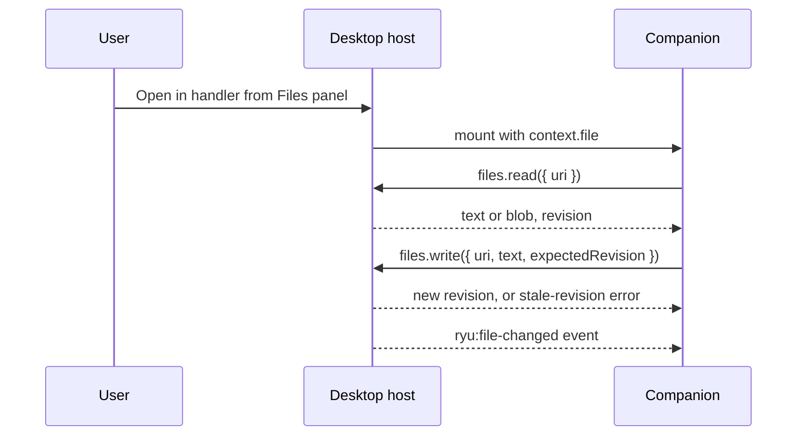

These contributions live in the `contributes` block of `manifest.json`. Both reference a companion
that belongs to the same plugin; see
[Bundle Runnables with manifest.json](/docs/extend/develop/extensions/plugin-json-manifest) for the
rest of the manifest.

## Open files in your companion

A plugin can declare a file handler that opens its own companion in the workspace Files panel.
The user chooses **Open in &lt;title&gt;** (the handler's `title`, for example
**Open in Document editor**) from a matching file's context menu. Extensions are lowercase strings
without a leading dot in the native manifest.

```json
{
  "contributes": {
    "fileHandlers": [{
      "id": "document-editor",
      "title": "Document editor",
      "extensions": ["txt", "md"],
      "companion": "editor",
      "editable": true
    }],
    "settings_tabs": [{
      "id": "editor.settings",
      "title": "Editor settings",
      "scope": "user",
      "companion": "editor"
    }]
  }
}
```

This excerpt is illustrative. The full manifest must also declare its `editor` companion runnable
and bundle its UI. Both contributions can reference only a companion belonging to that plugin.
Disabling the plugin removes its file handler and prevents its custom settings UI from running.

### Read and write the opened file

The file companion receives `window.ryu.context.file` with the file's name, an opaque `uri`, and
an `editable` flag.



- **Read** with `window.ryu.files.read({ uri })`. The result contains `text` or a base64 `blob`,
  and a `revision`.
- **Save** with `window.ryu.files.write({ uri, text, expectedRevision })`, or the same request
  with `blob` instead of `text`.
- **Scope.** Each panel can access only its opened resource. Reads and writes are limited to
  8 MiB.
- **Conflicts.** A stale revision fails without overwriting newer contents. Read the current
  version and resolve the changes before retrying.
- **Refresh.** File changes produce a `ryu:file-changed` event with the resource URI and revision,
  so the editor can refresh its view.

## Custom settings companions

A custom settings companion receives `{ surface: "settings", settingsTabId }` as its mount
context. It uses the same sandbox and approved capabilities as its ordinary companion surface.
Declarative settings fields remain available for plugins that do not need a custom interface.

### MCP server settings

An MCP server can instead advertise the OpenAI `openai/settings` capability with `readTool` and
`updateTool`. Ryu renders the returned primitive settings schema with native controls.

- Select an agent for the server's governed tool access.
- Saving sends only changed properties in `{ "set": { ... } }`, then reads the persisted settings
  again.
- Provider errors stay visible instead of being presented as successful saves.

## Related

<Cards>
  <DocCard href="/docs/extend/develop/extensions/contribution-surfaces" />
  <DocCard href="/docs/extend/develop/extensions/desktop-companion" />
  <DocCard href="/docs/extend/develop/extensions/plugin-json-manifest" />
</Cards>
