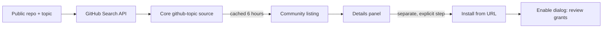

Ryu has two ways to put a third-party app or plugin in front of users:

- The GitHub-backed [Marketplace](/docs/extend/develop/extensions/marketplace) is the reviewed,
  signed, optionally paid path. GitHub holds the repository and the immutable `.ryupack` release.
  Ryu validates the package, handles billing and entitlements, and proxies private downloads.
- **GitHub topic discovery is the public browse path.** Add a topic to a public repo and Ryu finds
  it. Buyers do not need a GitHub account.

To publish a **collection**, tag the repo `ryu-marketplace` and put each package in a folder with
`ryu.package.json`. Ryu scans those folders directly. See
[Host a Community Marketplace](/docs/extend/develop/extensions/community-marketplace).

The legacy `marketplace.json` collection index is still read for old community listings only. New
repositories should not generate or depend on a central marketplace index.

Nobody reviews a topic-discovered listing, so it is not an install path. Discovery produces a
**listing**. A user who wants the code installs it in a separate, explicit step. Read the
[trust section](#trust-listings-are-not-reviewed) before you publish or install this way.

Ryu reads your release tags. Tag `v1.5.0-beta.1` and the listing shows a beta train beside your
stable one. These trains are browse-only, for the same reason the listing is. See
[Release Channels](/docs/extend/develop/extensions/release-channels).



## 1. Add the topic

Push your app or plugin to a **public** GitHub repository and add one of these topics to it
(**Settings** on the repo page, or the gear next to **About**):

| Topic | Use it for | How it lists |
|---|---|---|
| `ryu-app` | Anything with a UI destination: a Companion window, a workspace dock panel, or a top-level page | Classified as an **app** |
| `ryu-plugin` | Everything else: tools, agents, workflows, skills, hooks | Classified as a **plugin** |
| `ryu-marketplace` | A whole **collection**: the repo contains folders with `ryu.package.json` | Each package lists under your collection; see [Host a Community Marketplace](/docs/extend/develop/extensions/community-marketplace) |

No other step is needed for public discovery. Core's `github-topic` catalog source
(`apps/core/src/catalog_source/github_topic.rs`) queries the topics against the GitHub Search API
and projects the results into the Plugin catalog. Every Ryu install discovers your repo from the
same public search.

Paid or private publishing goes through the [Marketplace](/docs/extend/develop/extensions/marketplace)
instead. It creates a GitHub source binding in Ryu: the seller authorizes the GitHub App once, and
Ryu uses its installation token to proxy validated release assets to buyers.

<Callout type="info">
  The topic query that found the repo decides the classification, not the `topics` array your repo
  reports. Tag exactly one. A repo with **both** topics is classified from its own manifest as follows:

  - It lands as an app if the manifest claims a UI destination: a `companion` runnable, a non-empty
    `contributes.dock_panels`, or a `contributes.sidebar_buttons[].target` that is a top-level
    route.
  - It lands as a plugin otherwise.
  - A dual-tagged repo with no readable manifest stays an app.
</Callout>

Two filters apply before a repo becomes a listing:

- **Archived repos are dropped.**
- **Forks are kept but flagged** with a `fork` tag on the card.

### When it shows up

Discovery is cached for **6 hours** per install, and each topic query returns the top 100 repos by
star count. A new listing is not instant, and a zero-star repo in a crowded topic may not appear
until it gets stars. If GitHub is unreachable or rate-limited, clients keep serving the last good
list with a staleness note, so a new repo can take longer to appear on some installs.

## 2. Project a good listing

Only the topic is required. Ryu builds the card from public repo metadata:

| Card field | Comes from |
|---|---|
| Name | Repository name |
| Developer | Repository owner |
| Icon | A generated tile, seeded from the listing id, until your manifest declares one |
| Description | Repo description, trimmed to 300 characters |
| Stars, license, last push | Repo metadata |
| Tags | Your repo topics |

Write the repo description as the tagline. It is the only prose on the card. Set an SPDX license
(an unset or `NOASSERTION` license renders as blank). Keep pushing: `pushed_at` is displayed, and a
listing that has not moved in a year reads as abandoned.

### Add a package manifest

For an installable GitHub-backed listing, put `ryu.package.json` in the package folder and publish a
deterministic `<package-id>-<version>.ryupack` asset in an immutable GitHub Release. Ryu validates
the manifest and release digest before showing Install. The package remains installed and usable
after an entitlement expires; only new downloads and updates are blocked.

### Add a display manifest at the repo root

When a user opens your listing, Ryu makes a best-effort fetch for a manifest at the repo root, in
this order, first hit wins:

1. `manifest.json` (the canonical name; use this one)
2. `plugin.json` (legacy, pre-rename)
3. `ryu.json` (legacy)
4. `.ryu-plugin/manifest.json`
5. `.ryu-plugin/plugin.json`
6. `.codex-plugin/plugin.json` (Codex-compatible display manifest)
7. `.claude-plugin/plugin.json` (Claude-compatible display manifest)

Finding none is not an error. The detail panel is thinner and notes that no manifest was found.
Finding one enriches the detail view with a strict allowlist of **display fields only**. Ryu
understands both native top-level fields and the Codex `interface` block, so a compatible descriptor
can declare the same store presentation without duplicating a Ryu runtime manifest:

```json
{
  "id": "@example/research-assistant",
  "name": "Research Assistant",
  "version": "1.0.0",
  "description": "Drafts a literature review from a folder of PDFs.",
  "category": "Research",
  "icon": "https://example.com/icon.png",
  "homepage": "https://example.com/research-assistant",
  "requires": [],
  "targets": ["desktop"],
  "runnables": [
    { "id": "agent-main", "name": "Main", "kind": "agent", "config": {} }
  ]
}
```

From that file the listing lifts only safe presentation fields:

| Group | Fields |
|---|---|
| Name and text | `name` / `displayName`, `description` / `longDescription`, `shortDescription`, `defaultPrompt` |
| Identity | `version`, `category`, `author`, `developerName`, `license`, `keywords` |
| Links | `homepage` / `websiteURL`, `repository`, privacy and terms URLs |
| Artwork | `icon` / `composerIcon`, `iconUrl` / `logo`, `iconDither`, `iconBackground`, `banner`, `screenshots` |
| Shape | Non-executable capability and layer summaries from `provides`, `requires` / `targets`, and the **kinds** of your runnables |

The manifest's `id` is shown separately as a *manifest id*, never as the listing id. Executable
code, permission grants, MCP endpoints, and install artifacts stay excluded. See
[Bundle Runnables with manifest.json](/docs/extend/develop/extensions/plugin-json-manifest) for the
native schema.

<Callout type="warn">
  Executable fields are **not** lifted. `ui_code`, `backend_code`, and any `*_sha256`
  are dropped at the source, so no code can travel from an unsigned repo into a client through a
  listing. Do not design a listing that depends on them rendering.
</Callout>

## 3. How the listing renders

Topic-discovered listings render inside the Store's Apps and Plugins tabs, not in a tab of their
own:

- Standalone repos use the trailing **From the community** shelf.
- A `ryu-marketplace` repo's entries render under the **Community Marketplaces** heading, with one
  sub-heading per marketplace.

Either way the community feed is a separate fetch, not a filter. The first-party catalog pages
never return community rows, so an unreviewed listing cannot appear alongside reviewed ones.

Inside the section:

- Cards sort by stars, and search matches on repo name, description, and topics.
- Every card carries an amber **Community** badge and a **Descriptor** badge in the detail header.
- The **"Not reviewed by Ryu"** notice renders twice: as a banner above the grid, and inline in the
  detail panel directly above the action block, so it cannot be scrolled past on the way to
  installing.
- The action is **Details**, not Install. Community listings are descriptor-only, so the card's call
  to action opens the detail panel and links out. There is no Install button anywhere in this
  section.

Your id in the catalog is `gh:<owner>/<repo>`, namespaced so it can never collide with, or
masquerade as, an installed plugin id, even if your manifest declares the same `id` as something
first-party.

## Trust: listings are not reviewed

<Callout type="warn">
  **Listings here are discovered automatically from the public GitHub topics `ryu-app`,
  `ryu-plugin`, and `ryu-marketplace`. Anyone can tag a repo. They are published by third parties and are not reviewed by
  Ryu: no moderation, no signature, no vetting of any kind. Install at your own discretion.**
</Callout>

Being listed means exactly one thing: a public repo carries the topic. It is not a recommendation,
an endorsement, or evidence that anyone ran the code.

### What discovery cannot do

Being listed grants no execution. A community listing carries **no installable manifest**. Its
install descriptor is empty, so install-by-id skips this source and fails closed. Tagging a repo cannot make code run on anyone's machine.

To actually install a topic-discovered plugin, a user has to leave the listing and take a separate,
explicit action: **Install from URL** against that repo's manifest (`POST /api/plugins/install`).
That is a per-repo decision, not a trust grant to the catalog. If you are publishing, expect users
to arrive at your README first. Write it as the thing that earns the install.

### What to check before installing one

If you are on the installing side, this is the review nobody else did for you:

- **Read the requested permission grants.** An installed plugin's `permission_grants` are shown in
  plain English in the enable dialog: "Run commands on your device", "Access your files", "Access
  the internet", "Run AI agents". Grants are enforced by the Gateway, but only you decide whether
  this plugin should hold them. A note-taking plugin asking for shell access is the signal.
- **Expect no signature.** Marketplace items are ed25519-signed and verified at install against a
  pinned key. A repo install has no signature, so it installs with a warning instead of a
  verification. That warning is the difference between the two paths, not a glitch.
- **Audit the source.** Discovery only surfaces public repos, so the code is readable before you
  run it. Check what the manifest declares against what the repo
  actually does, look at the runnable kinds, and read any backend the manifest points at.
- **Weigh the repo signals shown on the card.** Stars, license, last push, and the `fork` flag are
  displayed so you can judge them. An unlicensed, never-updated fork with two stars is
  telling you something.
- **Install disabled, then enable on purpose.** Plugins install inert. Enabling runs the
  grant-confirmation dialog. Read it before you confirm.

Ryu's broader boundaries, what is contained and what is not, are in the
[trust model](/docs/security/trust-model). Note in particular that a Ryu install is a single trust
domain: a plugin you enable is not sandboxed from the rest of your install.

### If you want review and signing

Publish to the [Marketplace](/docs/extend/develop/extensions/marketplace) instead, or as well. That
path gives you Gateway grant validation, an ed25519 signature verified at install, moderation, and
monetization. It costs an account and an approval queue.

A repo can carry the topic and also be published to the Marketplace. Users then get the reviewed
listing with the signature, and the community listing as a link to the source.

## Reference

| Surface | Where | Notes |
|---|---|---|
| Topics | `ryu-app`, `ryu-plugin` | App vs plugin classification; carrying both defers to the manifest |
| Topics | `ryu-marketplace` | A **collection**: each folder containing `ryu.package.json` lists under your own heading. See [Host a Community Marketplace](/docs/extend/develop/extensions/community-marketplace) |
| Source | `apps/core/src/catalog_source/github_topic.rs` | GitHub Search API, Plugin kind, descriptor-only |
| Catalog id | `gh:<owner>/<repo>` | Namespaced; never collides with an installed plugin id |
| Marketplace entry id | `ghmp:<owner>/<repo>:<entry>` | Marketplace entries are a distinct namespace; never collides with a single listing |
| Manifest paths | `manifest.json`, legacy `plugin.json` / `ryu.json`, `.ryu-plugin/`, `.codex-plugin/plugin.json`, `.claude-plugin/plugin.json` | First hit wins, optional |
| Enriched fields | `name`, `description`, `shortDescription`, `version`, `category`, author, links, `icon`, `logo`, `iconDither`, `iconBackground`, `banner`, `screenshots`, prompts, capability/layer summaries, `requires`, `targets`, runnable kinds | Display only; no code, grants, MCP endpoints, or `*_sha256` |
| Trust triple | `origin: "community"`, `reviewed: false`, `descriptor_only: true` | Drives the Community section, the notice, and the Details-not-Install CTA |
| Cache TTL | 6 hours | Stale-serves the last good list when GitHub is unreachable |

<Cards>
  <DocCard href="/docs/extend/develop/extensions/plugin-json-manifest" />
  <DocCard href="/docs/extend/develop/extensions/marketplace" />
  <DocCard href="/docs/extend/develop/extensions/community-marketplace" />
  <DocCard href="/docs/extend/develop/extensions/ryu-apps" />
  <DocCard href="/docs/security/trust-model" />
  <DocCard href="/docs/surfaces/desktop/user-guide/store" />
</Cards>
