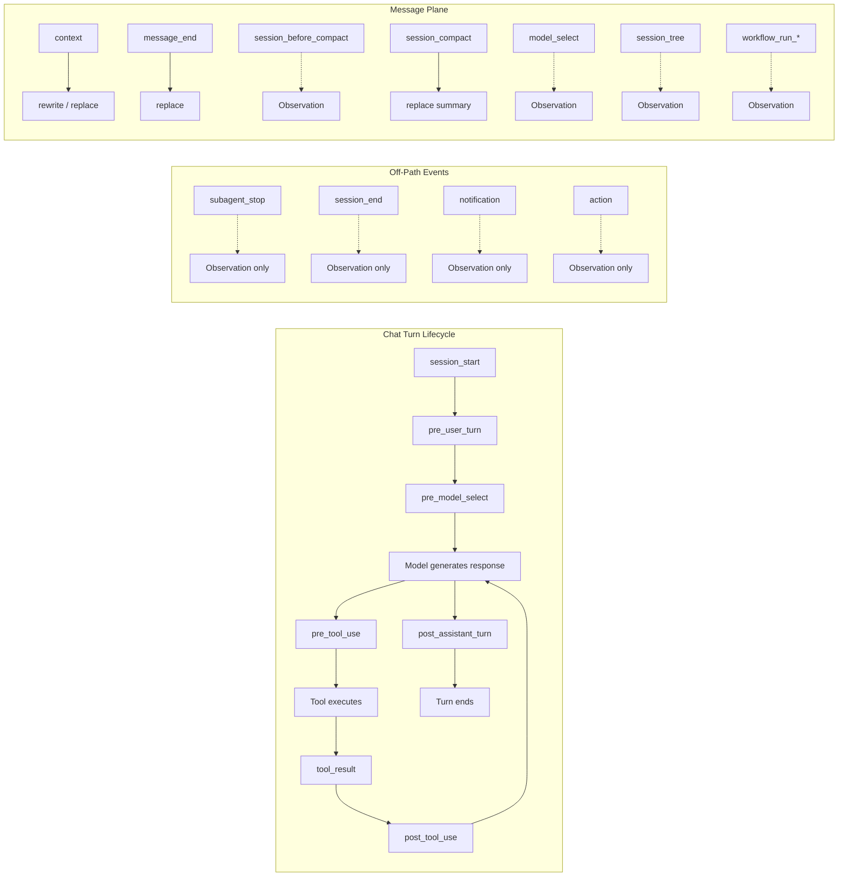

This page is the phase reference for [Hooks & Lifecycle](/docs/extend/develop/extensions/hooks-lifecycle).
For which phases apply their directives today, see the
[maturity matrix](/docs/extend/develop/extensions/hooks-lifecycle#maturity-matrix).

## Hook phases

Turn hooks are declared under `contributes.turn_hooks` in `manifest.json`. Each hook fires at a
specific boundary in the chat lifecycle. The `on` field selects the phase:



| Phase | `on` value | Fires when | Directives |
|---|---|---|---|
| **Session start** | `session_start` | First turn of a conversation | `inject`, `note` |
| **Pre-user turn** | `pre_user_turn` | Before the user message reaches the model; channel callbacks are available as `ctx.channel_action` | `replace`, `inject`, `handled` |
| **Pre-model select** | `pre_model_select` | After the agent binding is resolved and before the model transport opens, **awaited**; the one phase that may choose the turn's model | `select_model` (the first non-empty selection wins) |
| **Pre-tool use** | `pre_tool_use` | Before a tool call executes | `deny` (blocks the call) |
| **Tool result** | `tool_result` | After a tool call returns, **awaited** | `transform` (rewrites the result before the model sees it) |
| **Post-tool use** | `post_tool_use` | After a tool call returns | Observation only (detached, fail-open) |
| **Action** | `action` | For each normalized thinking or tool-call action in the assistant stream, which can fire before a tool result exists | Observation only (detached; never blocks or rewrites the stream) |
| **Post-assistant turn** | `post_assistant_turn` | After the assistant reply streams and persists | `note`, `continue`, `interactive_message` (channel replies) |
| **Stop** | `stop` | Alias of `post_assistant_turn`, accepted so a hook written against Claude's `Stop` name works unchanged | Same as `post_assistant_turn` |
| **Context** | `context` | Before the assembled context leaves Ryu for the model | `rewrite` (message-array plane) / `replace` (ACP plane) |
| **Message end** | `message_end` | When an assistant message is finalized, before it persists | `replace` |
| **Before compact** | `session_before_compact` | Before Ryu drops older turns to fit the context window | Observation only (sees what is about to be dropped) |
| **Session compact** | `session_compact` | After dropped turns have been summarized | `replace` (the summary text) |
| **Sub-agent stop** | `subagent_stop` | When a delegated sub-agent finishes | Observation only (v1) |
| **Delegation lifecycle** | `delegation_lifecycle` | When the global active-delegation count changes | Observation only (v1) |
| **Session end** | `session_end` | When a conversation is deleted | Observation only (v1) |
| **Notification** | `notification` | When a notification is fanned out | Observation only (v1) |
| **Model select** | `model_select` | When the active model or thinking/effort level changes | Observation only |
| **Session tree** | `session_tree` | When the conversation's message tree branches (edit/regenerate) | Observation only |
| **Workflow started** | `workflow_run_started` | When a workflow run starts | Observation only |
| **Workflow finished** | `workflow_run_finished` | When a workflow run completes successfully | Observation only |
| **Workflow failed** | `workflow_run_failed` | When a workflow run fails (or a gate is rejected) | Observation only |
| **View action** | `view_action` | When a user activates an app-backed action on one of the plugin's own declarative views | `note` (success message); `none` declines the action |
| **Plugin update** | `plugin_update` | After the plugin's own version changes through an update or rollback | Observation only (`note` is shown); use it to migrate the plugin's storage |

The manifest JSON Schema at `/schemas/plugin.json` lists every built-in phase Core declares,
including `pre_model_select` and `action`, which the first-party
[Effort Escalator](/docs/plugins/effort-escalator) and [Action Summary](/docs/plugins/action-summary)
plugins use, so an editor that validates `manifest.json` against it accepts their hooks.

### Directives reference

| Directive | Effect | Phase |
|---|---|---|
| `{ kind: "none" }` | Do nothing (also the fail-safe for errors) | All |
| `{ kind: "note", text }` | Surface `text` to the user as a `data-plugin_note` part, never in history. On `view_action`, `text` is the action's success message. | `post_assistant_turn`, `session_start`, `view_action` |
| `{ kind: "continue", text }` | Inject `text` as a follow-up user turn, loop < 25 | `post_assistant_turn` |
| `{ kind: "interactive_message", markup }` | Attach validated buttons to a channel reply while keeping its text as the message body | `post_assistant_turn` |
| `{ kind: "replace", text }` | Swap the pending text before it reaches the model. On the ACP `context` phase, `text` must start with `ctx.input` unchanged; only the appended part is used, and the warm ACP session is kept. | `pre_user_turn`, `message_end`, `session_compact`, `context` (ACP plane) |
| `{ kind: "inject", text }` | Append additional context to the outgoing message | `pre_user_turn`, `session_start` |
| `{ kind: "deny", reason }` | Block a pending tool call; `reason` returned as tool error | `pre_tool_use` |
| `{ kind: "transform", output }` | Rewrite a tool's result before the model sees it | `tool_result` |
| `{ kind: "rewrite", messages }` | Replace the outbound message array before it reaches the model. Every message before the newest user message must be unchanged | `context` (message-array plane) |
| `{ kind: "handled", text, interactive_markup? }` | Fully handle the turn: `text` becomes the assistant reply, no model call; optionally attach channel buttons | `pre_user_turn` |
| `{ kind: "select_model", model, effort?, acp_config?, reason? }` | Choose the model for this turn before the transport opens. `effort` is carried into the request, and `acp_config` sets ACP session options as strings. | `pre_model_select` |

`interactive_message` uses the platform-neutral markup contract described in [Channel bots](/docs/gateway/channels).
Reply-keyboard rows accept `{ label, action: { type: "reply" } }`. Inline rows accept callback
actions `{ type: "callback", actionId, payload }` and HTTPS or Telegram `tg:` URL actions. Markup
is validated before it reaches a provider. A channel without button support sends the reply text.

### `deny` and `transform` are the two halves of a tool firewall

`deny` stops a call from happening. `transform` reshapes what a call that already happened reports
back. It is the redaction and narrowing primitive, so a hook can read a tool's output and return a
rewritten value, keeping secrets, PII, or an oversized payload out of the transcript entirely.

Because `reason` on a `deny` comes back to the model as the tool's **error result** rather than as a
silent failure, the model can adapt: ask the user, try a different approach, instead of behaving
as though the call succeeded.

Two rules make `transform` trustworthy as a security boundary:

- **Transforms chain in priority order.** Each `tool_result` hook receives the latest transformed
  value, never the original raw result. A later redaction or narrowing policy therefore cannot
  accidentally restore a secret removed by an earlier hook.
- **Downstream observers see the final rewrite, not the original.** The detached `post_tool_use`
  observers receive the transformed output, so a redaction is not undone by handing the raw value
  to every other installed plugin.

Pick `post_tool_use` when you only need to watch. It stays detached, so logging and telemetry cost
the hot path nothing. Pick `tool_result` only when you need to *change* the result, and accept the
awaited cost.

### Message-plane phases

Beyond the chat turn, a set of Pi-parity phases fire at Ryu's own dispatch sites, so one plugin
governs every agent (Claude, Codex, or any other ACP agent) rather than only Pi-routed turns.

- **`context`** is the context-engineering phase, and it spans two structurally different planes. On
  the OpenAI-compat / local-engine / SDK plane, Ryu owns a real message array: `ctx.messages` is
  populated and a hook returns `{ kind: "rewrite", messages }` to replace the whole array (multimodal
  content survives because the array is carried as raw JSON). On the ACP plane there is no array to
  rewrite; Ryu flattens the window into one prompt string, so `ctx.input` carries that string and a
  hook returns `{ kind: "replace", text }` instead. A hook must check which field is set; the wrong
  directive for the plane is ignored. When project instructions are active, `ctx.project_instructions`
  contains the exact project-instructions block used for the current turn, so a hook can repeat it
  without parsing the surrounding prompt. The field is absent when no project instruction file is
  available or Safe Mode suppresses project instructions.

  **Context hooks may only change the latest message.** The system prompt and every earlier turn
  are the prefix that provider prompt caches reuse, so editing them after a chat has started would
  make every later turn pay full price for the whole window. Ryu enforces this: a `rewrite` must
  keep every message before the newest user message byte-for-byte identical (it may change that
  message and anything after it), and an ACP `replace` must keep `ctx.input` as its exact prefix and
  only append to it. A directive that edits the frozen prefix is ignored and the original context is
  sent. The appended ACP text also reaches a warm pooled session as part of the latest turn, so the
  session is kept rather than restarted.
- **`message_end`** fires when an assistant message is finalized, *before* it is persisted, and a
  `replace` rewrites both the persisted content and the sealed parts. It is distinct from
  `post_assistant_turn`, which runs after persistence and can only append a `note` or `continue`.
- **`session_before_compact`** fires before Ryu drops older turns to fit the context window. A hook
  sees what is about to be dropped. **`session_compact`** fires after the dropped turns are
  summarized, and a `replace` rewrites the summary text before it merges back into the window.
  Both also fire for a model-switch context handoff, where the dropped turns are everything said
  before the switch and the summary is the handoff briefing.
  (These fire at Ryu's own compaction sites, not Pi's. Pi auto-compacting inside its own turn loop
  is invisible to Core.)
- **`model_select`**, **`session_tree`**, and the three **`workflow_run_*`** phases are observation
  only: their payload rides in `ctx.event` (`{ run_id, workflow_id, workflow_name, ... }` for the
  workflow phases), and no directive can change what they report. `workflow_run_*` fire once per run
  as a user understands it, not per resume or nested sub-workflow, and a run suspended at an
  approval gate fires neither `finished` nor `failed` until it resumes and terminates.

### `handled` - own a turn without a model call

`replace` and `inject` still run the turn; they only reshape the prompt. `{ kind: "handled", text }`
ends it: `text` becomes the assistant reply and **no model call is made**. That is what lets a
plugin own a slash command, answer from cache, or refuse a prompt outright without burning a model
call. The reply is persisted like any assistant message, and first writer wins. Once one hook
handles a turn, later hooks do not run.

## The tool glob gate

A `pre_tool_use` or `post_tool_use` hook usually cares about only some tools. The manifest's
`match.tools` field is a spawn-avoidance gate evaluated in Rust before any sandbox spawn: the hook
runs only when the tool being called matches one of its patterns.

The matcher (`glob_match`) supports these pattern forms:

| Pattern | Matches |
|---|---|
| `*` | Everything |
| `bash*` | Prefix: `bash`, `bash_read`, etc. |
| `*write` | Suffix: `file_write`, `web_write` |
| `*edit*` | Substring: `file_edit`, `inline_edit` |
| `exact_name` | Exact match only |

A hook whose gate does not match the current tool never spawns the JS sandbox.

## The reply cadence gate

A `post_assistant_turn` hook that acts only every few replies can say so with `match.reply_cadence`,
so the turns in between never spawn the sandbox:

```json
"match": {
  "reply_cadence": {
    "every_pref": "my-plugin-every-n",
    "every_default": 5,
    "first_reply": true,
    "first_pref": "my-plugin-on-first-reply",
    "enabled_pref": "my-plugin-enabled"
  }
}
```

The hook runs on the first completed reply (unless `first_reply` is `false` or the `first_pref`
preference is `"false"`) and on every N-th reply, where N comes from the `every_pref` preference
(falling back to `every_default`, clamped to 1-100). It never runs while `enabled_pref` is `"false"`.
Keep the same checks in the hook body: a forced run through `host.runHook` skips the gate.

## Related

<Cards>
  <DocCard href="/docs/extend/develop/extensions/hooks-lifecycle" />
  <DocCard href="/docs/extend/develop/extensions/hook-recipes" />
  <DocCard href="/docs/extend/develop/extensions/hooks-authoring" />
</Cards>
