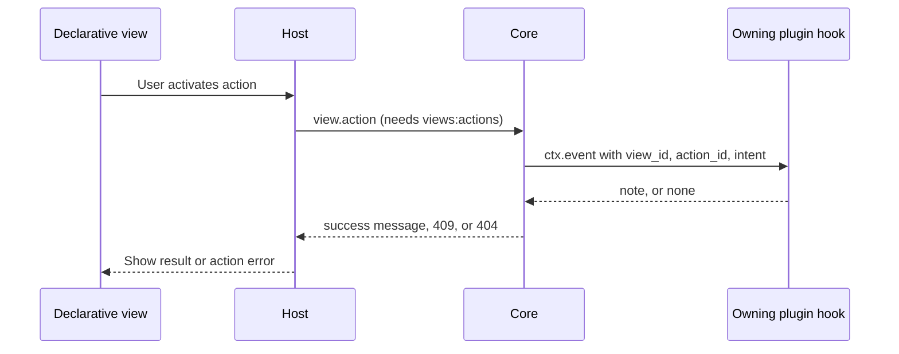
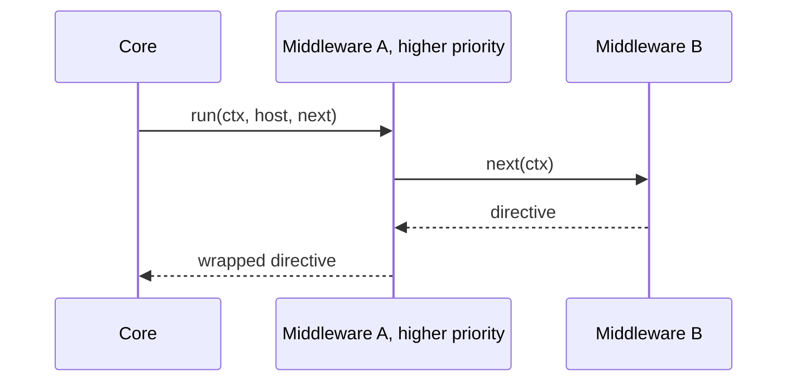

Hook bodies must stay portable across hosts. The rules are in
[Keep hook bodies cross-platform](/docs/extend/develop/extensions/hooks-authoring#keep-hook-bodies-cross-platform).

## Tokenmaxxing: notify when delegation becomes idle

The `delegation_lifecycle` event is the smallest useful primitive for an "always keep work moving"
plugin. It carries:

- a run id and the agent id;
- a monotonic transition id;
- the process-global `active_count`;
- the fan-out's `run_active_count`.

`run_active_count` counts every delegate the fan-out queued, including ones still waiting for a
concurrency slot. It reaches `0` only when the run's last delegate finishes. A plugin can watch for
that drop to zero and send one notification without polling. The shipped
[Tokenmaxxing](/docs/plugins/tokenmaxxing) plugin declares:

```json
{
  "id": "@ryu/tokenmaxxing",
  "name": "Tokenmaxxing",
  "version": "0.1.0",
  "permission_grants": ["notifications:send", "storage:kv"],
  "contributes": {
    "turn_hooks": [
      {
        "id": "tokenmaxxing.delegation-complete",
        "on": "delegation_lifecycle",
        "code_file": "hooks/delegation-complete.js"
      }
    ]
  }
}
```

The shipped hook stores the last transition id, ignores duplicate or out-of-order events, and
notifies only when the run's count reaches zero.

It is failure-closed: a notification failure does not start a timer, create a new agent, or claim
that work is still active. Disable the plugin if you do not want an idle notification. It does not
change delegation scheduling or model budgets.

## Handling declarative view actions

A declarative view action without an `http` handler is relayed to the app that owns the view.
The host sends it through the `view.action` host method, which requires the `views:actions`
grant. Core runs **only that plugin's own** hooks declared with `on: "view_action"`. Another
plugin's hook never receives the intent.



### Declaring a view action hook

```json
{
  "contributes": {
    "turn_hooks": [
      { "id": "tasks.view-action", "on": "view_action", "code_file": "hooks/view-action.js" }
    ]
  }
}
```

The hook reads the intent from `ctx.event`, which has these fields:

| Field | Meaning |
|---|---|
| `source` | Always `"view_action"` (set by Core) |
| `view_id`, `action_id` | Which view and which action fired |
| `intent`, `payload` | The action's opaque `intent` token and `payload`, echoed back |
| `values`, `item` | Form values and the row the action was fired on, when present |

The return value decides the outcome:

| Hook result | What the user sees |
|---|---|
| `{ kind: "note", text }` | The action succeeds, and `text` is its success message |
| `{ kind: "none" }` | The hook declined the action, for example an unrecognized intent. The host reports a failed action (HTTP 409) instead of claiming success |
| No `view_action` hook declared | HTTP 404 with a message naming the missing hook, shown in the view as an action error |

The hook runs with the grants the app already has. The relay adds a trigger, not an authority.

## Rolling back an update

Every successful update keeps the version it replaced: the previous manifest, its bundled UI code,
its release-channel pin, and its captured provenance. `POST /api/plugins/:id/rollback` restores that
version through the same store transition an update uses. It therefore:

- requires the same `app.update` permission;
- keeps the plugin enabled or disabled as it was;
- reconciles approved permissions against the restored manifest. A permission the older version
  never declared is dropped, never granted.

The version you rolled back from becomes the new snapshot, so a second rollback re-applies the
update. Only one previous version is kept, and uninstalling removes it.

Like an update, a rollback is refused with HTTP 409 when an installed plugin depends on a version
range the restored version does not satisfy. Pass `{ "force": true }` to roll back anyway, or
`{ "dryRun": true }` to see the version change without applying it.

## Migrating storage on update

Declare a hook with `on: "plugin_update"` to migrate data when your plugin's version changes. Core
runs **only your plugin's own** `plugin_update` hooks, from the newly active manifest, after a
successful update or rollback. The hook runs with the permissions your plugin already holds, so a
plugin with `storage:kv` can rewrite its keys through `host.storage`.

```json
{
  "contributes": {
    "turn_hooks": [
      { "id": "notes.migrate", "on": "plugin_update", "code_file": "hooks/migrate.js" }
    ]
  }
}
```

The hook reads the change from `ctx.event`, which has these fields:

| Field | Meaning |
|---|---|
| `source` | Always `"plugin_update"` (set by Core) |
| `plugin_id` | Your plugin id |
| `from_version`, `to_version` | The version before and after the change |
| `reason` | `"update"` or `"rollback"` |

The hook is fail-open: an error is logged and never undoes the update. A plugin that is disabled when
its version changes has no active hooks, so the phase does not fire for it. Write migrations that
check a schema marker in storage rather than relying on `from_version` alone, and make them safe to
run again, including when a rollback moves to an older version.

## Function-hook middleware

Ryu also supports an opt-in middleware form inspired by Koa-style function hooks. Set
`mode: "middleware"` on a `turn_hooks` entry, or use `defineFunctionHook` in the TypeScript SDK:

```ts
import { defineFunctionHook, definePlugin } from "@ryuhq/sdk";

export default definePlugin({
  id: "com.example.redact-tools",
  name: "Redact Tools",
  version: "1.0.0",
  turnHooks: [
    defineFunctionHook({
      id: "redact.result",
      on: "tool_result",
      match: { tools: ["http*"] },
      run: async (ctx, _host, next) => {
        const result = await next(ctx);
        if (result.kind !== "transform" || typeof result.output !== "object") {
          return result;
        }
        return {
          kind: "transform",
          output: { ...(result.output as Record<string, unknown>), secret: "[redacted]" },
        };
      },
    }),
  ],
});
```

Middleware hooks run in descending `priority` order, with ties resolved by plugin id and hook id.
`next(ctx)` reaches the remaining middleware hooks. A hook can:

- return without calling `next`, to short-circuit its chain;
- pass a rewritten event context downstream;
- await the downstream directive and wrap it on the way back out.



A failed middleware hook is skipped, and the chain below it continues. Legacy hooks (mode omitted)
keep their independent directive behavior.

The continuation is Core-owned and one-shot. Request identity (`conversation_id`,
`caller_user_id`, the resolved agent, and plugin flags) is preserved across rewrites. A plugin
therefore cannot retarget a downstream hook's tenant or enable another plugin's flag.

Middleware code still runs in the same deny-by-default sandbox and uses the same grant-gated
`host` capabilities. This is function-shaped composition, not ambient in-process plugin code. For
in-process functions that customize an agent loop your own app runs, use
[Agent middleware](/docs/extend/develop/sdk/agent-middleware).

## Related

<Cards>
  <DocCard href="/docs/extend/develop/extensions/hooks-lifecycle" />
  <DocCard href="/docs/extend/develop/extensions/hook-phases" />
  <DocCard href="/docs/extend/develop/extensions/hooks-authoring" />
</Cards>
