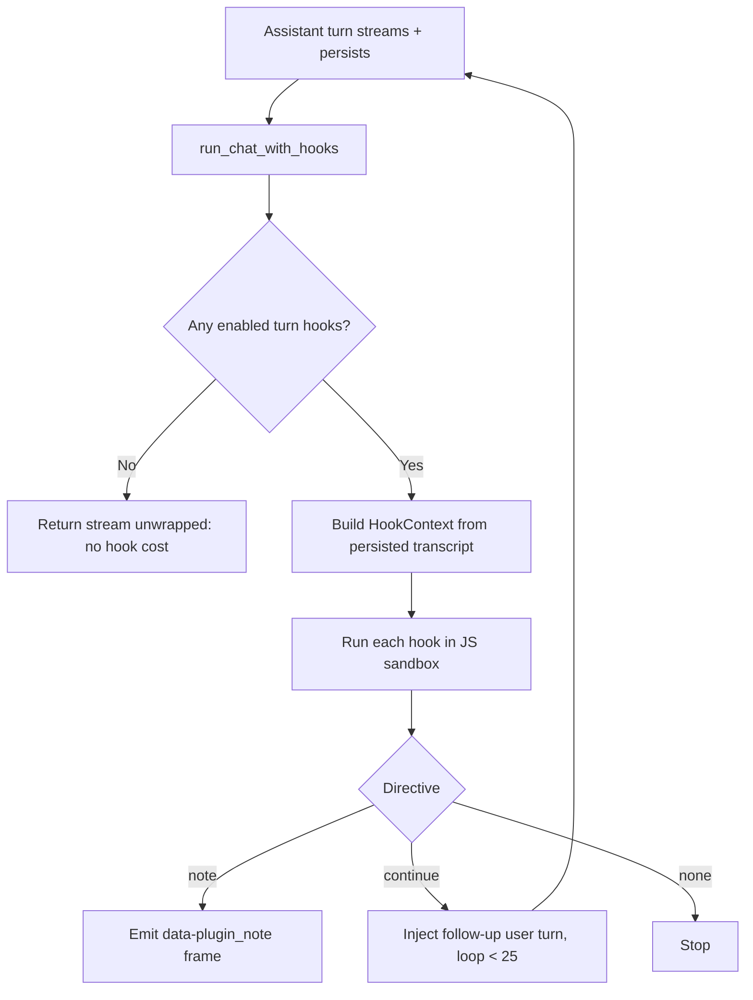

A turn hook is a sandboxed JavaScript body that Core runs at a chat lifecycle boundary. The steps
below declare a hook, write it with the TypeScript SDK, and use the `ctx` and `host` globals.

- For every phase, directive, and match gate, see
  [Hook Phases and Directives](/docs/extend/develop/extensions/hook-phases).
- For the opt-in middleware form (`mode: "middleware"`, `defineFunctionHook`), see
  [Function-hook middleware](/docs/extend/develop/extensions/hook-recipes#function-hook-middleware).

## 1. Declare the hook in manifest.json

```json
{
  "id": "com.example.double-check",
  "name": "Double Check",
  "version": "1.0.0",
  "permission_grants": ["hook:side-model"],
  "contributes": {
    "turn_hooks": [
      {
        "id": "dc.review",
        "on": "post_assistant_turn",
        "code_file": "hooks/review.js"
      }
    ],
    "composer_controls": [
      { "id": "dc.toggle", "type": "toggle", "flag": "com.example.double-check" }
    ]
  }
}
```

`hooks/review.js` holds the JavaScript body, which returns a directive such as
`{ kind: "note", text: "..." }`. `code_file` is the authoring form. Packing inlines the body as
`code`, the wire form Core receives.

## 2. Write the hook with the TypeScript SDK

```ts
import { definePlugin, defineTurnHook } from "@ryuhq/sdk";

export default definePlugin({
  id: "com.example.double-check",
  name: "Double Check",
  version: "1.0.0",
  grants: ["hook:side-model"],
  composerControls: [{ id: "dc.toggle", "type": "toggle", "flag": "com.example.double-check" }],
  turnHooks: [
    defineTurnHook({
      id: "dc.review",
      run: async (ctx, host) => {
        if (!ctx.flags["com.example.double-check"]) {
          return { kind: "none" };
        }
        const last = ctx.transcript.at(-1);
        const review = await host.sideModel({
          prompt: last?.content ?? "",
          model_pref_key: "double-check-model",
        });
        return { kind: "note", text: review };
      },
    }),
  ],
});
```

`defineTurnHook` defaults `on` to `post_assistant_turn`. Set `on` to target another phase.

## 3. Use the `ctx` and `host` globals

Each hook body runs in a fresh JS sandbox with exactly two globals:

**`ctx`** is the turn context:

| Field | Type | Description |
|---|---|---|
| `conversation_id` | `string` | Conversation id; natural key for per-conversation storage |
| `agent_id` | `string` | The agent that produced the turn |
| `transcript` | `{ role, content }[]` | Recent messages, oldest to newest |
| `flags` | `{ [pluginId]: boolean }` | Per-request plugin flags (e.g. composer toggles) |
| `project_instructions` | `string` (when available) | The project-instructions block used for the current `context` turn |
| `channel_action` | `{ action_id, label, payload }` (when available) | Typed button callback from a channel; its payload is user-controlled input |

**`host`** is the capability bridge:

| Call | Grant required | Returns |
|---|---|---|
| `host.sideModel({ prompt, system?, model?, model_pref_key?, effort?, images? })` | `hook:side-model` | One non-streaming Gateway completion as text |
| `host.storage.get(key, namespace?)` | `storage:kv` | Stored string or `null` |
| `host.storage.set(key, value, namespace?)` | `storage:kv` | `true` |
| `host.storage.delete(key, namespace?)` | `storage:kv` | `true` |
| `host.storage.keys(namespace?)` | `storage:kv` | Namespace's keys |
| `host.notify({ title, body })` | `notifications:send` | A bounded notification for the active user |
| `host.runAgent({ task, preset?, agent_id?, wall_time_secs?, max_tokens? })` | `hook:run-agent` (read-only presets); `hook:run-agent:write` as well for `preset: "code_write"` | The sub-agent's final text |
| `host.runFanout({ delegates, caps? })` | same as `host.runAgent`, checked per delegate preset | `{ ok, count, results }` |
| `host.log(...args)` | none | Written to the Ryu log, tagged with your plugin and hook id |

### Images in `host.sideModel`

`images` is optional. These limits apply:

- Up to 8 inline `data:image/png`, `data:image/jpeg`, or `data:image/webp` base64 URIs, totalling
  at most 1.5 MiB. Remote image URLs are rejected.
- The whole request, prompt and system text included, must fit in 2 MiB once encoded. A call over
  that limit is refused with a `host.sideModel` error before it is sent.

With images, the prompt is sent as OpenAI content parts (the text, then one `image_url` part per
image), and the Gateway translates them for the selected provider. A model that cannot read images
returns the provider's error. The call does not silently drop the images.

### Errors, storage, and logs

- Storage is namespaced per plugin.
- An ungranted capability call rejects with `is_error: true`.
- An uncaught throw degrades the hook to `{ kind: "none" }`, so a failing hook does not block the
  turn.
- `host.log` output is captured per run and written to the Ryu log with the plugin id and hook id.
  Each run keeps at most 20 lines of up to 1,024 characters each. Control characters are removed.

### Sub-agent grants

`hook:run-agent` alone starts only **read-only** sub-agents: the `code_read` (default), `research`,
and `summarise` presets. A `code_write` sub-agent can edit files, apply patches, and run commands,
so it also needs `hook:run-agent:write`.

<Callout type="warn">
  `hook:run-agent:write` is not approved for marketplace plugins by default. An organization
  administrator must allow it. Request it only when your plugin really needs a sub-agent that makes
  changes.
</Callout>

### Failing hooks are paused

A hook that fails three times in a row (it throws, times out, or returns an error) is skipped for
five minutes, then retried once. A successful run resets the count.

While a hook is skipped, the turn continues as if it returned `{ kind: "none" }`. One broken hook
therefore does not add its timeout to every turn or tool call. To run it again, fix the hook and
wait for the cool-down to end, or restart Ryu.

## Keep hook bodies cross-platform

Ryu hook bodies are sandboxed JavaScript fragments, not shell commands. Core loads a flat
`hooks/<name>.js` or `hooks/<name>.mjs` file from the plugin's `code_file` and runs it with only
`ctx` and `host` injected. The same body is therefore usable across Ryu's supported hosts; Core
owns the host-specific runtime details.

Keep the platform boundary in the host:

- Do not add `bash`, `sh`, PowerShell, `cmd`, `.sh`, `.cmd`, or `.ps1` wrappers. A hook has no
  command field; Core invokes the fragment through its sandbox.
- Do not import or reach for Node, Bun, Deno, `process`, `fetch`, child processes, or filesystem
  APIs. Use `host.storage`, `host.sideModel`, and other declared capabilities instead.
- Do not hard-code home, temporary, or drive paths (`/tmp`, `/Users`, `/home`, `C:\\...`, `$HOME`,
  `%TEMP%`). Treat paths in `ctx` or tool payloads as opaque strings. Filesystem or process work
  belongs in an app sidecar with a typed host boundary.
- Keep `code_file` package-relative with forward slashes, for example `hooks/review.js`. Core's
  manifest validator rejects traversal and backslash-separated forms before loading a plugin.

The repository's plugin test gate scans every packaged app and plugin hook body for these
portability hazards. A missing sandbox runtime degrades a hook to
`{ kind: "none" }`; it does not turn a platform-specific fallback into a supported path.

## Add buttons to a channel reply

Plugins and apps can contribute the same `turn_hooks` primitive. Use a post-turn hook to attach
buttons to the assistant reply, or a pre-user-turn hook to consume a callback and answer without a
model call. Hook bodies live in package-relative `.js` files referenced with `code_file`. The file
`hooks/next-steps.js` contains:

```js
return {
  kind: "interactive_message",
  markup: {
    layout: "inline",
    rows: [[
      {
        label: "Approve",
        action: {
          type: "callback",
          actionId: "review.approve",
          payload: { requestId: "req-42" },
        },
      },
      {
        label: "Open request",
        action: { type: "open_url", url: "https://example.com/requests/req-42" },
      },
    ]],
  },
};
```

Declare the hook in the plugin or app manifest:

```json
{
  "id": "com.example.review",
  "name": "Review",
  "version": "1.0.0",
  "contributes": {
    "turn_hooks": [
      {
        "id": "review.next-steps",
        "on": "post_assistant_turn",
        "code_file": "hooks/next-steps.js"
      }
    ]
  }
}
```

There are two kinds of button:

- **Reply buttons** send a normal text reply. Use `layout: "reply_keyboard"` and
  `action: { type: "reply" }`. The selected label arrives as the user's message.
- **Typed callbacks** reach `pre_user_turn` as `ctx.channel_action.action_id` and
  `ctx.channel_action.payload`. Use `action_id` and `payload` for routing. If a Telegram callback
  is too large to include its button label within the 64-byte limit, `label` falls back to the
  action id.

<Callout type="warn">
  A callback passes through the channel access gate and normal Core turn hooks, but its payload is
  not proof of identity, permission, or current state. Check those in the hook before making
  changes.
</Callout>

For example, a pre-turn hook can handle the selected action directly:

```js
if (ctx.channel_action?.action_id === "review.approve") {
  const requestId = ctx.channel_action.payload?.requestId;
  // Verify the caller and request state through the app's authorized capability.
  return {
    kind: "handled",
    text: `Approval recorded for ${requestId}.`,
    interactive_markup: {
      layout: "reply_keyboard",
      rows: [[{ label: "View status", action: { type: "reply" } }]],
    },
  };
}
return { kind: "none" };
```

## Where hooks run

Core runs enabled hooks at the chat lifecycle boundaries listed in
[Hook Phases and Directives](/docs/extend/develop/extensions/hook-phases). Any model call a hook
makes through `host.sideModel` still routes through the Gateway. This diagram shows the
`post_assistant_turn` path.



When no plugin contributes a hook, the chat stream passes through without hook processing. If the
sandbox backend is unavailable, the hook cannot run and the turn continues without that contribution.

## Review hooks in Gateway

The Desktop **Gateway → Hooks** tab is the management surface for these lifecycle contributions. It
shows the hook's owner, phase, matcher, priority, handler kind, and source path without exposing the
handler body to the client.

Hooks use the same effective scope order as managed MCP and skill configuration, most specific first.

```text
User → Team → Organization → Node
```

The effective value is resolved field by field. Trust and enablement are independent: a hook can be
trusted but disabled, or enabled by a policy while still waiting for review. Core checks both values
at dispatch time, in addition to plugin lifecycle state, approved grants, and sandbox availability.

Third-party hooks require review by default. Use **Trust** only after reviewing the displayed
metadata and source provenance. The Gateway tab does not edit arbitrary command or JavaScript bodies;
hook authors change the manifest/config source, and the management surface is for review and policy.
