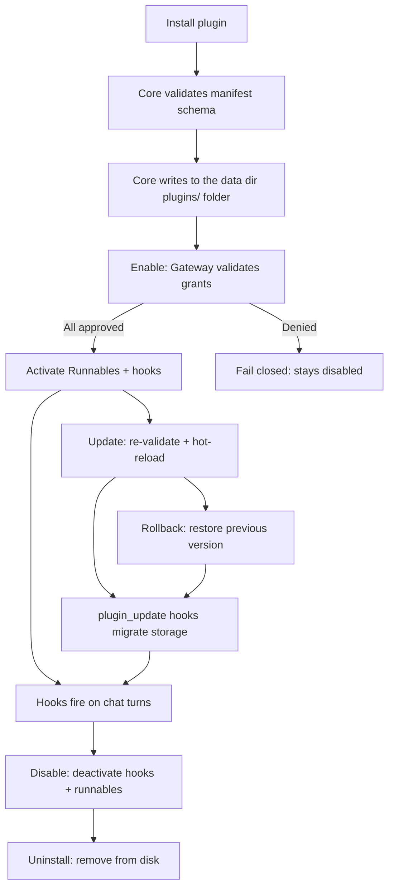
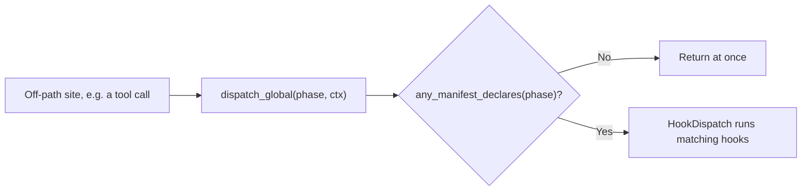

Plugins in Ryu go through a fixed lifecycle: install, validate, enable, run, disable, and
uninstall. At each stage, Core enforces manifest schema validation and Gateway grant checks.

Hooks let your plugin code react to chat events at specific boundaries: before a user message,
after an assistant reply, before or after a tool call, and more. For a step-by-step guide to
writing a hook, see [Build Turn Hooks](/docs/extend/develop/extensions/hooks-authoring).

## Plugin lifecycle overview

### Lifecycle stages

| Stage | What happens | Route |
|---|---|---|
| **Install** | Fetch manifest from URL, validate schema, write it under the data directory's `plugins/` folder, hot-reload manifest set | `POST /api/plugins/install` |
| **Install by id** | Install a known catalog plugin by its id | `POST /api/plugins/:id/install` |
| **Enable** | Validate each declared `permission_grants` via Gateway `POST /v1/grants/validate`, then activate Runnables + hooks | `POST /api/plugins/:id/enable` |
| **Disable** | Deactivate hooks (stop firing on next turn) + Runnables | `POST /api/plugins/:id/disable` |
| **Update** | Re-fetch manifest, re-validate, keep the replaced version for rollback, hot-reload, then run the plugin's `plugin_update` hooks | `POST /api/plugins/:id/update` |
| **Rollback** | Restore the version the last update replaced (manifest and bundled UI code), keeping the enabled state, then run `plugin_update` hooks | `POST /api/plugins/:id/rollback` |
| **Uninstall** | Remove plugin directory from disk | `POST /api/plugins/:id/uninstall` |

Enable **fails closed** if any declared grant is denied by the Gateway. This keeps the
Core-vs-Gateway split intact: Core decides what runs, the Gateway decides what is allowed.

### What happens on enable

When a plugin is enabled, Core validates and registers its declared runnable contributions:

1. **Agent runnables** get an `app__`-namespaced id in the agent store and appear in the agent picker.
2. **Workflow runnables** are saved as skeleton definitions and appear in the workflow list.
3. **Tool runnables** are registered into the MCP registry and appear in tool search on both planes.
4. **Skill runnables** register an app-skill reference; bundled `skills/<slug>/SKILL.md` files are materialized from the package tree when present.
5. **Engine, channel, and companion runnables** register into the corresponding contribution registries.
6. **Policy runnables** are validated by Core and applied through the Gateway/Core policy coordinator.
7. **Turn hooks** are collected by `collect_enabled_hooks` and will fire on the next matching turn boundary.
8. **Declarative contributions** (composer controls, settings tabs, slash commands, themes, and
   wallpaper backgrounds) are stored and served at `GET /api/plugins/contributions`.

The same generic registration path feeds every client surface. A manifest may target desktop, web,
extension, mobile, CLI, the terminal UI, Core, Gateway, Island, or a hardware-facing host.

- An empty target declaration means "all surfaces".
- An explicit surface map is authoritative.
- Surface support controls discoverability and rendering, not authorization. The host still checks
  the contribution's declared grants and the caller's permissions before it runs a sidecar, tool,
  or bridge method.

<Callout type="warn">
  Every Runnable kind has an activation handler. Core activates
  the declared contribution, but the Gateway decides whether its requested capabilities and policy
  effects are allowed. A `policy` handler coordinates state; it does not move firewall, routing, or
  budget enforcement into Core.
</Callout>

## Hook phases and recipes

Turn hooks are declared under `contributes.turn_hooks` in `manifest.json`, and the `on` field
selects the phase. Each phase, its directives, and the tool glob and reply cadence gates are in
[Hook Phases and Directives](/docs/extend/develop/extensions/hook-phases). Worked patterns are in
[Hook Recipes](/docs/extend/develop/extensions/hook-recipes).

## The process-global dispatcher

Off-path phases fire at sites that have no `ServerState`. They are `pre_tool_use`,
`post_tool_use`, `subagent_stop`, `session_end`, `notification`, and the observation-only
message-plane phases `model_select`, `session_tree`, and `workflow_run_*`.

They reach the runtime through a process-global dispatcher: `dispatch_global(phase, ctx)` over the
`HookDispatch` trait, installed once at boot with `set_global`.

Every off-path dispatch first runs a DB-free gate, `any_manifest_declares`. If no loaded manifest
declares the phase, it returns at once. A tool call pays nothing on the hot path unless a
tool-hook plugin is actually loaded.

## Maturity matrix

| Phase | Live-tested | Directives applied |
|---|---|---|
| `post_assistant_turn` / `stop` | Yes (double-check, goal, advisor fixtures) | `note`, `continue`, `interactive_message` |
| `pre_user_turn` | Wired | `replace`, `inject`, `handled` |
| `pre_model_select` | Wired | `select_model` |
| `session_start` | Wired | `inject`, `note` |
| `pre_tool_use` | Wired | `deny` (blocks the call) |
| `tool_result` | Wired | `transform` |
| `post_tool_use` | Wired | Observation only |
| `action` | Wired | Observation only |
| `context` | Wired | `rewrite` / `replace` |
| `message_end` | Wired | `replace` |
| `session_before_compact` | Wired | Observation only |
| `session_compact` | Wired | `replace` |
| `subagent_stop` | Wired | Observation only |
| `delegation_lifecycle` | Wired | Observation only |
| `session_end` | Wired | Observation only |
| `notification` | Wired | Observation only |
| `model_select` | Wired | Observation only |
| `session_tree` | Wired | Observation only |
| `workflow_run_started` / `_finished` / `_failed` | Wired | Observation only |
| `view_action` | Wired | `note`, `none` |
| `plugin_update` | Wired | Observation only (`note` is shown) |

<Callout type="info">
  The observation-only phases fire (detached, fail-open) but their directives are not applied to
  the result in v1. Treat them as telemetry, not control points, until that changes.
</Callout>

## Opt-in token-maxxing and duplicate work

Extensions that spend extra context or model budget may expose a user-controlled
"token-maxxing" mode through a contribution or setting. Such a mode must be opt-in, scoped to the
current turn or conversation, and explicit about cost. The runtime does not enable it merely
because a plugin is installed.

For an opt-in hook that watches delegated work, see the
[Tokenmaxxing](/docs/plugins/tokenmaxxing) plugin and its
[recipe](/docs/extend/develop/extensions/hook-recipes#tokenmaxxing-notify-when-delegation-becomes-idle).

Hooks should deduplicate work at the narrowest durable scope they own:

- Use the conversation id and a stable event or turn key for per-conversation state.
- Use the plugin namespace for storage.
- Make duplicate hook delivery harmless.
- Never share a dedupe record across users, plugins, or unrelated conversations.

Dedupe prevents repeated work. It does not grant permission or turn an observation-only phase into
a control point.

## Related

<Cards>
  <DocCard href="/docs/extend/develop/extensions/hooks-authoring" />
  <DocCard href="/docs/extend/develop/extensions/plugin-json-manifest" />
  <DocCard href="/docs/extend/develop/extensions/hook-phases" />
  <DocCard href="/docs/extend/develop/extensions/hook-recipes" />
  <DocCard href="/docs/extend/develop/extensions/plugin-runtime" />
  <DocCard href="/docs/extend/develop/extensions/author-workflows" />
  <DocCard href="/docs/extend/develop/extensions/author-actions" />
  <DocCard href="/docs/core/double-check" />
  <DocCard href="/docs/core/goals" />
  <DocCard href="/docs/extend/develop/sdk/plugin-api" />
  <DocCard href="/docs/core/observability" />
</Cards>
