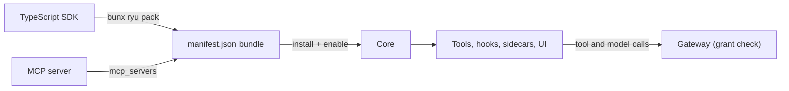

An extension adds tools, agents, workflows, skills, hooks, or UI to Ryu. Extensions run through
the same Core and Gateway as the built-in features.

<Figure name="extensions" />

<Callout type="info">
  Not sure whether you are building a **plugin** or an **app**? A plugin adds new logic that runs
  inside the platform. An app builds on existing primitives to ship a full surface backed by an
  out-of-process sidecar. See [Plugins vs Apps](/docs/extend/develop/extensions/plugins-vs-apps).
</Callout>

## Choose a path

There are three ways to extend Ryu, and they combine:

- An **MCP server** is the executable that exposes tools.
- A **`manifest.json` manifest** is the install and lifecycle wrapper around your tools, hooks,
  sidecars, and UI.
- The **TypeScript SDK** authors the same contributions in code and packs them into a manifest
  bundle.

| You want to... | Use | Start here |
|---|---|---|
| Expose a single tool or small toolset quickly, in any language | MCP server | [Register an MCP Server](/docs/extend/develop/extensions/mcp-server) |
| Ship a named, versioned bundle of Runnables with permission grants the Gateway enforces | `manifest.json` manifest | [Bundle Runnables with manifest.json](/docs/extend/develop/extensions/plugin-json-manifest) |
| React to chat events (turn hooks, tool gates) | `manifest.json` + hooks | [Hooks & Lifecycle](/docs/extend/develop/extensions/hooks-lifecycle) |
| Contribute Desktop UI | `manifest.json` + companion | [Contribution Surfaces](/docs/extend/develop/extensions/contribution-surfaces) |
| Author agents and workflows in typed TypeScript with Gateway-routed model calls, then pack them with `bunx ryu pack` | TypeScript SDK | [TypeScript SDK](/docs/extend/develop/extensions/typescript-sdk) |

To scaffold, run, and side-load your first plugin end to end, follow the
[Quickstart](/docs/extend/develop/quickstart).

## Concepts

<Cards>
  <DocCard href="/docs/extend/develop/extensions/plugins-vs-apps" />
  <DocCard href="/docs/extend/develop/extensions/schemas-and-layouts" />
</Cards>

## Plugins, hooks, and sidecars

<Cards>
  <DocCard href="/docs/extend/develop/extensions/plugin-json-manifest" />
  <DocCard href="/docs/extend/develop/extensions/hooks-lifecycle" />
  <DocCard href="/docs/extend/develop/extensions/hooks-authoring" />
  <DocCard href="/docs/extend/develop/extensions/plugin-runtime" />
  <DocCard href="/docs/extend/develop/extensions/managed-sidecar" />
  <DocCard href="/docs/extend/develop/extensions/extension-host" />
  <DocCard href="/docs/extend/develop/extensions/local-model-plugins" />
  <DocCard href="/docs/extend/develop/extensions/capability-broker" />
</Cards>

## MCP, skills, SDK, and testing

<Cards>
  <DocCard href="/docs/extend/develop/extensions/mcp-server" />
  <DocCard href="/docs/extend/develop/extensions/authenticated-mcp" />
  <DocCard href="/docs/extend/develop/extensions/agent-skills" />
  <DocCard href="/docs/extend/develop/extensions/typescript-sdk" />
  <DocCard href="/docs/extend/develop/extensions/testing-plugin-tools" />
</Cards>

## Apps and surfaces

<Cards>
  <DocCard href="/docs/extend/develop/extensions/ryu-apps" />
  <DocCard href="/docs/extend/develop/extensions/companion-ui" />
  <DocCard href="/docs/extend/develop/extensions/desktop-companion" />
  <DocCard href="/docs/extend/develop/extensions/inline-widget" />
  <DocCard href="/docs/extend/develop/extensions/contribution-surfaces" />
  <DocCard href="/docs/extend/develop/extensions/interfaces" />
  <DocCard href="/docs/extend/develop/extensions/channel-bot" />
  <DocCard href="/docs/extend/develop/extensions/ui-scorecard" />
</Cards>

## Workflows and distribution

<Cards>
  <DocCard href="/docs/extend/develop/extensions/author-actions" />
  <DocCard href="/docs/extend/develop/extensions/author-workflows" />
  <DocCard href="/docs/extend/develop/extensions/portable-packages" />
  <DocCard href="/docs/extend/develop/extensions/marketplace" />
  <DocCard href="/docs/extend/develop/extensions/release-channels" />
  <DocCard href="/docs/extend/develop/extensions/community-marketplace" />
</Cards>
