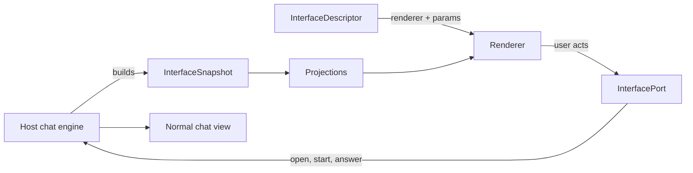

Plugin authors only need the manifest described in
[Publish an Interface](/docs/extend/develop/extensions/interfaces). If you are building a Ryu client
that renders interfaces, the contract is the `@ryuhq/protocol/interfaces` export of
`@ryuhq/protocol` (`packages/protocol/src/interfaces.ts`).

## Descriptors

`InterfaceDescriptor` is one switcher entry: `id`, `label`, `description`, `renderer`, `params`,
`origin` (`"builtin"` or `"marketplace"`), and the owning `plugin`.

| Function | Purpose |
|---|---|
| `parseInterfaceContributions()` | Validates served contribution rows |
| `resolveInterfaceParams()` | Turns untrusted params into typed options with defaults |
| `interfaceTier()` | Maps a renderer to its `managed`, `workspace`, or `admin` tier |

## Snapshot

Every interface reads one `InterfaceSnapshot` (`version: 1`). The required parts are:

| Field | Contents |
|---|---|
| `agents` | Id, name, description, avatar, and `idle` or `working` |
| `threads` | Title, agents, team, project, latest activity, latest message, message count, pinned, running, and an optional last run outcome `runState` |
| `groups` | Teams and projects with their member agents |

The other snapshot fields are optional and additive. Hosts without the data omit them, and
renderers treat a missing field as absent.

### Scheduled runs

`events` lists scheduled runs. Each `InterfaceEvent` has `id`, `title`, `agentId`, `kind` (`past`
or `upcoming`), `start`, a schedule `label`, and optionally `end`, `outcome`, and `count`. A missing
list means no scheduled runs.

### Usage account

`account` (`InterfaceAccount`) carries the user's usage account:

- `balance` and its `breakdown` (plan, top-up, and gift credit) in micro-units;
- a lower-case ISO 4217 `currency`;
- recent `transactions`, newest first.

Each `InterfaceAccountTransaction` has `id`, `at`, a signed `amount`, `kind` (`credit` or `debit`),
`label`, and `balanceAfter`. When known, it also has the `model`, `provider`, token counts, and
the `threadId` it belongs to.

### What waits on the user

- `asks` lists everything waiting on the user, most urgent first. Each `InterfaceAsk` has a `kind`
  (`approval`, `question`, `permission`, `input`, or `reply`), the `text`, the owning `agentId` and
  `threadId`, `since` and `expiresAt`, and the `choices` the host can answer in place. Omitted means
  the host has no ask sources. An empty list means it looked and found nothing.
- `askBlindSpots` names the ask kinds the host cannot see for every thread, so a renderer can say
  that some prompts only show in their chat. An empty `asks` says nothing about these kinds.
- An ask is `blocking` when it needs the user's decision before something can happen. `holdsRun`
  is narrower: a live run is waiting on it. A non-blocking ask other than a `reply` is a suggestion
  (a fix, a skill proposal, a question saved for later).
- `privacy: "redacted"` means the host has already removed text, titles, and details from the
  snapshot. Renderers show what they receive and offer no in-place answers.
- `observedAt` is the host's clock when it built the snapshot. Renderers use it as "now" for the
  data.

### Thread, agent, and event additions

| Object | Optional fields |
|---|---|
| Thread | `runStartedAt` (with `runStartedApprox` when it is only the first time the host saw the run), `runEndedAt`, `lastProgressAt` (when a running thread last made progress), `progress` (plan, workflow, or estimate steps), `activity`, `outcome`, `blocker`, `helpers`, `unread`, `routineRun`, `detail` |
| Agent | `focusThreadId`, `model`, `limit` (the usage window) |
| Event | `jobId`, `threadId`, `error`, `requiresApproval` |

- `routineRun` names the cron routine whose firing started this run. It is set only when the run
  demonstrably started at that fire time.
- `detail` is `summary` when the host read only the list, so a missing field means unknown.
- `runEndedAt`, `runStartedAt`, and `InterfaceBlocker.at` are exact only when they are not marked
  approximate. Never fill them from a "last updated" time.

## Port

Every interface acts through one `InterfacePort`. A host renders open conversations with its
normal chat view. The interface only chooses which conversation to show and where. It never sends
messages through a second path.

| Method | Required | Behavior |
|---|---|---|
| `openThread(id)` | Yes | Show an existing thread in the chat view |
| `startThread({ agentId, teamId, projectId, prompt })` | Yes | Start a thread. A `prompt` is sent right away, so hosts pass only text the user typed and submitted |
| `closeThread()` | Yes | Return to the interface's overview |
| `answerAsk(askId, choiceId)` | No | Answer an ask in place. Called only from the shared ask card, after its confirm step for choices the host marks `destructive` |
| `openInbox()` | No | Open the host's approvals inbox for an ask with no thread |
| `updateSettings(patch)` | No | Save the user's choice for some of the renderer's own settings (keys from `interfaceSettingsFor()`), for example from an in-view toggle |
| `resetSettings()` | No | Forget the user's saved settings for the interface from an in-view "restore defaults" control, so its own defaults apply again |

Hosts without `answerAsk` get ask cards that offer only **Open**. The card never answers while the
snapshot is redacted.

Ask ids are stable but not unique across threads, nodes, or restarts: `permission:<requestId>` and
`question:<toolCallId>` can repeat. A host therefore answers the ask it shows, for that ask's
`threadId` on the node the snapshot came from. It refuses when it cannot tell which ask was chosen.

For `updateSettings`, the host keeps only keys and values that fit those settings, stores them per
interface, and re-renders the interface with the new params.

## Settings

`rendererSettings(renderer)` lists a renderer's settings, held in step with the params
`resolveInterfaceParams()` accepts. Each `InterfaceSettingField` has `key`, `label`, an optional
`description`, a `type` (`boolean`, `select`, `number`, or `text`), a `default`, and `options`,
`min`, `max`, and `step` where they apply.

- `interfaceSettingsFor(descriptor)` is what to show for one interface: a contribution's validated
  `settings`, else its renderer's.
- `interfaceParamsWith(descriptor, overrides)` resolves the live params in this order: the
  contribution's setting defaults, then its `params`, then the user's overrides that fit
  (`settingValueFits()`).

## Projections

These functions turn a snapshot into each layout's data:

| Function | Produces |
|---|---|
| `projectChannels()` | Channels |
| `projectFeed()` | Posts |
| `layoutWorld()` | World placement |
| `projectBoard()` | Columns |
| `projectInbox()` | Sections |
| `projectGraph()` | Nodes |
| `projectTimeline()` | Days |
| `projectContacts()` | Contacts |
| `projectArena()` | Cards |
| `projectDeskViews()` | Views |

World placement depends only on the agents' names, so an agent stands in the same spot in 2D, 3D,
and after a reload. Every renderer added after these, from `card-table` to `warehouse`, builds its
view from the same snapshot inside Ryu. The protocol does not export projections for them.

## Related

<Cards>
  <DocCard href="/docs/extend/develop/extensions/interfaces" />
  <DocCard href="/docs/extend/develop/extensions/interface-renderers" />
  <DocCard href="/docs/surfaces/desktop/interfaces" />
</Cards>
