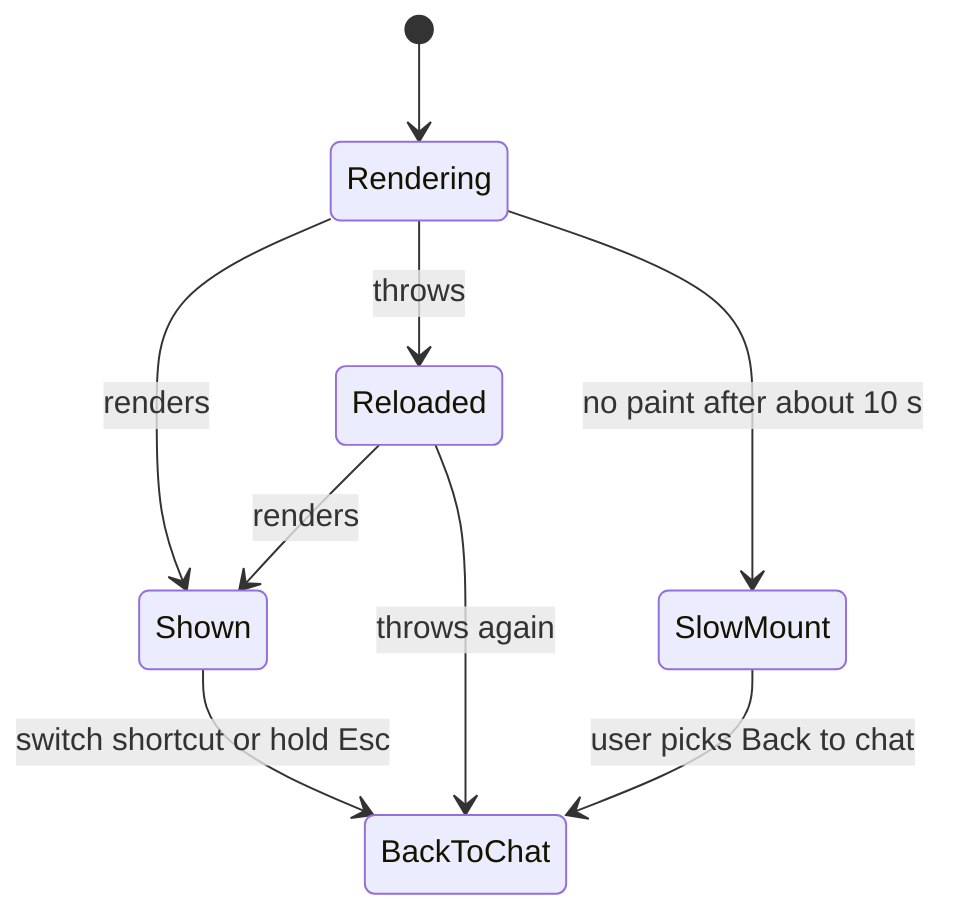
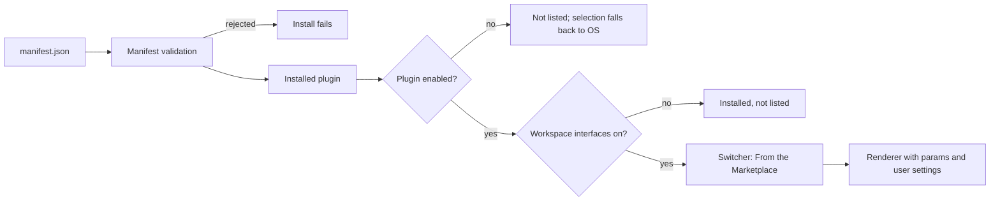

An **interface** is a presentation layer over the same agents, conversations, and messages. Bot,
OS, and Agent are interfaces, and so are the other built-ins such as Channels, Board, World 3D, and
Knowledge. Users pick one from the switcher in the Ryu lockup.

See [Interfaces](/docs/surfaces/desktop/interfaces) for what each one looks like. The built-ins
other than Bot and Agent, and interfaces from the Store, are rolling out gradually; see
[Availability](/docs/surfaces/desktop/interfaces#availability).

## What an interface plugin is

Like a [color theme](/docs/extend/develop/extensions/color-theme), an interface is not its own kind
of marketplace listing. It is a plugin whose contribution is `contributes.interfaces`, so a plugin
can ship an interface alongside other contributions. It inherits these from the plugin system:

- install, uninstall, enable and disable;
- versioning and signing;
- the Store detail page, reviews, and the trust scorecard.

An interface ships **no code at all**. Each entry names one of the renderers built into Ryu and sets
a few of its options. The app never runs anything from your manifest, so an interface needs **zero
permission grants**.

Every conversation still goes through the same chat engine, approvals, and permissions as the rest
of Ryu. The worst a broken interface can do is look wrong.

## The whole plugin is one file

<Files>
  <Folder name="pixel-town" defaultOpen>
    <File name="manifest.json" />
  </Folder>
</Files>

```json title="manifest.json"
{
  "id": "@acme/pixel-town",
  "name": "Pixel Town",
  "version": "1.0.0",
  "category": "Interfaces",
  "description": "Night-time tile worlds and a project-first channel layout for your agents.",
  "tagline": "Pixel Town: walk up to your agents",
  "keywords": ["interface", "world", "channels"],
  "engines": { "ryu": ">=0.1.0" },
  "runnables": [],
  "contributes": {
    "interfaces": [
      {
        "id": "@acme/pixel-town:night-town",
        "label": "Night Town",
        "description": "A 2D tile world after dark.",
        "renderer": "world-2d",
        "params": { "theme": "night" },
        "attribution": "Acme Studio"
      },
      {
        "id": "@acme/pixel-town:office-tower",
        "label": "Office Tower",
        "description": "An isometric 3D office floor.",
        "renderer": "world-3d",
        "params": { "theme": "office", "camera": "isometric" }
      },
      {
        "id": "@acme/pixel-town:project-rooms",
        "label": "Project Rooms",
        "description": "Channels for every project, DMs for every agent.",
        "renderer": "channels",
        "params": { "groupBy": "project" }
      }
    ]
  }
}
```

`"runnables": []` is the point: there is nothing to run. Set `"category": "Interfaces"` so the
listing lands on the Store's **Interfaces** shelf.

## The fields

| Field | Required | Role |
| --- | --- | --- |
| `id` | Yes | Stable id, persisted as the user's selection. **Namespace it with your plugin id** (`@acme/pixel-town:night-town`). The suffix starts with a lowercase letter or digit and uses only `a-z`, `0-9`, `.`, `_`, and `-` (up to 96 characters). Ids must be unique within the plugin. |
| `label` | Yes | The name shown in the switcher, the lockup, and the window title. Up to 64 bytes. |
| `description` | No | One line shown under the label in the switcher. Up to 160 bytes. |
| `renderer` | Yes | Which built-in renderer draws the interface. See [Renderers](#renderers). |
| `params` | No | Renderer options. See [Interface Renderer Params](/docs/extend/develop/extensions/interface-renderers). |
| `settings` | No | Which of the renderer's settings the user sees, and how they are labelled. See [Settings](#settings). |
| `attribution` | No | Creator credit shown with the interface. Up to 64 bytes. |

Text fields cannot be blank or contain control characters. Text limits count UTF-8 bytes, not
characters. Most accented letters take 2 bytes, most CJK characters 3, and emoji 4, so a 64-byte
label holds 21 CJK characters.

## Renderers

A contributed interface can select any **workspace** renderer. A manifest that names an unknown
renderer, or the Bot or Agent shell, is rejected.

Options you leave out use their default. An unknown option is ignored, and an invalid value falls
back to the default, so a typo degrades to the stock look instead of breaking the interface.

| Renderers | Params |
| --- | --- |
| `channels`, `feed`, `board`, `timeline`, `canvas`, `calendar`, `knowledge` | Their own params. |
| `world-2d`, `world-3d`, and the 3D games `aquarium`, `arcade`, `card-table`, `farm`, `kitchen`, `lobby`, `market`, `passport`, `path`, `planets`, `quiz`, `rides`, `seasonal`, `town`, `warehouse`, `workers` | Their own params plus the shared [3D game params](/docs/extend/develop/extensions/interface-renderers#3d-game-params). |
| `os`, `inbox`, `graph`, `messenger`, `terminal`, `arena`, `desk`, `sheet`, `notebook`, `mission-control`, `ticker`, `focus`, `stream`, `forum`, `live`, `posts`, `community`, `wiki`, `dashboard`, `mindmap`, `gallery`, `newspaper`, `qa`, `cinema`, `noticeboard`, `mail`, `status`, `records`, `glance`, `hub`, `library`, `tickets`, `persona`, `panels`, `departures`, `tracking`, `flow`, `moments`, `journal`, `bank`, `jobs`, `hologram` | None. |

Each renderer's params, with values and defaults, are in
[Interface Renderer Params](/docs/extend/develop/extensions/interface-renderers). What every
renderer draws, and how renderers follow the color theme, is in
[What Each Interface Renderer Draws](/docs/extend/develop/extensions/interface-renderer-catalog).

### Host-only renderers

`bot` and `console` (the Agent interface) are product tiers, not presentation choices, so a plugin
cannot select them. Bot's managed experience and Agent's organization-gated controls are only
reachable through Ryu's own entries. A manifest that names either one is rejected.

## Settings

Every param a renderer takes is also a user setting. The user can change it in **Settings →
Appearance → Interfaces**, and their choice is applied over your `params`. The Interfaces page
appears once the newer interfaces are turned on for the account.

Without `settings`, an interface shows all of its renderer's settings with Ryu's labels, and your
`params` become their starting values. Add `settings` to show only some of them, or to relabel them
in your interface's own terms:

```json
{
  "id": "@acme/pixel-town:office-tower",
  "label": "Office Tower",
  "renderer": "world-3d",
  "params": { "camera": "isometric" },
  "settings": [
    { "key": "theme", "label": "Floor", "default": "office",
      "options": [
        { "label": "Daytime", "value": "office" },
        { "label": "After hours", "value": "night" }
      ] },
    { "key": "workBubbles", "label": "Speech bubbles",
      "description": "What each colleague is typing, over their desk." }
  ]
}
```

| Field | Required | Role |
| --- | --- | --- |
| `key` | Yes | One of the renderer's params. |
| `label` | Yes | The setting's name. Up to 64 bytes. |
| `description` | No | One line under the name. Up to 160 bytes. |
| `default` | No | The starting value, which must be a valid value for that param. Defaults to the renderer's default; a key also in `params` starts from `params`. |
| `options` | No | For a choice param only: the choices to offer, a subset of the param's values, each with its own `label`. |

- A setting's type (on/off, choice, number, or text) comes from the renderer and cannot be changed.
- Settings you leave out keep your `params` (or the renderer's default) and are not shown.
- The order of `settings` is the order shown.

## Host guarantees

An interface only draws inside the space Ryu gives it. The host keeps a way out for the user,
whatever the interface does:

- **The top bar is Ryu's.** The host draws the bar with the Ryu lockup, the interface switcher (with
  **Back to chat**), **Marketplace**, and **Settings** above the interface. An interface can't hide,
  cover, or replace it.
- **The interface's area is its own stacking and clipping context.** Nothing it draws, including
  fixed-position elements, reaches the bar. Its dialogs, sheets, menus, popovers, and tooltips open
  inside that area too.
- **The switch shortcut always works.** The host handles the Switch Interface shortcut before any
  interface sees the key, so stopping key events in an interface doesn't block it. Holding `Esc`
  for about a second also returns to the chat.
- **Crashes are contained.** If an interface throws while rendering, the host reloads it once. If it
  throws again, the host switches it off, returns the user to the chat, and says so. If it takes
  more than about 10 seconds to appear, the host offers **Back to chat**.
- **Bad data degrades.** Invalid params fall back to their defaults. An interface whose plugin is
  disabled or uninstalled falls back to the OS desktop.



## Validation limits

Ryu validates every entry with the rest of the manifest and rejects the plugin when an entry breaks
a rule:

| Limit | Value |
| --- | --- |
| Interfaces per plugin | 16 |
| `label` length | 64 bytes (UTF-8) |
| `description` length | 160 bytes (UTF-8) |
| `attribution` length | 64 bytes (UTF-8) |
| Keys in `params` | 16 |
| `params` size | 4 KB, serialized |
| Param key | Starts with a letter; letters, digits, and `_` only; up to 64 characters |
| Param value | A boolean, a finite number, or a string of up to 128 bytes (UTF-8). Objects, arrays, and `null` are rejected. |
| Entries in `settings` | 16, each naming a different param |
| Setting `label` / option `label` | 64 bytes (UTF-8) |
| Setting `description` | 160 bytes (UTF-8) |

<Callout type="warn">
The desktop app ignores the whole `settings` list when it names a param the renderer does not take,
repeats a key, offers an option the param does not have, or sets a `default` that is not valid for
the param. The interface stays in the switcher and shows all of its renderer's settings with Ryu's
labels, so check the list against the renderer's params before you publish.
</Callout>

The desktop app checks the entries again before it lists them:

- It keeps at most 64 installed interfaces in the switcher.
- It drops any entry whose `id` is outside its plugin's namespace.
- The `ryu:` namespace is reserved for the built-ins, so a plugin whose id is `ryu` cannot
  contribute interfaces.

## Publish it

Publish the interface from its GitHub repository after attaching an immutable `.ryupack` release:

```bash
bunx ryu github-publish https://github.com/your-org/your-interface
```

Interfaces land on the **Interfaces** shelf in the Store. See
[Marketplace](/docs/extend/develop/extensions/marketplace) for the listing, pricing, and signing
story, and [GitHub topic discovery](/docs/extend/develop/extensions/github-topic-discovery) for the
free index.

## How it reaches the switcher

Installed interfaces appear in the Ryu lockup menu under **From the Marketplace**, after the
built-ins. They are **enabled-gated**:

- Disabling or uninstalling the plugin removes them from the switcher.
- A user who had one selected falls back to the OS desktop.
- Their stored choice is kept, so re-enabling the plugin brings the interface back.

Contributed interfaces belong to the workspace interfaces, which are rolling out gradually. A user
sees them in the switcher only once workspace interfaces are turned on for their account (see
[Availability](/docs/surfaces/desktop/interfaces#availability)). Until then the interface installs
normally but stays out of the switcher. They never change who can open Agent.



## The protocol, for host implementers

Plugin authors only need the manifest above. If you are building a Ryu client that renders
interfaces, see [Interface Protocol for Hosts](/docs/extend/develop/extensions/interface-protocol)
for the `@ryuhq/protocol/interfaces` contract.

<Cards>
  <DocCard href="/docs/extend/develop/extensions/interface-renderers" />
  <DocCard href="/docs/extend/develop/extensions/interface-renderer-catalog" />
  <DocCard href="/docs/extend/develop/extensions/interface-protocol" />
  <DocCard href="/docs/surfaces/desktop/interfaces" />
  <DocCard href="/docs/extend/develop/extensions/color-theme" />
  <DocCard href="/docs/extend/develop/extensions/background-contributions" />
  <DocCard href="/docs/extend/develop/extensions/marketplace" />
</Cards>
