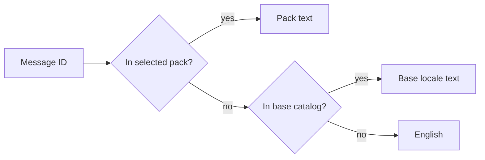
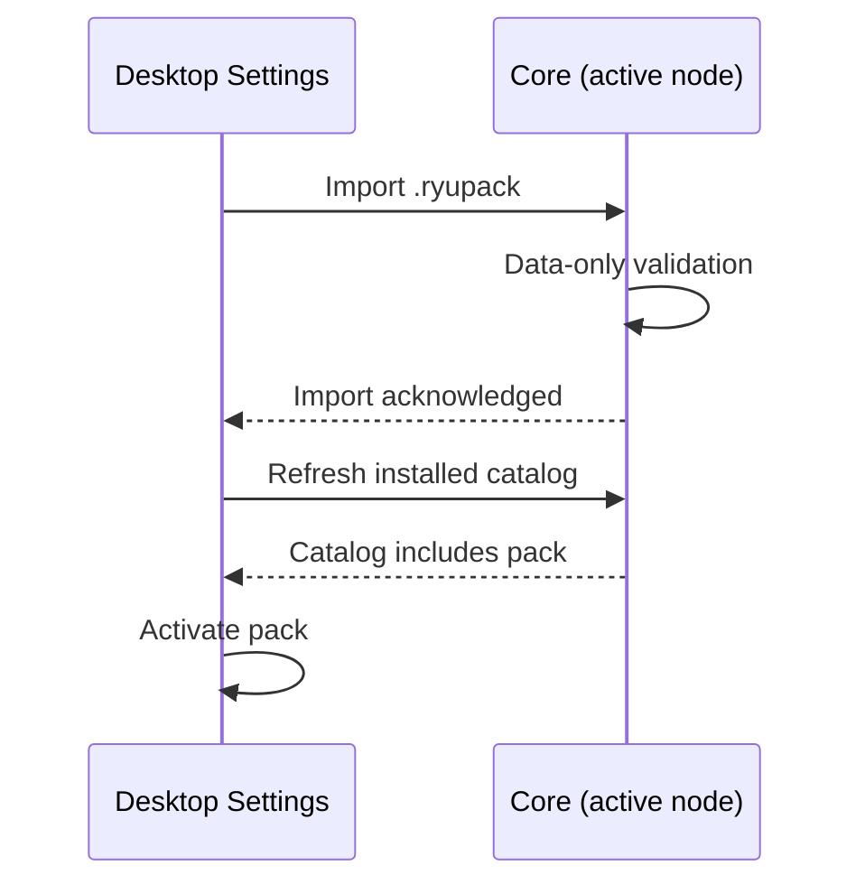

Ryu language packs are data-only overlays for the shared interface catalog. One pack can be used by
the Ryu website, Desktop, Island, the mobile app, the browser extension, and sandboxed apps and
plugins. For the outer archive, folder, and GitHub transport contract, see
[Portable packages](/docs/extend/develop/extensions/portable-packages).

A pack can be a normal locale translation, a regional variant, or a playful voice such as
**English (chronically online)**. A pack never ships JavaScript, permissions, credentials, account
data, or a plugin sidecar. Selecting one does not require an app update or restart.

## Starter packs

Ryu ships first-party starter packs for **Español**, **Français**, **Deutsch**,
**Português (Brasil)**, **日本語**, **简体中文**, **Italiano**, **한국어**, **हिन्दी**, **Русский**, and
**العربية**. Arabic uses the right-to-left layout direction.

The starter packs work offline and cover the shared interface catalog, including the desktop
welcome and device sign-in flow: the welcome actions, approval and retry states, and the local Core
download/setup dialog.

These official languages translate the whole first-party interface: Desktop, the website and cloud
dashboard, the browser-hosted app, Island, the mobile app, the browser extension, and Companion apps
opened from a Ryu host.

- On the web, Desktop, Island, and extension pages, a language's text downloads the first time you
  choose it, so other languages add nothing to what you load.
- The mobile app and the extension's in-page overlays include their own translated text.
- Text added in a newer release can briefly appear in English until the next translation update
  ships.

### Terminal and email

- The terminal CLI follows your system language. It reads `RYU_LOCALE` first, then `LC_ALL`,
  `LC_MESSAGES`, and `LANG` (for example `de_DE.UTF-8`). Set `RYU_LOCALE=en` to keep it in English.
  Machine-readable output, such as `--json`, stays in English.
- Emails use the language you last chose on the website or in Desktop while signed in. Until you
  choose one, emails sent during an action you take (such as a sign-in code or password reset) use
  your browser's language, and other emails are sent in English.

## How a message is resolved

English is the default source catalog, and the runtime always keeps it as a fallback. A message
missing from the selected pack falls back to the pack's base catalog, then English. When Ryu adds
new interface messages, older packs keep working, and pack authors can update later to cover them.



The website starts from the browser's locale when no language choice is stored. An explicit
selection always wins. Regional tags such as `es-MX` and `pt-PT` resolve to the closest reviewed
starter pack when one is available.

### Selection across windows and nodes

- In Desktop and the browser-hosted app, windows sharing the same local storage receive changes to
  the language mode and selected pack.
- Clearing local settings in another window returns the mode to automatic detection.
- If the host refuses a settings write, your new choice still applies in the current session,
  including a pack you switch to from **Auto detect** or choose in Marketplace. Choose it again
  after storage becomes available to save it for future launches.
- A language change saved in another window replaces a choice that this window could not save.

Installed-pack changes are reloaded from the active node, so a refresh cannot enable a pack that
Core has disabled. If you switch nodes or sign-in identity, or choose another language while an
import or Marketplace installation is pending, its later reply does not replace your current
choice.

An import already accepted by its original node can remain installed there. Changing the current
selection does not undo that remote write.

### Authentication errors

Authentication errors have a separate server boundary, independent from community UI packs. Ryu
registers Better Auth's i18n plugin with its built-in locale dictionaries. Standard auth error codes
follow the `locale` cookie when present, then the request's `Accept-Language` header, and finally
English.

Auth responses retain the original message for diagnostics. An `en-x-ryu-online` voice changes
product copy, while security-sensitive auth errors use reviewed Better Auth translations. See the
[Better Auth i18n plugin documentation](https://better-auth.com/docs/plugins/i18n) for the server
plugin's detection and error-response contract.

## The language-pack file

Put a `language-pack.json` file beside the package envelope:

```text
my-language-pack/
├── ryu.package.json
└── language-pack.json
```

The artifact is a partial catalog. Only the messages you want to change need to be present:

```json title="language-pack.json"
{
  "schemaVersion": 1,
  "id": "community/ryu-online",
  "name": "English (chronically online)",
  "version": "1.0.0",
  "locale": "en-x-ryu-online",
  "baseLocale": "en",
  "direction": "ltr",
  "messages": {
    "common.install": "Yeet it in",
    "common.marketplace": "The Bazaar",
    "language.title": "Language & vibes",
    "nav.marketplace": "The Bazaar",
    "sample.greeting": "Welcome to Ryu, {name}. The vibes are immaculate."
  }
}
```

- `locale` and `baseLocale` use BCP-47 tags.
- Use `direction: "rtl"` for Arabic, Hebrew, Persian, Urdu, or another right-to-left pack. Ryu
  updates the document direction with the selected pack.
- Message IDs are stable API. Keep placeholders unchanged, including the names inside `{name}` or
  `{count, plural, ...}`.

The validator rejects:

- malformed identity, or an invalid locale or direction;
- control characters and oversized messages;
- placeholder changes;
- artifacts larger than 4 MiB of UTF-8 JSON.

## Package it for sharing

The outer envelope marks the artifact as a data-only language pack:

```json title="ryu.package.json"
{
  "schemaVersion": 1,
  "id": "community/ryu-online",
  "name": "English (chronically online)",
  "version": "1.0.0",
  "kind": "language_pack",
  "artifacts": ["language-pack.json"],
  "targets": ["desktop", "web", "mobile", "extension", "island"],
  "scopes": ["desktop"],
  "requires": {},
  "capabilities": [],
  "security": {
    "containsSecrets": false,
    "permissions": [],
    "privateContent": false,
    "redacted": false
  }
}
```

Validate and create the portable archive with the same package commands used by every other
Marketplace kind:

```bash
ryu-cli package validate ./my-language-pack
ryu-cli package pack ./my-language-pack ./ryu-online-1.0.0.ryupack
ryu-cli package inspect ./ryu-online-1.0.0.ryupack
ryu-cli package export ./my-language-pack ./ryu-online-export.ryupack
```

`export` applies the normal redaction rules. A language pack's only artifact is public text, but the
same checks protect a package if extra files are added. The archive can be imported into another
node or attached to a GitHub Release.

### Import and export in the apps

- **Desktop**: **Settings → General → Language**, under **Available language packs**.
- **Mobile**: **Settings → Language packs**.

In either place, choose **Import** to send a local `.ryupack` through Core's data-only import
validator, or **Export** to share the currently selected pack.



Desktop activates an imported pack only after Core acknowledges the import and the refreshed
installed catalog includes it. If importing or enabling a pack fails, Settings shows the error and
keeps your current selection. Retry the same file, or choose the pack again after the node is
available.

After a successful import, the same node-scoped pack appears on the webapp, mobile, extension, and
Island surfaces.

## Publish it in Marketplace

Open Marketplace → **Sell** on the website or desktop app and submit the repository or package URL
through **Publish from GitHub**. Ryu then:

1. validates the artifact;
2. checks that the immutable Release asset matches the repository tree;
3. signs the package descriptor;
4. sends the listing through the normal moderation flow.

A free pack can be loaded by the website. Paid packs use the normal Ryu install handoff.

- For a standalone language-pack repository, add the `ryu-language-pack` GitHub topic.
- For a collection repository, add `ryu-marketplace` and place the package under a folder containing
  its own `ryu.package.json`.

The deterministic Release asset is named from the package id and version and must end in
`.ryupack`.

Marketplace cards show the locale, base language, text direction, and translated-string count when
the listing includes the language-pack metadata. The same listing is available at
`/marketplace/language-packs` and in the desktop Marketplace Browse kind.

## Use a pack

| Surface | Where to choose a pack |
| --- | --- |
| Website | A free pack's **Use in browser** action, or the language selector in the header. |
| Desktop | **Settings → General → Language** (or **Appearance → Language & vibe**), or **Language Packs** in Marketplace Browse. |
| Mobile | Marketplace → **Languages** to install a free pack, then choose it in Settings. |
| Browser extension | Its Appearance settings. |
| Island | The compact chat header. |

- The website selector applies the pack immediately and updates the document language for assistive
  technology and browser formatting. The selected website pack is remembered locally in the browser.
- The desktop General selector starts at **Auto detect** and can be fixed to English or an installed
  pack.
- Choosing a pack from Desktop Marketplace installs and enables it on the selected node. Your
  language choice is fixed after the refreshed catalog acknowledges the enabled pack, and saved in
  your local profile when local settings storage is available.

Installed packs are node-scoped and can be enabled or disabled without a restart. Desktop stores a
pack's lifecycle state on the selected Core node. The desktop selection is kept in the local app
profile and only takes effect on another node when that same pack is available there.

Island follows the language you choose in Desktop. Desktop also saves its choice (auto-detect or a
fixed pack) on the selected node, and Island reads it from there. A choice made in Island's header
stays in effect until you change the language in Desktop again.

## Localize the public Fumadocs site

The public documentation site uses Fumadocs' native i18n routing in addition to Ryu's shared product
language-pack runtime. The current docs locales are `en`, `es`, `fr`, `de`, `pt-br`, `ja`, `zh-cn`,
`it`, `ko`, `hi`, `ru`, and `ar`.

English keeps the existing canonical URLs. Translated routes use the locale prefix, for example
`/es/docs/start-here`. The site follows the
[Fumadocs internationalization configuration](https://www.fumadocs.dev/docs/internationalization)
and the [Next.js routing pattern](https://www.fumadocs.dev/docs/internationalization/next).

- A translated page sits beside its English source with the locale suffix, such as
  `start-here/index.es.mdx`.
- A translated navigation file uses the same convention, such as `start-here/meta.es.json`.
- The `dot` parser keeps the URL slug stable across languages.

Translations can land progressively. When a page or navigation file is not yet translated, the
Fumadocs loader serves the English source at the active locale URL. Every locale's page tree,
previous/next navigation, search index, Markdown projection, OpenAPI reference, and metadata stay
usable while individual pages are reviewed.

Search is filtered to the active locale, and the language selector preserves the current page when
switching languages. Fumadocs UI labels use the same locale list, including translated
language-switcher, search, theme, pagination, page-action, and table-of-contents labels. The Arabic
route carries right-to-left document and portal direction.

## Build an app or plugin with the primitive

Named translation is explicit: a pack changes text that a first-party surface or app/plugin sends
through `t`/`I18nText` or the host primitive. Legacy raw literals go through the
[automatic literal localization](#automatic-literal-localization) fallback instead.

App and plugin authors, and surface owners migrating legacy copy, should use explicit namespaced IDs
such as `my-app.refresh` with an English fallback. They are easier to review, support interpolation,
and remain stable when wording changes.

### React surfaces

First-party React surfaces use the shared provider and hook:

```tsx
import { useI18n } from "@ryu/i18n/react";

export function Welcome() {
  const { t, locale, direction } = useI18n();
  return (
    <p dir={direction} lang={locale}>
      {t("my-app.welcome", { name: "Ada" }, "Welcome, {name}.")}
    </p>
  );
}
```

A host using `I18nProvider` can change its optional `selectionKey` when it needs to re-read
`initialLocale` and `initialPackId`, including a selection stored by another window. This refreshes
the translation runtime while preserving mounted child components, unsent input, and keyboard focus.
Omitting `selectionKey` keeps the existing initialization behavior.

The provider compares each `packs` array it receives with the catalog it last applied:

- A new array with the same content, such as an unchanged reload of the installed catalog, is not
  republished. Consumers do not re-render and the page is not retranslated.
- Any change in content is republished, including changed messages, enabled state, or pack order,
  even when a pack keeps its id and version.
- While no pack is selected and the host leaves `initialPackId` unset, an unchanged array still
  re-reads the saved pack id. A choice that became readable since the provider started (for example
  after storage that refused reads recovers) is then applied and published once.
- With `initialPackId` set to `null`, the saved id is not read.

Shared web and desktop controls receive the pack's direction through Base UI's `DirectionProvider`.
Portalled menus, selects, comboboxes, popovers, dialogs, tooltips, and editor overlays keep their
`dir` attribute, spacing, directional icons, and animations aligned with the active language. The
logical `start`/`end` utility approach follows the [shadcn/ui RTL guide](https://ui.shadcn.com/docs/rtl).

### Sandboxed apps and plugins

Sandboxed apps and plugins use the same capability-gated host primitive. The `defaultMessage` is
required at the sandbox boundary, so an app stays readable when a community pack does not include its
namespaced IDs:

```ts
const snapshot = await window.ryu.i18n.get();
const label = await window.ryu.i18n.translate({
  id: "my-app.refresh",
  defaultMessage: "Refresh",
});
const subscription = window.ryu.i18n.subscribe({
  onChange(next) {
    document.documentElement.lang = next.locale;
    document.documentElement.dir = next.direction;
  },
});
```

An active subscription follows later language choices and installed-pack changes while the panel
stays open. Call `subscription.dispose()` when your app no longer needs updates; closing the panel
also ends its subscriptions.

The plugin SDK exposes the same API as `context.plugin.host.i18n`. It is read-only. Apps and plugins
can translate their own IDs and react to a pack change, but cannot install packs, change another
app's copy, access the full catalog, or receive credentials. The primitive is available through the
desktop, webapp, mobile WebView, browser-extension sandbox, Island, and widget host paths.

The browser extension's content-script overlays (the selection action, in-page Copilot launcher,
and AI-site prompt toolbar) run outside the React extension page. They use the extension worker's
read-only translation request, which loads the same built-in or installed pack and caches the
result. Page selections, Copilot answers, prompt records, and other user content are marked literal
and are not rewritten.

### Automatic literal localization

For legacy first-party UI that still contains a raw DOM literal, the shared provider offers that
text to a deterministic literal-ID resolver. Native `Text` elements use the equivalent build-time
boundary.

- Shared Ryu UI primitives localize direct literal children of user-facing controls (buttons,
  labels, headings, menus, select options, dialogs, empty states, settings rows) with deterministic
  `literal.<slug>.<hash>` IDs.
- String attributes owned by a primitive, such as `aria-label`, `title`, and `placeholder`, use the
  shared localization hook where supported.
- Data-bearing content such as entity names, tool output, and status badges stays literal by
  default, because a generic component cannot safely tell it from a label. Use `<I18nText>` or an
  explicit `t(...)` call for child text that is meant to localize.
- Automatic DOM localization resolves only known catalog literals. Unknown prose remains unchanged
  and is never interpreted as an ICU message.
- Code blocks, editable content, explicit opt-out regions, and unknown dynamic content are left
  alone.

The DOM fallback processes changed regions and reuses translations for unchanged text. Changing the
selected pack or replacing its catalog content refreshes those translations, even when the pack's ID
and version stay the same.

Companion apps get the same boundary from `RyuAppShell`. It mounts the shared provider and direction
context, mirrors the host-selected pack when one exists, auto-detects the browser locale otherwise,
and routes the fixed toolbar/list/form/empty slots and legacy DOM attributes through the shared
resolver. Use those slots for shell copy and keep domain values, records, and host-provided content
literal.

For legacy UI copy supplied by a Companion's host pack, opt the trusted UI subtree in with
`data-ryu-i18n="on"`. Keep user records, assistant responses, and other externally supplied content
outside that subtree, or mark them with `data-ryu-i18n="off"`. An opt-out takes precedence over an
ancestor's opt-in.

### Message format limits

ICU formatting supports nested select and plural messages within these limits. A message above a
limit is displayed literally rather than partially formatted.

| Limit | Value |
| --- | --- |
| Message length | 32,000 characters |
| Brace nesting | 32 levels |
| Expressions or option bodies | 1,024 |

## Review and maintain community packs

Treat a language pack like any other community-published content: review its repository, release
history, and translations before enabling it. A pack cannot execute code, but misleading text can
still make an interface confusing.

- Keep the stable message IDs.
- Keep interpolated values and plural/select branches semantically equivalent to the source message.
- Bump the package version when changing translations, and publish a new immutable Release for each
  update.

<Cards>
  <DocCard href="/docs/extend/develop/extensions/portable-packages" />
  <DocCard href="/docs/extend/develop/extensions/marketplace" />
  <DocCard href="/docs/extend/develop/extensions/github-topic-discovery" />
  <DocCard href="/docs/surfaces/desktop/user-guide/marketplace" />
</Cards>
