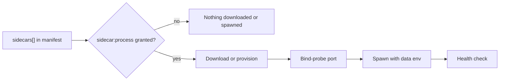

A manifest can declare `sidecars[]`, the long-running child processes Core downloads or provisions,
spawns, and health-checks. Use this when your app wraps a binary or a Python service (an Audio
engine, a capture daemon) rather than a stdio MCP server.

The field is `SidecarSpec`, defined in `crates/core/kernel-contracts/src/schema.rs` and re-exported
by `apps/core/src/plugin_manifest/schema.rs`. This page covers the declaration only. The download,
checksum, port-claim, and boot-reconcile behaviour, and the `may_run_sidecar` gate, are documented
once in
[App Managed Sidecars and Activation](/docs/core/app-managed-sidecars#manifest-declared-managed-sidecars).



```json
{
  "sidecars": [
    {
      "name": "engine",
      "process": {
        "kind": "binary",
        "url": "https://example.com/dl/my-engine",
        "sha256": "…",
        "version": "1.2.3",
        "args": ["--port", "8321"]
      },
      "port": 8321,
      "health_path": "/health"
    }
  ],
  "permission_grants": ["sidecar:process"]
}
```

| `process.kind` | What it runs |
|---|---|
| `binary` | A downloaded, checksum-verified executable or archive. |
| `python` | A provisioned venv running `python -m <entry>`. |
| `local`, `node` | A program already on the machine. |

A `local` sidecar can also declare per-platform `bundles` (a `tar.gz` plus the `entrypoint` to run
inside it) for programs that cannot be one file, such as a macOS `.app`. See
[Local release assets and bundles](/docs/core/app-managed-sidecars#local-release-assets-and-bundles).

A Community-tier plugin must declare the `sidecar:process` grant. The Gateway must approve it on
enable before Core will download or spawn anything. A Core-tier plugin is auto-allowed.

### The port

The `port` is bind-probed to reject a collision before the process starts. The example above repeats
`8321` in `args` because a `binary` sidecar has no way to be *told* its port.

The `local` and `python` kinds do: `port_env` names an environment variable Core sets on the child,
and the process reads the port from there instead of repeating it.
[Pick a Sidecar Port](/docs/extend/develop/extensions/sidecar-ports) covers which kinds support
that, why the injected value is not always the number in the manifest, and which port ranges are
safe to pick from.

## Declare what the sidecar needs from the filesystem

A node can run sidecars under an [OS sandbox](/docs/security/plugin-isolation#optional-os-sandbox-for-sidecars).
When enforced, the process can write only to its app's own directory, its own data directory
(`RYU_PLUGIN_DATA_DIR`), and the temp directory, and read the shared models directory
(`RYU_MODELS_DIR`). If your sidecar needs more, declare it in an optional `sandbox` block:

```json
{
  "name": "engine",
  "process": { "kind": "local", "command": "my-engine", "port_env": "MY_ENGINE_PORT" },
  "port": 8321,
  "sandbox": {
    "fs": {
      "read": ["$HOME/.config/my-engine"],
      "write": ["$RYU_DIR/my-engine"]
    }
  }
}
```

| Key | Meaning |
|---|---|
| `fs.read`, `fs.write` | Up to 32 paths in total. Each starts with `$APP_DATA` (your app's own directory), `$TMP`, `$RYU_DIR/<entry>`, or `$HOME/<entry>`. |
| `mode` | `audit` or `enforce`. Opts your sidecar into the sandbox even on a node that left it off. It can only make the sidecar stricter than the node's setting, never looser. |
| `memory_limit_mb` | 64 or more. Caps the sidecar's process tree on Windows; other platforms ignore it. |

These paths are rejected when the manifest is validated, and again after symlinks are resolved when
the sidecar starts:

- relative or absolute literal paths;
- `.`, `..`, empty segments, backslashes, and `:`;
- the whole home or data directory;
- other apps' directories and data directories (`$RYU_DIR/plugins`, `$RYU_DIR/apps`,
  `$RYU_DIR/plugin-data`).

Your own data directory is granted without a declaration. Downloading models into the shared cache
(`HF_HOME`, `TORCH_HOME`) needs a write declaration such as `$RYU_DIR/models/hf`.

Without `mode`, the block changes nothing on a node where the sandbox is off. Declaring paths you
do not use makes the sandbox weaker for your users, so keep the list short.

## Where a sidecar keeps its data

Core tells every sidecar where to store things, so a plugin never hardcodes a path under the
user's home folder. Each sidecar process starts with these environment variables:

| Variable | Value |
|---|---|
| `RYU_DIR` | The node's [data folder](/docs/surfaces/desktop/user-guide/data-and-storage#whats-in-the-data-folder) |
| `RYU_PLUGIN_DATA_DIR` | The plugin's own data folder, `<data folder>/plugin-data/<dir>` (the plugin id with `/` replaced by `+`). Core creates it before the spawn. Put databases, preferences, media, and caches here. |
| `RYU_MODELS_DIR` | The shared `<data folder>/models` root, for weights other parts of Ryu can reuse |
| `HF_HOME`, `TORCH_HOME` | `<data folder>/models/hf` and `<data folder>/models/torch`, unless the manifest sets them |
| `RYU_BRANDING_REMOVABLE` | `1` when the member's plan removes the [Powered by Ryu badge](/docs/billing/powered-by-ryu), otherwise `0`. Pages your app serves to the public should show the badge unless this is `1`. |

Core sets `RYU_DIR`, `RYU_PLUGIN_DATA_DIR`, `RYU_MODELS_DIR`, and `RYU_BRANDING_REMOVABLE` itself;
a manifest cannot override them. `RYU_PLUGIN_DATA_DIR` is the folder the **App files** uninstall
option deletes, so keep anything the user should be able to remove with the plugin there.

The `env` of a `local` or `python` sidecar can also build paths from these tokens, which Core
expands before the spawn:

| Token | Expands to |
|---|---|
| `${RYU_DIR}` | The data folder |
| `${RYU_PLUGIN_DATA_DIR}` | The plugin's own data folder |
| `${RYU_MODELS_DIR}` | The shared `models` root |
| `${RYU_PLUGIN_DIR}` | The installed package folder, `<data folder>/plugins/<dir>` |
| `${RYU_RUNTIME_DIR}` | `python` sidecars only: that sidecar's runtime folder (its venv and provisioned assets) |

```json
"env": {
  "MY_ENGINE_DATASETS": "${RYU_PLUGIN_DATA_DIR}/datasets",
  "MY_ENGINE_ADAPTERS": "${RYU_MODELS_DIR}/adapters"
}
```

## Related

<Cards>
  <DocCard href="/docs/extend/develop/extensions/plugin-json-manifest" />
  <DocCard href="/docs/extend/develop/extensions/sidecar-ports" />
  <DocCard href="/docs/extend/develop/extensions/sidecar-websocket-routes" />
  <DocCard href="/docs/core/app-manifest-lifecycle" />
  <DocCard href="/docs/security/plugin-isolation" />
</Cards>
