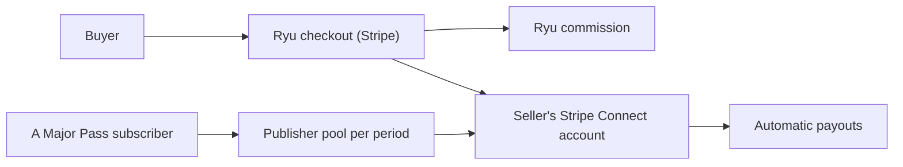

Paid Marketplace listings use Stripe Connect for item sales and an optional A Major Pass
publisher pool. The free publish path is on
[Publish to the Marketplace](/docs/extend/develop/extensions/marketplace).



## Paid items

### Seller onboarding

A paid package needs a seller org with Stripe Connect payouts enabled, so complete seller onboarding
first:

- On the web, Marketplace → **Sell** runs Stripe's onboarding inside Ryu.
- Other clients use the hosted onboarding link from `POST /api/seller/onboard`.

A paid publish from an org that has not enabled payouts is refused with a clear error. The server
resolves the publishing org and applies the platform fee, so pricing is set under server policy, not
by the manifest.

### Offer types

Buyers pay on [Ryu's checkout page](/docs/billing/checkout), which Stripe processes. Offers may be
one-time, monthly, yearly, or bounded-update. A bounded-update offer is a one-time charge with a
seller-defined `maxUpdates` allowance:

- The buyer keeps the purchased release and older ones.
- Each newer release they install uses one update.
- Reinstalling a release they already received is free.
- Once the allowance is used, a newer release needs a new purchase.

- Browsing a listing never uses an update.
- Fleet imports follow the same release allowance as installation.
- If several licenses cover an item, Ryu uses one that already covers the release before spending
  another license's update.
- Release ordering follows SemVer precedence and ignores build metadata.

### Renewals and payouts

Recurring invoices refresh the commercial record. The member who bought a monthly or yearly
license, or a member with billing permission in the buying organization, can cancel or resume its
renewal from **My licenses** on the web. A cancelled renewal ends at the close of the paid period,
and the license stays active until then.

Seller payouts follow Stripe's automatic schedule. Manual and instant payouts are not offered, so
recent sales remain available to cover refunds and disputes.

### Who can install a paid item

A paid listing stays browsable to everyone, but its installable package (the signed release archive,
manifest, and bundled code) is served only to:

- members of an organization that bought it;
- accounts whose plan includes the listing;
- members of the selling organization;
- holders of a publisher-issued share code.

Anyone else is asked to purchase first. A refund or payment dispute revokes the buyer's license.
Ryu then refuses to enable the item on the buyer's nodes at the next enable, after at most a short
offline grace period if the node cannot reach the Marketplace.

### Desktop publisher rules

- Paid prices must be positive and use no more than two decimal places.
- The currency field accepts a three-letter code.
- Bounded-update offers require a whole-number allowance from 1 to 10,000.
- A transient publish error keeps the draft available for retry.
- **Cancel** or **Done** closes the dialog and clears the repository and offer fields.

## Commission

Ryu's current Marketplace commission is **20% of the pre-tax item price**. The publisher sets the
item price; Ryu's server applies the commission.

Stripe processing and Connect fees are separate from this commission. They vary by payment method
and account pricing agreement, and they are not a fixed additional buyer-facing Ryu fee. In the
default destination-charge flow, Stripe debits payment processing from the platform balance.

The publish payload uses the stored offer, not a buyer-supplied price. For example, the bounded
form is:

```json
{
  "pricing": {
    "model": "bounded_updates",
    "amountMinor": 2900,
    "currency": "usd",
    "maxUpdates": 3,
    "distribution": "github_release"
  }
}
```

## A Major Pass publisher-pool opt-in

**A Major Pass** is a catalog and publisher-pool offer for one individual user; its price is on
[Plans](/docs/billing/plans). An **app** with a paid offer may opt into its recurring publisher pool
with `pricing.membershipOptIn: true`. The publisher checkbox is the normal authoring path.

The server sanitizes the value and accepts it only for live paid apps whose publisher organization
has Stripe Connect payouts enabled. Free items, plugins, organization-private listings, and
community-origin listings do not become pool-eligible.

<Callout type="warn">
  A Major Pass is behind a rollout flag. While it is not offered, the publish API ignores a
  requested opt-in: the listing still publishes and is stored as not opted in. The checkbox is
  hidden in that state, and republishing records the opt-in you send at that time, so choose it
  again once the offer returns.
</Callout>

The opt-in and the ticket badge on eligible listings are presentation and commerce metadata. They
never gate browsing, installation, updates, enablement, or runtime use. A one-time or bounded-update
item sale remains direct commerce; the publisher can still opt that paid app into the recurring
pool.

### How the pool is paid

For each paid A Major Pass recurring period, Ryu freezes a default **70% publisher pool**:

1. First-use signals are recorded once per buyer, app, and period.
2. The pool is split by deterministic price-tier weights.
3. Each share is paid to the publisher's existing Stripe Connect account with an idempotency key
   stable across retries.

The publisher report shows eligible apps, pending totals, paid totals, failed transfers, and
usage-signal counts. No buyer-level usage data is exposed.

### Refunds and the pool

A period's pool comes from the subscriber's payment for that period, so a refund withdraws it. A
renewal refund affects only the period that renewal paid for.

| Refund | Effect on that period's pool |
| --- | --- |
| Full refund | Cancels every publisher share not yet transferred. |
| Partial refund | Holds the whole pool for review instead of paying a recomputed amount. |
| After a share was transferred, or after a transfer with an unconfirmed outcome | Moves the period to manual review; no further shares are paid from it. |

<Callout type="info">
  Stripe Connect owns seller onboarding, Marketplace item checkout, transfers, and payouts,
  including publisher-pool transfers. Polar bills Ryu's recurring plans, including A Major Pass.
  Ryu stays authoritative for the GitHub package binding, signature, digest, and node ACL. A free
  or paid package uses the same install path once the caller is entitled to it; a paid package
  requires a purchase, an including plan, or a publisher share code first.
</Callout>

## Lifecycle permissions

Installing, updating, enabling, disabling, and uninstalling a package, paid or free, are separate
node-scoped permissions (`app.install`, `app.update`, `app.enable`, `app.disable`,
`app.uninstall`). See
[Node-scoped marketplace lifecycle](/docs/security/permissions-marketplace)
for scope rules, the structured `403`, and the ACL routes.
