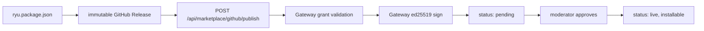

You have built a package and want others to install it. This page walks the GitHub-backed publish
path end to end: add `ryu.package.json`, create an immutable `.ryupack` Release, bind the repository
to Ryu, let the Gateway sign it, and (optionally) price it. Everything here is the author side. For
the buyer experience see [The Marketplace](/docs/surfaces/desktop/user-guide/marketplace).

If you have not built a plugin yet, start at
[manifest.json manifest](/docs/extend/develop/extensions/plugin-json-manifest) and the
[TypeScript SDK](/docs/extend/develop/extensions/typescript-sdk). Before choosing your release
tree, read [Extension schemas & folder layouts](/docs/extend/develop/extensions/schemas-and-layouts)
for the native manifest, Agent Plugins interop files, `ryu.package.json` envelope, and bundle
boundaries.

## GitHub is the package source of truth

The marketplace does not copy new package contents into a server-side artifact registry or require
you to maintain a central index. Tag a standalone repository with `ryu-app` or `ryu-plugin`, or tag
a collection repository with `ryu-marketplace`. Ryu scans collection folders containing
`ryu.package.json` and creates a listing for each package. You submit a repository or package-folder
URL from the seller flow.

The supported package kinds are apps, plugins, skills, **Agent Templates**, workflows, themes, output styles,
Spaces, profiles, and bundles. The package manifest is validated locally and again by Ryu. A release
must contain a deterministic `<id>-<version>.ryupack` asset whose digest matches the source tree.
For the folder, archive, GitHub, import, export, redaction, and update contract, see
[Portable packages](/docs/extend/develop/extensions/portable-packages).

### Publish a bundle

A bundle is a small, signed composition package. Put an ordered `bundle.json` in the package folder;
each member references an existing Marketplace `kind` and `id`. The desktop orchestrator calls the
member's normal installer, so an app, plugin, skill, Agent Template, workflow, or MCP server keeps its
own verification and permission boundary. A `knowledge` member installs through the active knowledge
catalog source. A `model` member installs only when its `source` names the exact GGUF file to download
(for example `"source": "model-Q4_K_M.gguf"`); otherwise the bundle finishes the other members and
lists the model as a manual step to complete from **Models**, where the user picks a file. Mark members
`required: false` when a missing integration should not make the whole collection incomplete. Do not
put credentials in a bundle and do not nest another bundle as a member.

Ryu's first-party catalog includes Software Factory, Social Media Marketing, Outreach, and role
bundles for Legal, Marketing, Sales, Engineering, Finance, Customer Support, HR, Operations,
Education, Data, Enterprise Search, Product Management, Real Estate, E-commerce, Security & IT,
and Small Business, alongside topic collections based on the [UI Skills catalog](https://www.ui-skills.com/skills).
A bundle listing is metadata and composition; it does not auto-enable the members or bypass node
lifecycle controls.

Knowledge bundles are listed under the `knowledge` kind and appear as a **Knowledge** category in
Marketplace browse, alongside models and Agent Templates.

The package/API kind for an Agent Template remains `agent` for compatibility. The Marketplace calls
it an **Agent Template** because it is a customized definition that can be shared and published,
not an ACP runtime from the **Agents** catalog.

You can also add a custom Agent Template source that points at another registry. The registry must
serve the Marketplace catalog shape for the `agent` kind (`/api/marketplace/catalog?kind=agent` and
`/api/marketplace/catalog/detail?kind=agent`) over HTTPS at a public address. Ryu sends no Ryu account
credentials to a custom registry, and installs a template only when its listing carries a signature
that verifies against the Marketplace signing key your node trusts; unsigned or altered listings can be
browsed but not installed.

## Listings after publish

How a listing shows support and extension rows, catalog search, version installs, deprecation and
yanking, remixes, reviews, creator profiles, and share previews are in
[Manage Marketplace listings](/docs/extend/develop/extensions/marketplace-listings).

## The GitHub release workflow

```mermaid
flowchart LR
  A[ryu.package.json in your repo] --> B[immutable GitHub Release]
  B --> C[inspect repository URL]
  C --> D[validate manifest and digests]
  D --> E[detect package type and UI]
  E --> F[Grade A preflight]
  F --> G[Gateway grant validation and signing]
  G --> H[Ryu master-admin moderation]
  H --> I[Ryu signed package proxy]
  I --> J[Core verifies and installs locally]
```

Core checks each signature against the Ryu Marketplace verifying key built into release builds,
never against a key supplied by the listing. A release build that has no Marketplace key refuses
Marketplace installs rather than trusting a key held on the same machine.

1. Add the package manifest and declared artifact files to your repository.
2. Create an immutable GitHub Release with the deterministic `.ryupack` asset.
3. Submit the repository URL through `POST /api/marketplace/github/inspect`, then
   `POST /api/marketplace/github/publish`.
4. Before writing a listing, Ryu pins the repository, commit, release, asset digest, and package
   digest, then runs an automatic Grade A preflight. The package kind selects its artifact checks.
   Ryu detects custom UI source and manifest-declared host-rendered surfaces: custom UI gets the
   source design-system checks, and host-rendered contributions use Ryu's shared-renderer profile.
   A package with no UI gets a passing not-applicable UI check. Missing evidence, an invalid
   artifact, unapproved Gateway grants, or a grade below A prevents submission and returns the
   failed checks to the publisher.
5. Only an A-grade package is signed and placed in the Ryu master-admin moderation queue. The report
   is stored with the exact source commit and package digest so reviewers can see what was checked.
   Organization-private listings remain private after approval, but also wait for Ryu review.
6. Configure `POST /api/marketplace/github/webhook` for release/push notifications, or use
   `POST /api/marketplace/github/resync` after a release change. Each updated package is rechecked;
   a non-A release is not added to the moderation queue. A listing that is already published stays
   published on its approved version while the new release waits for review; approval replaces the
   served version, and rejection leaves the approved version in place. A resync whose version and
   package digest match the published release does not create a new submission.

On the web, open Marketplace → **Sell** after Stripe Connect onboarding. The **Publish from
GitHub** panel uses the same repository URL, offer types, private-repository App handoff, and
moderation flow as the desktop publisher; buyers still install through Ryu without GitHub setup.

### Publishing from a terminal

`bunx ryu github-publish <url>` posts the same repository URL to the hosted Marketplace API
(`https://api.ryuhq.com`; override with `RYU_MARKETPLACE_API_URL`, or `RYU_API_URL`, for a self-hosted control plane).
Because the publishing routes accept only a signed-in account session, set `RYU_AUTH_TOKEN` to your
Ryu session bearer token. For a private repository the command prints the GitHub App installation
URL; after installing, set `RYU_GITHUB_INSTALLATION_PROOF` to the proof the installation callback
returns and rerun. If you do not already have a session token at hand, use **Publish from GitHub**
in the app: it signs you in and handles the installation step for you.

Private repositories require a one-time GitHub App installation for the seller. During the
installation GitHub asks you to authorize the Ryu App; Ryu accepts the installation only when that
GitHub account can see the installation and has write access to the repository. The resulting
binding belongs to the organization you started the installation from (even if the browser has a
different organization selected). Finish the installation in a browser signed in to the same Ryu
account that started it; a signed-out browser is asked to sign in and retry, and a browser signed in
to a different account is refused.

Inspecting, scanning or publishing from GitHub requires Marketplace publishing permission in that
organization. Installing the App on a repository does not let a different organization publish from
it. Ryu uses a short-lived installation token only for validation and proxying. Buyers never authenticate with GitHub or
install anything there.

## Ownership, review, and publisher trust

Marketplace listings belong to an organization, not to the user who submitted them. Organization
ownership, the listing lifecycle states, private collections, publisher trust marks, domain
verification, payout settings, and listing transfers are documented in
[Organization marketplaces](/docs/extend/develop/extensions/organization-marketplaces).

Publisher identity, the **Verified by Ryu** code review, and release-signature verification are
separate signals. One signal does not imply either of the others.

Ryu staff manage app submissions and published app listings in the App Store admin surface.
Approving a pending app publishes its stable build and marks that reviewed listing **Verified by
Ryu**. An already-published community app can receive the mark after a separate code review.
Apps discovered from public GitHub topics remain community listings until Ryu reviews them.
Promoting a prerelease build only approves that build; it does not mark the stable listing reviewed.
Each approval or rejection is recorded in the listing's release history.

## Supply-chain protections

**Publishing requires two-factor authentication.** Creating or updating a listing, re-syncing it
from GitHub, deprecating or yanking a release, uploading listing media, editing collections or the
creator profile, and creating a share code all require an authenticator app or a passkey on the
publishing account. Revoking a share code does not, so a code can always be withdrawn. Without
one, the request answers `403` with `code: "marketplace_mfa_required"`. This applies even where
account-wide two-factor is not otherwise required, because every install of a listing trusts the
account that published it.

**New releases wait seven days before they install.** Like npm's minimum release age, a stable
release is not handed to installs or updates until seven days after GitHub published its immutable
release. GitHub sets that time, so a publisher cannot backdate it. During the window:

- Installing or updating the listing gets the previous approved version instead.
- A listing with no earlier approved version cannot be installed until the window ends.
- Requesting the new version explicitly is refused with `409` and `code: "release_cooldown"`. The
  response's `installableAt` gives the time it becomes available.

Prerelease channels are exempt because testers opt into them. If a publisher account or repository
is compromised, this window lets a bad release be reported and pulled before it reaches anyone's
machine.

## How distribution works

Every catalog in Ryu is browsed and installed through one swappable seam. The Ryu-hosted marketplace
is the billing and commerce bridge behind that seam. New GitHub-backed records store the repository
binding and release metadata; GitHub owns the package contents. Legacy server-stored artifacts remain
read-only compatibility data while they are verified.

Two rules shape the flow:

- Publishing is **Better Auth authenticated**. The write surface is not anonymous (browse is). It
  accepts only a signed-in Ryu account session; API keys and third-party OAuth tokens are refused.
- Signing and grant validation are the **Gateway's** job. Core decides what runs; the Gateway
  decides what is allowed and signs what ships. See
  [Gateway governance](/docs/gateway/governance) for the grant + signing ceremony.

## Legacy server artifacts

The old `POST /api/marketplace/publish` endpoint is a read-only compatibility boundary. New
writes receive `410 github_source_required`; existing server-stored records can still be browsed while
they are verified and migrated. Use the GitHub release workflow above for every new listing and
release.

Use `ryu-cli package pack <dir> <asset>.ryupack` (the Ryu terminal client) to create the
deterministic release asset locally. The SDK's `bunx ryu pack` command remains available for
plugin-manifest validation, but neither command uploads package contents into Ryu. The package and
release asset must live in the seller's repository.

## Install-time verification (what buyers get)

At install time Core verifies the signature against a **pinned** Marketplace key, or the Gateway's
resident key, never the manifest's self-attested key, so a forged manifest cannot vouch for itself.
Core verifies the complete signed descriptor and manifest together. Missing or invalid signatures,
changes to either signed field, and unavailable verification all reject installation before executable
content is installed. Unsigned listings remain available to browse. You do not configure any of this
as a publisher, but it is why the signing step above is mandatory.

## Paid listings

For the supported paid-item flow, eligibility rules, and seller responsibilities, see [Marketplace monetization](/docs/extend/develop/extensions/marketplace-monetization).

## Reference

| Surface | Where | Notes |
|---|---|---|
| `ryu-cli package pack <dir> <asset>.ryupack` | Ryu terminal client | Create the deterministic GitHub Release asset |
| `bunx ryu pack <dir>` | TypeScript SDK | Validate a plugin manifest; does not upload to the Marketplace |
| `bunx ryu github-publish <url>` | TypeScript SDK | Submit a repository/package URL from a terminal (see [Publishing from a terminal](#publishing-from-a-terminal)) |
| `ryu-cli package <command>` | Ryu terminal client | Validate, inspect, pack, unpack, import, export, or check a package for publishing |
| `POST /api/marketplace/github/inspect` | Ryu Marketplace API | Validate a seller repository/package URL |
| `POST /api/marketplace/github/publish` | Ryu Marketplace API | Pin, sign, and submit a GitHub-backed listing |
| `POST /api/marketplace/membership/usage` | Ryu Marketplace API | Record one idempotent first-use signal for an eligible listing |
| `GET /api/marketplace/membership/publisher-report` | Ryu Marketplace API | Read the active publisher organization's A Major Pass totals |
| `POST /api/marketplace/publish` | Ryu Marketplace API | Deprecated; read-only compatibility boundary (410 for writes) |
| `GET /api/marketplace/catalog` | Ryu Marketplace API | Public search; `kind` (or `kinds`, a comma-separated list where `all` and `template` expand), `query` (every word must match a listing field), `category`, `limit` (max 100), `cursor` from the previous page's `nextCursor`, and `id` to return one exact listing. Exact id and name matches rank first |
| `POST /api/marketplace/deprecate`, `POST /api/marketplace/yank` | Ryu Marketplace API | Flag a listing or one released version; publisher organization or Ryu moderator |
| `POST /api/marketplace/updates/check` | Ryu Marketplace API | Compare installed `{ kind, id, version }` entries against published listings |
| `GET /api/marketplace/creators` | Ryu Marketplace API | Public creator directory; `query` and `sort` (`popular`, `listings`, `rating`, `newest`, `name`) |
| `GET /api/marketplace/creators/:handle` | Ryu Marketplace API | One creator's profile and live public listings, by organization slug or id |
| `GET/PUT /api/marketplace/creator-profile` | Ryu Marketplace API | Read or update the active organization's creator bio and links |
| `POST /v1/grants/validate` | Gateway | Fail-closed grant check before publish |
| `POST /v1/manifests/sign` | Gateway | ed25519 signing; requires the Gateway master key (from any peer; a Gateway with no master key cannot sign) |
| Pinned Marketplace public key | Core configuration | Key Core verifies installs against |

For the full grant catalog and the signing/verification endpoints, see
[Gateway governance](/docs/gateway/governance). For how the marketplace federates across all four
catalog kinds, see [the unified tool catalog](/docs/core/unified-tool-catalog).

<Cards>
  <DocCard href="/docs/extend/develop/extensions/marketplace-listings" />
  <DocCard href="/docs/extend/develop/extensions/schemas-and-layouts" />
  <DocCard href="/docs/extend/develop/extensions/plugin-json-manifest" />
  <DocCard href="/docs/extend/develop/extensions/typescript-sdk" />
  <DocCard href="/docs/surfaces/desktop/user-guide/marketplace" />
  <DocCard href="/docs/gateway/governance" />
</Cards>
