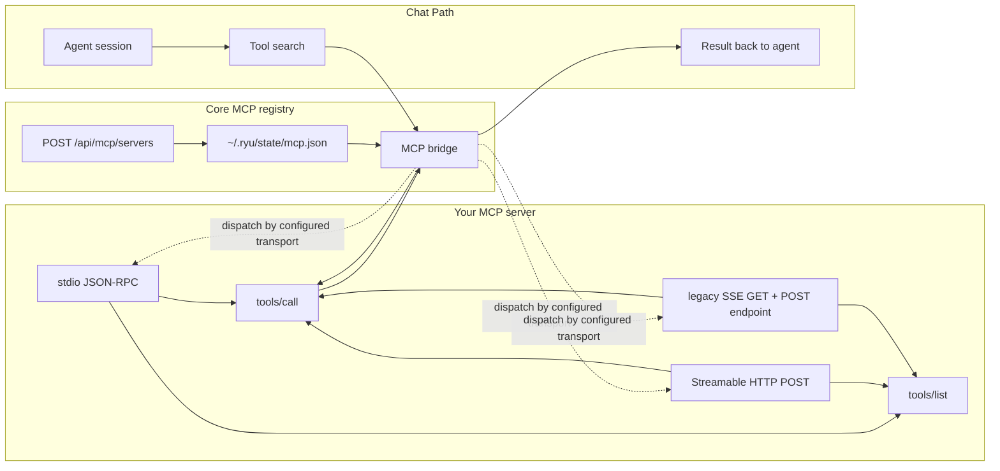

MCP (Model Context Protocol) is an open standard that lets an AI host call tools and read data from
an MCP server. A tool exposed over MCP is callable by any MCP host, including Ryu Core's MCP
registry. Registering an existing MCP server needs no manifest, no SDK, and no Core restart.

Ryu speaks MCP over stdio, current Streamable HTTP, and legacy HTTP+SSE. Stdio uses
newline-delimited JSON-RPC. Streamable HTTP uses a POST endpoint whose response may be JSON or
request-scoped SSE. The legacy transport opens an SSE endpoint first and POSTs messages to the
endpoint it announces. See the
[MCP specification](https://modelcontextprotocol.io) for the full protocol.

This guide uses the **headroom** context-compression engine
([`chopratejas/headroom`](https://github.com/chopratejas/headroom)) as the worked example: it
ships an MCP server, so you register an *existing* server rather than writing one. To build
your own server instead, see [Build your own](#build-your-own).

<Callout type="info">
  This page covers a user- or operator-registered MCP server. If you are shipping MCP with a
  plugin or app, declare it under native `manifest.json` → `mcp_servers` so Core can validate its
  transport, Gateway grant, allowlist, and lifecycle together. See [Extension schemas & folder
  layouts](/docs/extend/develop/extensions/schemas-and-layouts#pluginjson-mcpjson-and-skills-interop)
  for the native-versus-interop boundary; the generated Agent Plugins `mcp.json` projection carries
  stdio, Streamable HTTP, and legacy SSE entries.
</Callout>

## How MCP servers connect to Ryu



When an agent emits a tool call for a registered MCP tool, Core's MCP bridge dispatches it through
the registry, uses the configured transport, and feeds the result back into the chat loop.

## Configure each transport

The shared `mcpServers` shape accepts the same three transport forms in `~/.ryu/state/mcp.json`
(the `state/` folder of the default data directory), in a native manifest, or through the
registration API:

```json
{
  "mcpServers": {
    "local": {
      "type": "stdio",
      "command": "headroom",
      "args": ["mcp", "serve"]
    },
    "hosted": {
      "type": "streamable-http",
      "url": "https://mcp.example.com/mcp",
      "headers": { "Authorization": "Bearer <token>" }
    },
    "legacy": {
      "type": "sse",
      "url": "https://legacy.example.com/sse"
    }
  }
}
```

`http` is accepted as a compatibility alias for Streamable HTTP. If `type` is omitted, Ryu infers
stdio from `command` and Streamable HTTP from `url`. Remote headers are sent on every request;
Core reserves protocol headers, screens remote URLs before connecting, does not follow redirects,
and withholds configured credentials if a legacy SSE server announces a different-origin message
endpoint.

## Step 1 - Install headroom

Headroom's MCP **serve** path needs only the `[mcp]` extra. Install the minimal MCP build instead
of the larger `[all]` extra:

```bash
pipx install --python python3.13 "headroom-ai[mcp]"
# or: pip install "headroom-ai[mcp]"
```

This installs the `headroom` CLI and its MCP server.

## Step 2 - Register with Core

Core exposes `POST /api/mcp/servers` (`apps/core/src/server/mod.rs`). It appends the server to
`~/.ryu/state/mcp.json` and hot-reloads the registry, so the tools become callable without a restart:

```bash
curl -X POST http://localhost:7980/api/mcp/servers \
  -H "Authorization: Bearer $RYU_CORE_TOKEN" \
  -H 'content-type: application/json' \
  -d '{
    "name": "headroom",
    "command": "headroom",
    "args": ["mcp", "serve"],
    "description": "Context compression: compress, retrieve, stats."
  }'
```

`headroom mcp serve` speaks the stdio MCP transport. Core validates the request:

- `name` must be non-empty, must not contain `__` (the reserved legacy tool-id separator), and must
  not match a server that is already registered.
- Exactly one of `command` (stdio) or `url` (remote) must be set.

`headroom` must be on Core's `PATH` (`pipx ensurepath` adds it). Otherwise, set `command` to the
absolute path of the binary in your virtualenv.

Once registered, the tools are listed by `GET /api/mcp/servers` and callable via
`POST /api/mcp/tools/call`. Tool ids are namespaced by server name, for example
`headroom.headroom_compress`.

Preinstalled plugins such as Ghost register their servers a different way: they declare them under
`mcp_servers` in their plugin manifest, and Core adds them to the registry when the plugin
activates (`apps/core/src/sidecar/mcp/mod.rs`). They do not use `~/.ryu/state/mcp.json`.

## Step 3 - Call it from chat

With the server registered, its tools are injected into ACP agent sessions through Core's MCP
bridge (`apps/core/src/sidecar/adapters/mcp_bridge.rs`). When an agent emits a tool call for one
of your tools, Core dispatches it through the registry and feeds the result back into the chat
loop. Plugin-declared servers use the same tool loop.

### headroom tools

Upstream headroom's MCP server exposes these tools. Check the
[headroom repository](https://github.com/chopratejas/headroom) for current parameters.

| Tool | Purpose |
|---|---|
| `headroom_compress` | Compress text and return a handle for reversible retrieval |
| `headroom_retrieve` | Return the original or most relevant content for a query |
| `headroom_stats` | Report cumulative compression metrics |

### Allowlist the tools

In Tools Library, open **Filter & add → Allowlist** to show the tools available to
one agent. The picker opens below the field. Use the arrow keys to navigate, End
to reach the last agent, and Enter to select it. Change the agent's allowed tools
in its settings.

<Callout type="warn">
  An agent can call a registered tool only when the tool is on that agent's **allowlist**. Every
  call routes through `McpRegistry::call_tool`, which enforces the per-agent allowlist
  (`apps/core/src/sidecar/adapters/mcp_bridge.rs`). The discovery meta-tools `tool_search` and
  `describe` are always offered, but a tool they surface still needs an allowlist entry to run.
  Registration alone does not grant access.
</Callout>

### Automatic compression vs. tool calls

Registering headroom as above gives agents compress/retrieve **as tools they choose to call**.
Compressing model calls automatically is a separate, complementary path: an egress
transform in the **Gateway**, switched on by enabling the
[Headroom Compression](/docs/plugins/headroom) plugin. It is off by default and, when enabled,
applies to eligible OpenAI-format requests on the default chat path with no per-agent setup.
It does not cover every ACP runtime, provider-native passthrough, or direct-egress path. See
[Context Compression](/docs/gateway/compression) for the exact coverage. Keep MCP servers focused
on the tool surface and let the Gateway own on-the-wire transforms and policy.

## Protocol behavior

The sections below describe how Core handles MCP protocol features for any registered server.

### MCP 2026-07-28

Core probes modern servers with `server/discover`. On a 2026 connection it sends
`protocolVersion`, `clientCapabilities`, and client identity in every request's
`_meta`. It also mirrors `Mcp-Method` and the applicable `Mcp-Name` into Streamable
HTTP headers. For tool parameters annotated with `x-mcp-header`, Core reads the
latest tool schema and sends encoded `Mcp-Param-*` headers; malformed annotations
are excluded from HTTP tool discovery.

Core validates `resultType`, handles `input_required` responses through its
caller-provided MRTR resolver, and exposes cache hints from `ttlMs` and
`cacheScope`. Task-aware calls opt into `io.modelcontextprotocol/tasks` only when
the remote server advertises that extension. They return a durable task ID and
can resume with `tasks/get`, send input with `tasks/update`, or request
cancellation with `tasks/cancel`.

Legacy SSE connection setup has a 60-second deadline, including response headers
and the initial message-endpoint event. A server that stalls during setup releases
its discovery slot when that deadline expires. Established event streams remain
open for the session, with a separate deadline for each RPC response.

### Request structured information in chat

An MCP tool running in a conversation can request a form through standard
`elicitation/create` or `openai/elicitation/create`, or through a modern `input_required` response
containing an `elicitation` input request. Ryu shows the server's message and schema fields,
then returns the user's `accept`, `decline`, or `cancel` decision to the waiting
tool. Accept includes structured `content`; declining or cancelling does not.
Forms expire after five minutes, and answers are scoped to the conversation that
owns the tool call. Conversation-scoped tool forwards allow six minutes for a
human answer and transport overhead; detached calls keep their ordinary timeout.

Use an object `requestedSchema` with up to 32 string, boolean, number, integer,
or string-array properties. Required fields, numeric bounds, string length bounds,
patterns, enums, and titled choices are supported. `x-openai-suggestions` supplies
suggestions while preserving custom text; arrays support multiple selections.
Choices can include descriptions and `x-openai-thumbnail` icons with HTTPS or
base64 PNG, JPEG, WebP, or GIF images. Remote thumbnails omit credentials and
referrers. `x-openai-input` resource fields support explicit selection from supplied
resources and submit their URI strings. User uploads and implicit resource selection
are not supported. Keep passwords and authentication tokens in your OAuth flow.
Unsupported schemas fail explicitly instead of being flattened into free text.

```json
{
  "message": "Choose the report layout.",
  "requestedSchema": {
    "type": "object",
    "properties": {
      "layout": {
        "type": "string",
        "oneOf": [
          { "const": "compact", "title": "Compact", "x-openai-thumbnail": { "src": "https://example.com/compact.png" } },
          { "const": "expanded", "title": "Expanded" }
        ]
      }
    },
    "required": ["layout"]
  }
}
```

Background calls without an interactive conversation do not advertise form
support. Form responses resume the pending call; they do not create an extra
user message or grant permission for unrelated tools.

### Open an MCP App from the sidebar

An approved, enabled MCP App with a global entrypoint opens beside a conversation
and composer. Choose an agent for the app; Ryu creates an empty conversation with
that agent and the current user's ownership before invoking the entrypoint. The
conversation is available while the app loads, so an opening tool can request a
form without waiting for the app to finish rendering. Opening an app from an
existing conversation preserves that conversation.

The host reuses an activation UUID when recovering a dropped response. Identical
retries recover the pending conversation or completed app without invoking the
opening tool again. Recovery lasts for 30 minutes while the same Core process
remains running; it does not guarantee provider-side exactly-once execution after
a Core restart. Conflicting retries are rejected. Settings action tools that do
not declare a static entrypoint can open their UI without creating a conversation.

## Build your own

To author a new MCP server rather than register an existing one, use the SDK's `McpServer`
(`packages/sdk/src/mcp/server.ts`). Register `SdkRunnable` objects (a `name` plus a `run`
function); the SDK handles MCP `2026-07-28` per-request metadata, `server/discover`, `tools/list`,
`tools/call`, result envelopes, and the legacy initialize flow for older hosts. Register the
resulting stdio command with Core exactly as in Step 2. See the
[TypeScript SDK guide](/docs/extend/develop/extensions/typescript-sdk) for the full surface.
