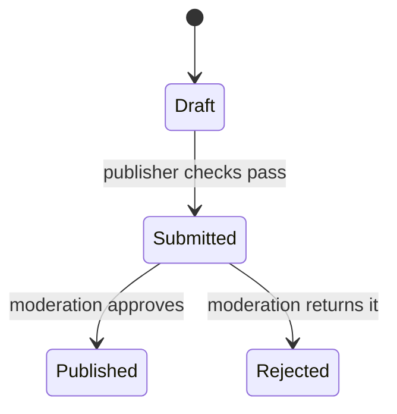
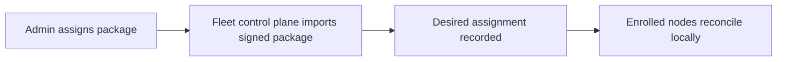
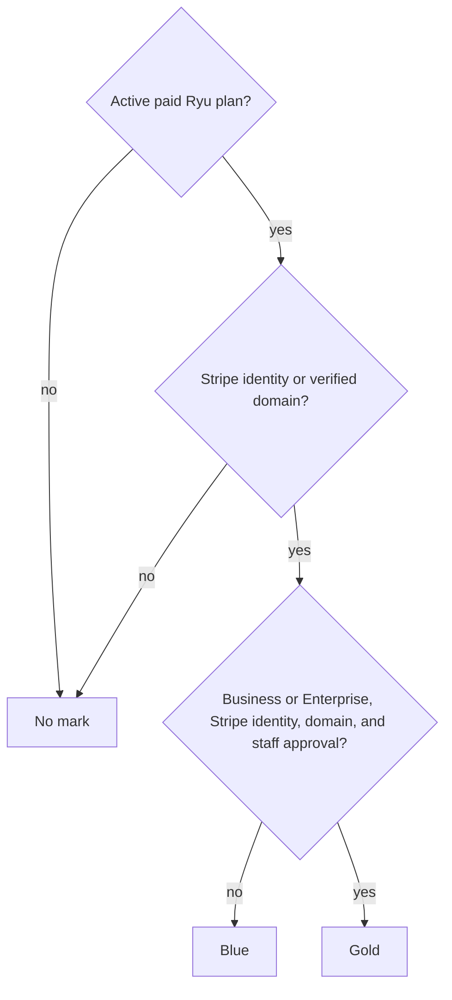
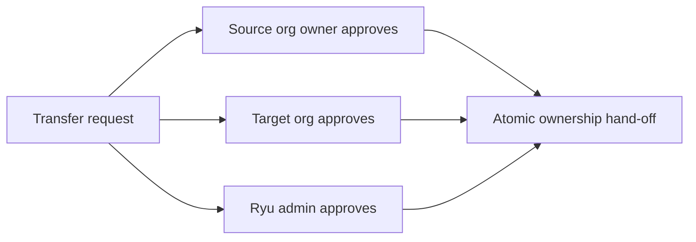

An organization owns its Marketplace listings, collections, payout account, and trust marks. For the
GitHub release and signing flow, see [Publish to the Marketplace](/docs/extend/develop/extensions/marketplace).

## Organization ownership and publishing states

Marketplace listings belong to an **organization**, not to the user who submitted them. This
applies to free and paid listings.

- The publishing user is kept as the actor for audit and attribution.
- The organization controls the listing, pricing, Connect payout account, republish rights, and
  transfer decisions.

The listing lifecycle is presented as:

| User-facing state | Meaning |
| --- | --- |
| **Draft** | The organization is preparing a listing and it is not submitted for review. |
| **Submitted** | The listing has passed the publisher-side checks and is awaiting moderation. |
| **Published** | Moderation approved the listing and it is live in the catalog. |
| **Rejected** | Moderation returned the listing for changes. |
| **Unlisted** | The listing is not discoverable but its ownership and history remain intact. |

The storage layer keeps its existing compatibility states (`draft`, `pending`, `live`, `rejected`,
and `unlisted`). Organization verification and listing moderation remain separate decisions.

## Public and organization-private marketplaces

Any authenticated organization publisher with the `marketplace.publish` permission can create a
Marketplace collection and submit packages. Identity verification is not required to submit, and
free packages do not need Stripe Connect payouts.

| Collection | Who sees it | Before install |
| --- | --- | --- |
| Public | Discoverable on Ryu | Each package passes its Grade A preflight and Ryu moderation |
| Organization-private | Members of the owning organization only | The same Grade A preflight and Ryu moderation; approval does not change the organization-only visibility |

Use a private collection for internal plugins, MCP servers, and skills that the organization
needs without listing them in the public catalog. The package stays tied to the publishing
organization; assigning it to nodes does not make it public.

### Assign a private package to nodes

From the organization Marketplace surface, an administrator can assign a private package at
organization scope. Ryu imports the signed package into the Fleet control plane and records the
organization's desired assignment. Enrolled nodes then reconcile that assignment locally.

The same package installs across different nodes without copying credentials or giving each node
a separate Marketplace source.

<Callout type="info">
Marketplace visibility and node install authorization are separate checks. Being able to browse a
collection does not grant access to an organization's nodes.
</Callout>

## Publisher trust marks

Publisher identity is a separate signal from code review and release-signature verification. The
catalog uses one shared check mark and these meanings:

| Mark | Meaning |
| --- | --- |
| **Gold** | A Business or Enterprise organization that verified its identity with Stripe Connect, verified a domain, and was approved by Ryu staff. |
| **Blue** | An organization with an active paid Ryu plan (for example Plus, Pro, Max, or Teams) that verified its identity with Stripe Connect **or** a domain. Automatic; not a Ryu review of the publisher. |
| **No mark** | Everyone else. Publishing is still allowed, but the listing is treated as community-published. |

Only paid organizations that have proved who they are get a check. Payment alone is not enough, so
an organization cannot buy a check under someone else's name.

### Keeping the gold mark

Gold needs every part at once. If an approved organization leaves Business, or its Stripe identity
or last verified domain lapses, its listings fall back to blue (or no mark) until it is restored.

Staff approval covers the organization name, URL slug, and logo that were reviewed. Changing any of
them removes the gold mark until staff approve a new verification request; submit one from
**Verification** after the change. Ryu staff can also revoke an approval, for example when the
organization's ownership can no longer be confirmed.

### Verify a domain

1. Open **Verification** from the organization switcher and add the domain.
2. Publish the TXT record it shows (`_ryu-verification.<your-domain>`) at your DNS provider.
3. Select **Check DNS**.

Keep the record published. Ryu re-checks it daily and removes the domain after three consecutive
days without it.

A domain belongs to one organization at a time. Verifying it moves it off any organization that
held it before, so use a subdomain (for example `eng.example.com`) for a second organization.
Domains verified through Enterprise SSO count too. Stripe identity comes from the organization's
Stripe Connect account under **Marketplace & payouts**.

### What buyers see

Select a publisher mark to open its verification details. When a date is available, the popover
shows when the primary mark was established and the public methods behind it: **Ryu review**,
**Business plan**, **Paid Ryu plan**, **Stripe identity**, **Verified email**, or **Verified
domain**.

Email and domain checks are supporting identity signals. They do not turn an unreviewed listing
into code-reviewed software.

When a buyer installs a listing with no publisher mark, Ryu shows a two-step community disclosure
with the publisher health score and its observable signals. The buyer must acknowledge the risk
before the install begins.

<Callout type="warn">
The health score is a review aid, not a security guarantee. Install-time signature and permission
checks still apply.
</Callout>

Public user profiles use the same disclosure pattern. A plain shield-check means the profile has a
publicly shareable verification signal. Its popover lists methods such as a verified email or a
verified organization domain without revealing the email address or domain value.

### Following publishers

Visitors can follow a public publisher organization from its Marketplace listings or the publisher
directory. Buyers can then use the **Following** filter across Marketplace catalog tabs to see
public listings from those organizations.

Following is personal account state. It does not grant access to private collections, nodes,
package artifacts, or organization controls.

## Organization Marketplace settings and transfers

### Settings and payouts

Open **Organization Settings → Marketplace & payouts** to configure the organization's Stripe
Connect seller account. On the web, the same page lists the licenses the organization owns. Its
payout button opens Stripe's onboarding, payouts, payments, and account views inside Ryu. See
[Publishers & payouts](/docs/surfaces/desktop/user-guide/marketplace-publishing#sell-your-own-items).

The Marketplace page remains the place to browse and manage listings. Its organization switcher
selects which organization owns the listing you are editing. A personal seller settings link
redirects to the organization-scoped Marketplace settings tab.

### Transfer a listing

Transferring a listing requires three approvals. The listing changes ownership only after all
three decisions are recorded.

1. The source organization owner.
2. A target organization owner or admin, or a member whose custom role grants
   `marketplace.transfer`.
3. A Ryu admin.

- Rejected, cancelled, or expired requests remain in the audit history and cannot be reused.
- Approvals submitted at the same time are combined in the request's current state.
- Retrying an already recorded decision does not duplicate its approval or approval notification.
- If the request expires while a decision is being submitted, that decision cannot reopen it.

Existing versions, licenses, purchases, and moderation history remain attached to the listing. A
public collection listing is detached from the old collection during the hand-off, so the new owner
does not inherit the old organization's publishing scope.

<Callout type="warn">
An organization-private listing cannot be transferred by itself because its collection is an
access boundary. Transfer the collection boundary as a separate operation first.
</Callout>

### Transfer notifications

Each request, approval or rejection, completion, cancellation, and expiry produces a transactional
organization activity notification. The server sends it to the owner/admin roster of both
organizations and writes a row to each recipient's Ryu inbox. The organization activity email
switch controls email delivery only; it does not remove the server-side inbox record.
