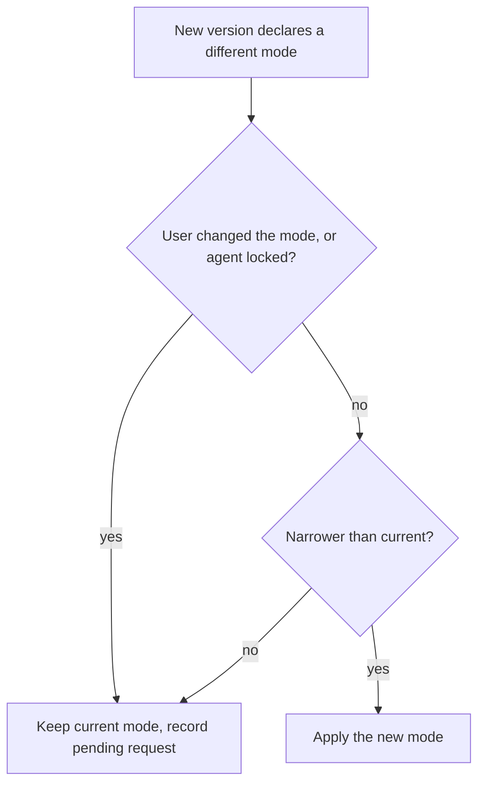
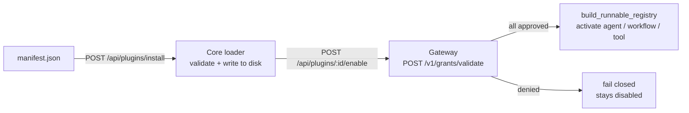

A Ryu **Plugin** is a bundle of one or more [Runnables](/docs/start-here/architecture/runnable-model)
plus the permission grants they need, described by a single declarative `manifest.json`. The steps
below assemble that file and install it to Core.

The full field-by-field schema (all eight Runnable kinds, per-kind `config`, `contributes`,
`activation_events`, `engines.ryu`) lives in the
[plugin-api reference](/docs/extend/develop/sdk/plugin-api) and the
[Runnable model](/docs/start-here/architecture/runnable-model).

For the relationship between the native manifest, generated Agent Plugins files, `skills/`,
portable `ryu.package.json`, and app/plugin folder layouts, see
[Extension schemas & folder layouts](/docs/extend/develop/extensions/schemas-and-layouts).

## 1. Write the manifest skeleton

Create a `manifest.json` with the three required top-level fields plus an empty `runnables` array.
The `id` is a scoped id such as `@example/research-assistant` (bare kebab-case and legacy dotted
ids such as `com.example.my_app` are also accepted), `version` must be valid semver, and `name` is
the display label shown in the Store.

```json
{
  "id": "@example/research-assistant",
  "name": "Research Assistant",
  "version": "1.0.0",
  "runnables": [],
  "permission_grants": []
}
```

The loader (`apps/core/src/plugin_manifest/mod.rs`) rejects a manifest whose `version` is not valid
semver. The canonical file name is `manifest.json`; the legacy `ryu.json` is still read for plugins
installed before the apps-to-plugins rename.

`bunx ryu pack` and `bunx ryu publish` preserve the complete Core manifest while validating it. Top-level
`permission_levels`, `sidecars`, `stability`, and `surfaces` declarations remain in the signed
package rather than being reduced to the SDK's convenience vocabulary. Forward-compatible
top-level fields are preserved for Core, which remains the authoritative manifest validator.

`surfaces` answers **where the package is supported**; `provides` and `contributes` answer **what it
extends**. See [Plugins vs Apps](/docs/extend/develop/extensions/plugins-vs-apps#describe-an-extension-on-three-axes) for the full three-axis model.

## 1a. Add Store presentation metadata

The native manifest also owns the user-facing fields the Marketplace and Library show, such as
`tagline`, `icon`, `screenshots`, and `examplePrompts`, plus `deprecated` and `allowRemix`. See
[Add Store Listing Metadata](/docs/extend/develop/extensions/store-listing-metadata).

## 2. Add your Runnables

Each entry in `runnables` carries an `id`, a `name`, a `kind`, and an optional per-kind `config`.
The example below is taken from the built-in `sample.manifest.json` fixture.

<Callout type="warn">
  The TypeScript SDK's `RunnableKindSchema` (`packages/sdk/src/manifest.ts`) types six of Core's
  eight kinds (`agent`, `workflow`, `tool`, `skill`, `companion`, and `policy`). It does not type
  `channel` or `engine`. To author those kinds, write the `manifest.json` directly.
</Callout>

```json
{
  "id": "@example/research-assistant",
  "name": "Research Assistant",
  "version": "1.0.0",
  "runnables": [
    {
      "id": "agent-researcher",
      "name": "Researcher",
      "kind": "agent",
      "config": {
        "system_prompt": "You are a research assistant.",
        "model": "gemma4",
        "tools": ["web_search"]
      }
    },
    {
      "id": "tool-web-search",
      "name": "Web Search",
      "kind": "tool",
      "config": { "slug": "web_search" }
    }
  ],
  "permission_grants": ["mcp:web_search"]
}
```

The agent `model` field routes through the Gateway registry and is never hardcoded; an agent's
`tools` are a subset of the plugin's `permission_grants`. A `tool` entry wraps a single MCP tool
slug.

An agent's `config` can also set `identity_mode` to choose how Ryu creates the agent:

| `identity_mode` | In the app | Meaning |
|---|---|---|
| `managed` (default when omitted) | Acts as you | Works on your behalf with the accounts you've connected. |
| `individual` | Its own identity | Gets its own accounts and logins, and never touches yours. |
| `mixed` | Both | Has its own accounts, and can also use the ones of yours you allow. |

Manifests without the field keep working and their agents act as you. Any other value makes Ryu
refuse the manifest rather than fall back to `managed`.

The mode applies when Ryu first creates the agent. Restarting Ryu keeps an existing agent,
including any mode the user picked in its settings. Disabling the plugin removes its agents, so
enabling it again recreates them with the manifest's `identity_mode` and no account limit.

#### Changing `identity_mode` in a new version

When a new version of your app (an update or a rollback) declares a different `identity_mode` for
an agent that already exists, Ryu keeps the agent and the user's settings on it and reconciles the
mode.
It orders the modes by how much of the user's accounts they reach: `managed` reaches the most, then
`mixed`, then `individual`, which never reaches the user's accounts.

- **Narrower:** Ryu applies a narrower mode automatically, but only if the user never changed the
  mode themselves and the agent isn't locked. Ryu records the mode your app last set on each
  agent; an agent whose mode differs from it counts as the user's choice.
- **Wider, or the user chose their own mode:** Ryu never applies a wider mode on its own. It keeps
  the current mode and records yours as a pending request. The same happens to any new mode when
  the user changed the mode themselves or the agent is locked.



`GET /api/agents/:id` returns a pending request as `app_identity.pending_mode`. The user accepts
it by saving the agent with that mode, or dismisses it and keeps their mode
(`"dismiss_pending_identity_mode": true`).

| Surface | Shows the request | Resolves it |
|---|---|---|
| CLI | `ryu-cli agents show` | `ryu-cli agents identity <id> dismiss` |
| Desktop | The agent editor's identity section | **Accept** or **Keep current** |
| Mobile | Not yet | Not yet |

Store updates, bundle updates, and rollbacks list each narrowed or pending agent under
`agent_identity` in their response; an update your organization's fleet applies only logs them.
An app update never changes a user's account limit. See
[app manifest lifecycle](/docs/core/app-manifest-lifecycle) for what each update path does to the
app's other agent fields.

A manifest cannot choose which of the user's accounts the agent may use. Ryu refuses an agent
`config` that contains `account_access`, and the agent starts with no account limit within its
mode until the user sets one. For the exact `config` shape of every kind, see the
[plugin-api reference](/docs/extend/develop/sdk/plugin-api).

### Sandboxed JavaScript tools

A `tool` whose config sets `"backend": "inline_js"` ships its own JavaScript body in `code` instead
of wrapping an existing tool. Core runs that body in its deny-by-default JavaScript sandbox, and the
plugin must grant `tool:execute`. The TypeScript SDK emits this shape for you; to author and verify
a body by hand, see [Testing plugin tools](/docs/extend/develop/extensions/testing-plugin-tools).

<Callout type="info">
  **Renamed from `inline_deno`.** Current Core still loads the old backend name, runs it exactly
  like `inline_js`, and logs a deprecation warning, so rename it the next time you publish.

  Core releases from before the rename reject `inline_js`. If your plugin must still install on
  them, keep the old name until you raise its `engines.ryu` floor to a release that accepts
  `inline_js`.
</Callout>

### Workspace-scoped command paths

A command-backed tool that reads caller-selected files must mark those argument names with
`workspace_path_args`, for example:

```json
{
  "slug": "search",
  "backend": "command",
  "bin": "rg",
  "command_args": ["--", "{pattern}", "{path}"],
  "workspace_path_args": ["path"]
}
```

Core resolves each marked value against the active conversation workspace immediately before
spawning the allowlisted binary. It refuses missing paths, traversal that escapes the workspace,
symlink components, and protected host data such as Ryu's node directory or agent credential
directories. A command tool must not use an unrestricted absolute path as a substitute for this
declaration.

### Command tool version requirements

A command-backed tool can require a specific release of its allowlisted binary with the
`bin_version` field:

```json
{
  "slug": "spider.crawl",
  "backend": "command",
  "bin": "spider",
  "command_args": ["crawl", "--", "{url}"],
  "egress_url_arg": "url",
  "bin_version": {
    "args": ["--version"],
    "pattern": "spider_cli {version}",
    "requirement": "=2.53.9",
    "install_hint": "cargo install spider_cli --version 2.53.9 --locked"
  }
}
```

| Field | Required | Meaning |
|---|---|---|
| `args` | no | Fixed probe arguments (default `["--version"]`). Placeholders are not allowed. |
| `pattern` | yes | Literal text with exactly one `{version}` placeholder. The text around it must appear on one line of the probe output (stdout, then stderr), and the placeholder must hold a SemVer version. |
| `requirement` | yes | A SemVer requirement in the same syntax as `engines.ryu`, such as `"=2.53.9"` or `">=2.53.9, <3.0.0"`. |
| `install_hint` | no | One line, up to 200 characters, shown in the error when the check fails. |

Before each call, Core runs the probe against the resolved binary with the same cleared
environment and a short timeout. It refuses the call when the output has no matching line, the
version does not parse, or it falls outside `requirement`. The error names the installed version,
the required range, and the `install_hint`.

Core caches the probe result by the binary's path, size, and modification time, so replacing the
binary triggers a new probe on the next call.

A tool that declares `egress_url_arg` must also declare `bin_version`, or the manifest is rejected.
Core's per-call egress proxy only screens traffic from a binary that honours the standard proxy
variables, so the release verified to do that has to be named.

<Callout type="info">
  All eight Runnable kinds have an activation handler. Agents, workflows, tools, skills, engines,
  channels, and companions register into their Core contribution/store surface. Core validates a
  `policy` entry and coordinates it through the policy pass; the Gateway enforces policy.

  Enable reports per-Runnable errors, so a bad entry is visible without aborting unrelated entries.
</Callout>

## 3. Declare permission grants

`permission_grants` are strings the plugin declares it needs, for example `mcp:web_search`. They
are declarations only; the Gateway enforces them.

On enable, Core calls the Gateway's `POST /v1/grants/validate` for each declared grant
(`validate_grants_via_gateway`, `apps/core/src/plugins/lifecycle.rs`) and fails closed if any grant
is denied. Core decides what runs; the Gateway decides what is allowed. See
[governance](/docs/gateway/governance) for the grant model.

### Required and optional host permissions

Host access needed for ordinary enable belongs in `permission_grants`. Extra access that a user
may approve later belongs in `optional_permission_grants`, for example:

```json
{
  "permission_grants": ["usage:read"],
  "optional_permission_grants": ["usage:audit"]
}
```

- Optional grants start off. Install, enable, and upgrade never approve them.
- After enabling the app, an administrator can request them in its Permissions section. The
  Gateway still decides whether the node's policy permits them.
- Rejected or unavailable optional access does not block ordinary enable.
- Removing either declaration revokes that capability from runtime calls, even if an older
  approval remains in stored state.

## 4. (Optional) Add contribution points and an engine pin

These VS Code-style blocks tune how the plugin loads. All of them are optional.

`contributes` holds two kinds of entries:

- Declare-by-id fields for runnable-backed surfaces such as commands, tools, agents, workflows,
  and policies. Every id must exist in `runnables`, or the loader rejects the manifest, so a typo
  is caught at load.
- Typed host catalogs such as `computer_use_planners`, where the owning plugin supplies model
  metadata and Core stamps the plugin id. See
  [Bundle Hugging Face Models in a Plugin](/docs/extend/develop/extensions/local-model-plugins)
  for the model adapter contract.

The OS wallpaper picker also accepts data-only `contributes.backgrounds` variants; see
[Wallpaper backgrounds](/docs/extend/develop/extensions/background-contributions).

`engines.ryu` is a semver requirement string (e.g. `">=0.3.0"`). The loader rejects the manifest
if the running Core version does not satisfy it, mirroring `engines.vscode`.

`engines.host_api` (optional) is a semver requirement on the plugin **host API** version, which is
separate from the Ryu release version. It advances by a minor each time host methods, grants, or
hook context fields are added, and by a major only for a breaking change.

Declare the minor that introduced the newest `host.*` method your plugin calls (for example
`"^1.17"`). When it is not satisfied, Ryu shows the plugin as incompatible and refuses to install
or enable it, naming the required and served versions. An unparseable value rejects the manifest.

```json
{
  "contributes": {
    "tools": [{ "id": "tool-web-search", "title": "Search the web" }]
  },
  "activation_events": ["onStartup"],
  "engines": { "ryu": ">=0.0.1", "host_api": "^1.17" }
}
```

`activation_events` lazily wake the plugin. An empty list (the default) means eager activation, so
existing manifests keep activating on enable. The recognised tokens are:

| Token | Fires |
|---|---|
| `"*"` | Eager; the plugin is always active |
| `"onStartup"` | At Core boot (`fire_activation_event`, called from `main.rs`) |
| `"onChat"` | The first time Core handles a chat turn in the process |
| `"onCommand:<id>"` | When the Desktop command palette runs the command (`POST /api/plugins/activation-event`) |
| `"onRoute"` | The first time an inbound proxy hit wakes a lazy sidecar |
| `"onCapabilityCall"` | When a capability-broker hit wakes a lazy provider sidecar |

## 4a. (Optional) Hide tools with `tool_filters`

A plugin can withdraw tools from the model's view without touching the tool itself. The
`contributes.tool_filters` array is a list of `{ "tool": ..., "reason"?: ... }` entries. When an
enabled plugin declares one, the matched tool is removed from the list offered to the model, so the
model never spends a round-trip discovering it is unavailable.

```json
{
  "contributes": {
    "tool_filters": [
      { "tool": "shell.exec", "reason": "Shell execution is disabled while this policy is on" },
      { "tool": "shadow.*", "reason": "Removes the entire shadow server namespace" }
    ]
  }
}
```

Pattern rules:

- The `tool` id is fully qualified as `<server>.<tool>` (for example `browser.navigate`). A bare
  `navigate` is ambiguous across servers and is rejected at import.
- A trailing `*` is the only allowed wildcard and hides every tool with that prefix (`shadow.*`
  hides a whole server). An interior or leading `*` is rejected because it would match far more
  tool ids than intended.
- An exact pattern (no `*`) matches exactly one tool id; it is not a prefix.
- `reason` is optional and appears in the plugin's listing, so a user can see what a plugin
  removes before installing it.

## 4b. (Optional) File viewers, editors, and custom settings

A plugin can contribute `fileHandlers` that open its companion from the workspace Files panel, and
`settings_tabs` that render a custom settings companion. See
[Add a File Viewer or Custom Settings](/docs/extend/develop/extensions/file-handlers).

## Declare a managed sidecar

A manifest can declare `sidecars[]`, the long-running child processes Core downloads or provisions,
spawns, and health-checks. See [Declare a Managed Sidecar](/docs/extend/develop/extensions/managed-sidecar)
for the fields, the filesystem sandbox block, and the data folders Core gives each sidecar.

## 5. Install and enable

Host the `manifest.json` at a URL, then install it by URL and enable it.

```bash
# Install: Core fetches the manifest, validates the schema, writes it under
# the data folder's plugins/ directory, and hot-reloads (no restart needed).
curl -X POST http://localhost:7980/api/plugins/install \
  -H "Authorization: Bearer $RYU_CORE_TOKEN" \
  -H 'content-type: application/json' \
  -d '{"url": "https://example.com/research-assistant/manifest.json"}'

# Enable: validate grants via the Gateway, then activate the Runnables.
curl -X POST http://localhost:7980/api/plugins/@example/research-assistant/enable \
  -H "Authorization: Bearer $RYU_CORE_TOKEN"
```

`RYU_CORE_TOKEN` is the node's bearer token. To side-load a local project instead of hosting it,
run `bunx ryu pack .` and `bunx ryu install . --enable`, which posts the packed bundle to
`POST /api/plugins/install-bundle` with the local node's token.

After install the plugin appears in `GET /api/plugins` immediately. The lifecycle routes are
`POST /api/plugins/:id/{enable,disable,update}` (`apps/core/src/server/mod.rs`, backed by
`apps/core/src/plugins/lifecycle.rs`). Enable fails closed if any declared grant is denied by the
Gateway. The `/api/apps*` aliases still resolve to the same handlers but are deprecated.

<TryInRyu page="store" />

## What runs where



## Related

<Cards>
  <DocCard href="/docs/extend/develop/sdk/plugin-api" />
  <DocCard href="/docs/extend/develop/extensions/managed-sidecar" />
  <DocCard href="/docs/extend/develop/extensions/hooks-lifecycle" />
  <DocCard href="/docs/extend/develop/extensions/mcp-server" />
  <DocCard href="/docs/extend/develop/extensions/typescript-sdk" />
  <DocCard href="/docs/extend/develop/extensions/marketplace" />
  <DocCard href="/docs/core/app-manifest-lifecycle" />
</Cards>
