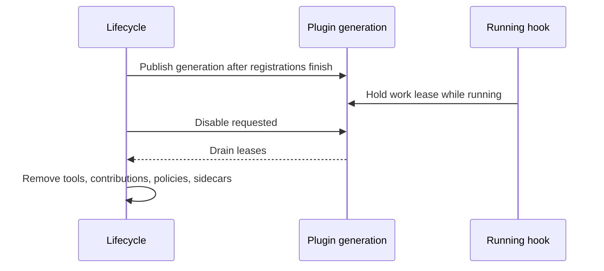

This page is the lifecycle half of [Plugin Runtime (Turn Hooks)](/docs/extend/develop/extensions/plugin-runtime).

## Plugin lifecycle

The runtime reads from the live, hot-updated manifest set, so enable and disable take effect on the
next turn with no restart. The lifecycle routes are defined in `apps/core/src/server/mod.rs` and
backed by `apps/core/src/plugins/lifecycle.rs`.

| Method + path | Purpose |
|---|---|
| `GET /api/plugins` | List installed plugins and their enabled state. |
| `GET /api/plugins/contributions` | Serve enabled declarative contributions, including desktop themes and data-only wallpaper backgrounds, for host renderers. |
| `POST /api/plugins/install` | Install by URL. Core fetches the manifest, validates it, writes it under the data folder's `plugins/` directory, and hot-reloads. |
| `POST /api/plugins/:id/install` | Install a known catalog plugin by id. |
| `POST /api/plugins/:id/enable` | Validate grants via the Gateway, then activate the plugin's contributions. |
| `POST /api/plugins/:id/disable` | Deactivate the plugin; its hooks stop firing on the next turn. |
| `POST /api/plugins/:id/update` | Update an installed plugin to a newer manifest. |

### Install and discovery

A discovered local package can be listed before it has an installed lifecycle record.
Installing that package records its validated manifest so it can be enabled; discovery
alone is not treated as a duplicate installation. An already installed package still
reports an installation conflict.

### Grants and enabled state

Hook host capabilities use the intersection of declared permissions and approved grants. Core
checks the current approval again when each hook starts, so revoking a grant applies to newly
invoked hooks without disabling the plugin. A missing or unreadable approval record prevents the
hook from running.

A `post_assistant_turn` hook fires only while its plugin is **enabled**. `collect_enabled_hooks`
(`plugin_host/mod.rs`) filters the manifest set by enabled state on every assistant turn, so a
toggle in the store is immediate.

Running hooks requires the Core sandbox runtime. When it is unavailable, the runtime no-ops and
logs, the same graceful-degrade posture as the rest of the sandbox.

### Generation-aware deactivation

Runtime deactivation is generation-aware:

- A callback from an older generation cannot republish stale runtime state.
- New work after re-enable uses a new generation.
- Mandatory Core plugins, and plugins a Core subsystem depends on, remain protected by the
  lifecycle guards.

## Declarative contributions

Declarative contributions are the complementary half of hooks: logic is sandboxed code, UI is
declarative, mirroring the VS Code split. Core stores `composer_controls`, `settings_tabs`,
`slash_commands`, `agent_edit_panels`, `themes`, and `backgrounds`, serves them at
`GET /api/plugins/contributions`, and the renderer interprets them.

- Background variants reference host-owned renderers and carry bounded parameters plus source
  attribution. They never carry executable rendering code.
- An `agent_edit_panels` entry mounts a supported native panel in the agent editor and is tagged
  with its owning plugin id. Disabling that plugin removes both its panel and its hooks.

### Settings tab fields

- Each field's `label` is the accessible name of its input, switch, picker, or select.
- A `model_picker` keeps provider and model choices available at every chat interface density,
  because it configures a plugin setting, not the chat bar.
- Preference-backed controls save to their declared `pref_key`. If a write fails, switches,
  selects, pickers, and number fields return to the last saved value, while text fields keep
  their draft for retry.
- A `secret` field is write-only and displays only whether a value is set.

## Related

<Cards>
  <DocCard href="/docs/extend/develop/extensions/plugin-runtime" />
  <DocCard href="/docs/extend/develop/extensions/contribution-surfaces" />
  <DocCard href="/docs/extend/develop/extensions/plugin-json-manifest" />
</Cards>
