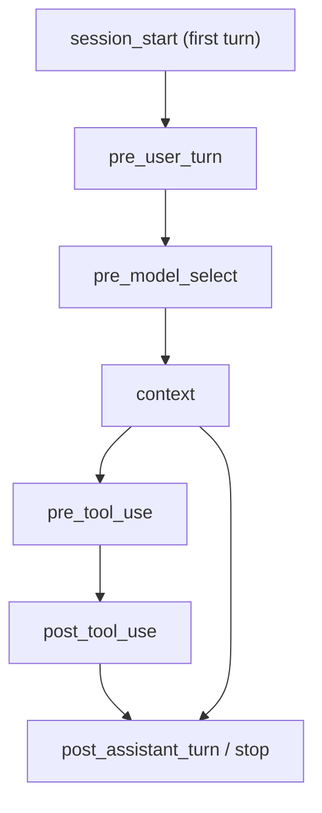

Read [Plugin Runtime (Turn Hooks)](/docs/extend/develop/extensions/plugin-runtime) first for the
`ctx` fields, `host` calls, and the base directive contract.

## Beyond the turn boundary: the Claude-parity phases

`post_assistant_turn` is one of several **phases** a hook can declare (via the `on` field of a
`contributes.turn_hooks` entry). The additional phase constants live in `plugin_host/mod.rs`, each
mapping to a Claude Code hook event. A plugin authored against Claude's naming can use `stop`, which
`phase_matches` normalises to `post_assistant_turn`.

This page covers the Claude-parity set. Other phases, such as `tool_result` and the message,
session, and workflow seams, are listed in [Hooks & Lifecycle](/docs/extend/develop/extensions/hooks-lifecycle).

| Phase constant | `on` value | Fires | Directives applied |
|---|---|---|---|
| `ON_PRE_USER_TURN` | `pre_user_turn` | Before the user message reaches the model | `Replace`, `Inject` |
| `ON_PRE_MODEL_SELECT` | `pre_model_select` | Before the turn's model session or request is created | `SelectModel` |
| `ON_SESSION_START` | `session_start` | On the first turn of a conversation | `Inject`, `Note` |
| `ON_CONTEXT` | `context` | After Core assembles the complete outbound context, immediately before model dispatch | `Rewrite` for message arrays, `Replace` for ACP prompts |
| `ON_PRE_TOOL_USE` | `pre_tool_use` | Before a tool call executes | `Deny` (blocks the call) |
| `ON_POST_TOOL_USE` | `post_tool_use` | After a tool call returns | none (observation only, v1) |
| `ON_SUBAGENT_STOP` | `subagent_stop` | When a delegated sub-agent finishes | none (observation only) |
| `ON_SESSION_END` | `session_end` | When a conversation is deleted | none (observation only) |
| `ON_NOTIFICATION` | `notification` | When a notification is fanned out | none (observation only) |

The `pre_*` phases add directives to the small set from
[the directive contract](/docs/extend/develop/extensions/plugin-runtime#the-directive-contract):

| Directive | Effect |
|---|---|
| `{ kind: "replace", text }` | Swap the pending outgoing user message for `text` before it reaches the model. The rewritten text is what gets sent and persisted (a `pre_user_turn` directive - the auto-expand plugin uses this). |
| `{ kind: "inject", text }` | Append `text` as additional context to the outgoing message (additive, not a replacement). Emitted by `session_start` (setup context) and `pre_user_turn` (per-message context), mirroring Claude Code's `SessionStart` / `UserPromptSubmit`. |
| `{ kind: "select_model", model, effort?, acp_config?, reason? }` | Choose the model, reasoning effort, or ACP session options for this turn only (a `pre_model_select` directive). The first non-empty selection wins, and the agent's saved model is never changed. |
| `{ kind: "deny", reason }` | Block a pending tool call (a `pre_tool_use` directive). `reason` is returned to the model as the tool's error result, so it can adapt instead of treating the call as done - a plugin-authored tool firewall. |
| `{ kind: "rewrite", messages }` | Return the OpenAI-compatible message array with changes to the newest user message (or later rows) only, during `context`. The system prompt and earlier turns must stay byte-identical so prompt caching keeps working; a rewrite that edits them is ignored. Preserve multimodal and tool parts you do not intend to change. |
| `{ kind: "replace", text }` | Append to the flattened ACP prompt during `context`. `text` must start with `ctx.input` unchanged. A replacement that edits the existing prompt is ignored. The appended text also reaches a warm pooled session with the latest turn. |

During `pre_model_select`, `ctx.event.model` is the requested model and `ctx.event.background` marks
background turns. When the turn runs the Ryu agent straight against a subscription provider, the
event also carries **predictions** of what the turn will spend:

| Field | What it predicts |
|---|---|
| `ctx.event.provider_id` | The subscription provider the turn will use, such as `claude-pro-max`. |
| `ctx.event.account_id` | The saved account this conversation is expected to use, when Ryu already knows it. Never an account name. |
| `ctx.event.pool_strategy` | How the provider's account pool picks an account (`manual`, `round_robin`, `quota_first`, `fill_first`, or `reset_first`). |

Each field is omitted when Ryu cannot predict it:

- Other agents and Gateway-routed turns carry none of them.
- `account_id` is missing until the conversation has used an account, and for providers whose
  account is chosen by the provider connection itself, such as ChatGPT.

They are predictions, not pins. The pool can still pick another account when the turn starts, and a
hook cannot choose the account. Making the prediction never delays the turn.

During `context`, `ctx.project_instructions` contains the exact legacy root instruction block, and
`ctx.project_rules` contains normalized Cursor, Claude, and `AGENTS.md` rule records for the active
workspace. Core discovers the files; the plugin decides which records apply and whether to inject
them.

### The process-global dispatcher

The on-chat-path phases (`session_start`, `stop`) fire inside `run_chat_with_hooks`, where the
`ServerState` is already in scope. The off-path phases fire at sites that have no server state:

- the shared tool-dispatch core (`pre_tool_use` / `post_tool_use`);
- the delegation engine (`subagent_stop`);
- the notification fan-out (`notification`).

Those reach the runtime through a **process-global dispatcher**, `dispatch_global(phase, ctx)` over
the `HookDispatch` trait, installed once at boot via `set_global` (`plugin_host/mod.rs`). It returns
an empty vec when no dispatcher is installed, so callers stay fail-open.

Every off-path dispatch first runs a DB-free gate (`any_manifest_declares`). If no loaded manifest
declares the phase, it returns at once, so a tool call adds no hot-path cost unless a tool-hook
plugin is loaded.

### The `tools` glob gate

A `pre_tool_use` / `post_tool_use` hook usually cares about only some tools. The manifest `match`
block's `tools` list is a gate evaluated in Rust before any sandbox run. The hook runs only when the
tool being called matches one of its patterns, so a non-matching hook never starts a sandbox.

The matcher (`glob_match`) supports only these forms:

| Pattern | Matches |
|---|---|
| `*` | Everything |
| `bash*` | A prefix |
| `*write` | A suffix |
| `*edit*` | A substring |
| Anything else | An exact tool name |

<Callout type="warn">
Maturity varies by phase.

- `session_start`, `pre_user_turn`, and `post_assistant_turn` fire on the chat path.
- `pre_tool_use` fires at the tool-dispatch core, and its `Deny` **is** applied (the call is
  blocked).
- `post_tool_use`, `subagent_stop`, `session_end`, and `notification` are **observation only** in
  v1. They fire (detached, fail-open), but their directives are not applied to the result.

The live-verification caveat from [Plugin Runtime](/docs/extend/develop/extensions/plugin-runtime)
applies: the sandbox and the `post_assistant_turn` path are live-tested; the extended phases are
wired but not all exercised end-to-end. Treat the observation-only phases as telemetry, not control
points, until that changes.
</Callout>

## Related

<Cards>
  <DocCard href="/docs/extend/develop/extensions/plugin-runtime" />
  <DocCard href="/docs/extend/develop/extensions/hooks-lifecycle" />
  <DocCard href="/docs/extend/develop/extensions/hooks-authoring" />
</Cards>
