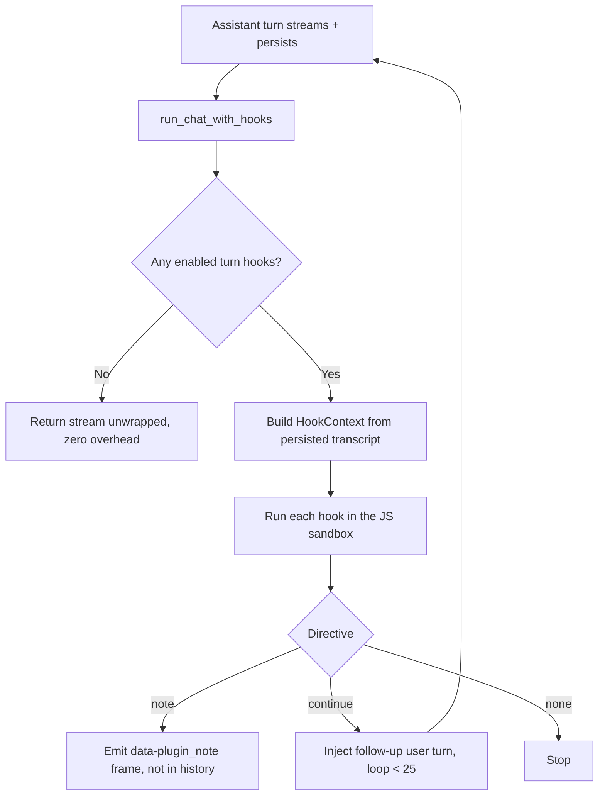

The plugin runtime runs plugin code at chat-turn boundaries. It lets developers ship features such
as double-check, goal, and advisor as installable plugins instead of hardcoded Core endpoints.

A plugin declares a **turn hook** in its `manifest.json`. The hook is plugin-authored JavaScript.
It runs in a deny-by-default JS sandbox, like [programmatic tool calling](/docs/core/programmatic-tool-calling),
and reaches Core only through capability-gated host functions.

It lives in `apps/core/src/plugin_host/` (`mod.rs`, `bridge.rs`) and is wired into the chat path once,
at the top-level handler, so the CLI, bots, and desktop all receive hooks. The declarative
manifest that carries a hook is described in
[Bundle Runnables with manifest.json](/docs/extend/develop/extensions/plugin-json-manifest).

<Callout type="warn">
  The Core sandbox layer is live-verified: the `plugin_host::tests::live_*` tests run the shipped
  double-check, goal, and advisor fixture hooks in the real JS sandbox, round-trip
  `host.sideModel` / `host.storage` through the capability bridge, and assert the correct directives.
  The **desktop** side is compile-checked only. The `data-plugin_note` banner render, the `continue`
  multi-turn streamed render, and the end-to-end double-check / goal flow through a running desktop
  are not yet live-verified. Beyond `post_assistant_turn`, a `pre_user_turn` boundary and a set of
  Claude-Code-style phases (`session_start`, `pre_tool_use`, `post_tool_use`, `subagent_stop`,
  `session_end`, `notification`) also exist, but their maturity varies - see
  [Turn hook phases](/docs/extend/develop/extensions/plugin-runtime-phases). There is no
  per-token hook.
</Callout>

## What a turn hook is

A turn hook is server-side logic that runs at a chat turn boundary. You declare it under
`contributes.turn_hooks` in the manifest, and its `code` field is the JS body of your hook:

```jsonc
"contributes": {
  "turn_hooks": [
    { "id": "my.review", "on": "post_assistant_turn", "code": "<JS body that returns a directive>" }
  ]
}
```

The primary chat boundary is `post_assistant_turn` (the constant `ON_POST_ASSISTANT_TURN` in
`plugin_host/mod.rs`). Additional phases are available at the message, tool, session, and workflow
seams; their maturity and directive support are listed in [Hooks & Lifecycle](/docs/extend/develop/extensions/hooks-lifecycle).
The post-assistant hook runs after the assistant turn has streamed and persisted, so it can review the
answer the user just received and decide what happens next.

Each hook body runs in a fresh sandbox with exactly two globals in scope, the way a Worker body has
only its message in scope. There is no module system, no captured closure, and no filesystem or
network outside the host bridge.

### `ctx` - the turn context

`ctx` is the serialized `HookContext`. A hook reads it to decide whether and how to act. The core
fields are below; some phases add more (for example `ctx.event` and `ctx.project_rules`).

| Field | Type | What it carries |
|---|---|---|
| `conversation_id` | `string` | The conversation id, also the natural key for per-conversation plugin storage. |
| `agent_id` | `string` | The agent that produced the turn. |
| `transcript` | `{ role, content }[]` | Recent messages, oldest to newest, so the hook can inspect the last answer. |
| `flags` | `{ [pluginId]: boolean }` | Per-request plugin flags set by the client, for example a composer toggle. A hook reads its own flag to decide whether to act this turn. |

### `host` - the capability bridge

`host` is the only way out of the sandbox. Every call is routed through `PluginHookBridge`
(`plugin_host/bridge.rs`) and gated by a manifest `permission_grants` entry. The most common calls are below. The bridge also
exposes calls for agents, Spaces, preferences, and navigation, each behind its own grant; see the
[plugin-api reference](/docs/extend/develop/sdk/plugin-api).

| Call | Grant required | Returns |
|---|---|---|
| `await host.sideModel({ prompt, system?, model?, model_pref_key?, effort?, images? })` | `hook:side-model` | One non-streaming Gateway completion as text. The model is resolved through the configured model/provider policy; a hook should not assume a particular backend. Optional `images` takes up to 8 inline PNG, JPEG or WebP data URIs (1.5 MiB in total, and the whole encoded request at most 2 MiB) for a vision-capable model. |
| `await host.storage.get(key, namespace?)` | `storage:kv` | The stored string, or `null`. |
| `await host.storage.set(key, value, namespace?)` | `storage:kv` | `true`. Non-string values are JSON-stringified. |
| `await host.storage.delete(key, namespace?)` | `storage:kv` | `true`. |
| `await host.storage.keys(namespace?)` | `storage:kv` | The namespace's keys. |
| `await host.notify({ title, body })` | `notifications:send` | One bounded, informational app notification for the active user. The host sanitizes the text and routes it through the normal notification store. |
| `await host.usage({ agent_id })` | `usage:read` | One agent's subscription usage windows, the same reading the composer shows. See [subscription usage in hooks](#subscription-usage-in-hooks). |
| `await host.usage({ provider_id, account_id? })` | `usage:read` | Every saved account of one subscription provider with its cached usage, without account names. Node owner and admins only. |
| `await host.subscriptions.list({ providerId?, usage? })` | `subscriptions:read` | Each subscription provider with its saved accounts, their names, and their usage. Node owner and admins only. |
| `await host.subscriptions.usage({ providerId, accountId? })` | `subscriptions:read` | The usage reading for one saved account (the active account when `accountId` is omitted). Node owner and admins only. |
| `host.log(...args)` | none | Captured logs. |
| `await host.gatewayAudit({ limit? })` | `usage:audit` | Administrative Gateway audit records; requires node administrator authority and separately approved access. |

`usage:read` permits ordinary usage summaries, not administrative audit records. Those records
can span callers and contain command or error details. An administrator must permit `usage:audit`
and approve it for the app. Adding the declaration to a manifest does not upgrade existing approvals.

Storage is namespaced per plugin (`namespace` defaults to `"default"`), so one plugin can never read
another plugin's keys. Values are limited to 1 MiB, each plugin has a 16 MiB/10,000-key durable
quota, and key listings are bounded to 10,000 entries. Oversized or control-character identifiers
are rejected before SQLite is touched.

`host.notify` cannot select another user, address an arbitrary device,
or bypass the notification store. Keep it for actionable, user-visible events such as "the last
agent finished" and let the normal notification settings decide where that event is delivered. The
call is bounded and grant-gated; an unavailable store, missing active user, denied grant, or invalid
payload is a failure, not a silent success.

The bridge is the native capability seam for the hook runtime. Desktop, web, extension, mobile, CLI,
TUI, and hardware-facing clients may expose different host adapters, but they do not receive authority
just because a capability is discoverable. The host advertises what is available on that surface, then
applies the declared grant and caller policy at invocation time. Unsupported surfaces should hide or
disable a contribution while keeping it installable and inspectable; a missing permission must fail
closed.

### Subscription usage in hooks

`host.usage` takes exactly one of two forms. Passing both `agent_id` and `provider_id`, or
`account_id` without `provider_id`, is rejected.

- **`{ agent_id }`** returns one usage snapshot (`available`, `windows`, and so on) for the agent.
  When `agent_id` is a Ryu subscription provider id such as `claude-pro-max`, the reading comes
  from that provider's active saved account in Ryu, not from a CLI login on the machine. Ordinary
  agent ids are unchanged. A snapshot read from a saved account also carries `provider_id` and
  `account_id`.
- **`{ provider_id, account_id? }`** returns every saved account of one provider:

  ```jsonc
  {
    "provider_id": "claude-pro-max",
    "usage_supported": true,
    "pool_strategy": "quota_first", // or "manual", "round_robin", "fill_first", "reset_first", null
    "accounts": [
      {
        "account_id": "acct_…",
        "active": true,
        "eligible": true, // in the pool and not waiting for a fresh login
        "needs_reauth": false,
        "state": "ok", // "pending", "unavailable", "needs_reauth", "pool_disabled", "unsupported"
        "usage": { "available": true, "windows": [] }, // or null
        "observed_at": "2026-10-14T09:30:00Z"
      }
    ]
  }
  ```

  This form never includes account names, because they are often email addresses. It is cache-only,
  so a hook never waits on the provider: an account with no recent reading has state `pending`, and
  Ryu reads it in the background for a later turn. An unknown `account_id` returns
  `{ accounts: [], error: "account_not_found" }`; Ryu never substitutes another account. Only the node
  owner and admins can use this form, so handle a rejected call and fall back to `{ agent_id }` or
  `{ kind: "none" }`.

`host.subscriptions.list` and `host.subscriptions.usage` are the labelled inventory that
[Desktop companion apps](/docs/extend/develop/extensions/desktop-companion-runtime#subscription-accounts-and-usage)
use through `window.ryu.subscriptions`, with the same arguments, results, and `subscriptions:read`
consent (**See your subscription accounts**). They answer only when the turn's caller is the node
owner or an admin. `list` is cached by default; `usage: "refresh"` and `subscriptions.usage` may read
the provider, so avoid them on every turn. Ryu limits how often one plugin can trigger a live read of
the same account.

Per-account usage covers Claude Pro/Max, ChatGPT, OpenAI Codex, and GitHub Copilot. ChatGPT plan,
Kiro, Kimi, Radius, Ant Ling, and CLI logins report no per-account usage: their accounts have state
`unsupported`. Older Ryu hosts do not have `host.subscriptions`, and an unknown host method rejects
the call, so check for it before use.

<Callout type="warn">
  Gating returns an error, it does not silently pass. An ungranted capability call (or an unknown
  `host.*` method) rejects the awaited call with `is_error: true` and a message like
  `capability 'hook:side-model' not granted`. A plugin can catch that error. The fail-open to a no-op
  directive happens one level up: an **uncaught** throw, like any other hook error, degrades the whole
  hook to `{ kind: "none" }`, so a misbehaving plugin can never block or break a chat turn.
</Callout>

## The directive contract

A hook returns a directive that the chat path applies. The shape is the `HookDirective` enum in
`plugin_host/mod.rs`.

| Directive | Effect |
|---|---|
| `{ kind: "none" }` | Do nothing. This is also the fail-safe for any error, unparseable result, or a build without the sandbox. |
| `{ kind: "note", text }` | Surface `text` to the user out-of-band as a `data-plugin_note` AI-SDK part. It never enters chat history. This is double-check's review. |
| `{ kind: "continue", text }` | Inject `text` as a follow-up user turn and run another assistant turn, streamed into the **same** response. This is goal's loop, capped server-side at `MAX_CONTINUE_TURNS` (25). |

A missing, `null`, or unparseable return value, an explicit `{ kind: "none" }`, a thrown hook, an
unsupported sandbox pause, or a build without the sandbox all resolve to `{ kind: "none" }`. The runtime is
fail-open: a plugin cannot block a turn.

### Cross-platform authoring

Hook bodies are platform-neutral fragments. They are not shell commands and do not receive a
working-directory-dependent path: Core invokes the `code_file` body in its sandbox with only `ctx`
and `host` available. Do not add `bash`/PowerShell/`cmd` wrappers, Node/Bun/Deno imports, `process`
or filesystem access, or hard-coded home and temporary paths. Use the grant-gated host API for
effects; if a plugin needs a file, process, or OS integration, put that work in an app sidecar and
expose a typed capability. See [Keep hook bodies cross-platform](/docs/extend/develop/extensions/hooks-authoring#keep-hook-bodies-cross-platform)
for the source and `code_file` rules.

Hooks can also run at session, tool, sub-agent, and notification phases. See
[Turn hook phases](/docs/extend/develop/extensions/plugin-runtime-phases) for the phase table, the extra directives, the
process-global dispatcher, and the `tools` glob gate.

## Where it runs (Core vs Gateway)

A turn hook decides *what runs next*, which is a Core concern, so the runtime lives in
`apps/core/src/plugin_host/`. Any model call a hook makes still routes through the Gateway:
`host.sideModel` calls `call_side_model`, the same governed path that `/btw` and the side-question
feature use. The sandbox grants capabilities; the Gateway governs every model call.

The chat path wires hooks in at `run_chat_with_hooks` (`apps/core/src/server/mod.rs`). After the
assistant turn streams and persists, `dispatch_turn_hooks` collects every enabled `post_assistant_turn`
hook, runs each one, and applies the directives in plugin order: a `note` is emitted as a
`data-plugin_note` frame, a `continue` rebuilds the request from the persisted transcript and loops.
When no plugin contributes a hook (the common case) or the sandbox backend is absent, the inner stream
is returned unwrapped, so the hot path has no extra work.



## Plugin lifecycle

Enable and disable apply on the next turn with no restart. The lifecycle routes, grant rechecks,
and generation-aware deactivation are in [Plugin lifecycle routes](/docs/extend/develop/extensions/plugin-lifecycle).

## Building one

1. Write a `manifest.json` with `id` (for example `@example/my-hook`), `version` (semver), the `permission_grants` your
   hook needs (for example `hook:side-model`), and a `contributes.turn_hooks` entry whose `code` is
   your self-contained JS hook body.
2. Drop it at `plugins/<dir>/manifest.json` in the node's [data folder](/docs/surfaces/desktop/user-guide/data-and-storage#whats-in-the-data-folder) (`<dir>` is the id with `/` replaced by `+`), or host it and install by URL.
3. Enable it (`POST /api/plugins/:id/enable`, or from the Store in Desktop).
4. Your hook runs after each assistant turn while the Core sandbox runtime is available; if it is
   unavailable, the hook degrades to a no-op and the turn continues.

The bundled plugins, published in the public `amajorai/ryu-marketplace` repository, are the worked
reference: `double-check` returns a `note`, `goal` returns a `continue`, and `advisor`
consults a stronger model and returns either, depending on the composer toggle or a `/advisor`
slash command. Each is a manifest plus a JS hook body, with no Core or Desktop code specific to the plugin.

Rather than hand-writing the manifest JSON, the TypeScript SDK gives you typed factories:

```ts
import { definePlugin, defineTurnHook } from "@ryuhq/sdk";

export default definePlugin({
  id: "com.example.double-check",
  name: "Double Check",
  version: "1.0.0",
  grants: ["hook:side-model"],
  composerControls: [{ id: "dc.toggle", type: "toggle", flag: "com.example.double-check" }],
  turnHooks: [
    defineTurnHook({
      id: "dc.review",
      run: async (ctx, host) => {
        if (!ctx.flags["com.example.double-check"]) {
          return { kind: "none" };
        }
        const last = ctx.transcript.at(-1);
        const review = await host.sideModel({
          prompt: last?.content ?? "",
          model_pref_key: "double-check-model",
        });
        return { kind: "note", text: review };
      },
    }),
  ],
});
```

`defineTurnHook` serializes your `run(ctx, host)` into the sandbox `code`. The function must be
self-contained, with no captured variables or imports, because it runs in a fresh sandbox with only
`ctx` and `host` in scope.

## Not a turn hook: compression

Gateway-side message compression (headroom) is a related plugin mechanism but a different one. It is a
`policy` runnable read by the Gateway egress transform, not a `post_assistant_turn` hook, and it never
enters the Core sandbox. Reach for a turn hook when you need to react to a finished turn from Core;
reach for a compression policy when you need to transform requests on the way out through the Gateway.

Turn hooks are the **sandboxed** half of what a plugin can contribute. A plugin that also ships a
sidecar or an MCP server runs that part with Ryu's own privileges, under a different set of rules.
See [Plugin isolation](/docs/security/plugin-isolation) for what your users are trusting when they
install it.

## Related

<Cards>
  <DocCard href="/docs/extend/develop/extensions/plugin-runtime-phases" />
  <DocCard href="/docs/extend/develop/extensions/plugin-lifecycle" />
  <DocCard href="/docs/security/plugin-isolation" />
  <DocCard href="/docs/extend/develop/extensions/plugin-json-manifest" />
  <DocCard href="/docs/extend/develop/sdk/plugin-api" />
  <DocCard href="/docs/core/double-check" />
  <DocCard href="/docs/core/goals" />
</Cards>
