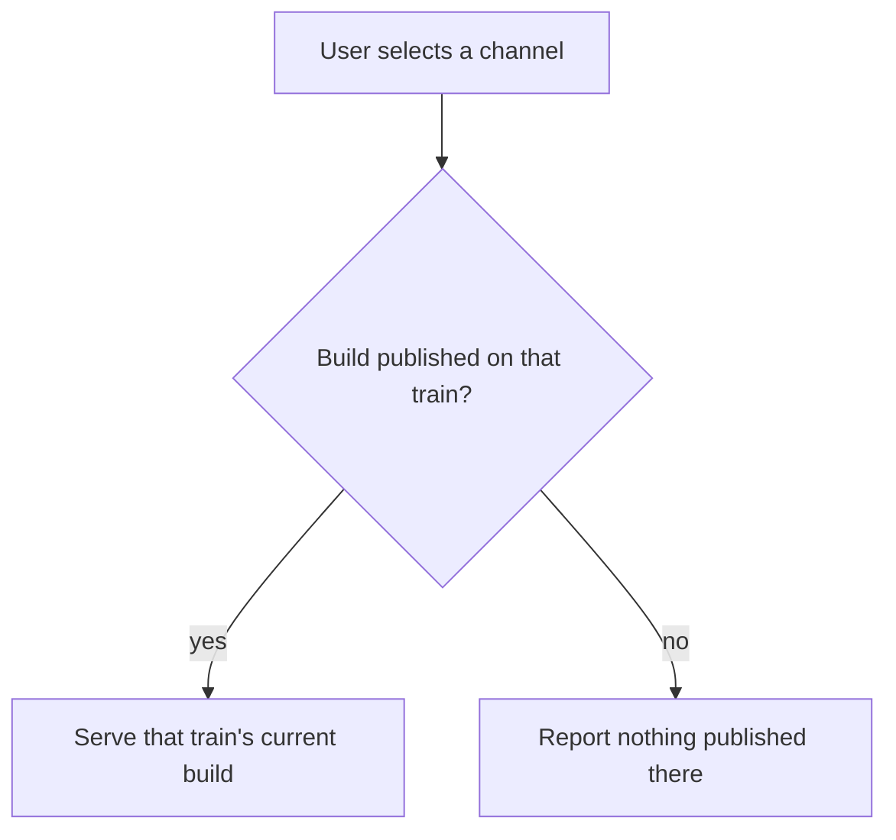

A **release channel** lets one Marketplace listing ship more than one build: for example a stable
release for most users, a **beta** for testers, and a **nightly** built from today's commit.

A channel is a train: `stable`, `beta`, `rc`, `nightly`, `canary`, or any name you choose. A user
picks a train, and every later update follows it instead of jumping to the latest release on
another train.

<Callout type="info">
  This page documents release trains for Marketplace extensions and apps. For the Ryu desktop app and
  Core build channels, including the current Beta behavior and local data-sharing boundaries, see
  [Ryu Release Channels](/docs/start-here/release-channels).
</Callout>

## The version names the channel

There is no `channel` field to set. A channel is read off the version you publish, from its first
[semver](https://semver.org) prerelease identifier, lowercased:

| Published version        | Channel   |
| ------------------------ | --------- |
| `1.4.0`                  | `stable`  |
| `1.4.0-beta.2`           | `beta`    |
| `2.0.0-rc.1`             | `rc`      |
| `1.5.0-nightly.20260813` | `nightly` |
| `1.5.0-canary.7`         | `canary`  |
| `0.3.0-edge.4`           | `edge`    |

Ryu applies the same rule to its own builds. A version string cannot disagree with its train, while
a separate field could drift until a `1.0.0` claims to be a nightly.

- Build metadata is ignored: `1.4.0-beta.2+sha.abc123` is still `beta`.
- The channel name is case-insensitive, so `Beta` and `beta` are one train, never two.

<Callout type="warn">
  A numeric prerelease identifier (`1.4.0-0`) is legal semver but derives the channel `0`, a train
  nobody could pick out of a menu. Publishing one is refused with a 422; give the identifier a name.
</Callout>

### `stability` is a badge, not a channel

A manifest's `stability` field (`"beta"`, `"experimental"`, …) paints a badge on your listing card.
It has nothing to do with which build a user receives. If you set `stability: "beta"` on a `1.4.0`
manifest, you have a stable release that says "Beta" on it. Ship `1.4.0-beta.1` if you meant the
beta train.

## Channel resolution rules



**A channel serves only its own builds.** Asking for `beta` never hands back a nightly, however much
newer the nightly is. Blending trains would put a beta subscriber on the least tested code in the
repository.

**There is no fallback.** If someone selects `canary` and you have published no canary build, they
are told nothing is published there. They are not quietly moved to stable, because then nobody,
including you, could tell who is actually on canary.

**A prerelease sorts below its stable release.** Semver ranks
`1.4.0-beta.1 < 1.4.0`, so a user switching from stable `1.4.0` to your beta train may move to an
*older* build. Ryu allows the switch (it is what the user asked for) and reports the version delta so
the app can say so plainly. Cut `1.5.0-beta.1`, not `1.4.0-beta.1`, if you want the beta to lead.

## Publishing to a channel

Publishing a prerelease uses the GitHub-backed bridge with a prerelease version in the immutable
GitHub Release:

```bash
# create the stable GitHub Release first
bunx ryu github-publish https://github.com/your-org/your-package  # version: 1.4.0

# then create and submit the beta GitHub Release
bunx ryu github-publish https://github.com/your-org/your-package  # version: 1.5.0-beta.1
```

What differs on the server side:

- **Your listing already has to exist.** A train attaches to a published listing. Its ratings,
  pricing, ownership and reviews all belong to the listing, and there is nothing for a beta to hang
  off before a stable release exists. Publishing a prerelease for an unknown id is a 409.
- **A prerelease publish touches only that train.** Your listing's description, icon, pricing, and
  `live` status are left alone. A nightly cut every morning must never knock your
  stable listing back into the review queue.
- **Each build is reviewed on its own.** A prerelease lands `pending` and becomes installable once a
  moderator promotes it. Your stable listing being live vouches for the code a moderator read, not
  for a bundle you published afterwards.
- **Every trust gate still runs.** The Gateway validates the build's requested grants and signs its
  manifest; Ryu recomputes `sha256(ui_code)` against the signed hash at install. A nightly gets the
  same checks as a stable release. The channel selects a build; it does not relax any check.

### Limits

A listing carries at most **four** prerelease trains, and all of them together at most **8 MiB** of
bundled code. Publishing past either is refused with a message naming what is consuming the budget.

Both limits exist because a build's code is stored inline on the listing, and a rolling train
publishes forever. Each channel holds only its **current** build. A nightly publish replaces
yesterday's nightly rather than accumulating, which is what keeps a daily train bounded. Retire a
train you no longer ship before adding another.

## What users see

On a listing that publishes more than one installable train, a channel selector appears beside the
**Add** button, listing each train and the version it currently resolves to. A listing with only a
stable build shows no selector at all.

The chosen channel is **persisted with the install**, so the plugin keeps following that train on every later update, instead
of being pulled back to stable the first time it checks. An installed listing shows the train it
follows, and switching trains is an explicit action, not something an update does on its own.

## Repository-published listings

If your listing is discovered from a public repo via
[GitHub topic discovery](/docs/extend/develop/extensions/github-topic-discovery) rather than published to
the Marketplace, Ryu derives its channels from your **release tags** using the same rule. Tag
`v1.5.0-beta.1` and the beta train appears on the listing.

Those channels are **browse-only**. Topic-discovered listings are not an install path at all
(nobody reviewed them, so nothing signs them), and that does not change per channel. A user reads
what you tagged and installs the repository as a separate, explicit act.

If you want a channel a user can select and install from, publish to the
[Marketplace](/docs/extend/develop/extensions/marketplace).

## Built-in apps

Apps that ship inside Ryu have no independent train. Their version *is* Ryu's version, so they
follow the channel of the Ryu build the user is running. Choose your Ryu release channel in
**Settings → Updates**; there is nothing to publish per app.

## Recipes

**A beta that leads the next release.** Publish `1.5.0-beta.N` while `1.4.x` stays stable. Testers
select Beta once; every subsequent `1.5.0-beta.N+1` reaches them automatically. When it is ready,
publish `1.5.0`. Beta testers stay on the beta train and get `1.6.0-beta.1` next, which is usually
what they want.

**A nightly from CI.** Derive the version from the date so it always sorts forward:
`1.5.0-nightly.20260813`. One channel entry is kept, so daily publishing does not grow your listing.

**A canary for a risky rewrite.** Publish `2.0.0-canary.N` while `1.x` continues on stable. Because
a channel never falls back, someone who selected Canary and then sees you stop publishing there is
told the train is empty. They are never silently migrated onto `2.0.0` when it lands.
