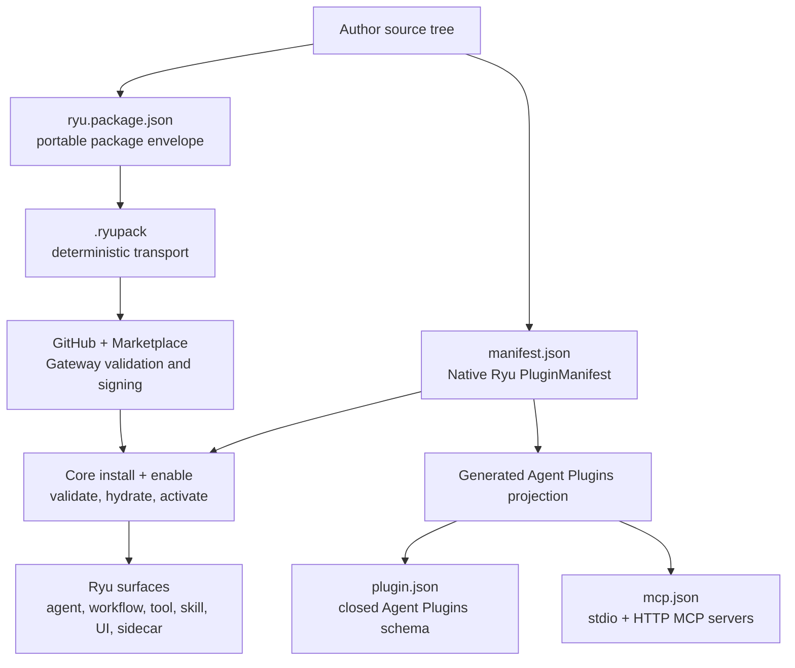
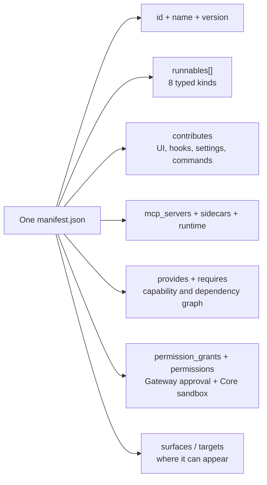
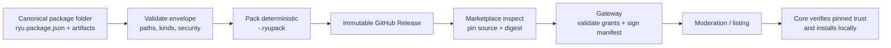

Ryu extensions have several files that look like manifests. They are related, but they are not
interchangeable. `manifest.json` describes what Ryu runs,
`plugin.json` and `mcp.json` are the portable Agent Plugins projection, and `ryu.package.json`
describes how a package moves through folders, archives, GitHub, and the Marketplace.

<Callout type="info">
  **One source of truth.** Author the native Ryu contract in `manifest.json`. `plugin.json` and
  `mcp.json` are generated interop files; do not hand-edit them in a Ryu package. The outer
  `ryu.package.json` is a separate envelope for portable distribution and can contain a native
  manifest as one of its declared artifacts.
</Callout>

## The three layers

These layers answer different questions:

| File or layer | Question it answers | Source-of-truth rule |
|---|---|---|
| `manifest.json` | What does this Ryu plugin/app declare and how can Core activate it? | Native Ryu truth. |
| `plugin.json` | What portable Agent Plugins metadata can another compatible host read? | Derived projection; the Agent Plugins schema is closed. |
| `mcp.json` | Which stdio or remote MCP servers can a compatible host use? | Derived from native `mcp_servers` when exporting; it is not the native Ryu grant boundary. |
| `skills/<slug>/SKILL.md` | What reusable instruction bundle can a Skills-compatible host discover? | Folder convention; the skill body remains a file in the package tree. |
| `ryu.package.json` | What is this package, what files belong to it, and where may it be applied? | Portable package truth for the envelope. |
| `.ryupack` | How are the same files transported reproducibly? | Deterministic archive of the package tree. |

## Native `manifest.json` - the plugin and app contract

Plugins and apps use the same native manifest schema. The difference is where their product logic
lives and how it is distributed, not a second "app schema". A manifest may be surface-only, so
`runnables` can be empty when the useful contribution is a sidecar, a capability provider, or a
declarative UI surface.

The required native identity is `id`, `name`, `version`, and `runnables`. The important optional
blocks are:

| Block | Use it for | Boundary to remember |
|---|---|---|
| `runnables` | Declare agents, workflows, tools, skills, companions, channels, engines, and policies. | The per-kind `config` is validated before activation. |
| `contributes` | Add hooks, widgets, views, settings tabs, composer controls, message actions, output styles, LSP servers, and typed host catalogs such as local computer-use planners. | A contribution is a declaration; it does not grant arbitrary UI or Core code execution. |
| `mcp_servers` | Register declarative stdio or remote HTTP MCP servers owned by the plugin. | The server still needs the appropriate Gateway grant and tool allowlist; OAuth belongs in the native manifest. A stdio server starts in the installed plugin directory, so relative `args` such as `server.mjs` name files the package ships. When the same manifest's sidecar declares `host_api.grants`, a stdio server is spawned with the per-plugin host-callback credential that sidecar receives, so it can call the same approved host APIs (for example a model completion under `hook:side-model`). |
| `sidecars` | Describe a managed process Core can download, provision, spawn, health-check, and stop. | The process runs outside Core through the generic lifecycle/proxy seams. |
| `provides` / `requires` | Publish or consume a swappable capability and declare plugin dependencies. | Capability versions are not the same as plugin versions. |
| `permission_grants` | Ask the Gateway for host capabilities such as MCP, sidecar, storage, model access, or host-rendered declarative HTTP/toast surfaces. | A declaration is not approval; enable fails closed when a required grant is denied. |
| `permissions` | Describe the typed runtime sandbox set for filesystem, network, child-process, and tool access. | This is Core enforcement, distinct from Gateway grants and human-facing `permission_levels`. |
| `surfaces` / `targets` | State whether the extension supports desktop, web, mobile, CLI, and other hosts, including `full`, `limited`, `list`, or `commands` support. | An explicit `surfaces` map wins over legacy `targets`; the Marketplace also shows Web, Mobile, and Browser-extension rows as shared Desktop-shell wrappers when applicable. |
| `runtime` | Provision an external runtime such as a Python environment when the extension needs one. | Runtime provisioning is a separate process boundary with its own security review. |

The full per-field and per-kind contract lives in [Plugin API Reference](/docs/extend/develop/sdk/plugin-api).
The worked authoring path is [Bundle Runnables with manifest.json](/docs/extend/develop/extensions/plugin-json-manifest).

### Read the support contract in the Marketplace

The catalog keeps **support**, **extension**, and **implementation** separate:

- **Support** is the host matrix from `surfaces`. It is a compatibility and presentation fact;
  install and enable still run through Core's signed manifest and lifecycle gates.
- **Extends** is derived from the existing `provides` and `contributes` declarations. A provider of
  `browser.control` extends the Browser capability; a `dock_panels` contribution extends the shared
  Ryu shell. It does not mean the package edits the host application.
- **Where it lives** groups the runtime boundary: Core for registered runnables and hook/capability
  contracts, the shared shell for host-rendered UI, and the package sidecar for its own process.

The Web app, Mobile app, and Browser extension use the Desktop shell's contribution vocabulary with
their own host bridges. Their Marketplace support row may show `inherited from Desktop`; that means
shared shell composition only, not access to Desktop-only native APIs.

### The eight Runnable kinds

The native schema accepts eight peer kinds. They are not a hierarchy, and a single manifest may
declare more than one.

| Kind | What it contributes | Where the current handler lands it |
|---|---|---|
| `agent` | A configured model loop with tools and persona. | The agent store, namespaced to the package. |
| `workflow` | A reusable workflow definition. | The workflow store/executor. |
| `tool` | A callable tool binding, including supported MCP/backend forms. | The MCP/tool registry. |
| `skill` | A named reusable instruction reference. | The app-skill registry; the body is supplied by the bundled `skills/` tree when present. |
| `companion` | A desktop overlay or sidebar surface. | The app-contribution registry and desktop host. |
| `channel` | A messaging-platform adapter declaration. | The channel contribution registry; credentials and routing remain operator configuration. |
| `engine` | A selectable model/inference engine binding. | The engine contribution registry; model calls remain Gateway-routed. |
| `policy` | A switch for a Gateway/Core policy such as firewall, routing, compression, or sandbox. | Core validates and coordinates the state; the Gateway owns policy enforcement where applicable. |

Every handler reports its own result. A malformed or unsupported entry does not silently turn the
whole package into an apparently successful install; enable exposes per-entry failures.

<Callout type="warn">
  The native runtime accepts all eight kinds. The TypeScript SDK has typed runnable factories only
  for `defineAgent`, `defineWorkflow`, `defineTool`, and `defineSkill` (plus `defineAction`, which
  lowers to a tool, and `defineApp` for widget apps). Its `RunnableKindSchema` also accepts `companion` and `policy`, but not `channel` or
  `engine`. Declare companion, channel, engine, or policy entries with the native manifest shape
  and their per-kind config.
</Callout>

## Plugin versus app: same schema, different ownership

A plugin and an app use the same `manifest.json` contract, the same Gateway grants, the same Core
lifecycle, and the same Marketplace packaging. The difference is where the product logic lives:
inside a Core registry or turn boundary (plugin), or in the package's own process and surface (app).
A plugin may declare a sidecar, and an app may contribute Runnables, so the boundary is ownership,
not a keyword. [Plugins vs Apps](/docs/extend/develop/extensions/plugins-vs-apps) owns the decision
guide, the three-axis model, and the meanings of the name "app".

## What can be bundled and where it goes

Which files `ryu pack` inlines into the signed manifest, how hook and adapter source becomes wire
form, and the canonical plugin, app satellite, and portable package folder trees are in
[Extension bundles and folder layouts](/docs/extend/develop/extensions/extension-folder-layouts).

## `plugin.json`, `mcp.json`, and Skills interop

Ryu implements the Agent Plugins v1 floor as a projection and importer:

| Interop file | Shape | What Ryu exports | What Ryu imports |
|---|---|---|---|
| `plugin.json` | Closed manifest with `$schema`, name/version/description, author, links, keywords, and `extensions` | Native id/display data plus notes under `com.ryuhq.ryu` | Derives a namespaced native id and then applies normal manifest validation |
| `mcp.json` | `$schema` plus `mcpServers` stdio, Streamable HTTP, or legacy SSE entries | Native declarations that satisfy the portable shape | Remote URLs and headers remain explicit; Ryu-only grants and OAuth metadata stay native |
| `skills/<slug>/SKILL.md` | Universal folder convention | Carries the files in the source tree | Materializes into Ryu's Skills home with ownership-safe copy/deactivate/remove behavior |

In an imported `mcp.json`, Ryu expands `${PLUGIN_ROOT}` to the installed package folder and
`${PLUGIN_DATA}` to the plugin's own data folder, `plugin-data/<dir>/` in the node's data folder, inside `args` and
`env` values. Neither placeholder is expanded in `command`.

The projection is lossy. A foreign host cannot understand Ryu's Gateway grants,
sidecar lifecycle, surfaces, or capability broker, so those remain native Ryu declarations. A Ryu
host never treats a portable `plugin.json` as permission approval; install/enable still applies the
normal trust and Gateway checks.

## The portable package envelope

`ryu.package.json` is the contract for moving a package. Its fields are:

| Field | Meaning |
|---|---|
| `schemaVersion` | Envelope version; current package contract is `1`. |
| `id`, `name`, `version` | Stable package identity and release version. |
| `kind` | One of `plugin`, `app`, `skill`, `agent`, `workflow`, `theme`, `output_style`, `space`, `profile`, `bundle`, or `language_pack`. |
| `artifacts` | Relative files that make up the package tree. |
| `targets` | Host/product targets such as desktop, node, or a custom target label. |
| `scopes` | Safe application scopes: `desktop`, `node`, `gateway`, `agent`, `space`, or `workflow`. |
| `requires` | Package dependency/version requirements. |
| `capabilities` | Human-readable capabilities the package provides or expects. |
| `connectionRequirements` | Optional. Integrations the package needs, as metadata only (see [Portable packages](/docs/extend/develop/extensions/portable-packages#declare-connections-without-shipping-credentials)). |
| `includes` | Optional. Included package references for a bundle. |
| `source` | Optional. Provenance: local folder, archive, or pinned GitHub repository/path/ref/commit/checksum. |
| `security` | Redaction and risk flags: secrets, private content, permissions, and whether the tree is redacted. |
| `metadata` | Optional. Safe presentation metadata for a Marketplace card; it is not an execution permission. |

Use the [Ryu package JSON Schema](https://raw.githubusercontent.com/amajorai/ryu-marketplace/HEAD/schema/ryu.package.schema.json)
for machine validation, then use the package CLI for tree-level checks. The package envelope does
not replace `manifest.json`; it tells Ryu how to validate, move, scope, and publish the artifacts
inside it.

## Marketplace and signing flow

The Marketplace stores the source binding, release metadata, entitlement, and moderation state;
GitHub remains the package and release source of truth. A package can be discovered through a
public topic, but a reviewed Marketplace install still requires a validated immutable release.
Publishing details are in [Publish to the Marketplace](/docs/extend/develop/extensions/marketplace),
and collection discovery is in [Publish via GitHub Topics](/docs/extend/develop/extensions/github-topic-discovery).

## Author checklist

1. Start with `manifest.json`; choose plugin or app from the ownership boundary, not from the file name.
2. Declare only the Runnables and contributions you actually ship. Add grants and typed sandbox permissions separately.
3. Keep hook/adapter bodies in flat `hooks/` or `adapters/` files and hydrate them during packing.
4. Put Skills in `skills/<slug>/SKILL.md`; include their resources in the package tree.
5. Declare native MCP servers under `mcp_servers`; let the Agent Plugins projection generate `mcp.json`.
6. For apps, keep `backend/` or `sidecar/` independent of Core and use generic capability/ext-proxy seams.
7. Validate the native manifest, run `bunx ryu pack <dir>` for the plugin bundle, and run `ryu-cli package validate` / `ryu-cli package pack` for a portable Marketplace release.
8. Regenerate `plugin.json` and `mcp.json` with `bunx ryu agent-plugin <dir>` before publishing so they do not drift from `manifest.json`.

<Cards>
  <DocCard href="/docs/extend/develop/extensions/extension-folder-layouts" />
  <DocCard href="/docs/extend/develop/extensions/plugins-vs-apps" />
  <DocCard href="/docs/extend/develop/extensions/plugin-json-manifest" />
  <DocCard href="/docs/extend/develop/extensions/agent-skills" />
  <DocCard href="/docs/extend/develop/extensions/mcp-server" />
  <DocCard href="/docs/extend/develop/extensions/portable-packages" />
  <DocCard href="/docs/extend/develop/sdk/plugin-api" />
</Cards>
