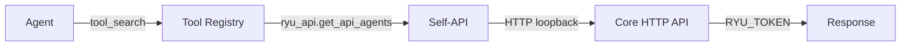

The Self-API turns Core's own HTTP endpoints into tools. An agent finds them with `tool_search`,
reads them with `describe`, and runs them with `execute`, the same as any MCP (Model Context
Protocol) or built-in tool in the [unified tool catalog](/docs/core/unified-tool-catalog). The implementation is `apps/core/src/self_api/mod.rs`.

## How it works



1. Core builds the tool catalog from its generated OpenAPI spec. Only routes in that spec become
   tools.
2. An agent calls `tool_search` with a query such as "list agents".
3. The tool registry returns matching Self-API tools, for example `ryu_api.get_api_agents`.
4. The agent calls `execute` with the tool id and arguments.
5. Core makes an HTTP loopback call to itself with the node's own `RYU_TOKEN`. Each loopback call
   times out after 30 seconds.
6. Core returns the response to the agent.

## Tool naming

Every Self-API tool id has this shape:

```text
ryu_api.<method>_<path slug>
```

The path slug is the OpenAPI path in lowercase, with each run of non-alphanumeric characters
replaced by one `_`. Path parameter names stay in the slug.

| Tool id | Route |
|---|---|
| `ryu_api.get_api_agents` | `GET /api/agents` |
| `ryu_api.post_api_plugins_install` | `POST /api/plugins/install` |
| `ryu_api.post_api_plugins_id_enable` | `POST /api/plugins/{id}/enable` |
| `ryu_api.get_api_spaces` | `GET /api/spaces` |

Path parameters, query parameters, and the request `body` are the tool's arguments.

## The denylist

Security-critical routes are never exposed. The denylist is a compile-time constant (`is_denied`
in `apps/core/src/self_api/mod.rs`). No runtime configuration can expose a denied route.

| Denied for every method | Why |
|---|---|
| `/api/auth/` | An agent must never drive login, logout, or the device flow |
| `/api/identity/`, `/api/identities`, `/api/vault` | Never expose stored secrets or their lifecycle |
| `/api/host/` | Capability broker, a cross-app privilege escalation surface |
| `/api/plugins/<id>/host` | The app host-capability bridge for Companion frames |
| `/api/mesh/` | A loopback call must not mint or expose peer credentials |
| `/api/tools/` | Recursion (search, describe, and exec are the tools themselves) |
| `/api/rules/` | Rule discovery accepts a filesystem root |
| `/api/webhooks/<id>/secret` | Webhook signing secrets are credentials |
| `/api/openapi.json` | Reading the spec to self-expand is recursion and exposes the full surface |
| `/api/mcp/tools/call` | Recursion into tool dispatch |
| `/api/gateway/providers`, `/api/gateway/web-accounts`, `/api/gateway/cloud-speech-accounts` | Provider API keys and service accounts are credentials; add them in Gateway settings |
| `/api/gateway/governance/hooks`, `/api/hooks/overrides` | Hook overrides can switch off safety hooks |
| `/api/gateway/audit/prune` | An agent must not erase the record of what it did |
| `/api/gateway/traffic` | Live traffic is a stream |
| `/api/widgets/tools/call` | Recursion into tool dispatch as the widget's agent |
| `/api/widgets/open` | Opening an MCP App runs its entrypoint tool as the agent named in the request |
| `/mcp/{agent_id}` | Recursion into tool dispatch as the agent in the path |
| `/api/chat/permission` | An agent must never answer its own in-chat permission prompt |

A write to `/api/gateway/config` is also refused when it touches the `auth`, `audit`, `bind`,
`channels`, `composio`, `control_plane`, `egress`, `firewall`, `firewall_org_overlays`,
`firewall_agent_overlays`, or `providers` section. These carry credentials, or decide where
traffic and secrets go, what is filtered, or what is recorded, so they are changed in Settings.

Non-GET methods under `/api/approvals/` are also denied, so an agent cannot approve or reject its
own approvals. Approval reads stay available.

Writes that connect, sign in to, re-key or remove one of your accounts are also never exposed,
to any agent. Reading their status stays available.

| Denied writes (reads stay available) | Covers |
|---|---|
| `/api/composio/connections`, and anything below it | Starting or finishing a Composio connection on your account |
| `/api/plugins/{id}/auth/…`, `/api/plugins/{id}/secrets/…`, `/api/plugins/{id}/grants`, and the same paths under `/api/apps/{id}/` | Signing an MCP server in or out, plugin secrets, and the permissions you granted a plugin or app |
| `/api/pi-config`, `/api/pi-config/providers/…`, `/api/pi-config/login/…`, `/api/gateway/providers` | Model-provider keys, accounts, account pools and sign-ins. `PUT /api/pi-config` also sets the provider, model, thinking level and routing of Ryu's engine, so agents cannot change those either. Turning one of a provider's models on or off (`POST /api/pi-config/providers/model-enabled`) stays available |
| `/api/agents/{id}/accounts/…`, `/api/agents/{id}/native-accounts/…`, `/api/agents/{id}/authenticate` | Signing an agent runtime in or out, or switching its accounts |
| `/api/cloud-environments`, `/api/cloud-environments/github`, `/api/cloud-environments/import` | Values sealed into your cloud-environment vault, including a GitHub token |
| `/api/channels/managed-bot/…` | Pairing a managed chat bot |
| `/api/backups/recovery-key` | Creating a backup recovery key |
| `DELETE /api/composio/trigger-subscriptions/{id}` | Removing one of your Composio trigger subscriptions |

These run with the node's full power and no verified user, so an approval prompt is not enough:
with approvals off they would run unchecked. To get an account connected, an agent asks with a
**Connect** card (the `consent.connect_app` tool), and nothing connects until you finish sign-in
yourself.

Streaming routes (WebSocket and SSE) are excluded when the catalog is built. Paths that contain
`/ws`, `_ws`, `stream`, or `/events` never become tools, because a blocking loopback call to them
would hang until timeout.

## Security invariants

### Who the call runs as

On a personal or unbound node there is one person, so the loopback runs with the node token and
full access.

On a node that belongs to an organization, the agent acts with the role of the person in the
chat:

- Only Gateway and routing routes are available. Reads need `gateway.view`, changes need
  `gateway.configure`, and audit reads need `audit.view`. Every other Self-API route is refused on
  a shared node.
- Core looks up the person's permissions (their built-in role plus any custom roles) before the
  call. If the lookup fails, the call is refused.
- The chat must be private, with no collaborators, so nobody else can ask the agent to act with
  that person's role.
- The call then runs as that person, so every route applies the same permission checks it applies
  to the person in Settings.

The owner of a personal node that is registered to an organization keeps full access on that node.

### Every change asks first

Non-GET requests (POST, PUT, PATCH, DELETE) always need the person's approval, in every approval
mode including `off`. Reads never ask.

When the agent runs in a chat you are looking at, the approval appears in that chat as a
permission prompt that names the endpoint and shows the arguments. Choose **Allow once**,
**Allow for this chat** (that endpoint, any arguments, until the conversation ends or Core
restarts), or **Deny**. A Gateway or routing change offers only **Allow once** and **Deny**, so
approving one change never lets a later one through. A denied call does not run. When nobody is in the chat, for example a
routine or an external MCP client, the call waits in **Approvals** instead. An organization tool
policy that denies the call still wins: allowing it in chat cannot override an administrator.

### Path parameters stay inside one URL segment

Core rejects path values that contain path separators, `..`, `?`, `#`, `%`, or control characters.
The resolved request therefore stays on the route described by the selected tool.

### Agents with limited account access write only workspace content

An agent set to **Its own identity** or **Both**, or one whose account access is limited, can
still read through these tools.

It can write only through a reviewed list of endpoints that
change workspace content: Spaces (documents, pages, whiteboards, databases, files; a new Space must
be private), memory entries and memory proposals, conversation housekeeping (title, icon, pin, archive, folder, read
state, reactions, feedback, response choice, checkpoints, history previews and local history
saves, saving a temporary chat, pausing or clearing a goal, cancelling a turn), notifications,
prompt-suite authoring and reviews, activity and presence, improvement records, learning capture
and opt-outs, uploads, new workspace folders, widget and tool-card state, and pausing, resuming, cancelling,
retrying or clearing downloads already queued.

Every other write is refused for that agent, including any endpoint added later until it is
reviewed. That covers agents, plugins and installs, sharing and visibility, anything that runs another
agent, a tool, a routine or a workflow, anything that calls a model provider (such as image
generation or prompt-suite runs), and node settings. These writes still ask for approval as
described above. Connections, accounts, provider keys and plugin secrets are refused for every
agent, not only limited ones (see [the denylist](#the-denylist)).

## Tool discovery

Self-API tools appear in the tool registry with MCP and built-in tools. Filter search results to
them with the `kind=core-api` query parameter:

```bash
# Search for Self-API tools
curl -H "Authorization: Bearer $RYU_CORE_TOKEN" \
  "http://localhost:7980/api/tools/search?q=list+agents&kind=core-api"

# Describe a specific tool
curl -H "Authorization: Bearer $RYU_CORE_TOKEN" \
  "http://localhost:7980/api/tools/describe?id=ryu_api.get_api_agents"
```

## Model and Store tools

Self-API tools also cover local model settings and Store packages. Each of these is a mutation, so
it is approval-gated:

| Tool id | Route |
|---|---|
| `ryu_api.put_api_models_id_launch_config` | `PUT /api/models/{id}/launch-config` (context size, GPU layers, threads, and other launch settings) |
| `ryu_api.put_api_models_id_sampling_config` | `PUT /api/models/{id}/sampling-config` |
| `ryu_api.post_api_marketplace_packages_install` | `POST /api/marketplace/packages/install` |
| `ryu_api.post_api_marketplace_packages_kind_id_disable` | `POST /api/marketplace/packages/{kind}/{id}/disable` |

The built-in Ryu assistant is told about this surface in its system prompt, so asking it to, for
example, "raise the context window for my local model to 16k" makes it read the model's launch
settings, change only that field, and ask you before saving. Launch settings apply the next time
the engine loads the model.

## Related

<Cards>
  <DocCard href="/docs/core/unified-tool-catalog" />
  <DocCard href="/docs/security/permissions" />
  <DocCard href="/docs/security/command-approval" />
  <DocCard href="/docs/extend/develop/extensions/capability-broker" />
  <DocCard href="/docs/extend/develop/api-reference/core" />
</Cards>
