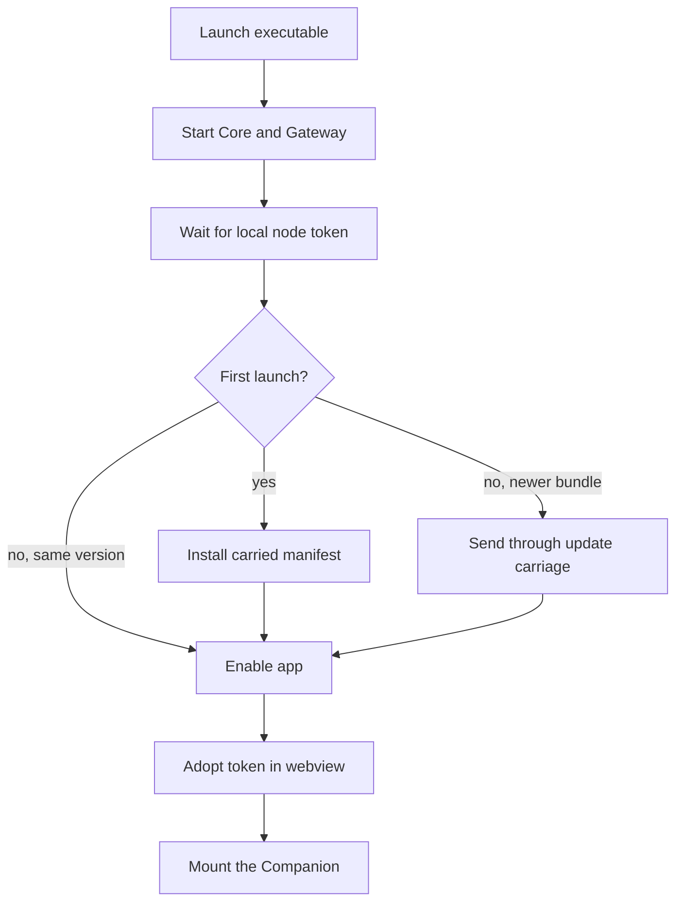

A [Ryu app](/docs/apps) can run in two modes without maintaining two implementations:

- **Hosted mode**: the app is installed into an existing node in the Ryu desktop app and uses that node's
  Core, Gateway, data directory, and lifecycle.
- **Standalone mode**: the same app manifest and Companion are carried inside a small desktop
  executable built from Desktop. The executable starts the normal local Ryu services for that app and opens the app's
  Companion as its first surface.

The app still owns its domain behavior and data. Core owns generic lifecycle, permissions, routing,
and process supervision. An app such as an expense tracker can therefore ship as its own product
without a fork of the Ryu runtime.

The standalone executable does not open the Ryu navigation shell. It mounts the app's Companion as
the window's primary surface. Ryu's host providers, capability bridge, and Core and Gateway
processes run behind that surface, so the app keeps the same governed integrations as it has inside
Ryu.

## Build one

From a Ryu source checkout, pass either an `apps-store` directory name or its manifest id:

```bash
bun run --cwd apps/desktop build:standalone expenses
# or
bun run --cwd apps/desktop build:standalone @ryu/expenses
```

The command:

1. builds the Companion when needed;
2. validates the app manifest;
3. carries the UI into the desktop host;
4. names the executable from the app manifest;
5. produces the platform bundles supported by the local Tauri toolchain.

| Flag | Effect |
|---|---|
| `--debug` | Makes a development build. |
| `--prepare-only` | Validates the carriage and sidecar plan without building the desktop executable. |

For an app-source change, work in the matching `amajorai/ryu-<app>` repository and follow its own
release guide.

The app id, version, manifest, UI hash, and sidecar declarations travel together as one versioned
bundle. The portable `.ryupack` format remains useful for marketplace and hosted installation; it is
the app package, not the standalone executable itself.

The Core install boundary accepts self-contained UI carriages up to 32 MiB (with a 40 MiB bundle
request envelope). Keep larger model weights, media, and other binary assets in declared sidecars
or app-managed storage rather than embedding them in the HTML carriage.

The app host bridge accepts a JSON envelope of up to 64 MiB for `storage:kv` calls. Apps that
persist binary data should use their own file or object layout and send only the bytes they need.

## What is shared

Standalone and hosted apps use the same:

- `manifest.json`, runnable ids, permissions, Companion entrypoint, and public mounts;
- Core install/enable lifecycle and Gateway authorization path;
- `@ryu/app-host` bridge and `@ryu/ui` / `@ryu/blocks` design seams;
- app-owned storage and domain APIs.

Do not add an app-specific server, route, credential store, or port table to Core. Declare the
sidecar and its public mount in the app manifest so the generic host can supervise it in either
mode.

## External app example

An app can live in its own repository and still be a first-party Ryu Marketplace app. The
repository carries a Ryu `manifest.json` at its root and a host build that produces one
self-contained Companion HTML file. Pass the builder either that directory or an `apps-store/`
app name or id (`findAppDirectory` in `apps/desktop/scripts/standalone.mjs`).

```bash
bun run --cwd /path/to/ryu/apps/desktop build:standalone /path/to/your-app
```

When the builder cannot find a built Companion entry, it runs the app's `bun run build` with
`VITE_RYU_HOST=true`, after `bun install --frozen-lockfile` if the app has a `bun.lock` but no
`node_modules`.

The standalone builder reads the app's root `manifest.json`, packages the built Companion, and
boots it through the same Core and Gateway lifecycle as an app from `apps-store/`. The app receives
only the governed Ryu bridge, never provider credentials.

## Sidecar carriage

The standalone host carries local Rust sidecars and Bun sidecars that expose a compiled `--compile`
artifact with the executable. It points the manifest's declared command at that private resource.
This keeps those apps usable without a separately installed sidecar binary.

Apps whose sidecars are Python, Electron, or another externally provisioned runtime still use the
normal Core-provisioned sidecar contract. Their standalone shell is buildable, but the runtime
artifact must be supplied by the app's release channel or installation environment.

Embedding a language runtime or browser engine into every app would change the distribution
boundary and its security review.

Apps without a Companion can still be packaged as a standalone node-facing app, but they do not
have a visual first screen until they declare a Companion runnable. Add the Companion through the
manifest rather than special-casing the app in Desktop.

## App startup



At first launch the native host:

1. waits for Core to mint the local node token;
2. installs the carried manifest through Core's normal lifecycle API;
3. enables it;
4. adopts that local token in the webview;
5. mounts the Companion.

The startup path is bounded and does not require a Ryu account for local operation.

Later launches reuse the app-private data directory and start the same generic Core and Gateway
process pair. If the carried bundle has a newer app version, the host sends it through the local
update carriage before enabling the app again. Existing approved grants and enabled state are
preserved.

Hosted installation follows the regular install and enable API instead.

## Install an app as a standalone window

Desktop users can right-click an enabled app with a Companion surface and choose
**Install as standalone app**. This creates an app-first Ryu window for the existing
installation. It does not install a second manifest, sidecar, credential set, or data directory.

The window resolves the same app id through the active Core node. Records, settings, connections,
and app-owned storage stay shared with the app inside Ryu.

The standalone binding is local to that Desktop installation and is keyed to the active node. It
is a launch surface, not a second app lifecycle record:

- The app must stay installed and enabled on the node.
- If the app is disabled or uninstalled inside Ryu, its standalone window becomes unavailable. It
  does not re-enable or reinstall the app.

Choosing **Remove standalone app** removes only that local launch surface and closes its
window. The app and all of its data remain installed inside Ryu. This is separate from the
plugin **Uninstall** action, which owns the app lifecycle and may offer its own optional data
cleanup review.

Local models remain local-node configuration. They run without a Ryu account or your own provider
key. Cloud providers and user-supplied keys still need the normal Gateway setup on the node. The
standalone executable never embeds provider credentials.

On macOS, the window controls use the ordinary app-window inset in a standalone app, so they stay
outside the app's Companion content.

## Release checklist

- Keep `manifest.json` authoritative for lifecycle, permissions, public mounts, and sidecars.
- Keep the Companion self-contained and on the shared theme/bridge seams.
- Build the app in both hosted and standalone modes.
- Verify that every local sidecar has a release artifact for each target platform.
- Verify the app's data migration and update behavior before publishing a new executable.
- Do not put credentials in the bundle; provider accounts remain node or Gateway configuration.

<Callout type="info">
  Standalone packaging changes the distribution shape, not the app ownership model. If the app
  works only because it reaches into Desktop or Core internals, it is not ready to ship this way.
</Callout>

## Related

<Cards>
  <DocCard href="/docs/extend/develop/extensions/ryu-apps" />
  <DocCard href="/docs/extend/develop/extensions/companion-ui" />
  <DocCard href="/docs/extend/develop/extensions/sidecar-ports" />
  <DocCard href="/docs/extend/develop/extensions/portable-packages" />
  <DocCard href="/docs/extend/develop/extensions/plugin-runtime" />
</Cards>
