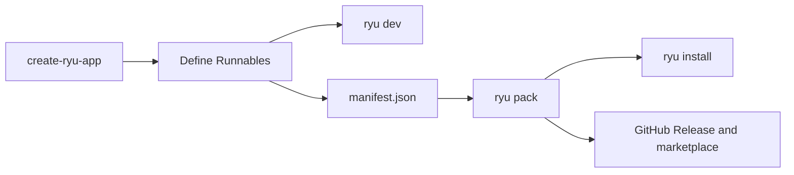

Use this path to ship a TypeScript extension. Create a project, define one or more **Runnables**
(agents, tools, skills, or workflows), pack them into a `manifest.json` plugin, and install it.



The native manifest also accepts companion, channel, engine, and policy entries. The SDK's typed
factories currently cover the four authoring kinds above. See
[Extension Schemas and Folder Layouts](/docs/extend/develop/extensions/schemas-and-layouts) and the
[manifest.json reference](/docs/extend/develop/extensions/plugin-json-manifest) for the full
contract.

`@ryuhq/sdk` (`packages/sdk/src/`) is Ryu's own SDK. It references patterns from Mastra, the Vercel
AI SDK, and ACP, but does not depend on them.

Every model call routes through the Gateway: Core, then Gateway, then the engine. The SDK has no
first-party provider bindings. See [why that matters](/docs/start-here/architecture/core-vs-gateway).

## 1. Scaffold

```bash
bunx create-ryu-app my-extension
cd my-extension
```

`create-ryu-app` (`packages/create-ryu-app/`) generates a starter project with a `manifest.json`
already validated against the manifest schema, plus a working starter agent.

The default template is `agent`. Pass `--template <name>` for another starter, such as `ryu-app`,
`app`, `hook-plugin`, or `adapter`.

<Callout type="info">
  For which SDK packages are published and on which release train, see
  [SDK publishing](/docs/extend/develop/sdk/publishing).
</Callout>

## 2. Define your Runnables

The SDK has four Runnable factories, one per authoring kind. Each takes an `id`, a `name`, and an
async `run(input, ctx)`.

The kinds are peers. An agent can list a workflow or tool in its `tools` array, and a workflow can
call an agent as a step.

### An agent

An agent drives a multi-turn model loop. Reach the model only through `ctx.gateway`, never a direct provider import:

```typescript
import { defineAgent } from "@ryuhq/sdk";

export const researcher = defineAgent({
  id: "agent-researcher",
  name: "Researcher",
  async run({ query }, ctx) {
    const result = await ctx.gateway.chat([{ role: "user", content: query }]);
    return { answer: result.content };
  },
});
```

### A tool

A tool is a stateless function with a JSON Schema for its input. The schema is validated at `run()` time and is compatible with Core's `ToolInfo.schema`, so it forwards verbatim into the unified tool catalog:

```typescript
import { defineTool } from "@ryuhq/sdk";

export const search = defineTool({
  id: "tool-web-search",
  name: "Web Search",
  schema: {
    type: "object",
    properties: { query: { type: "string", description: "Search query" } },
    required: ["query"],
  },
  async run({ query }) {
    return { results: [`Result for: ${query}`] };
  },
});
```

A tool does not need a model, so `ctx` is optional in the body. If it does call a model, it still goes through `ctx.gateway`.

### A skill and a workflow

`defineSkill` encapsulates a reusable prompt pattern (stateless like a tool, but its job is the prompt, not a side effect). `defineWorkflow` orchestrates other Runnables as steps. Both follow the same `run(input, ctx)` shape.

<Callout type="info">
  Every Runnable receives a `GatewayClient` as `ctx.gateway`. The SDK ships no provider SDKs and
  fails closed if it cannot reach the configured Gateway rather than falling back to a direct call.
  The Gateway URL defaults to `http://127.0.0.1:7981` and is overridable via `RYU_GATEWAY_URL`.
</Callout>

## 3. Run it locally

`bunx ryu dev` (`packages/sdk/src/cli/dev.ts`) runs a dev-loop module in an interactive chat loop. It
does not run a `defineAgent` or `defineWorkflow` result directly. The module must export, as
`default` or as `runnable`, an object with a `name` and a `run(messages, model)` generator that
yields `text`, `tool_call`, `tool_result`, or `error` events. A small wrapper module can call your
code from that generator:

```bash
bunx ryu dev ./src/dev-loop.ts
```

The dev loop probes the Gateway before starting. If the Gateway is unreachable, it prints an error and exits. There is no silent provider fallback.

## 4. Declare it in the manifest

List your Runnables in `manifest.json` so Core knows what the plugin contributes and what Gateway grants it needs. The schema, the per-kind fields, and the `contributes` / `activation_events` blocks are documented in the [manifest.json reference](/docs/extend/develop/extensions/plugin-json-manifest).

## 5. Pack and publish

The `ryu` CLI (`packages/sdk/src/cli.ts`) ships with `@ryuhq/sdk`. Its everyday commands:

| Command | What it does |
|---|---|
| `bunx ryu dev <entry>` | Run a dev-loop module (a `run(messages, model)` generator) locally with an interactive chat loop |
| `bunx ryu validate <dir>` | Check `manifest.json` against the SDK schema and the public JSON Schema |
| `bunx ryu pack <dir>` | Validate the `manifest.json` and emit `<dir>/dist/plugin.bundle.json` |
| `bunx ryu install <bundle-or-dir>` | Side-load the packed bundle into a Ryu node (`--enable`, `--update`) |
| `bunx ryu github-publish <url>` | Submit a seller-owned GitHub repository/package URL to the marketplace bridge |

The full list, including the interop exporters, is in [SDK tooling](/docs/extend/develop/sdk/tooling#the-cli).

```bash
bunx ryu pack .
```

`pack` validates against the manifest schema. It exits non-zero with the failing field if the
manifest is invalid.

`github-publish` submits the repository URL after you create its immutable `.ryupack` GitHub
Release. It needs your Ryu account session token in `RYU_AUTH_TOKEN`. See the
[marketplace publishing guide](/docs/extend/develop/extensions/marketplace).

<Callout type="warn">
  An SDK-authored extension always publishes as a `plugin` (a `manifest.json` bundle of Runnables),
  never as a `skill`, because a skill install expects the Agent Skills layout
  (`~/.claude/skills/<slug>/SKILL.md`), which a `manifest.json` does not carry. To ship a
  standalone skill instead, follow [Authoring a Skill](/docs/extend/skills/authoring).
</Callout>

## 6. Install the plugin

Run `bunx ryu install . --enable` to install the packed bundle on a local node and enable it.

The same two steps are available over HTTP as `POST /api/plugins/install-bundle` and
`POST /api/plugins/{id}/enable`. See [Author a Ryu App](/docs/extend/develop/extensions/ryu-apps#4-install-and-enable)
for the requests.

Enable validates the plugin's Gateway grants. Once enabled, its tools appear in tool search on both
the ACP and OpenAI-compatible planes.

## MCP bridge

The SDK ships an `McpServer` class that exposes your Runnables over MCP, and `listTools` /
`callTool` client functions that call external MCP servers. Import them from `@ryuhq/sdk/mcp`, or
from the narrower `@ryuhq/sdk/mcp/server` and `@ryuhq/sdk/mcp/client` subpaths
(`packages/sdk/src/mcp/`). See the [MCP server guide](/docs/extend/develop/extensions/mcp-server).

## Related

<Cards>
  <DocCard href="/docs/extend/develop/extensions/plugin-json-manifest" />
  <DocCard href="/docs/extend/develop/extensions/marketplace" />
  <DocCard href="/docs/extend/develop/extensions/mcp-server" />
  <DocCard href="/docs/extend/develop/extensions/agent-skills" />
</Cards>
