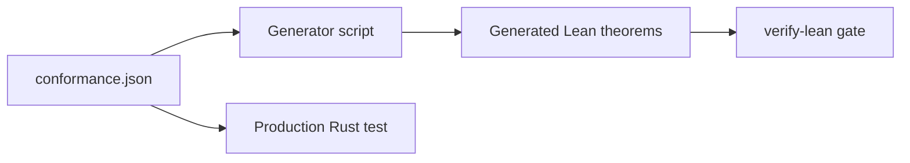
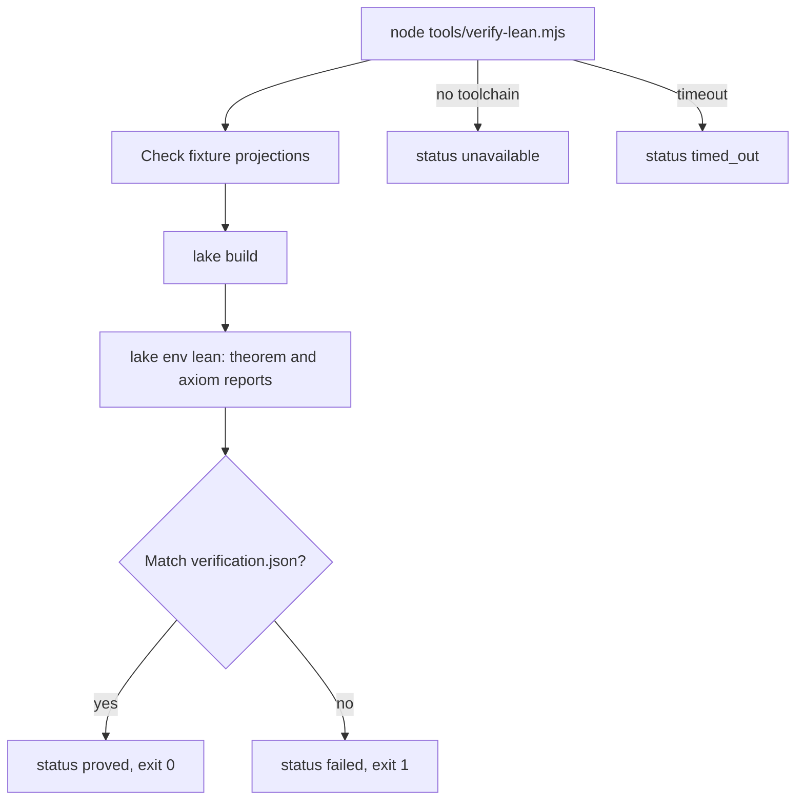

Ryu's default formal verification lane is a small, pinned Lean project. It proves properties that
are easier to state as mathematics than as an end-to-end test:

- the semantic core of deterministic reasoning;
- goal and proof continuation transitions;
- Blueprint dependency graphs.

Ryu also supports Bend projects that keep their laws in `LAWS.bend` and proofs in `PROOF.bend`.

This is a developer and CI verification record. It complements, and does not replace,
[Automated Reasoning](/docs/apps/reasoning), [Goals](/docs/core/goals),
[Proof of Work](/docs/plugins/proof), live Checks runs, `/proof` workspace inspection, and
`/receipt` visual evidence.

<Callout type="warn">
  The Lean project (`formal/`) and its gate (`tools/verify-lean.mjs`) are part of the Ryu monorepo.
  They are not included in the public `amajorai/ryu` repository, so the commands on this page need a
  monorepo checkout.
</Callout>

## Reference project

The formal project lives under `formal/lean` and is pinned by
`formal/lean/lean-toolchain` to Lean 4.33.1. It has no Mathlib dependency, which keeps the trust and installation surface small.

The checked entrypoint imports the reference models and reports the axiom
dependencies for every declared theorem:

- `Ryu.Formal.Reasoning.entails_iff_no_counterexample` proves the meaning of a
  valid claim: no policy-and-premise model makes the claim false.
- `Ryu.Formal.Goals.continue_requires_active_budget` proves that a continuation
  requires an active goal below its turn cap.
- `Ryu.Formal.Goals.paused_cannot_continue` and
  `Ryu.Formal.Goals.achieved_cannot_continue` prove that paused and achieved
  states have no continuation transition.
- `Ryu.Formal.Graph.no_cycle_of_rank_decrease` proves the reusable graph contract
  used by Blueprint: dependencies with strictly decreasing layers cannot form a
  non-empty cycle.

### Conformance fixtures

A conformance fixture is one JSON file that both the Lean project and a production test load. It
ties the Lean model to the runtime code.



| Fixture | Projected by | What it pins |
|---|---|---|
| `apps-store/reasoning/backend/fixtures/conformance.json` | `tools/generate-lean-conformance.mjs` | The four runtime verdict classes `valid`, `invalid`, `satisfiable`, and `impossible`. The production Rust reasoning test loads the same file. |
| `apps-store/blueprint/backend/fixtures/conformance.json` | `tools/generate-lean-blueprint-conformance.mjs` | Diamond and longest-path cases where layout layers move every dependency strictly downward. The production Blueprint graph test loads the same file, and its Rust cases also pin cycle, dangling-dependency, and duplicate-id rejection. |

The production Rust and TypeScript implementations remain the runtime owners. The Lean model is
not automatically a proof that those binaries implement the model. That stronger claim needs
conformance fixtures or a bound runtime snapshot.

## Run the gate

From a Ryu monorepo checkout:

```bash
node tools/verify-lean.mjs
```

The command builds the project, checks the declared theorem reports, and parses the axioms Lean
reports. Set `RYU_LAKE_BIN` when `lake` is not on `PATH`.



The gate fails closed. It exits non-zero for any of these:

- a compiler error;
- a missing toolchain;
- a timeout;
- theorem-list drift;
- an axiom outside the allowlist in `formal/verification.json`.

The gate checks every projection listed in `formal/verification.json`. After you edit a shared
fixture, run its generator, for example `node tools/generate-lean-blueprint-conformance.mjs` for
Blueprint.

### The certificate

The Lean command prints one JSON certificate. Its `status` is `proved`, `failed`, `unavailable`,
or `timed_out`. It also includes:

- `claimHash` and `sourceHash`;
- the exact Lean toolchain and version;
- the theorem names and their axiom dependencies;
- bounded diagnostics.

Pass `--snapshot <file>` to bind the certificate to an evidence snapshot through `snapshotHash`.

## Bend projects

For a Bend project, run the Ryu wrapper from a Ryu monorepo checkout and point it at the
project directory:

```bash
node tools/verify-bend.mjs --project path/to/bend-project
```

Install Bend and make `bend` available on `PATH` first. The project must contain sibling
`LAWS.bend` and `PROOF.bend` files.

The wrapper runs `bend PROOF.bend --verdict`. It accepts the result only when Bend exits
successfully and prints `ALL PROOFS CHECK`.

The certificate:

- uses `system: "bend"`;
- lists the law names;
- records Bend's version when the executable reports it, or `unknown` when it does not (a missing
  version never turns a failed check into a passing one);
- hashes the project's `.bend` sources;
- includes a `snapshotHash` when you pass `--snapshot <file>`.

Bend's [`--verdict` mode](https://github.com/bendlang/bend) rechecks proofs with the project's
Lean-proved kernel. When a workspace has both the Ryu Lean lane and a Bend project, run both and
keep their certificates separate. Lean remains the default for Ryu's reference model.

### Check a source inside a workflow

To check a Lean or Bend source as one step of a workflow, use a
[`code` step](/docs/core/workflow-code-and-scripts#code-steps-lean-bend-and-baml) in `check` mode.
It runs Lean or `bend --check-only` in your sandbox. The step fails on an error, a `sorry`, or a
law Bend cannot prove. It does not produce this page's `formal-proof` certificate.

## Evidence boundary

`evidenceLevel: "formal-model"` means the theorem or law was checked against the recorded formal
source. It does not imply that a deployed service, browser surface, provider response, or
screenshot has been verified.

Keep those records in their existing evidence lanes. Combine them by hash when a goal needs both a
model invariant and observed product behavior.

The built-in `/proof` verifier runs this gate when a workspace goal is relevant. It records the
certificate in its independent verifier report, and still requires separate live or visual
evidence for those claims.
