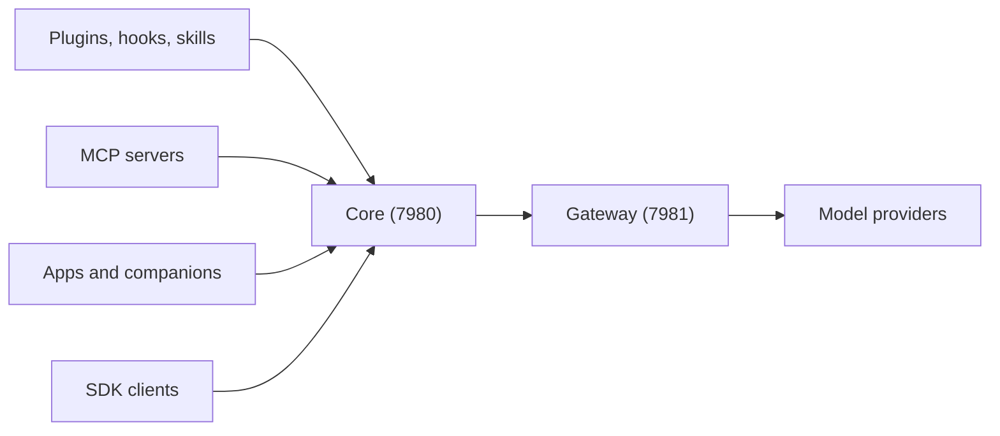

Build extensions and integrations on Ryu. Core runs locally on port 7980 and exposes a JSON and SSE
HTTP API. The Gateway on port 7981 is the LLM control plane that model calls route through.

<Figure name="extend" />

To choose between an MCP server, a `manifest.json` plugin, and the TypeScript SDK, see
[Choose a path](/docs/extend/develop/extensions#choose-a-path).

## What you can build

| Category | What | Guide |
|---|---|---|
| **Core APIs** | Stable HTTP and MCP surfaces for integrating with Ryu | [API Reference](/docs/extend/develop/api-reference) |
| **Plugins vs Apps** | When to ship net-new capability logic vs a full surface on pre-built primitives | [Plugins vs Apps](/docs/extend/develop/extensions/plugins-vs-apps) |
| **Plugins** | Installable bundles of agents, tools, workflows, skills | [manifest.json](/docs/extend/develop/extensions/plugin-json-manifest) |
| **Turn hooks** | React to chat events (pre/post turn, tool use, sessions) | [Hooks & Lifecycle](/docs/extend/develop/extensions/hooks-lifecycle) |
| **MCP servers** | Expose any tool over the Model Context Protocol | [MCP Server](/docs/extend/develop/extensions/mcp-server) |
| **Agent skills** | Reusable prompt patterns as SKILL.md files | [Authoring a Skill](/docs/extend/skills/authoring) |
| **Ryu apps** | Interactive in-chat widgets | [Ryu Apps](/docs/extend/develop/extensions/ryu-apps) |
| **Desktop companions** | Contribute UI into the desktop app | [Desktop Companion](/docs/extend/develop/extensions/desktop-companion) |
| **Channel bots** | Messaging-platform bot adapters | [Channel Bot](/docs/extend/develop/extensions/channel-bot) |
| **Actions** | Define governed business operations with typed input/output contracts | [Build Actions](/docs/extend/develop/extensions/author-actions) |
| **Workflows** | Orchestrate agents as a DAG in TypeScript | [Author Workflows](/docs/extend/develop/extensions/author-workflows) |
| **Formal verification** | Prove model-level invariants with a pinned Lean certificate gate | [Formal Verification](/docs/extend/develop/formal-verification) |
| **UI** | Consistent components, themes, and hooks | [Ryu UI](/docs/ui) |

<Callout type="info">
  `@ryuhq/sdk` and `@ryuhq/client` 0.3.0 are on npm. These are not in that release yet:

  - newer SDK entry points, such as workflows and `createRyuServer`;
  - the `ryu validate`, `install`, `build`, and `deploy` commands;
  - the Managed Agents, Messaging, Notify, and Box clients in `@ryuhq/client`.

  [Choose an SDK](/docs/standalone/sdk/choose-an-sdk) lists every package's publication status.
  [SDK publishing](/docs/extend/develop/sdk/publishing) covers the packages the SDK release train
  publishes.
</Callout>

<Cards>
  <DocCard href="/docs/extend/develop/quickstart" />
  <DocCard href="/docs/extend/develop/extensions" />
  <DocCard href="/docs/standalone/sdk/choose-an-sdk" />
  <DocCard href="/docs/extend/develop/sdk" />
  <DocCard href="/docs/ui" />
  <DocCard href="/docs/extend/develop/contributing" />
  <DocCard href="/docs/extend/develop/api-reference" />
</Cards>
