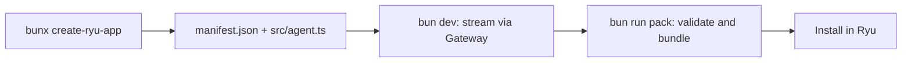

In this tutorial you scaffold a plugin with `create-ryu-app`, run its starter agent against your
local Gateway, bundle it, and install it into your node. At the end you have a valid
`manifest.json` and an agent whose model calls all route through the Gateway.

You write plugins with `@ryuhq/sdk` (the Ryu developer SDK) and scaffold them with
`create-ryu-app`. For the full SDK surface see [the SDK reference](/docs/extend/develop/sdk), and
for every manifest field see [the Plugin API Reference](/docs/extend/develop/sdk/plugin-api).

You need [Bun](https://bun.sh) (`bun` and `bunx` on your PATH) and a running local Ryu node. A
running Core also runs the Gateway as a managed sidecar, so the starter agent has a model to call.

<Callout type="warn">
  The current npm releases of `create-ryu-app` and `@ryuhq/sdk` are 0.3.0. The `ryu validate` and
  `ryu install` commands used below are newer and are not in 0.3.0.
  [What you can install today](/docs/standalone/sdk/choose-an-sdk#what-you-can-install-today) lists
  each package's status, and the [SDK hub](/docs/extend/develop/sdk/hub) carries the current source.
</Callout>

## What you build



The install moment uses the same review language as the product surface:

<SurfacePreview surface="plugin" />

The scaffold emits a directory with three files that matter:

| File | What it is |
|---|---|
| `manifest.json` | The plugin manifest, validated against `PluginManifestSchema` so the desktop plugin store can install it |
| `src/agent.ts` | A starter agent with one local tool; every model call goes through the Gateway |
| `package.json` | A minimal project with a `@ryuhq/sdk` dependency plus `dev` and `pack` scripts |

## Step 1: Scaffold the project

Run the scaffolder, passing a project name. The name becomes the directory and the app id slug,
so use lowercase letters, digits, hyphens, or underscores.

```bash
bunx create-ryu-app my-first-plugin
```

`create-ryu-app` (`packages/create-ryu-app/index.ts`) copies the template, stamps your name into
`manifest.json`, validates the result against `PluginManifestSchema`, and writes `package.json`. On
success it prints the next steps:

```text
  created my-first-plugin/ (agent)

  next steps:
    cd my-first-plugin
    bun install
    bun dev         # runs the template entry
    bun run pack    # validate and bundle manifest.json
```

This tutorial uses the default `agent` template. Pass `--template <name>` for a different starter:

| Template | What it scaffolds |
|---|---|
| `expense-agent` | An agent that calls existing Ryu tools such as Gmail |
| `workflow` | A workflow with an approval gate, opened in the dev studio |
| `multi-agent` | A supervisor and its team |
| `action` | A governed business action |
| `adapter` | A capability adapter |
| `hook-plugin` | A post-assistant-turn hook |
| `ryu-app` | An in-chat widget |
| `companion-plugin` | A widget that calls a companion tool, plus a panel |
| `app` | A sidecar-backed app satellite |
| `services` | A standalone server on `@ryuhq/services`, not an extension |

Every template is described in [Scaffold a project](/docs/extend/develop/sdk/tooling#scaffold-a-project).

The generated `manifest.json` looks like this (your name is stamped into the `id` and `name`):

```json
{
  "id": "com.example.my-first-plugin",
  "name": "My First Plugin",
  "version": "0.1.0",
  "runnables": [
    { "id": "agent-main", "name": "Main Agent", "kind": "agent" }
  ],
  "permission_grants": [],
  "companion": {
    "label": "My First Plugin",
    "icon": "sparkles",
    "shortcut": "ctrl+shift+r"
  }
}
```

A plugin bundles one or more Runnables (the unified Agent / Workflow / Tool / Skill / MCP-server
contract) plus an optional companion surface. See [the Runnable model](/docs/start-here/architecture/runnable-model)
for the concept and [the manifest reference](/docs/extend/develop/sdk/plugin-api) for every field.

## Step 2: Install dependencies

```bash
cd my-first-plugin
bun install
```

This pulls `@ryuhq/sdk`, which gives you the Gateway-only model client, the loop-owning
`Agent`, and the `defineAgent` / `defineWorkflow` / `defineTool` / `defineSkill` Runnable factories.

## Step 3: Read the starter agent

Open `src/agent.ts`. It declares an `Agent` with one local tool and asks it one question. The agent
owns the tool-calling loop: you declare instructions, a model, and tools, then call `generate()`.

```ts
import { defineTool } from "@ryuhq/sdk";
import { Agent } from "@ryuhq/sdk/agent";

const MODEL_ID = process.env.RYU_MODEL ?? "gpt-4o-mini";
const WHITESPACE = /\s+/;

const wordCount = defineTool<{ text: string }, { characters: number; words: number }>({
  id: "word-count",
  name: "Word Count",
  description: "Count the words and characters in a piece of text.",
  schema: {
    type: "object",
    properties: { text: { type: "string", description: "The text to measure" } },
    required: ["text"],
  },
  run({ text }) {
    const words = text.trim().split(WHITESPACE).filter(Boolean).length;
    return Promise.resolve({ words, characters: text.length });
  },
});

const agent = new Agent({
  name: "my-first-plugin",
  model: MODEL_ID,
  instructions: "You are a concise writing assistant running inside Ryu. ...",
  tools: { wordCount },
});

const result = await agent.generate(
  process.argv.slice(2).join(" ") || 'How many words are in "Ryu routes every model call through its gateway"?'
);
process.stdout.write(`${result.text}\n`);
```

The local tool runs in your process, so the starter needs no API key, account connection, or Core
agent. It needs only a node whose Gateway can route a model. To call tools that already exist in Ryu (for
example Gmail through Composio), scaffold `--template expense-agent`, which uses `ryuTool` and lists
the one-time setup those tools need.

Two design points matter here:

- **The model is a swappable string.** Change `MODEL_ID` in the file, or set `RYU_MODEL`, and the
  Gateway resolves the provider. No provider is hardcoded.
- **No key lives in your code.** Every call goes through the Gateway, and credentials live in the
  Gateway config, never in this file. See [the Gateway overview](/docs/gateway) for what the
  Gateway governs.

## Step 4: Run it against the Gateway

```bash
bun dev
```

This runs one agent turn, calling the tool if the model asks for it. Pass your own prompt with
`bun run src/agent.ts "count the words in this sentence"`. The model client targets
`RYU_GATEWAY_URL` (default `http://127.0.0.1:7981`); set `RYU_GATEWAY_TOKEN` first if your Gateway
requires auth.

<Callout type="warn">
  The starter agent needs a routable model behind the Gateway. A fresh local install ships a local
  engine and a default model, but if the Gateway cannot resolve `gpt-4o-mini` (or your
  `RYU_MODEL`) the turn fails.

  Point `RYU_MODEL` at a model your Gateway can route, for example a local model id or an
  `openrouter/...` slug. Pick a model that supports tool calling so the agent can use `wordCount`.
</Callout>

## Step 5: Validate and bundle

When the agent works, bundle the plugin for the store:

```bash
bun run pack
```

This calls `bunx ryu pack .`. The `ryu` CLI that ships with `@ryuhq/sdk` validates `manifest.json`
against the same `PluginManifestSchema` and, on success, writes a publish-ready bundle to
`dist/plugin.bundle.json`. If the manifest is invalid it exits non-zero and names the failing
field, so a broken manifest never reaches the store.

For a stricter authoring check, `bunx ryu validate .` also checks the manifest against the public
[JSON Schema](https://ryuhq.com/schemas/plugin.json), which flags values such as a misspelled hook
phase that Core would accept and then never use.

The CLI also offers:

| Command | What it does |
|---|---|
| `bunx ryu pack <dir>` | Validate `manifest.json` and emit `dist/plugin.bundle.json` |
| `bunx ryu validate <dir>` | Check `manifest.json` against the SDK schema and the public JSON Schema |
| `bunx ryu install <bundle-or-dir>` | Side-load a packed bundle into a Ryu node |
| `bunx ryu dev <entry>` | Run a dev-loop module (a `run(messages, model)` generator) locally with an interactive chat loop |
| `bunx ryu github-publish <url>` | Submit a seller-owned GitHub repository/package URL to the GitHub-backed Marketplace bridge |

See [SDK tooling](/docs/extend/develop/sdk/tooling#the-cli) for every command and option.

## Step 6: Install it in Ryu

Side-load the bundle into your local node with the SDK CLI:

```bash
bunx ryu install . --enable
```

`bunx ryu install` posts `dist/plugin.bundle.json` to the node's authenticated
`POST /api/plugins/install-bundle` endpoint:

- **Target node.** On the same machine it finds the node's token automatically. For another node,
  set `RYU_CORE_URL` and `RYU_CORE_TOKEN`.
- **Enable.** The plugin installs disabled, as a store install does. `--enable` then enables it,
  which validates its declared grants through the Gateway. Without the flag, enable it from the
  store when you are ready.
- **Update.** Re-run with `--update` after you change and re-pack it.

The same request works from any HTTP client that presents the node's bearer token:

```bash
curl -X POST "$RYU_CORE_URL/api/plugins/install-bundle" \
  -H "Authorization: Bearer $RYU_CORE_TOKEN" \
  -H 'content-type: application/json' \
  --data @dist/plugin.bundle.json
```

<TryInRyu page="store" />

### Publish to the marketplace

Publishing a GitHub-backed package to the marketplace adds Gateway governance (grant validation
plus manifest signing):

1. Create the immutable `.ryupack` release.
2. Submit its repository URL through **Publish from GitHub** on the web Marketplace, or run
   `bunx ryu github-publish <url>` with your Ryu session token in `RYU_AUTH_TOKEN`.
3. For a private repository, install the Ryu GitHub App once if asked.

The full flow is on [the marketplace authoring page](/docs/extend/develop/extensions/marketplace).

## Where to go next

<Cards>
  <DocCard href="/docs/extend/develop/sdk" />
  <DocCard href="/docs/extend/develop/sdk/plugin-api" />
  <DocCard href="/docs/extend/develop/extensions/hooks-lifecycle" />
  <DocCard href="/docs/extend/develop/extensions/marketplace" />
  <DocCard href="/docs/extend/develop/contributing" />
  <DocCard href="/docs/start-here/architecture/runnable-model" />
</Cards>
