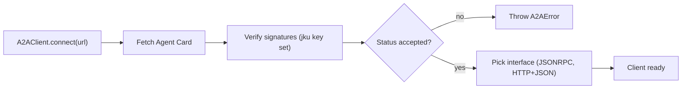

`@ryuhq/sdk/a2a` is an [Agent2Agent Protocol](https://a2a-protocol.org/latest/specification) v1
client for your own TypeScript process. It speaks the same protocol Ryu uses for
[A2A integration](/docs/extend/integrate/a2a): the JSON-RPC and HTTP+JSON bindings, Server-Sent
Events streaming, and signed Agent Cards.

Use it to call another Ryu node or any A2A v1 agent directly from an app, or to give an SDK
`Agent` a remote agent as a tool.

<Callout type="warn">
  `@ryuhq/sdk/a2a` is newer than `@ryuhq/sdk` 0.3.0, the current npm release.
  [What you can install today](/docs/standalone/sdk/choose-an-sdk#what-you-can-install-today) lists
  what each published version includes.
</Callout>

```typescript
import { A2AClient } from "@ryuhq/sdk/a2a";

const peer = await A2AClient.connect("https://agent.example.com", {
  credential: { kind: "bearer", token: process.env.PEER_TOKEN ?? "" },
  requireVerifiedSignature: true,
});

const reply = await peer.sendMessage("Summarize yesterday's incidents.");
if (reply.kind === "task") console.log(reply.task.id, reply.task.status.state);
else console.log(reply.message.parts);
```

## Discovery and card signatures

`A2AClient.connect(url)` (or `discoverAgentCard(url)`) fetches the Agent Card and picks an
interface. A base URL resolves to `/.well-known/agent-card.json`; a URL ending in `.json` is used
as-is. The card must name 1 to 16 interfaces and stay within the protocol's size limits. The
client prefers `JSONRPC`, then `HTTP+JSON`, at protocol version `1.0`; pass `preference` to
change the order.



Signed cards are checked the same way Ryu checks its peers. Each `signatures` entry is a detached
JWS (`EdDSA`) over the RFC 8785 canonical JSON of the card without `signatures`. The key is
fetched from the `jku` in the protected header, and only when that key set is on the card's own
origin. The result is on `client.signature` and on `discoverAgentCard(...).signature`, with one
of these statuses.

| `status` | Meaning | Accepted |
|---|---|---|
| `verified` | A signature matched a key from the card origin's key set (`kid`, `jku`) | Yes |
| `unsigned` | The card has no signatures | Unless `requireVerifiedSignature` is set |
| `unverifiable` | The key set could not be fetched, is on another origin, or the algorithm is unsupported | Unless `requireVerifiedSignature` is set |
| `invalid` | A signature is malformed, names an unpublished key, or does not match the card | Never |

A verified signature proves the card came from the holder of that key. Still authenticate the
endpoint itself with HTTPS and a credential. The signing helpers (`canonicalizeJson`,
`verifyAgentCardSignatures`, `ed25519KeysFromJwks`) are exported for custom key sources.

## Calls

| Method | A2A operation |
|---|---|
| `sendMessage(params)` | `SendMessage`; resolves to `{ kind: "task", task }` or `{ kind: "message", message }` |
| `sendStreamingMessage(params)` | `SendStreamingMessage`; an async iterator of task, message, status, and artifact updates |
| `getTask(id, { historyLength })` | `GetTask` |
| `listTasks({ contextId, status, pageSize, ... })` | `ListTasks` |
| `cancelTask(id)` | `CancelTask` |
| `subscribeToTask(id)` | `SubscribeToTask` |
| `createPushConfig`, `getPushConfig`, `listPushConfigs`, `deletePushConfig` | Push-notification configuration |
| `getExtendedAgentCard()` | `GetExtendedAgentCard` |

`params` is either text or `{ message, configuration, metadata }`, where `message` is text or a
partial message (`parts`, `contextId`, `taskId`, ...). The client fills in `messageId` and the
user role. To pick one agent on a Ryu node that publishes several, send
`metadata: { ryuAgentId: "..." }`.

Each stream update carries a `kind` field.

```typescript
for await (const update of peer.sendStreamingMessage("Draft the release notes.")) {
  if (update.kind === "artifact_update") console.log(update.artifactUpdate.artifact.parts);
  if (update.kind === "status_update") console.log(update.statusUpdate.status.state);
}
```

## Use a remote agent as a tool

`client.asTool()` wraps the remote agent as a tool for an SDK `Agent`. The model sends a
`prompt`; the tool streams when the card advertises streaming, otherwise it sends the message and
polls the task until it finishes.

```typescript
import { Agent } from "@ryuhq/sdk";
import { A2AClient } from "@ryuhq/sdk/a2a";

const remote = await A2AClient.connect("https://agent.example.com", {
  credential: { kind: "bearer", token: process.env.PEER_TOKEN ?? "" },
});

const assistant = new Agent({
  name: "assistant",
  model: "your-model-id",
  tools: { incidents: remote.asTool({ description: "The on-call incident agent." }) },
});
```

| Remote result | Tool result |
|---|---|
| Completed task or direct message | Its text parts, or its `data` parts when there is no text |
| `TASK_STATE_INPUT_REQUIRED` or `TASK_STATE_AUTH_REQUIRED` | `{ state, text, taskId, contextId }`; the next call continues the same task |
| Failed, rejected, or canceled task | A tool error with the agent's status message |
| Still running after `timeoutMs` (default 300 s) | `{ state, text, taskId, contextId }` |

A streamed task is read until it completes, fails, or asks for input, even if the peer keeps the
stream open; past `timeoutMs` the task is returned in its current state.

The tool keeps one A2A context across calls unless `keepContext: false`. That context belongs to
the tool object, so create a separate tool for each independent conversation. Other options are
`name`, `id`, `stream`, `pollIntervalMs`, `metadata`, and `needsApproval`. For one-off calls
without an agent, `runA2ATask(client, message)` returns the same outcome.

## Credentials

| `credential.kind` | Sends |
|---|---|
| `none` (default) | No credential |
| `bearer` | `Authorization: Bearer <token>` |
| `api_key` | The value in your chosen header (`Host`, `Content-Length`, and `Transfer-Encoding` are refused) |
| `basic` | HTTP Basic |
| `oauth2_client_credentials` | Fetches a bearer token from `tokenUrl` with the client ID, secret, and `scopes` before each call |

`extensions` sends the listed extension URIs in `A2A-Extensions`.

## Network safety

Every request sends `A2A-Version: 1.0` and follows at most three redirects that stay on the same
origin. These are the default size limits, which you can adjust with the `limits` option.

| Payload | Limit |
|---|---|
| JSON response | 4 MiB |
| Stream event | 4 MiB |
| Agent Card | 512 KiB |

The signature key set is fetched from its `jku` without following redirects. In a browser, where
`fetch` hides a redirect's target, a redirect is refused because it cannot be checked.

URLs must use HTTPS, carry no embedded credentials or fragment, and must not name a private,
loopback, link-local, or reserved address, or a `localhost`, `.local`, or `.internal` host. For
local development, `policy: { allowLoopbackHttp: true }` allows plain HTTP to loopback hosts:

```typescript
const local = await A2AClient.connect("http://127.0.0.1:7980", {
  policy: { allowLoopbackHttp: true },
});
```

A browser or Node `fetch` cannot pin the addresses a hostname resolves to, so these checks apply
to the URL and to IP literals. When a peer is untrusted and DNS rebinding matters, call it through
your Ryu node's A2A peer connection instead, which re-checks every resolved address.

Failures throw `A2AError` with a `code` (`http_status`, `json_rpc`, `invalid_agent_card`,
`cross_origin_redirect`, `response_too_large`, ...), plus `status` or `rpcCode` when they apply.
Rejected URLs throw `A2AEndpointError`.

Pass `fetch` to supply your own transport, for example in tests.
