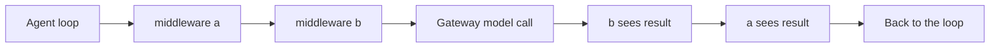

An SDK `Agent` without a `sessionId` runs its model-and-tool loop inside your own process. The
`middleware` option lets that process shape every round: rewrite the context sent to the model,
switch models, answer from a cache, block or rewrite a tool call, redact a tool result, or ask for
another turn.

Middleware entries are plain functions, so they can use your app's own state, imports, and
clients. Every model call still routes through the Gateway, and remote Ryu tools are still
executed and governed by Core.

```typescript
import { Agent, type AgentMiddleware } from "@ryuhq/sdk";

const redactSecrets: AgentMiddleware = {
  name: "redact-secrets",
  wrapToolCall: async (request, next) => {
    const { output } = await next(request);
    return { output: JSON.parse(JSON.stringify(output).replaceAll(/sk-[\w-]+/g, "[redacted]")) };
  },
};

const readOnly: AgentMiddleware = {
  name: "read-only",
  wrapToolCall: (request, next) =>
    request.name.startsWith("delete")
      ? Promise.resolve({ output: { error: "This agent may not delete anything." } })
      : next(request),
};

const agent = new Agent({
  name: "support",
  model: "your-model-id",
  tools: { searchTickets, deleteTicket },
  middleware: [readOnly, redactSecrets],
});
```

## Phases

| Handler | Runs | Use it to |
|---|---|---|
| `wrapModelCall(request, next)` | around every Gateway call | rewrite `messages`, change `model` or `tools`, inspect the result, or return a result without calling `next` to skip the model |
| `wrapToolCall(request, next)` | around every tool execution | rewrite `input`, return an error output without calling `next` to block the call, or change the output before the model sees it |
| `afterTurn(turn)` | when the model stops calling tools | return `{ continue: "..." }` to add a user message and run another turn |

Each handler is optional. A middleware entry can define any combination of them.

## Order

Middleware composes in array order, with the first entry outermost. For
`middleware: [a, b]`, a model call runs `a` before `b` on the way in and `b` before `a` on the
way out. Calling `next` more than once is allowed, which is how a retry wrapper works.



`afterTurn` handlers run in array order and the first one that returns a non-empty `continue`
wins. A continued run still counts against `maxSteps`, so a handler that always continues ends
when the step limit is reached.

## Requests and results

`wrapModelCall` receives `{ messages, model, step, tools }` and returns the model result
`{ message, finishReason, usage }`. `messages` is a copy of the transcript for this call only:
return a rewritten array in the request you pass to `next` rather than mutating it. The run's own
transcript is unchanged, so a context rewrite applies to one call.

`wrapToolCall` receives `{ id, name, input, step }` and returns `{ output }`. An object output is
JSON-encoded into the transcript. The loop's `tool_call` event carries the model's original
input; the `tool_result` event carries the output after middleware.

The tool executes the final `request.input` passed to `next`, including changes to nested fields
made in place. Invalid model argument JSON remains a tool error and does not execute the tool.

Text deltas stream to your app as the model produces them. When a `wrapModelCall` handler
replaces the reply, the final `result.text` reflects the replacement, and a reply supplied
without calling the model is emitted as one `text` event.

## Errors and approvals

An error thrown by `wrapModelCall` or `afterTurn` ends the run with an `error` event. An error
thrown by `wrapToolCall` or by the tool itself is returned to the model as the tool's error
output, so the model can adjust. Unlike sandboxed plugin hooks, which are skipped when they fail,
in-process middleware is your own code, and its failures are surfaced.

Tools marked `needsApproval` still ask your `approvalHandler` first. `wrapToolCall` runs only for
calls that were approved.

## Core-owned runs

Middleware applies only to the loop the SDK runs itself. When you pass a `sessionId`, Core
executes the run, so an `Agent` configured with both returns an `error` event instead of silently
ignoring the middleware. To customize a Core-owned run, package the logic as a plugin with
`defineFunctionHook`; see [Hooks & Lifecycle](/docs/extend/develop/extensions/hooks-lifecycle).
