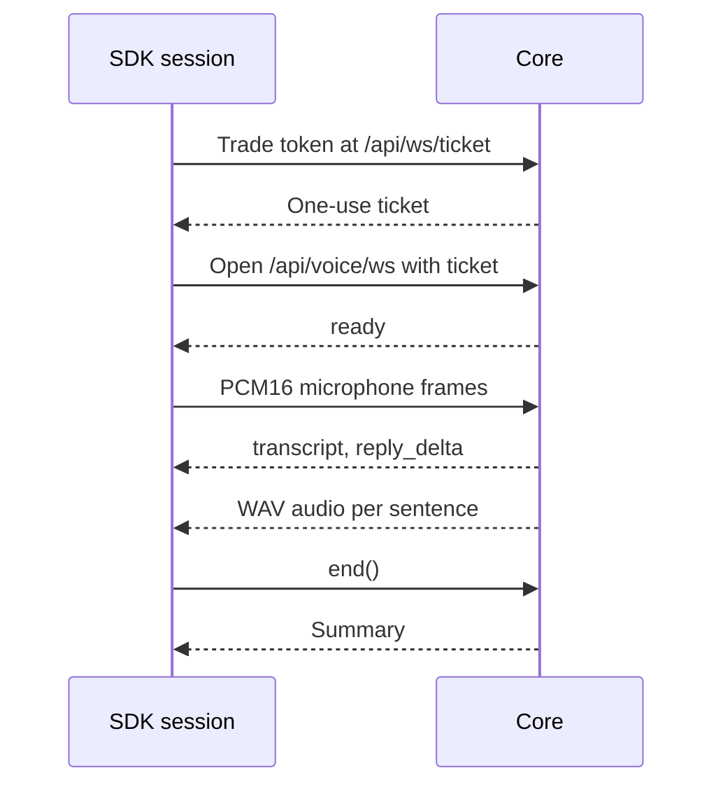

Every SDK `Agent` (see [the SDK overview](/docs/extend/develop/sdk)) has a `voice` field with
three calls, `speak`, `listen`, and `realtime`. They go to the agent's own Ryu node, never to a
speech provider.

You choose a Gateway model id, and the Gateway uses the provider key the node holds, with the same
budgets and guardrails as chat. Without a model id, Core's local speech engines do the work.

<Callout type="warn">
  `@ryuhq/sdk/voice` is newer than `@ryuhq/sdk` 0.3.0, the current npm release.
  [What you can install today](/docs/standalone/sdk/choose-an-sdk#what-you-can-install-today) lists
  what each published version includes.
</Callout>

```typescript
import { Agent } from "@ryuhq/sdk/agent";

const agent = new Agent({
  name: "concierge",
  model: "openai/gpt-4o",
  agentId: "concierge",
  voice: {
    speechModel: "openai/gpt-4o-mini-tts",
    transcriptionModel: "openai/whisper-1",
    voice: "alloy",
  },
});

const { audio, mimeType } = await agent.voice.speak("Your table is ready.", { format: "mp3" });
const { text } = await agent.voice.listen(recordingBlob);
```

## Routing

| Call | With a model id | Without a model id |
|---|---|---|
| `speak(text, options)` | Gateway `POST /v1/audio/speech` | Core `POST /api/voice/speak` (`ttsEngine`, or the node default) |
| `listen(audio, options)` | Gateway `POST /v1/audio/transcriptions` | Core `POST /api/voice/transcribe` (`sttEngine`, or the node default) |
| `realtime(options)` | Core realtime voice mode (`/api/voice/ws`) | Same |

- **Model id.** It comes from `options.model`, or from `voice.speechModel` /
  `voice.transcriptionModel` on the agent.
- **Endpoints.** The Gateway URL and token come from the agent's `node`, and the Core URL and token
  from `core`, with the same environment defaults as the rest of the agent.
- **Agent overrides.** When the agent has an `agentId`, Gateway calls send it so the node can apply
  that agent's speech model overrides.
- **Egress check.** Both base URLs go through the SDK's direct-provider egress check, so pointing
  the agent at a provider's API fails before any request is sent.

## `speak`

```typescript
const result = await agent.voice.speak("Hello", {
  voice: "alloy",          // default: voice.voice
  format: "wav",           // Gateway: mp3, wav, aac, flac, opus, pcm. Core: wav, mp3, ogg, flac
  instructions: "Warm and unhurried",
  speed: 1.1,
  language: "en",          // Core engines
});
result.audio;    // Blob, typed with result.mimeType
result.via;      // "gateway" | "core"
```

The Gateway route defaults to `wav`. Asking a route for a format it cannot produce throws before
the request. A node error is thrown with the node's message.

## `listen`

```typescript
const transcript = await agent.voice.listen(audio, {
  timestamps: true,   // Gateway: verbose_json with segment timings
  language: "en",
  prompt: "Ryu, Kokoro",
});
transcript.text;
transcript.segments; // [{ startMs, endMs, text }]
transcript.words;    // when the engine reports word timings
```

`audio` can be a `Blob`, `ArrayBuffer`, or `Uint8Array`. The upload filename's extension tells the
node the container. It comes from the Blob's MIME type, or you can pass `filename`; raw bytes are
sent as `audio.wav`.

## `realtime`

`realtime()` opens a session on Core's voice mode. Core runs voice activity detection, speech to
text, the agent turn, and per-sentence speech. Your code sends microphone audio and plays the
WAV audio Core sends back.

```typescript
const session = await agent.voice.realtime({
  sampleRate: 16_000,          // PCM16 mono frames you will send
  conversationId: "conv_123",  // optional: persist turns into a conversation
});

for await (const event of session) {
  switch (event.type) {
    case "transcript":    console.log("user:", event.text, event.final); break;
    case "reply_delta":   process.stdout.write(event.text); break;
    case "audio":         player.enqueueWav(event.audio); break;
    case "stop_playback": player.flush(); break;  // the user talked over the reply
    case "error":         console.error(event.code, event.message); break;
  }
}

session.sendAudio(pcm16Frame);    // Int16Array, Uint8Array, or ArrayBuffer
session.sendText("Book it");      // typed turn, no speech to text
session.interrupt();              // stop the current reply now
const summary = await session.end(); // { conversationId, messageId, durationSeconds, content }
```



- **Auth.** The session first trades the Core token for a one-use ticket at `/api/ws/ticket`. Only
  the ticket goes in the socket URL.
- **Identity.** Turns run as the agent's `agentId`. Set `callerTrusted: false` when the speaker is
  not the node owner, and every turn uses Core's restricted untrusted-caller tool set.
- **Ready.** The session resolves once Core acknowledges it (`readyTimeoutMs`, default 15 seconds).
- **Socket.** It uses the runtime's global `WebSocket`. Pass `webSocket` to supply another socket
  implementation.

Event types: `ready`, `state` (`idle`, `listening`, `thinking`, `speaking`), `speech_start`,
`transcript`, `reply_delta`, `reply_end`, `audio_start`, `audio`, `audio_end`,
`stop_playback`, `call_ended`, `error`, `pong`, and `closed`. You can also pass `onEvent` or
call `session.subscribe(listener)`.

To serve the same agent to a browser frontend, see [AG-UI protocol](/docs/extend/develop/sdk/ag-ui).

`@ryuhq/sdk/voice` exports `AgentVoice`, `openRealtimeVoice`, and the types for use outside an
`Agent`.
