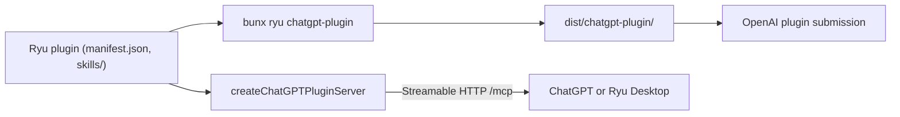

`@ryuhq/sdk` can export a plugin as an OpenAI-compatible Agent Plugin directory and run an MCP
server that supports ChatGPT's extensions (`packages/sdk/src/chatgpt/`).

The export includes only the source plugin's declared MCP servers and its `skills/` tree. It never
reads the user's node-wide MCP or skill configuration.

<Callout type="warn">
  The `@ryuhq/sdk/chatgpt` subpath and the `ryu chatgpt-plugin` command are newer than
  `@ryuhq/sdk` 0.3.0, the current npm release.
  [What you can install today](/docs/standalone/sdk/choose-an-sdk#what-you-can-install-today) lists
  what each published version includes.
</Callout>

Related guides:

- **OpenAI.** [Plugin Extensions](https://developers.openai.com/plugins/build/extensions), [Build an MCP server](https://developers.openai.com/plugins/build/mcp-server), and [Package your plugin](https://developers.openai.com/plugins/build/plugins).
- **Ryu.** The [MCP server guide](/docs/extend/develop/extensions/mcp-server), the [skill authoring guide](/docs/extend/skills/authoring), and the [SDK tooling guide](/docs/extend/develop/sdk/tooling).



## Package a Ryu plugin

Run the SDK command from the repository or package root:

```bash
bunx ryu chatgpt-plugin ./my-extension
```

It writes `dist/chatgpt-plugin/` with:

- a portable `plugin.json`, whose OpenAI `interface` metadata is projected from the Ryu listing
  fields in `manifest.json`;
- an `mcp.json` built from the native manifest's `mcp_servers`, when it declares any;
- a copy of the selected `skills/<slug>/` folders;
- `.app.json` when present, with `extensions.com.openai.apps` pointing at that package file.

Credential-like headers, environment values, command arguments, and URL query parameters are
omitted from the ChatGPT projection. Configure authentication on the MCP server through the
ChatGPT connection flow or the server's OAuth boundary.

OpenAI imports up to five skills per scan, and `--skills` accepts at most five slugs. If the plugin contains more, select a subset:

```bash
bunx ryu chatgpt-plugin ./my-extension --skills research,calendar
```

- **Skill names.** The folder slug becomes the portable skill's frontmatter `name`. The package
  keeps the original Ryu skill folder and the rest of its frontmatter and resources.
- **Checks.** Each skill must include a description. The packer checks OpenAI's current resource
  limits before writing the package.
- **Re-runs.** The export is idempotent for its managed output. Use `--force` only when replacing an
  existing `dist/chatgpt-plugin/` directory that was not produced by Ryu.

<Callout type="info">
  The output keeps stdio MCP declarations for compatible local plugin hosts. ChatGPT's hosted MCP
  connection needs a Streamable HTTP endpoint that ChatGPT can reach. The package does not deploy
  an endpoint or turn a local command into a public server.
</Callout>

## Create the server

Use the `@ryuhq/sdk/chatgpt` subpath for a standard MCP server, UI resources, app tools, and OpenAI-specific controls:

```ts
import {
  createChatGPTPluginServer,
  registerChatGPTAppResource,
  registerChatGPTAppTool,
  RESOURCE_MIME_TYPE,
} from "@ryuhq/sdk/chatgpt";

const plugin = await createChatGPTPluginServer({
  name: "research-assistant",
  version: "1.0.0",
  instructions: "Use search results as evidence and cite each source.",
  skills: {
    directory: "./skills",
    pluginName: "ryu.research-assistant",
  },
  configure: (server, openai) => {
    registerChatGPTAppResource(
      server,
      "Research panel",
      "ui://research/panel.html",
      {},
      async (uri) => ({
        contents: [{ uri: uri.href, mimeType: RESOURCE_MIME_TYPE, text: panelHtml }],
      }),
    );

    registerChatGPTAppTool(
      server,
      "research.open",
      {
        description: "Open the research panel.",
        inputSchema: {},
        _meta: {
          ui: { resourceUri: "ui://research/panel.html" },
          "openai/ui": { entrypoints: [{ type: "global" }, { type: "thread" }] },
        },
      },
      async () => ({ content: [{ type: "text", text: "Research panel opened." }] }),
    );

    openai.mentions.setHandler(async ({ query }) => ({ items: await searchItems(query) }));
  },
});

await plugin.listen({
  host: "127.0.0.1",
  port: 3000,
  path: "/mcp",
  allowedHosts: ["127.0.0.1"],
  authorize: (request) => verifyAccessToken(request),
});
```

The example assumes project-defined `panelHtml`, `searchItems`, and `verifyAccessToken` functions.
`verifyAccessToken` is your authorization function.

The listener:

- requires `authorize` on every request, binds to loopback by default, and checks the configured
  Host and Origin allowlists;
- closes a session after 15 minutes idle (`sessionIdleTimeoutMs`);
- keeps at most 100 sessions by default (`maxSessions`);
- reports request method, duration, and status through the optional `onRequest` callback.

The `configure` callback runs once for each initialized MCP client session, so keep it
deterministic and register the same tool surface each time.

<Callout type="warn">
  A public deployment still needs HTTPS, an authorization boundary such as OAuth 2.1, and stable
  hosting. Use a temporary tunnel only for local developer-mode testing. It is not a submission
  endpoint.
</Callout>

The returned `openai` object provides OpenAI's server extension handlers for settings, mentions,
and structured elicitation. `registerChatGPTAppTool` and `registerChatGPTAppResource` re-export the
MCP Apps server helpers (`@modelcontextprotocol/ext-apps/server`) and carry ChatGPT's optional UI
metadata. Tool handlers also work without UI.

## Publish bundled skills over MCP

`registerChatGPTSkills`:

- advertises `io.modelcontextprotocol/skills`;
- serves paginated `skills/list` and `skills/get`;
- registers every skill file for `resources/read`;
- normalizes the portable skill name to the folder slug and preserves the remaining frontmatter;
- calculates SHA-256 digests from the exact bytes served.

Skill files are snapshots at server startup. After updating a skill, restart the server and run
**Scan Tools** again in OpenAI's plugin submission flow. OpenAI imports the skill files into the
draft. It does not fetch them at runtime.

## Use extensions inside Ryu

Desktop also consumes MCP Apps UI resources and OpenAI extension metadata.

### Entry points

- A tool's `_meta.ui.resourceUri` identifies its UI.
- The `openai/ui.entrypoints` metadata can expose the app in the sidebar, beside a conversation, or
  as a handler for declared filename extensions.
- Only global entrypoints appear in app launchers. Thread and file entrypoints keep their
  contextual routes without becoming unrelated global launch targets.
- File suffixes accept an optional leading dot and normalize case. Repeated file declarations merge
  into one handler with at most 64 suffixes.

### Permissions

The owning plugin must be enabled and approved to render widgets. Metadata does not grant
permissions. Opening an app uses the selected agent's normal tool authorization and approval flow.
The trusted host holds credentials; the app runs in the existing sandbox and receives only its
scoped bridge.

### App lifecycle

- **Initialization.** MCP App initialization uses the standard JSON-RPC window transport. The host
  supplies the initial tool arguments and result without invoking the tool twice.
- **Context.** App context updates replace the same instance's prior context, and host context
  notifications keep the mounted app synchronized.
- **Placement.** A sidebar entry opens with an owned conversation and composer beside its permanent
  app view. Conversation panels share context with their owning conversation. Settings action
  views can stay detached and do not advertise conversation-dependent actions.
- **Display modes.** Inline, fullscreen, and picture-in-picture use the shared widget renderer.

### Opening tools and retries

An opening tool can request information before its UI is ready. Ryu publishes the owning
conversation while the tool waits, so the native form stays available.

Retrying an opening with the same operation key recovers its result while Core is running and its
receipt is retained. It does not invoke the tool again. Operation receipts are bounded and expire
after thirty minutes. This does not promise a provider transaction can be replayed across a Core
restart.

### Files, model context, and settings

- **Files.** File handlers receive an opaque resource URI for the file the user opened, and the URI
  grants access to that file only. Resource reads include an ETag, and saves report conflicts
  instead of overwriting a newer version.
- **Model context.** It accepts text, images, resource links, and embedded text or binary resources.
  Binary resources become file attachments for the selected model, which must support the file
  type. Private content-block metadata stays out of model input.
- **Settings.** Structured settings advertised through `openai/settings` use the server's read and
  update tools. Ryu renders the schema with shared controls and sends only changed values back. The
  plugin stays responsible for persistence. Pending authorization and provider errors stay
  visible, and Ryu confirms a save only after reading back the changed values.

See [Contribution surfaces](/docs/extend/develop/extensions/contribution-surfaces) for native authoring and [MCP servers](/docs/extend/develop/extensions/mcp-server) for structured input requests.

## Verify the server

From a checkout of the [SDK hub](/docs/extend/develop/sdk/hub), run the focused tests and the
package typecheck.

```bash
bun test packages/sdk/src/agent-plugin.test.ts packages/sdk/src/chatgpt
bun run --cwd packages/sdk check-types
```

The MCP server tests exercise the actual local Streamable HTTP endpoint, OpenAI UI metadata,
authorization failure, skill discovery, and digest-backed resource reads. They do not prove a
public deployment or a live ChatGPT account connection.
