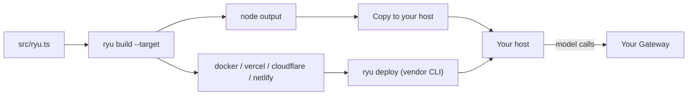

`ryu build` bundles a [project module](/docs/extend/develop/sdk/server#project-modules) (default
`src/ryu.ts`) into a deployable [`createRyuServer`](/docs/extend/develop/sdk/server) for the target
you pick. `ryu deploy` builds and then hands the output to the vendor's own CLI.



<Callout type="warn">
  `ryu build` and `ryu deploy` are newer than `@ryuhq/sdk` 0.3.0, the current npm release.
  [What you can install today](/docs/standalone/sdk/choose-an-sdk#what-you-can-install-today) lists
  what each published version includes.
</Callout>

```bash
bunx ryu build --target node                 # .ryu/build/node
bunx ryu build app.ts --target docker,vercel # several targets at once
bunx ryu deploy cloudflare --prod
```

## ryu build

```text
ryu build [entry] --target <node|docker|vercel|cloudflare|netlify>[,<target>…]
          [--out <dir>] [--name <name>]
```

| Option | Default |
|---|---|
| `[entry]` | `src/ryu.ts` |
| `--target` | required; comma-separate several |
| `--out` | `.ryu/build`; each target writes to `<out>/<target>` |
| `--name` | the `name` in your `package.json`, else the directory name (lowercased, dashes only) |

Each build bundles your project and the server into one ES module with `Bun.build`, so `ryu build`
runs under Bun (`bunx ryu`). Generated files start with a "do not edit" header: change your project
and rebuild instead.

| Target | Output | Run or ship it |
|---|---|---|
| `node` | `server.mjs`, `package.json` | `npm install && node server.mjs` |
| `docker` | the `node` files plus `Dockerfile` and `.dockerignore` | `docker build -t <name> .` |
| `vercel` | `.vercel/output` in [Build Output API v3](https://vercel.com/docs/build-output-api/v3) form: one Node.js 22 function serving every path | `vercel deploy --prebuilt` |
| `cloudflare` | `worker.mjs` (Workers module syntax) and `wrangler.toml` with `nodejs_compat` | `wrangler deploy` |
| `netlify` | `netlify/functions/ryu.mjs` (routed at `/*`), `netlify.toml`, and an empty `public/` | `netlify deploy` |

The `node` and `docker` servers listen on `PORT` (default `3000`) and `HOST` (default `0.0.0.0`).
The Docker image runs as the unprivileged `node` user.

### Native addon and serverless targets

The SDK's native addon is a platform-specific binary. The `node` and `docker` outputs keep it as a
dependency in `package.json`, so it installs for the platform the server runs on.

Vercel, Netlify, and Cloudflare cannot use a binary built on your machine, so those bundles link a
pure-JavaScript replacement instead. The replacement:

- resolves `RYU_GATEWAY_URL` and `RYU_GATEWAY_TOKEN` from the environment;
- enforces the same rule that refuses direct provider URLs;
- sends model and embedding calls to your Gateway's OpenAI-compatible endpoints with `fetch`.

Agents, `ctx.gateway` inside local tools and workflow steps, and `defineModel` work the same as on
Node.

<Callout type="warn">
  Manifest validation needs the native addon and throws a clear error on serverless targets. Use
  `node` or `docker` if your server validates manifests at runtime.
</Callout>

### Authentication

A built server refuses to start unless your project's server has an `auth` hook. Anyone who can
reach an open server can run your agents on your Gateway budget and call your tools.

Export a server created with `auth: bearerAuth(process.env.API_TOKEN)` (see
[the server guide](/docs/extend/develop/sdk/server)). If the API is meant to be public, set
`RYU_SERVER_PUBLIC=1` in the deployment's environment to opt out explicitly.

### Configuration and secrets

Builds contain no credentials. Set configuration in each platform's own settings at deploy time:

| Variable | Purpose |
|---|---|
| `RYU_GATEWAY_URL`, `RYU_GATEWAY_TOKEN` | The Gateway that agents send model calls to |
| `RYU_CORE_URL`, `RYU_CORE_TOKEN` (else `RYU_TOKEN`) | The Core node that runs remote Ryu tools (`ryuTool`) |
| `RYU_MODEL` | The model id for the default tool and step runtime |
| `RYU_SERVER_PUBLIC` | Set to `1` to let a server without an `auth` hook start |
| Your own, for example `API_TOKEN` | Read in your project, for example `bearerAuth(process.env.API_TOKEN)` |

On Cloudflare, `nodejs_compat` exposes Worker variables and secrets as `process.env`; add secrets
with `wrangler secret put <NAME>`, never in `wrangler.toml`.

A deployed server must be able to reach your Gateway. Agent routes fail if it is only listening on
your machine's loopback address.

### Run history on serverless platforms

The default run store is in memory, so on serverless platforms each instance keeps its own short
history and a workflow suspended in one invocation may not be resumable from another. Pass a
persistent [`runStore`](/docs/extend/develop/sdk/server#persisting-runs) to keep run history and
resume across instances.

## ryu deploy

```text
ryu deploy <vercel|cloudflare|netlify|docker> [entry] [--out <dir>] [--name <name>] [--prod] [--no-build]
```

`ryu deploy` builds the target (skip with `--no-build`), then runs the vendor's CLI in the target's
output directory with your terminal attached:

| Target | Command | Install it |
|---|---|---|
| `vercel` | `vercel deploy --prebuilt` (`--prod` adds `--prod`) | `npm i -g vercel` |
| `cloudflare` | `wrangler deploy` | `npm i -g wrangler` |
| `netlify` | `netlify deploy` (`--prod` adds `--prod`) | `npm i -g netlify-cli` |
| `docker` | `docker build -t <name> .` | [Docker](https://docs.docker.com/get-docker/) |

- **Missing CLI.** If the CLI is not on your `PATH`, `ryu deploy` stops before building and tells
  you how to install it.
- **Sign-in.** The vendor CLI owns sign-in (`vercel login`, `wrangler login`, `netlify login`, or
  your registry login for Docker). `ryu deploy` never asks for, reads, or stores credentials.
- **Exit code.** It exits with the vendor CLI's exit code.
- **Docker.** A `docker` deploy builds the image. Push it to your registry and run it where you host
  containers.
- **Node.** The `node` target has no vendor. Copy `.ryu/build/node` to your host and start
  `server.mjs`.
