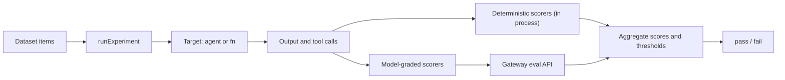

`@ryuhq/sdk/evals` tests an agent, or any function, against a dataset in code. Each case gets
per-scorer results, the experiment gets aggregate scores, and thresholds turn the result into a
pass/fail you can use in CI.

<Callout type="warn">
  `@ryuhq/sdk/evals` is newer than `@ryuhq/sdk` 0.3.0, the current npm release.
  [What you can install today](/docs/standalone/sdk/choose-an-sdk#what-you-can-install-today) lists
  what each published version includes.
</Callout>

```typescript
import { Agent } from "@ryuhq/sdk";
import {
  answerRelevancy,
  exactMatch,
  loadDataset,
  runExperiment,
  toolCallAccuracy,
} from "@ryuhq/sdk/evals";

const agent = new Agent({
  name: "support",
  model: "your-model-id",
  instructions: "Answer billing questions briefly.",
});

const result = await runExperiment({
  agent,
  dataset: await loadDataset("evals/support.jsonl"),
  scorers: [exactMatch(), answerRelevancy(), toolCallAccuracy()],
  thresholds: { exact_match: 0.8, answer_relevancy: 0.7 },
  concurrency: 4,
});

console.table(result.scores);
if (!result.pass) process.exitCode = 1;
```

Deterministic scorers run in your process. Model-graded scorers call the Ryu Gateway's eval API,
so judging uses the same judge prompt format, model routing, budgets, and audit as Desktop and
`ryu eval`. The SDK never calls a model provider directly and needs no provider key.



## Datasets

A dataset is a list of items. Each item has an `input` and can carry an `expected` answer,
`context` for faithfulness checks, `expectedToolCalls`, an `id`, and `metadata`.

```typescript
import { createDataset, loadDataset, parseDataset } from "@ryuhq/sdk/evals";

const inCode = createDataset("geography", [
  { input: "Capital of France?", expected: "Paris" },
  {
    id: "weather",
    input: "Weather in Paris?",
    expectedToolCalls: [{ name: "get_weather", input: { city: "Paris" } }],
  },
]);

const fromFile = await loadDataset("evals/qa.csv"); // .json, .jsonl, .ndjson, or .csv
const fromText = parseDataset(text, { format: "jsonl", name: "nightly" });
```

Files use common eval-file field names, so existing datasets load unchanged:

| Field | Accepted names |
|---|---|
| Input | `input`, `prompt`, `question`, `query` |
| Expected answer | `expected`, `expected_output`, `expectedOutput`, `answer`, `reference` |
| Context | `context` (a CSV cell holding a JSON array or object is parsed) |
| Expected tool calls | `expectedToolCalls` or `expected_tool_calls` (JSON array of `{ name, input? }`) |
| Other columns | Kept in `metadata` |

A JSON file can be an array of items or an object with an `items` (or `cases`) array and an
optional `name`. Items without an `id` get `case-1`, `case-2`, and so on. Ids must be unique.

## Scorers

Every scorer returns a score from 0 to 1 where higher is better, an optional reason, and a pass
flag. A scorer that cannot run for a case (for example, no expected answer) reports `skipped`,
and skipped cases are left out of the aggregates instead of counting as zero. A scorer that
throws fails that case rather than passing it.

### Deterministic

| Scorer | Score |
|---|---|
| `exactMatch()` | 1 when the output equals `expected` (whitespace and case normalized by default) |
| `contains({ value? })` | Fraction of the required substrings found; defaults to `expected` |
| `regex({ pattern, negate? })` | 1 when the output matches (or, with `negate`, does not) |
| `jsonSchema({ schema })` | 1 when the output contains JSON that validates against a JSON Schema or any Standard Schema (zod, valibot, arktype) |
| `levenshtein({ threshold? })` | `1 - editDistance / maxLength` against `expected`; passes at 0.8 by default |
| `toolCallAccuracy({ ordered?, strict? })` | Fraction of `expectedToolCalls` the agent made, matched by name and a subset of arguments |
| `completeness({ threshold? })` | Fraction of the expected answer's content words that the output mentions |

`toolCallAccuracy` reads the tool calls captured from an `Agent` run. With `strict`, calls to
tools that were not expected lower the score; with `ordered`, the expected calls must happen in
sequence. An empty `expectedToolCalls` list passes only when the agent called no tools.

### Model-graded

| Scorer | What the Gateway judges |
|---|---|
| `llmJudge({ rubric, model? })` | Your rubric. `{{input}}`, `{{expected}}`, and `{{context}}` are replaced with the case's values |
| `answerRelevancy({ model? })` | Whether the output directly answers the question asked |
| `faithfulness({ model? })` | Whether every claim in the output is supported by the case `context` (skipped without context) |
| `toxicity({ model? })` | The catalog `toxicity` evaluator, reported as 1 = benign |
| `catalogEvaluator({ evaluator, model? })` | Any offline evaluator in the Gateway catalog, such as `correctness`, `conciseness`, or a custom evaluator |
| `embeddingSimilarity({ model })` | Cosine similarity between Gateway embeddings of the output and `expected` |

`model` is the judge model. When you omit it, the Gateway uses its configured eval default
model. Catalog evaluators that score a bad signal (the catalog reports `higherIsBetter: false`,
as for `toxicity`) are inverted so that a higher score is always better. Without a `threshold`,
a catalog evaluator uses the Gateway's own pass decision.

The scorers find the Gateway from `RYU_GATEWAY_URL` and authenticate with `RYU_GATEWAY_TOKEN`.
To target another node, pass a client:

```typescript
import { GatewayEvalClient, llmJudge } from "@ryuhq/sdk/evals";

const gateway = new GatewayEvalClient({ baseUrl: "https://node.example:7981", token });
const citesSources = llmJudge({
  id: "cites_sources",
  gateway,
  model: "your-judge-model",
  rubric: "Question: {{input}}\nScore 1 if the answer cites at least one source.",
});
```

### Custom scorers

```typescript
import { createScorer } from "@ryuhq/sdk/evals";

const concise = createScorer({
  id: "concise",
  threshold: 1,
  score: ({ output }) => (output.split(/\s+/).length <= 50 ? 1 : 0),
});
```

`score` receives the case `input`, `output`, `expected`, `context`, `metadata`, and the captured
`toolCalls`, and returns a number or `{ score, pass?, reason?, skipped?, details? }`.

## Experiments

`runExperiment` takes exactly one target:

- `agent` - an SDK `Agent`. The final text is scored, and its tool calls are captured for
  `toolCallAccuracy`. A run that pauses for an approval or an account connection fails that case.
- `fn` - any `(item, { signal }) => string | { output, toolCalls? }`, sync or async.

| Option | Default | Meaning |
|---|---|---|
| `concurrency` | 4 | Cases in flight at once (1 to 64) |
| `thresholds` | none | One minimum mean for every scorer, or `{ [scorerId]: minimum }` |
| `timeoutMs` | none | Per-case deadline for the target |
| `signal` | none | Cancels the whole experiment |
| `onCaseComplete` | none | Called as each case finishes |

The result holds:

- `cases` - input, output, tool calls, duration, error, and per-scorer results;
- `scores` - per scorer, `mean`, `passRate`, `executed`, and `skipped`;
- `thresholds` and `errored`;
- `pass` - true when no case errored and every threshold was met.

A scorer that never executed fails its threshold. A threshold that names an unknown scorer, or a
minimum outside 0 to 1, is rejected before any case runs.

## Upload to Prompt Studio

Save an experiment as a run in an existing prompt suite to review it beside Desktop runs:

```typescript
import { uploadExperiment } from "@ryuhq/sdk/evals";

const run = await uploadExperiment(result, { suiteId: "suite_123" });
```

The run is stored with one assertion row per scorer and the full SDK result. Saving needs edit
access to the suite's agent.

- **Node.** `baseUrl`, else `RYU_CORE_URL`, else the local node.
- **Bearer.** `token`, else `RYU_CORE_TOKEN`, else `RYU_TOKEN`. For a local node with neither set,
  the node's own token is used. That token is never sent to a remote URL.

## Run evals in CI

For a CI gate that does not need TypeScript, replay a dataset through the Gateway with the CLI or
the GitHub Action. Both accept the same dataset files and thresholds:

```sh
ryu eval support-agent --dataset evals/support.jsonl \
  --scorer answer_relevance --scorer toxicity --threshold 0.8 --junit > ryu-eval.xml
```

See the [CLI reference](/docs/surfaces/cli/reference#observability-and-ci) and
[GitHub Actions](/docs/ci/github-actions#gate-a-pull-request-on-evals).
