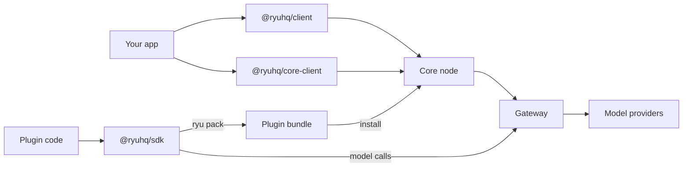

The SDK source, packages, binding projects, examples, tests, and release automation live in the
[`amajorai/ryu-sdk` public hub](https://github.com/amajorai/ryu-sdk). This section is the API and
integration reference for that hub. For the package map and local verification commands, see
[Public SDK hub](/docs/extend/develop/sdk/hub).

<Figure name="sdk" />

## Start here

| If you want to... | Start with |
|---|---|
| Call an existing Ryu agent from TypeScript or React Native | [`@ryuhq/client`](/docs/extend/develop/sdk/client) |
| Call Managed Agents, Mail, Notify, Box, Messaging, or another standalone service with retries, idempotency, and typed errors | [`@ryuhq/services`](/docs/standalone/sdk) |
| Call the standalone services from Python | `ryu_sdk.services` in [`ryu-sdk`](/docs/standalone/sdk#python) |
| Publish and consume standalone product notifications | [`@ryuhq/services`](/docs/standalone/sdk/notify) (or the low-level `@ryuhq/client` `createNotifyClient`) and [Ryu Notify](/docs/standalone/notify) |
| Start, resume, cancel, or observe a durable agent run | [Durable harness](/docs/extend/develop/sdk/harness) |
| Customize the SDK agent loop's model and tool calls in your own process | [Agent middleware](/docs/extend/develop/sdk/agent-middleware) |
| Type tool arguments and agent outputs with zod, valibot, or arktype | [Typed schemas and structured output](/docs/extend/develop/sdk/typed-schemas) |
| Score agents against datasets and gate CI on eval thresholds | [Evals](/docs/extend/develop/sdk/evals) |
| Combine agents as tools, hand off between them, or run a supervisor | [Multi-agent](/docs/extend/develop/sdk/multi-agent) |
| Call a remote A2A v1 agent, or use it as a tool, from TypeScript | [A2A client](/docs/extend/develop/sdk/a2a-client) |
| Serve an SDK agent to CopilotKit or another AG-UI frontend | [AG-UI protocol](/docs/extend/develop/sdk/ag-ui) |
| Give an SDK agent speech output, transcription, or realtime voice | [Agent voice](/docs/extend/develop/sdk/agent-voice) |
| Manage agents, plugins, models, skills, MCP, Spaces, or workflows from TypeScript or React Native | [`@ryuhq/core-client`](/docs/extend/develop/sdk/core-client) |
| Call Core from a Java application | [Java library](/docs/extend/develop/sdk/java) |
| Build agents, tools, structured output, or Core workflows in Python | [Python SDK](/docs/extend/develop/sdk/python) |
| Build a Ryu plugin, app, tool, workflow, or skill | `@ryuhq/sdk` below |
| Embed the Rust kernel in another language | [Libraries and bindings](/docs/extend/develop/sdk/language-bindings) |

[Choose an SDK](/docs/standalone/sdk/choose-an-sdk) compares every package, command line, and MCP
server, with the environment variables each one reads and its publication status.

## Terms

- **SDK** means the authoring package, `@ryuhq/sdk`.
- **Library** means a language-specific package that calls Core over HTTP.
- **Binding** means a generated package that wraps the shared Rust kernel. Most app developers do
  not need one.

## How the packages connect



Clients and libraries talk to a running Core node. Plugin code written with `@ryuhq/sdk` is packed
into a bundle that Core installs. Every model call reaches a provider only through the Gateway.

## TypeScript authoring API

`@ryuhq/sdk` (`packages/sdk/`) is the authoring package. You write governed Actions and Runnables
(agents, workflows, tools, and skills) in typed TypeScript, declare them in a `manifest.json`, and
pack the result into a publish-ready bundle. Every model call routes through the Gateway.

- For a walkthrough that builds a plugin end to end, see
  [TypeScript SDK](/docs/extend/develop/extensions/typescript-sdk).
- For the `manifest.json` schema, lifecycle endpoints, and signing, see
  [Plugin manifests](/docs/extend/develop/extensions/plugin-json-manifest) and the
  [Plugin API](/docs/extend/develop/sdk/plugin-api).
- To operate a running Core node, use [`@ryuhq/core-client`](/docs/extend/develop/sdk/core-client).
  Desktop, `ryu-cli`, and the mobile app use the same package.

Use the [durable harness](/docs/extend/develop/sdk/harness) instead of a one-shot chat helper when
a caller needs cursorable events, idempotent retries, execution-profile provenance, and
approval-aware control.

<Callout type="warn">
  The model client depends on the native addon `@ryuhq/sdk-native`, so a model call only runs where
  that addon has been built. Action authoring, manifest validation, and the MCP adapter are pure
  TypeScript and do not require the addon.
</Callout>

## Package layout

The package (`packages/sdk/package.json`) exposes a subpath per concern in its `exports` map:

| Subpath | Resolves | Holds |
|---|---|---|
| `.` | the main API | factories, builders, model client, manifest types and schemas |
| `./manifest` | the manifest schema | `PluginManifestSchema` and the manifest types |
| `./runnable` | the Runnable factories | `defineAgent`, `defineWorkflow`, `defineTool`, `defineSkill` |
| `./chatgpt` | OpenAI MCP Extensions | Streamable HTTP server setup, MCP App helpers, bundled skills, and ChatGPT package export |
| `./action` | the governed Action contract | `defineAction` |
| `./builder` | the fluent builders | `PluginBuilder` plus per-kind builders |
| `./model` | the model client | `defineModel`, `ModelClient` |
| `./agent` | the agent factory | `createAgent`, `query`, `ryuTool`, `AgentMiddleware` |
| `./plugin` | the plugin facade | `definePlugin`, `toDisposable`, and the contribution and host-service types |
| `./agent-plugin` | Agent Plugins interop | the Agent Plugins v1 `plugin.json`/`mcp.json` emission |
| `./mcp` | the MCP bridge | `McpServer`, `listTools`, `callTool` |
| `./mcp/server` | the stdio server | `McpServer` |
| `./mcp/client` | the stateless client | `listTools`, `callTool` |
| `./workflow` | typed workflows | `createWorkflow`, `createStep`, `compileWorkflow` |
| `./schema` | schema validation | `validateJsonSchema`; see [Typed schemas](/docs/extend/develop/sdk/typed-schemas) |
| `./rag` | retrieval helpers | `splitText`, `matchesFilter`, `weightedRrf`; see [Retrieval helpers](/docs/extend/develop/sdk/rag) |
| `./loaders` | document loaders | web, sitemap, GitHub, Notion, Drive, Confluence, feed, and file loaders; see [Document loaders](/docs/extend/develop/sdk/document-loaders) |
| `./evals` | evals | `runExperiment`, scorers, `uploadExperiment`; see [Evals](/docs/extend/develop/sdk/evals) |
| `./prompts` | the prompt registry | `prompts`, `TextPrompt`, `ChatPrompt`; see [Prompts](/docs/extend/develop/sdk/prompts) |
| `./a2a` | the A2A client | `A2AClient`, `discoverAgentCard`; see [A2A client](/docs/extend/develop/sdk/a2a-client) |
| `./agui` | AG-UI support | `toAgUiHandler` and the event converters; see [AG-UI protocol](/docs/extend/develop/sdk/ag-ui) |
| `./voice` | agent voice | `AgentVoice`, `openRealtimeVoice`; see [Agent voice](/docs/extend/develop/sdk/agent-voice) |
| `./server`, `./server/node` | the HTTP server | `createRyuServer`, and a Node listener adapter; see [Serve agents over HTTP](/docs/extend/develop/sdk/server) |
| `./cli` | the `ryu` CLI | also installed as the `ryu` bin |

The MCP bridge (`McpServer`, `listTools`, `callTool`, `MCP_PROTOCOL_VERSION`, `unwrapContent`) is a
public export (`packages/sdk/src/mcp/`). See [MCP bridge](/docs/extend/develop/sdk/builders#mcp-bridge).
For a ChatGPT plugin package, OpenAI MCP Extensions, or skills served by MCP, see
[ChatGPT plugins and MCP extensions](/docs/extend/develop/sdk/chatgpt).

## The Runnable contract

Every factory returns a value satisfying one shared interface (`packages/sdk/src/runnable/runnable-types.ts`).
The four kinds are peers, not a hierarchy: an agent lists a workflow as a tool, a workflow lists an
agent as a step.

```typescript
interface Runnable<TInput = unknown, TOutput = unknown> {
  readonly id: string;
  readonly kind: "agent" | "workflow" | "tool" | "skill";
  readonly name: string;
  run(input: TInput, ctx: RunnableContext): Promise<TOutput>;
}

interface RunnableContext {
  gateway: GatewayClient;   // the only allowed path to a model; never null
  sessionId?: string;       // optional Core session id for stateful runs
  signal?: AbortSignal;     // optional abort for long-running runs
  // optional primitive clients: rag, memory, storage, durable, engines, ...
}

interface GatewayClient {
  chat(messages: ChatMessage[]): Promise<ChatResult>;
  stream(messages: ChatMessage[]): AsyncGenerator<ChatDelta>;
}
```

`RunnableContext` always carries a `gateway`. A context cannot be built without one, so a Runnable
reaches a model only through the Gateway. The optional primitive clients are described in
[SDK primitives](/docs/extend/develop/sdk/primitives). See
[Gateway enforcement](/docs/extend/develop/sdk/runnables#gateway-enforcement) for the construction-time check.

## Focused guides

<Cards>
  <DocCard href="/docs/extend/develop/sdk/runnables" />
  <DocCard href="/docs/extend/develop/sdk/builders" />
  <DocCard href="/docs/extend/develop/sdk/tooling" />
</Cards>
