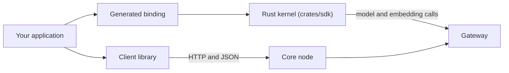

Ryu supports two integration jobs:

1. **Call Ryu from an application.** Use a client library. It sends normal HTTP and JSON requests
   to a running Core node.
2. **Embed the shared Rust kernel.** Use a generated binding. It exposes manifest validation,
   Gateway egress checks, model calls, and embeddings, but it does not run Core for you.

If you are unsure, use the client library. Calling an agent needs no Rust toolchain and no
generated binding.



The checkout commands on this page run from the public
[`amajorai/ryu-sdk`](https://github.com/amajorai/ryu-sdk) hub, which holds the language-binding
projects. The public runtime repository,
`amajorai/ryu`, does not carry the language-binding projects. It keeps only the client packages
that `ryu-cli` and the host surfaces need.

## Choose your library

| Application | Start with | Package/install |
|---|---|---|
| TypeScript or JavaScript | Embedded chat | [`@ryuhq/client`](/docs/extend/develop/sdk/client) |
| React Native or Expo | Embedded chat | [`@ryuhq/client`](/docs/extend/develop/sdk/client) with `expo/fetch` for streaming |
| React Native or Expo | Full Core control | [`@ryuhq/core-client`](/docs/extend/develop/sdk/core-client) |
| Java 17+ | Core client | [`com.ryu:ryu-client`](/docs/extend/develop/sdk/java) |
| Rust | Kernel or Gateway model client | [`ryu-sdk`](/docs/extend/develop/sdk/rust) |
| Python | Agent authoring, Core clients, and the Rust-kernel surface | [Python SDK](/docs/extend/develop/sdk/python) (`ryu-sdk`, not yet on PyPI) |
| C# | Rust-kernel surface | `Ryu.Sdk` (not yet on NuGet) |
| Swift or Kotlin | Rust-kernel surface | `ryu-sdk-uniffi` generated binding from the SDK hub |
| C or Go | Rust-kernel surface | `ryu-sdk-ffi` C ABI |

## React Native / Expo

Ryu's React Native integration is a TypeScript library, not a Node-API addon. The first-party
mobile app uses `@ryuhq/core-client` directly. The package has no React or platform dependency,
so your app supplies the selected node target.

- For list, create, and management calls, pass an `ApiTarget` to the
  [`@ryuhq/core-client`](/docs/extend/develop/sdk/core-client#react-native--expo) domain modules.
- For embedded chat, create an [`@ryuhq/client`](/docs/extend/develop/sdk/client#react-native--expo)
  client and inject `expo/fetch` for streaming.

Store the node token with `expo-secure-store`. A node token grants access to that Core node. It is
not a provider key. Never put an OpenAI, Anthropic, or other provider key in the mobile bundle.

## Java

Java applications use the Maven library `com.ryu:ryu-client`, not a kernel binding. The
[Java library](/docs/extend/develop/sdk/java) page covers install, chat, streaming, and Spaces.
Its source is in `bindings/java`. To test it, run:

```bash
bash bindings/java/test.sh
```

## Kernel bindings

These targets are generated from the same Rust export (`crates/sdk/uniffi/src/lib.rs`). Use one
when your app needs the kernel's local validation or the Gateway model and embedding clients
instead of Core's HTTP API.

The generated surface is:

| Operation | Purpose |
|---|---|
| `validate_plugin_id` | Check a plugin identifier |
| `parse_and_validate_manifest` | Parse and validate a `manifest.json` string |
| `plugin_manifest_json_schema` | Get the Rust-derived JSON Schema |
| `resolve_gateway_url` / `resolve_gateway_token` | Read Gateway connection defaults |
| `assert_allowed_egress` | Reject direct-provider URLs |
| `ModelClient` | Gateway-routed chat and streaming |
| `EmbeddingClient` | Gateway-routed embeddings |

The generated files are build outputs. The source of truth is `crates/sdk/uniffi`. Do not edit
generated language code by hand.

## Python

<Callout type="warn">
  The `ryu-sdk` Python package is not published to PyPI yet. Build and test it from the SDK hub
  with the command below. [SDK publishing](/docs/extend/develop/sdk/publishing) tracks the release
  state.
</Callout>

The package contains the generated `ryu_sdk` module and the native library for the platform
wheel. The same package carries the pure-Python authoring surface (agents, tools, workflows, and
Core clients), documented on the [Python SDK](/docs/extend/develop/sdk/python) page.

To regenerate and test the binding from the hub, run:

```bash
bash bindings/python/test.sh
```

```python
import ryu_sdk

ryu_sdk.validate_plugin_id("io.example.plugin")
client = ryu_sdk.ModelClient("gemma4", None, None)
reply = client.chat([ryu_sdk.ChatMessage("user", "Hello from Python.")])
print(reply.content)
```

## Kotlin

The generated Kotlin package is callable from Kotlin or Java. For Core HTTP access, use the Java
library instead. Use this binding only when you need the Rust-kernel surface:

```bash
bash bindings/kotlin/test.sh
```

## Swift

```bash
bash bindings/swift/test.sh
```

The Swift package uses the same `ModelClient`, `EmbeddingClient`, manifest,
and egress operations. Streaming is callback-based through `ChatSink` because
UniFFI cannot export a language-neutral closure.

## C#

<Callout type="warn">
  `Ryu.Sdk` is not published to NuGet yet. Build and test it from the SDK hub.
</Callout>

To regenerate and test the binding from the hub, run:

```bash
bash bindings/csharp/test.sh
```

The C# package uses the same `ModelClient`, `EmbeddingClient`, manifest, and
egress operations. It uses the version-matched third-party UniFFI generator.

## C

`ryu-sdk-ffi` is the maintained C ABI. The generated header is in
`crates/sdk/ffi/include/ryu_sdk.h` in the hub. Returned strings are owned by
the library and must be released with the matching `*_free` functions.

## Node-API

`@ryuhq/sdk-native` is the Node-API implementation detail used by
`@ryuhq/sdk`. Application code should install `@ryuhq/sdk` rather than loading
the addon directly.

```bash
(cd crates/sdk/napi && bun run test)
```

The `test` script builds a debug addon and runs its smoke test.

## Go

`ryu-sdk-ffi` is the maintained C ABI. Go uses it through cgo:

```bash
bash bindings/go/test.sh
```

See the generated
[`include/ryu_sdk.h`](https://github.com/amajorai/ryu-sdk/blob/main/crates/sdk/ffi/include/ryu_sdk.h)
when writing a non-Go consumer. The [C](#c) section covers string ownership.

## Testing boundary

- The binding examples use local fixtures and need no provider credentials.
- Core and Gateway are separate processes with their own configuration.
- A binding call cannot create a node or replace Core's permissions, routing, approvals, or audit
  policy.

The hub's CI runs each binding's
`test.sh`.
