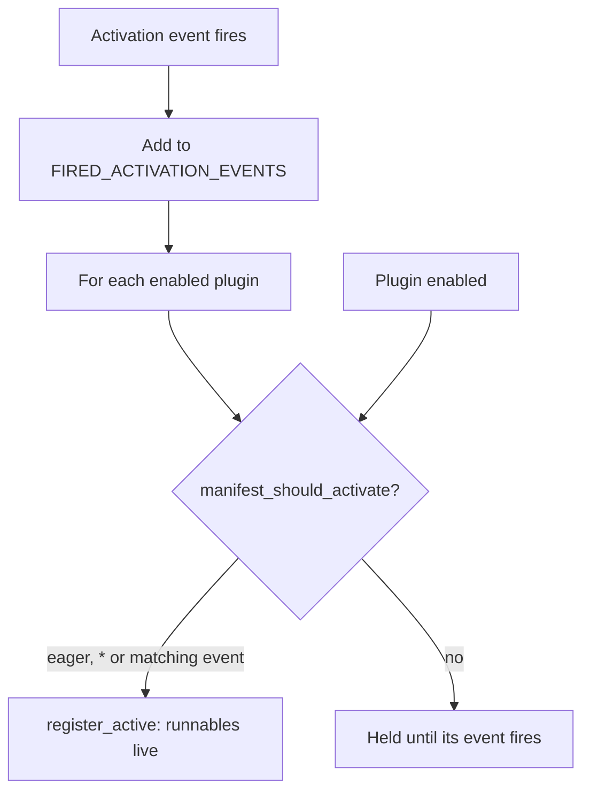

This page is part of the [Plugin API reference](/docs/extend/develop/sdk/plugin-api).
VS-Code-style manifest fields drive the activation runtime. They live on `PluginManifest`, and the
loader validates them at load time.

Sidecar-backed data categories, scheduled jobs, event subscriptions, and activity rows are in
[Plugin sidecar capabilities](/docs/extend/develop/sdk/plugin-sidecar-capabilities).

## Activation fields

| Field | Type | Default | Rule |
|---|---|---|---|
| `contributes` | `Contributes \| null` | absent | A block containing declare-by-id Runnable surfaces (`commands`, `tools`, `agents`, `workflows`, `policies`) plus self-contained contributions such as hooks, widgets, views, settings, and actions. Every referenced Runnable id **must** exist in `runnables`; the loader cross-validates it. |
| `activation_events` | `string[]` | `[]` | Lazy-activation tokens: `"*"`, `"onStartup"`, `"onChat"`, `"onCommand:<id>"`, `"onRoute"`, and `"onCapabilityCall"`. An **empty** list means eager. |
| `engines` | `{ "ryu": string } \| null` | absent | A semver **requirement** the running Core version must satisfy (e.g. `">=0.3.0"`). An unparseable or unsatisfied requirement makes the loader **reject** the manifest. |

A `contributes` entry is declare-by-id, not a second copy of the runnable:

```json
{
  "runnables": [
    { "id": "tool-x", "name": "Tool X", "kind": "tool", "config": { "slug": "web_search" } }
  ],
  "contributes": { "tools": [ { "id": "tool-x", "title": "Search the web" } ] },
  "activation_events": ["onStartup"],
  "engines": { "ryu": ">=0.0.1" }
}
```

The loader checks the version pin against `core_version()` (`apps/core/src/plugin_manifest/mod.rs`),
which is the Core crate version.

## Message actions

Plugins can contribute per-message controls through `contributes.message_actions`.

- Core validates the required identity fields and serves each declaration only while its plugin
  is enabled.
- Desktop owns the renderer. It dispatches the action with the current message id through the
  host's supported seam.
- The `kind` and `args` fields are extensible. Renderer-specific metadata stays opaque to Core and
  never runs as plugin code.

For example, a plugin can opt into Ryu's native emoji reaction surface with a generic menu action:

```json
{
  "contributes": {
    "message_actions": [
      {
        "id": "reactions.picker",
        "label": "Add reaction",
        "target": "any",
        "kind": "menu",
        "capability": "reactions.toggle",
        "args": {
          "renderer": "reaction-picker",
          "dispatch": "reactions.toggle"
        }
      }
    ]
  }
}
```

The contribution contains no executable UI code. Plugin enable state decides whether the control
appears, and the shell keeps accessibility, emoji data loading, and message-id validation in one
renderer.

## Contribution reference

Each `contributes` key below is self-contained:

- Core validates the required fields and tags every entry with its owning plugin id.
- Core serves the entry from `GET /api/plugins/contributions` only while the plugin is enabled.
- The shell owns rendering and dispatch. No entry carries executable UI code.
- Where an entry names a `capability`, it must be one the plugin was granted. Its static `args`
  are passed through unchanged.

The complete field list for every key is in the public
[JSON Schema](https://ryuhq.com/schemas/plugin.json). `bunx ryu validate <dir>` checks a plugin
against it.

| Key | Each entry | Required fields | Notes |
|---|---|---|---|
| `hook_events` | An app event this plugin emits | `id`, `title` | `id` is `<this plugin id>#<event name>` (name: `[a-z0-9][a-z0-9._-]*`). Other plugins consume it with `turn_hooks[].on` and workflows with an `event` trigger; the plugin's own sidecars can receive it through [`subscribes`](/docs/extend/develop/sdk/plugin-sidecar-capabilities#sidecar-event-subscriptions). A plugin can emit only its own events, and the `core#` namespace is reserved. Optional `description`, `payload_example`. |
| `data_categories` | A "Delete all X" row in Settings → Danger Zone | `id`, `title`, `noun`, `detail` | `id` is the category the delete request names; `noun` is the plural used in counts; `detail` says exactly what is deleted; optional `confirm_word` (defaults to `noun`). The row appears only while the plugin is enabled and its sidecar implements it: add [`provides`](/docs/extend/develop/sdk/plugin-sidecar-capabilities#data-category-capabilities) entries for `data.count` and `data.purge`. |
| `create_actions` | A "New X" row in the shell's create menu | `id`, `label` | Either `target` (an in-app path such as `/workflows/new`, never a URL; optional tab `title`) or a granted `capability` with `args`. Optional `icon`, `order`. |
| `selection_actions` | A button on the floating text-selection toolbar | `id`, `label`, `kind` | `kind: "button"` today. Names a granted `capability` or renderer `args`; the selected text is supplied at click time, never stored in the manifest. On click, a `capability` entry is invoked with its static `args` merged with `selection_text` (string, the selected text), `selection_note` (string, only when the user typed a note), and `conversation_id` and `model` (each only when known). The capability's input schema must accept these keys: declare them, or do not set `additionalProperties: false`. Optional `icon`, `order`. |
| `sidebar_modes` | A named preset of the whole left sidebar | `id`, `title` | `sections` lists the sidebar sections offered as tabs (empty means the mode is ignored); `default_section` picks the one it opens on. Optional `description`, `icon`, `order`. |
| `store_tabs` | A tab in the Store's navigation with the app's own catalog | `id`, `title` | `group` is one of `discover`, `catalog`, `community`, `manage`, `account`; `spec` is the opaque tab spec the desktop renders. Optional `subtitle`, `icon`, `order`. |
| `chat_features` | A chat behavior the host implements, declared so clients can feature-detect it | none (opaque objects) | For example `{ "id": "ghost-chats", "kind": "ghost-chat", "renderer": "temporary-chat" }`. Disabling the plugin removes the descriptor and its UI. |
| `fileHandlers` | File extensions a companion opens | `id`, `title`, `extensions`, `companion` | `extensions` are lowercase without a dot (`stl`); `companion` is a companion runnable in the same plugin; optional `editable`. The host passes only the selected file; this is not a filesystem grant. |
| `pi_extensions` | A TypeScript extension the managed Pi agent loads at start | `id`, `file` | `file` is exactly `pi-extensions/<name>.ts`; `id` uses `[a-z0-9][a-z0-9._-]*`. Optional `description`. |
| `output_styles` | A Markdown style that changes how an agent answers | `id` | Author `file` as exactly `output-styles/<name>.md`; packing inlines it as `source` (exactly one of the two). |
| `context_menu_items` | A row in an entity's context menu | `id`, `label`, `anchor`, `capability` | `anchor` - `conversation`, `message`, `space`, `agent`, `project`, `workflow`, `skill`, or `channel`; an unknown anchor is ignored. Optional `args`, `feedback` (`{ loading, success, error }`), `icon`, `order`. |
| `message_actions` | A control on the per-message toolbar | `id`, `label`, `target`, `kind`, `capability` | `target` - `assistant`, `user`, or `any`. `kind` - `button`, `toggle-group` (with `states`), or `menu`. Optional `args`, `state_source`, `icon`, `order`. See [Message actions](#message-actions). |

## How activation fires

The activation contract is in `apps/core/src/runnable/mod.rs`.



- `RunnableRegistry::register_active(manifest, fired_events)` activates a plugin's runnables **only**
  if it should wake. `manifest_should_activate` returns `true` for an eager plugin (empty
  `activation_events`), for a `"*"` declaration, or when any declared event is in `fired_events`.
- A process-global `FIRED_ACTIVATION_EVENTS` set tracks which events have fired. It is monotonic, so a
  plugin enabled **after** an event still sees it via the snapshot.
- `fire_activation_event(state, event)` (`apps/core/src/server/mod.rs`) is the live driver: it records
  the event, then runs every **enabled** plugin through `register_active` against the new snapshot.
- `onStartup` is fired once at boot (`apps/core/src/boot/state_wiring.rs`) after `ServerState`
  exists.
- `onChat` is fired once from the first HTTP chat entry, without blocking the streaming response.
- `onCommand:<id>` is fired by the desktop command-palette activation seam,
  `POST /api/plugins/activation-event` with `{ "event": "onCommand:<id>" }`. The route accepts
  only `onCommand:` events.
- `onRoute` and `onCapabilityCall` are fired when a lazy sidecar/provider is cold-started by its
  first matching request.
- The `enable` lifecycle path uses the same `register_active` against the live fired set, so enable and
  event-driven activation share one contract (an eager plugin activates immediately on enable; a gated
  plugin is held back until its event fires).

<Callout type="warn">
  The live activation set is bounded. `onRunnable:<id>` is not a general-purpose event bus, and the
  current runtime does not fire it. Use declared hook events or the supported
  `onStartup`, `onChat`, `onCommand:<id>`, `onRoute`, and `onCapabilityCall` seams.
</Callout>

## Gateway policy runnables

A `policy`-kind runnable is an on/off switch for a Core or Gateway feature
(`apps/core/src/sidecar/gateway_policy.rs`). `apply_policy` (`apps/core/src/server/mod.rs`)
dispatches on each Policy runnable's `policy_type` when the plugin is enabled or disabled:

| `policy_type` | Effect | Gateway change |
|---|---|---|
| `compression` | Flip the headroom flag and start or stop the headroom proxy. | Respawn |
| `firewall` | Turn the Gateway firewall on or off. The Gateway enforces it. | Live config push |
| `routing` | Turn smart (classifier) routing on or off. | Live config push |
| `sandbox` | Toggle Core's wasmtime sandbox availability (an in-process flag). | None |
| `predict` | Turn Core's system-wide autocomplete on or off. | None |
| `dictation` | Turn system-wide dictation on or off and sync the `dictation` preference. | None |

- **Live push.** `firewall` and `routing` push their section to the running Gateway with no
  respawn, so in-flight requests, rate-limit windows, and caches survive. The flag is also set, so
  the change survives the next spawn.
- **Respawn.** `compression` sets a `gateway_dirty` flag. `apply_policy` calls `gateway.refresh()`
  once at the end, so enabling several respawn policies costs one restart.
- **Unknown types.** An unknown `policy_type` is a logged no-op.
- **Restarts.** At startup, Core seeds the flags from each plugin's persisted state
  (`apps/core/src/boot/plugin_boot.rs`), so a Gateway restart never reverts what a Policy plugin
  set.

<Callout type="info">
  Per the Core-vs-Gateway rule, Core decides whether a feature is active for this install, and the
  Gateway owns enforcement (firewall scanning, smart routing). The policy definition, such as the
  firewall pattern set or the routing model map, stays in the Gateway's `/v1/config`. See
  [Gateway governance](/docs/gateway/governance).
</Callout>

The built-in Policy plugins `@ryu/firewall`, `@ryu/routing`, `@ryu/sandbox`, `@ryu/headroom`, and
`@ryu/predict` are opt-in. `@ryu/dictation` is pre-installed and enabled on a fresh install; the
user can disable it.

## External-runtime provisioning (scaffold)

A plugin may declare an external language runtime in an optional `runtime` block. Today that is a
Python venv with pip dependencies. The provisioner is `apps/core/src/sidecar/external_runtime.rs`.

- It derives OS-correct venv paths: `.venv/Scripts/python.exe` on Windows, `.venv/bin/python`
  elsewhere.
- Its best-effort `provision()` fetches declared assets through Core's download center, creates
  the venv, and runs `pip install`.
- The enable path calls `provision_external_runtime` (`apps/core/src/server/mod.rs`). It spawns
  the work, so a slow `pip install` never blocks the enable response.

<Callout type="warn">
  External-runtime provisioning is a scaffold. Only `kind: "python"` is provisionable.

  Running `pip install` from a manifest is a network and arbitrary-code surface. A Core-tier
  (first-party) plugin may provision. A Community plugin may provision only when the Gateway
  approved its `runtime:external` grant.

  Live provisioning is not exercised by tests. The path derivation, asset resolution, and
  provisioning gate are unit-tested.
</Callout>

## Remaining runtime boundaries

The activation runtime is live, but a manifest field does not lift these boundaries:

- **Arbitrary in-process Core APIs or route mutation.** Plugins use declared contribution points,
  the sandbox, MCP, sidecar, and host bridge; they do not patch Core.
- **Unimplemented contribution consumers.** A manifest can validate a forward-compatible
  contribution key, but a host surface must implement the renderer/consumer before users see it.
- **`onRunnable:<id>` activation.** It is not implemented. The five live event families above are
  the supported lazy activation contract.

Every model call a plugin causes routes through the Gateway. A plugin that governs egress declares
a `policy` Runnable. Core coordinates its state, and the Gateway enforces it.

## Related

<Cards>
  <DocCard href="/docs/extend/develop/sdk/plugin-api" />
  <DocCard href="/docs/extend/develop/sdk/plugin-sidecar-capabilities" />
  <DocCard href="/docs/core/app-manifest-lifecycle" />
  <DocCard href="/docs/gateway/governance" />
</Cards>
