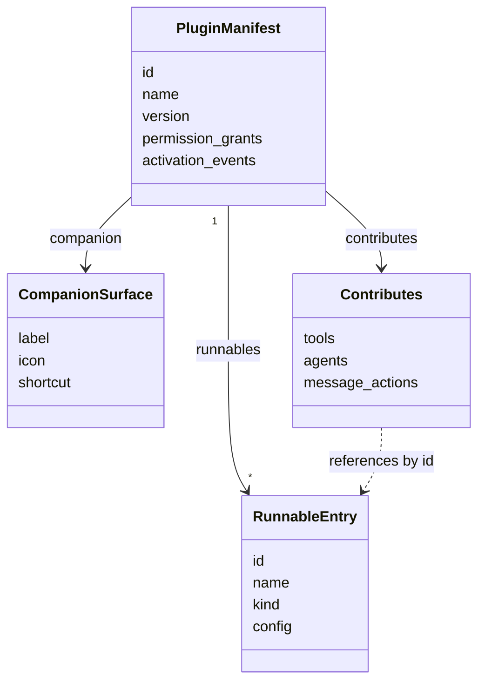

This page is the canonical reference for the native `manifest.json` contract: the eight Runnable
kinds and their required config, and the install and enable lifecycle and its endpoints. The
per-kind table lives only here.

- [Plugin grants and signing](/docs/extend/develop/sdk/plugin-grants-signing) covers Gateway grant
  validation, ed25519 manifest signing, and deferred execution authorization.
- [Plugin activation](/docs/extend/develop/sdk/plugin-activation) covers the activation runtime,
  contribution points, and Gateway policy runnables.
- [Plugin sidecar capabilities](/docs/extend/develop/sdk/plugin-sidecar-capabilities) covers
  sidecar-backed data categories, scheduled jobs, event subscriptions, and activity rows.
- [Extension schemas and folder layouts](/docs/extend/develop/extensions/schemas-and-layouts) maps
  the package envelope, interop files, source trees, and file-to-wire boundaries.

For the conceptual model, see [the Runnable model](/docs/start-here/architecture/runnable-model).
For a worked example, see the [Plugin manifests tutorial](/docs/extend/develop/extensions/plugin-json-manifest).

<Callout type="warn">
  The VS-Code-style runtime is partly live and bounded. The manifest carries a `contributes`
  block, `activation_events`, and an `engines.ryu` version pin
  (`apps/core/src/plugin_manifest/mod.rs`). The activation runtime
  (`apps/core/src/runnable/mod.rs`) wakes a plugin's runnables when its startup, chat, command,
  route, or capability cold-start events fire.

  A plugin gets no arbitrary in-process Core API and cannot mutate Core routes. UI uses pre-built widget, Companion, and extension-host seams.
  Each declarative contribution is only as live as its owning surface.

  See [activation runtime](/docs/extend/develop/sdk/plugin-activation) and
  [remaining runtime boundaries](/docs/extend/develop/sdk/plugin-activation#remaining-runtime-boundaries).
</Callout>

## What a plugin is

A **plugin** is a bundle of one or more **Runnables** plus the **permission grants** they need,
packaged so Core can install, enable, disable, and update it as a unit. The canonical manifest file
name is `manifest.json`. Core still reads the earlier `plugin.json` and legacy `ryu.json` names.
`bunx ryu pack` writes its bundle to `dist/plugin.bundle.json`.



The authoritative Rust types live in `crates/core/kernel-contracts/src/{manifest.rs,schema.rs}`.
Core (`apps/core/src/plugin_manifest/`) and the [Rust SDK](/docs/extend/develop/sdk/rust) re-export
them. TypeScript mirrors them in `packages/sdk/src/manifest.ts` (a Zod `PluginManifestSchema`). All
of them deserialize the same bytes.

## Manifest schema

### Top-level fields

```json
{
  "id": "io.ryu.headroom",
  "name": "Headroom",
  "version": "1.0.0",
  "runnables": [],
  "permission_grants": [],
  "companion": null
}
```

| Field | Type | Required | Rule |
|---|---|---|---|
| `id` | string | yes | Either a scoped id `@scope/name` (exactly one `/`) or a flat id such as `my-plugin` or `com.example.my-plugin`. A `.` is **not** required. The flat id, and each half of a scoped id, uses only `a-z A-Z 0-9 . - _`, with no `..`, no leading or trailing `.`, and no leading `-`; the whole id is at most 128 bytes. Doubles as a filesystem directory name (a scoped id is flattened first). |
| `name` | string | yes | Human-readable display name. |
| `version` | string | yes | Valid semver (`MAJOR.MINOR.PATCH`). A non-semver version is rejected. |
| `runnables` | `RunnableEntry[]` | yes | The Runnables this plugin bundles. It may be an empty array for a surface-only plugin. |
| `permission_grants` | `string[]` | no (default `[]`) | Grant scopes the plugin declares it needs. Declarations only - the Gateway enforces. |
| `companion` | `CompanionSurface \| null` | no | Optional in-desktop overlay or sidebar panel. |
| `subscribes` | `EventSubscription[]` | no (default `[]`) | Events delivered to one of the plugin's sidecars. See [Sidecar event subscriptions](/docs/extend/develop/sdk/plugin-sidecar-capabilities#sidecar-event-subscriptions). |

The id `core` is reserved and cannot be used as a plugin id.

### Marketplace listing fields

Some top-level fields are listing attributes. They do not change how Core runs the plugin. They
control how it appears in the marketplace catalog and the storefront index.

| Field | Type | Meaning |
|---|---|---|
| `category` | string | Taxonomy bucket for the marketplace index and README grouping (e.g. `"Developer Tools"`, `"Automation"`). |
| `keywords` | `string[]` | Search terms for the marketplace. |
| `tagline` | string | One-line tagline for the catalog card. |
| `description` | string | Longer description for the detail view. |
| `tags` | `string[]` | Curated Store filter tags. Unlike `keywords` (free search vocabulary), these are the bounded labels the Marketplace filter exposes. |
| `stability` | string | How finished the listing is (`alpha`, `beta`, `rc`, …). Absent or `stable` renders no badge; an unknown tier renders verbatim. |
| `repository` | string | Public source repository URL. Listing metadata only; install and signature resolution use the catalog's own source fields. |
| `hidden` | boolean | Hides the listing from the Store without uninstalling or disabling it (absent = visible). |
| `icon` | string | Icon token or URL for the catalog card. |
| `iconDither` | object | Optional `{ from, to, direction }` dither treatment for the icon. |

Some attributes are **not** manifest fields a third-party author sets:

- **Uninstall protection.** Core decides which plugins are protected system components (see
  [App lifecycle](/docs/core/app-manifest-lifecycle)).
- **Official or verified publisher marks.** The Marketplace derives them from publisher
  verification.
- **Pre-installation.** There is no `preinstalled` field. Fresh-install records come from Core's
  preinstall policy. Install-on-demand packages stay absent until the user installs them.

`validate_plugin_id` (`crates/core/kernel-contracts/src/manifest.rs`, mirrored in `ryu-sdk`)
enforces the id rules above so an `id` can never escape `~/.ryu/plugins/<id>/`.

### Permission fields

| Field | Type | Meaning |
|---|---|---|
| `optional_permission_grants` | `string[]` | Grants available only after explicit per-app approval. They never join the default install/enable grant set and never block an ordinary enable. |
| `permission_levels` | object[] | The user-facing permission vocabulary the app declares (for example `read`, `edit`) that an administrator can later grant to a person or team inside the app. Each level has `id`, `label`, `description`, and optional `implies` (other level ids from this app that it includes; implying a built-in permission is rejected at load, and a level id another installed app also declares conveys no implied grants, keeps its implications only for denials, and is not offered in the grant picker). Absent means the app declares none. |

### RunnableEntry

Each entry in `runnables` is a `RunnableEntry`, with identity fields plus an optional typed
`config` whose required shape is driven by `kind`.

```json
{
  "id": "io.example.researcher",
  "name": "Researcher",
  "kind": "agent",
  "config": { "system_prompt": "You are a careful researcher.", "model": "gemma4", "tools": ["web_search"] }
}
```

Core's schema defines eight kinds (`RunnableKind` in `crates/core/kernel-contracts/src/runnable.rs`).
`validate_runnable` (`crates/core/kernel-contracts/src/schema.rs`) enforces each kind's required
fields:

| `kind` | What it is | Config required? | Required field(s) |
|---|---|---|---|
| `agent` | Multi-turn model loop with swappable model/tools/persona slots | optional (all default) | none; optional `identity_mode` is `managed`, `individual` or `mixed`, and `account_access` is refused |
| `workflow` | A DAG of typed nodes run by Core's workflow engine | yes | `entry` |
| `tool` | A callable function (wraps an MCP tool slug) | yes | `slug` |
| `skill` | An Agent Skill (versioned, shareable) | yes | `skill_id` (non-empty) |
| `companion` | An in-desktop overlay or sidebar panel | yes | `label` |
| `channel` | A messaging-platform bot adapter | yes | `platform` |
| `engine` | A model/inference backend binding | yes | `engine_type` (non-empty) |
| `policy` | A Gateway-enforced rule fragment | yes | `policy_type` (non-empty) + `definition` |

<Callout type="warn">
  The TypeScript SDK's `RunnableKindSchema` (`packages/sdk/src/manifest.ts`) lists six kinds:
  `agent`, `workflow`, `tool`, `skill`, `companion`, and `policy`. Core validates all eight. To author
  a `channel` or `engine` runnable, write the `manifest.json` directly instead of relying on the
  TypeScript type. The Rust kernel (`ryu-sdk`) covers all eight.
</Callout>

### CompanionSurface

```json
{ "label": "Research Panel", "icon": "search", "shortcut": "ctrl+shift+r" }
```

`label` is required. `icon` and `shortcut` are optional, and the desktop shell resolves them. Core
registers the descriptor when the plugin is enabled. The desktop host renders it through the
sandboxed Companion surface described in [Build a Desktop Companion](/docs/extend/develop/extensions/desktop-companion).

## Lifecycle

Core decides what runs. It persists install, enable, disable, and update state and compares
semver. The Gateway decides what is allowed, and `enable` is the only transition that calls it. The
full state machine and the on-disk record live in
[App manifest and lifecycle](/docs/core/app-manifest-lifecycle). This page lists only the endpoints
and the per-operation contract a manifest author needs.

| Operation | Effect | Gateway involved? |
|---|---|---|
| install | Creates a `PluginRecord` with `enabled = false`; validates semver first. Fails if already installed. | no |
| enable | Validates declared grants via the Gateway, then flips `enabled = true` and stores the approved grants. **Fails closed** if the Gateway denies a grant or is unreachable. | yes |
| disable | Flips `enabled = false`, clears approved grants, and revokes the app's sidecar bearer. Re-enabling issues a fresh credential, including when durable credential cleanup reported an error. | no |
| update | Sets a new version. **Refuses a downgrade** (new < installed) unless `force = true`. A same-version update is a no-op. Does *not* re-enable a disabled plugin. | no |
| uninstall | Removes the lifecycle record, the scheduled automations the plugin created, the installed package, runtime contributions, approved permissions, bundled skills, and the plugin's sidecar binaries. Its other data is kept unless the request selects cleanup options (see [Uninstall and app data](#uninstall-and-app-data)). | no |

### Endpoints

The canonical routes are `/api/plugins*` (`apps/core/src/server/mod.rs`). Deprecated `/api/apps*`
aliases point at the same handlers. Do not use them in new code.

| Method + path | Purpose |
|---|---|
| `GET /api/plugins` | List loaded manifests (system + user-installed). |
| `GET /api/plugins/catalog` | Browse installable plugins from the remote registry. |
| `POST /api/plugins/install` | Install by fetching a `manifest.json` from an `https://` URL, validate, write to `~/.ryu/plugins/`, hot-reload. |
| `POST /api/plugins/install-bundle` | Install a local bundle (`ryu pack` output: manifest plus optional `ui_code`). Body `update: true` replaces an installed copy of the same id. `bunx ryu install` calls this. |
| `GET /api/plugins/doctor` | Read-only audit of loaded plugin and app manifests; never runs plugin code. |
| `GET /api/plugins/evals` | Inspect a plugin's package-local eval suite (`?id=`), or every installed suite's summary. |
| `POST /api/plugins/evals/run` | Run an enabled plugin's eval cases through its normal Core agent path. |
| `GET /api/plugins/contributions` | Declarative UI contributions of every enabled plugin, each tagged with its owning `plugin` id. |
| `POST /api/plugins/reload` | Re-scan system manifests + `~/.ryu/plugins/*/manifest.json`. |
| `POST /api/plugins/:id/install` | Record an already-known plugin as installed (disabled). |
| `POST /api/plugins/:id/enable` | Validate grants via the Gateway, then enable. |
| `POST /api/plugins/:id/grants` | Set an enabled plugin's approved grants to an explicit subset of its declared grants (per-grant revocation); re-validated through the Gateway. |
| `POST /api/plugins/:id/disable` | Disable and clear approved grants. |
| `POST /api/plugins/:id/update` | Update the installed version (body may carry `force`). |
| `GET /api/plugins/:id/uninstall-data` | Preview the optional data the plugin owns before uninstalling. |
| `POST /api/plugins/:id/uninstall` | Uninstall; the body's `cleanup` list selects which owned data to delete. |

Install hot-reloads Core's manifests, so a newly installed plugin appears in `GET /api/plugins`
with no restart. These routes are on Core's authenticated API, so send the node's bearer token
(`Authorization: Bearer <token>`). On a shared node, the lifecycle routes also check the signed-in
caller's app permissions.

### Uninstall and app data

Uninstalling removes the package but keeps the plugin's data by default, so a later reinstall picks
up where it left off.

`GET /api/plugins/:id/uninstall-data` lists the optional data the plugin currently owns. Each item
has a label, description, count, and size. Only items the plugin actually has are returned.

To delete some of it in the same uninstall, send their ids in the body:
`POST /api/plugins/:id/uninstall` with `{ "cleanup": ["settings", "files"] }`.

| Cleanup id | Label | What it deletes |
|---|---|---|
| `keybindings` | Keyboard shortcuts | Saved shortcut overrides for the plugin's commands |
| `settings` | Saved app settings | The plugin's saved settings values |
| `secrets` | Saved credentials | The plugin's encrypted secret slots. Always applied, even when not selected, so a credential never outlives the app it was given to. |
| `storage` | Plugin storage | Key/value records the plugin stored |
| `scheduler` | Scheduled automations | Automations the plugin created |
| `oauth` | Connected accounts | Accounts connected for the plugin's MCP servers |
| `spaces` | App spaces and documents | Spaces and documents the app owns |
| `files` | App files | The plugin's own data folder, `<data dir>/plugin-data/<dir>/` (its databases, preferences, media, and caches) |
| `data:<category>` | The category's title | A data category the plugin declares in its manifest |

A cleanup step that fails is reported in the response without blocking the uninstall itself. The
body also accepts `delete_storage: true` (alias `deleteStorage`), which is the same as selecting
`storage`.

## Related

<Cards>
  <DocCard href="/docs/extend/develop/sdk/plugin-grants-signing" />
  <DocCard href="/docs/extend/develop/sdk/plugin-activation" />
  <DocCard href="/docs/extend/develop/sdk/plugin-sidecar-capabilities" />
  <DocCard href="/docs/core/app-manifest-lifecycle" />
  <DocCard href="/docs/gateway/governance" />
  <DocCard href="/docs/extend/develop/extensions/marketplace" />
</Cards>
