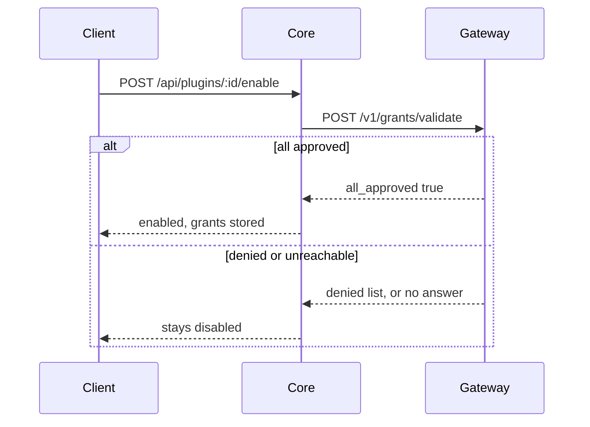
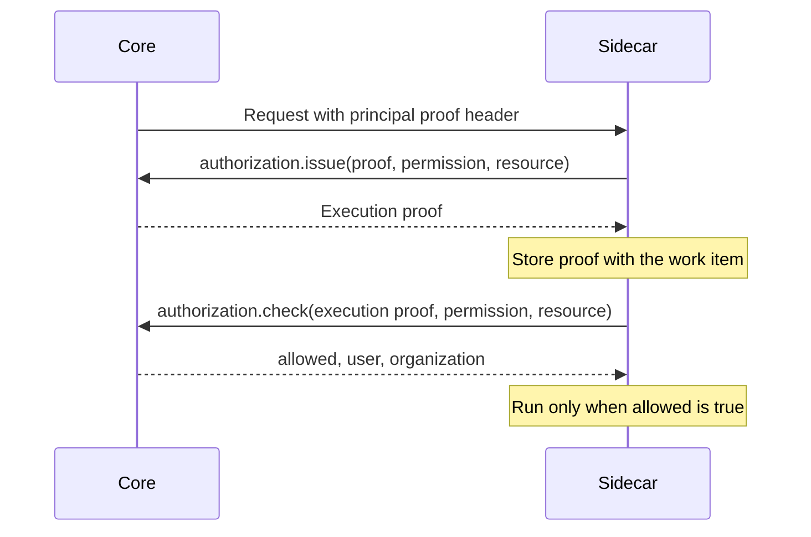

This page covers the trust checks around a plugin's [`manifest.json`](/docs/extend/develop/sdk/plugin-api): grant
validation on enable, ed25519 manifest signing and verify-on-install, and deferred execution
authorization for sidecars that run saved work later.

## Grant validation

`permission_grants` are scope strings the plugin declares (for example `mcp.tools`, `model.chat`,
`memory.read`). They are declarations only. On `enable`, Core calls the Gateway's
`POST /v1/grants/validate` with the declared grants (`apps/gateway/src/api/governance.rs`).



```json
// request
{ "app_id": "@ryu/headroom", "grants": ["mcp.tools", "model.chat"] }
// response
{ "approved": ["mcp.tools", "model.chat"], "denied": [], "all_approved": true }
```

The Gateway decides each grant under the capability grammar
(`apps/gateway/src/governance/mod.rs`). Two rules approve a scope:

- **It is in your own namespace.** A capability whose namespace (the token before its first `:` or
  `.`) equals the last segment of your manifest id is auto-approved. `com.acme.invoices` or
  `@acme/invoices` may declare `invoices:crud` with no Gateway change and no operator action. Build
  app-owned capabilities this way. It is the only path that needs no Ryu-side edit.
- **It is a reviewed host primitive.** The built-in allowlist covers the host vocabulary, such as
  `mcp.tools`, `tools.read`, `tools.invoke`, `memory.read`, `memory.write`, `spaces.read`,
  `spaces.write`, `files.read`, `model.chat`, `model.embed`, `network.fetch`, `hook:*`,
  `widget:render`, `shell:integrate`, and `storage:kv`. An operator can override it with
  `RYU_MARKETPLACE_GRANT_ALLOWLIST`.

Namespaces that name a host primitive (`model`, `memory`, `sidecar`, `runtime`, `tool`, `mcp`,
`identity`, `ui`, `views`, and others) are reserved. The first rule never auto-approves them, even
for an app whose id ends in that name. A grant neither rule approves lands in `denied`, which
blocks the enable.

**Fail-closed behavior** (`apps/core/src/plugins/lifecycle.rs`):

- Any `denied` grant -> the plugin stays disabled (`GrantsDenied`).
- Gateway unreachable or non-2xx -> the plugin stays disabled (`GatewayUnreachable`). Core applies
  no inline policy and never silently allows.
- Empty grant list -> trivially approved (nothing to validate).

If the Gateway is unavailable, configure and start the policy service, then retry the enable.
Do not treat a missing grant-validation response as permission to run the plugin.

## Manifest signing (ed25519)

Publishing a plugin to the Ryu Marketplace is a governed action, so the Gateway owns the signing key
and the sign and verify endpoints. The algorithm is ed25519. Both sign and verify canonicalize the
manifest (recursively sorted object keys) before hashing, so JSON round-trips across the stack
never change the signed bytes.

[Gateway governance](/docs/gateway/governance) documents the full signing ceremony: master-key
signing, the trust-anchor rules, and where the key resolves from. A manifest author needs only the
three endpoints and the verify-on-install contract.

| Method + path | Purpose | Access |
|---|---|---|
| `POST /v1/manifests/sign` | Sign a manifest; returns `{ algorithm, signature, public_key }`. | **Master key.** The caller must present the Gateway master key as the bearer, from any peer (including a hosted Gateway over TLS); a loopback peer without it is refused, and a Gateway with no master key cannot sign. The legitimate caller is the control-plane server on publish. |
| `POST /v1/manifests/verify` | Verify a signature; returns `{ valid }`. | Open (read-only check over caller data). |
| `GET /v1/manifests/pubkey` | The public verifying key; returns `{ algorithm, public_key }`. | Open (no secret). |

### Verify-on-install

When Core installs a Ryu Marketplace item, it verifies the manifest signature before any install
work (`apps/core/src/catalog_source/sources.rs`):

- The trust anchor is a pinned Marketplace public key: the `RYU_MARKETPLACE_PUBLIC_KEY` environment
  variable when an operator sets it (for example on a self-hosted Marketplace), else the
  production key compiled into the build.
- A shipped build (release, beta, canary, or nightly) with no pinned key refuses Marketplace
  installs. Only a debug build or the `dev`
  profile sends no key and lets the local Gateway verify with its own resident key.
- The manifest's own `signingPublicKey` field is never the trust anchor. A tamperer could ship
  their own key with a matching signature. The field is for display and rotation cross-checks only.
- Signature present + invalid -> **reject** (the tamper case).
- Signature absent -> **reject** before any install work.
- Gateway unreachable -> **reject (fail closed)**, so a tampered manifest cannot install merely
  because the verifier is down.

## Deferred execution authorization

Native sidecars that retain recurring work can declare `authorization:defer` in both their
permission grants and sidecar host API grants. The authenticated host RPC methods
`authorization.issue` and `authorization.check` keep user permissions separate from the app's own
capability grants.

### Principal proof

Core supplies a short-lived principal proof in the trusted `x-ryu-caller-principal-proof` header
on a verified proxied request. Caller-supplied copies of this header are discarded.

On an unbound local node, the request must also carry the active node-owner bearer. A user JWT
alone grants no local owner authority.

### Issue and check

1. Call `authorization.issue` with that `proof`, an app-declared `permission`, and a
   `resource`. It checks the caller's current access and returns an opaque
   execution proof.
2. Store the execution proof with the work item.
3. Before every deferred execution, call `authorization.check` with the execution proof and the
   same permission and resource.
4. Run the work only when the response contains `allowed: true` and the expected user and
   organization.



### Proof scope

Execution proofs are bound to the app, node, organization, user, permission, and resource. They
grant no broader access and contain no user session credentials.

Each check resolves current organization and team membership and applies current resource ACLs.
These conditions must stop execution:

- a missing proof;
- removed access;
- unavailable authorization;
- changed bindings.

Reauthorize saved work after an owner-token rotation, or when migrating work that has no execution
proof.

## Related

<Cards>
  <DocCard href="/docs/extend/develop/sdk/plugin-api" />
  <DocCard href="/docs/extend/develop/sdk/plugin-activation" />
  <DocCard href="/docs/gateway/governance" />
</Cards>
