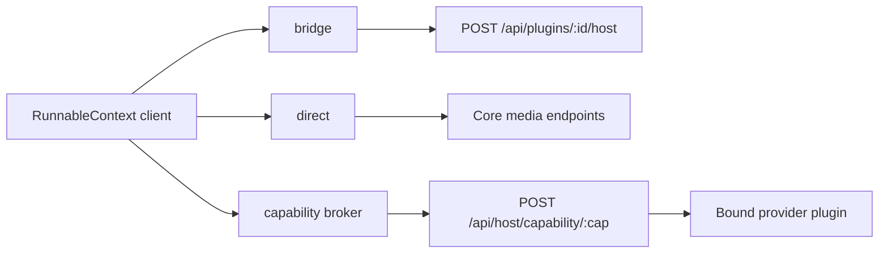

The SDK primitive clients give a Runnable typed access to Ryu capabilities through Core's governed
host APIs (`packages/sdk/src/runnable/primitives.ts`). They are thin wrappers over existing Core
endpoints. Model work routes through the Gateway, so an app never holds provider credentials.

## The RunnableContext

Every `run(input, ctx)` receives a `RunnableContext`. Only `gateway` is always present:

```typescript
interface RunnableContext {
  gateway: GatewayClient;    // model calls (chat, stream); never null
  rag?: RagClient;           // retrieve, embed, rerank
  memory?: MemoryClient;     // recall, store
  storage?: StorageClient;   // app-owned key/value state
  tts?: TtsClient;           // speech synthesis
  stt?: SttClient;           // transcription
  image?: ImageClient;       // image generation
  durable?: DurableClient;   // checkpoint, resume
  realtime?: RealtimeClient; // room events
  engines?: EnginesClient;   // one-shot completion, embedding
  backups?: BackupsClient;   // encrypted app-owned snapshots
  sessionId?: string;        // Core session id
  signal?: AbortSignal;      // cancellation
}
```

The primitive clients are present only when the runner injects a `PrimitiveTransport`, for example
for a Core node it holds a token for. A context with only `{ gateway }` is still valid. To build the
bundle yourself, pass a transport to `createPrimitives`. The returned `RyuPrimitives` bundle also
has a `background` client, which is not on `RunnableContext`.

```typescript
import { createPrimitives, httpPrimitiveTransport } from "@ryuhq/sdk";

const primitives = createPrimitives(
  httpPrimitiveTransport({
    baseUrl: "http://127.0.0.1:7980", // the Core node URL
    token: nodeToken,
    pluginId: "com.example.my-plugin", // required for bridge-backed methods
  }),
);
```

`baseUrl` is the Core node URL. The older `nodeUrl` option still works but is deprecated.
`httpPrimitiveTransport` checks the URL against the direct-provider egress blocklist at
construction, the same check as [Gateway enforcement](/docs/extend/develop/sdk/runnables#gateway-enforcement).

## How each method reaches Core

Each method uses one of three transports (`PRIMITIVE_BINDINGS`):



| Methods | Transport | Endpoint | Requirement |
|---|---|---|---|
| `engines.complete` | bridge (`model.complete`) | `POST /api/plugins/:id/host` | `hook:side-model` grant |
| `storage.get`, `set`, `delete`, `keys`, `compareAndSet` | bridge | `POST /api/plugins/:id/host` | `storage:kv` grant |
| `backups.destinations`, `create`, `list`, `get`, `restore` | bridge | `POST /api/plugins/:id/host` | `backups:app` grant |
| `background.list`, `stop` | bridge | `POST /api/plugins/:id/host` | `background:control` grant |
| `image.generate` | direct | `POST /api/images/generate` | `media:generate` grant |
| `tts.speak` | direct | `POST /api/voice/speak` | `media:generate` grant |
| `stt.transcribe` | direct | `POST /api/voice/transcribe` | `media:transcribe` grant |
| `rag.*`, `memory.*`, `realtime.*`, `durable.*`, `engines.embed` | capability broker | `POST /api/host/capability/:cap` | Declare the capability in `requires.capabilities` and hold the bound provider's grant |

A broker-backed call fails closed (404 or 403) when the caller has not declared the capability edge
or lacks the provider's grant. See [Capability broker](/docs/extend/develop/extensions/capability-broker).

## GatewayClient

`GatewayClient` is the only path to a model. Every Runnable uses `ctx.gateway` for model calls.

```typescript
const result = await ctx.gateway.chat([
  { role: "system", content: "You are a helpful assistant." },
  { role: "user", content: "Hello!" },
]);
console.log(result.content);

for await (const delta of ctx.gateway.stream(messages)) {
  if (delta.content) process.stdout.write(delta.content);
}
```

## RagClient

```typescript
const chunks = await ctx.rag.retrieve({
  query: "deployment steps",
  topK: 5,
  spaceId: "my-space",
  filter: { kind: "page", ordinal: { $lt: 10 } }, // keep only matching chunks
  hybrid: { alpha: 0.6 },                         // fuse keyword and vector rankings
});
const vectors = await ctx.rag.embed({ input: ["text1", "text2"] });
const ranked = await ctx.rag.rerank({ query: "deployment steps", documents: chunks.map((c) => c.text) });
```

| Method | Input | Returns |
|---|---|---|
| `retrieve` | `{ query, topK?, spaceId?, filter?, hybrid? }` | `RagChunk[]` (`id`, `text`, `score`, `source?`, `metadata?`) |
| `embed` | `{ input: string \| string[], model? }` | `number[][]` |
| `rerank` | `{ query, documents, topK?, model? }` | `RagRerankResult[]` (`index`, `document`, `score`) |

`filter` uses the metadata filter language described in
[Metadata filters](/docs/core/spaces-rag#metadata-filters). The SDK validates `filter` and
`hybrid.alpha` before the call (an invalid value throws) and forwards both unchanged to the bound
RAG provider. To test a filter or a chunking strategy locally, use the helpers in
[`@ryuhq/sdk/rag`](/docs/extend/develop/sdk/rag).

## MemoryClient

```typescript
const memories = await ctx.memory.recall({ query: "architecture decisions", limit: 10 });
const { id } = await ctx.memory.store({
  content: "The team decided to use WASM for sandboxing",
  category: "decision",
  tags: ["architecture"],
});
```

`recall` takes `{ query, levels?, limit? }` and returns `MemoryItem[]`. `store` takes
`{ content, level?, category?, importance?, tags? }` and returns `{ id }`.

## StorageClient

Durable app-owned key/value state. Values are strings. Encode JSON yourself when needed.

```typescript
await ctx.storage.set({ key: "cursor", value: "42" });
const cursor = await ctx.storage.get({ key: "cursor" }); // null when missing
const swapped = await ctx.storage.compareAndSet({ key: "cursor", expected: "42", value: "43" });
```

Every method accepts an optional `namespace`. `keys({ namespace? })` lists the keys in a namespace.

## TtsClient and SttClient

```typescript
const audioUrl = await ctx.tts.speak({ text: "Hello, world!", voice: "default" });
const transcript = await ctx.stt.transcribe({ audio: audioDataUrl, filename: "note.wav" });
```

`speak` takes `{ text, engine?, voice?, speed?, language? }` and returns a renderable `data:` audio
URL. `transcribe` takes an audio `data:` URL and returns the transcript text.

## ImageClient

```typescript
const images = await ctx.image.generate({ prompt: "A sunset over a city", size: "1024x1024" });
```

`generate` takes `{ prompt, count?, size?, provider?, model? }` and returns renderable `data:` URLs.

## DurableClient

```typescript
const { token } = await ctx.durable.checkpoint({
  key: "approval-123",
  state: { step: "awaiting_approval", proposalId: "123" },
});

// On a later invocation:
const resumed = await ctx.durable.resume({ token }); // null when the token is unknown
```

## EnginesClient

```typescript
const text = await ctx.engines.complete({
  prompt: "Summarize this ticket in one line.",
  system: "Be brief.",
  modelPrefKey: "my-plugin-model",
});
const vectors = await ctx.engines.embed({ input: ["hello world"] });
```

`complete` is a tool-less, one-shot completion routed through the Gateway. It takes
`{ prompt, system?, model?, modelPrefKey?, effort? }` and returns a string.

## RealtimeClient

```typescript
await ctx.realtime.broadcast({ room: "room:general", event: "update", payload: { done: true } });
const subscription = await ctx.realtime.subscribe({ room: "room:general" });
```

<Callout type="warn">
  The broker is a unary POST, so `subscribe` does not stream events. It returns a
  `{ room, subscriptionId }` handle only.
</Callout>

## BackupsClient

An app can save and recover JSON snapshots through Ryu's S3 backup service. Declare `backups:app`
in `permission_grants`. A node administrator must also add the app's canonical ID to the chosen
[backup destination](/docs/surfaces/desktop/user-guide/s3-backups). A managed sidecar declares the
same grant in its host API permissions. No S3 credentials enter the app.

```typescript
const destinations = await ctx.backups.destinations();
if (destinations.length === 0) throw new Error("No backup destination is shared with this app");
const destinationId = destinations[0].id;
const operation = await ctx.backups.create({
  destinationId,
  namespace: "workspace",
  idempotencyKey: crypto.randomUUID(),
  data: { schemaVersion: 1, records: [{ id: "example", title: "Saved work" }] },
});
// Poll get({ destinationId, namespace: "workspace", operationId: operation.id })
// until status is completed or failed before treating the snapshot as saved.
const snapshots = await ctx.backups.list({ destinationId, namespace: "workspace" });
if (snapshots.length > 0) {
  const data = await ctx.backups.restore({
    destinationId,
    namespace: "workspace",
    backupId: snapshots[0].id,
  });
  // Validate the app's own schema before applying recovered data.
}
```

- The JSON snapshot limit is 8 MiB (`apps/core/src/backups/mod.rs`).
- Core derives the calling app and tenant. Apps cannot supply a node or Space scope, a raw object
  key, or a filesystem path.
- Restore returns the snapshot to the app, and the app decides how to apply it to its own store.
- To back up on a schedule, use the app's existing job mechanism.

Companion frames expose the same methods through `window.ryu.backups`, over the host bridge
methods `backups.destinations`, `backups.create`, `backups.list`, `backups.get`, and
`backups.restore`. Feature-detect the capability before showing backup controls.

## BackgroundClient

`background` lists the node's background processes and asks one to stop. It is part of the
`createPrimitives` bundle only.

```typescript
const running = await primitives.background.list({ runningOnly: true });
const { requested } = await primitives.background.stop({ processId: running[0].process_id });
```

`list` takes `{ producer?, runningOnly? }` and returns process records (`process_id`, `producer`,
`kind`, `running`, `started_at`, `elapsed_ms`, and more). `stop` sends a cooperative stop request
and returns `{ ok, requested, process_id }`.

## Related architecture

For the Core-vs-Gateway split behind these clients, see
[Runnable model](/docs/start-here/architecture/runnable-model),
[Capability layers](/docs/start-here/architecture/capability-layers), and
[Gateway governance](/docs/gateway/governance).
