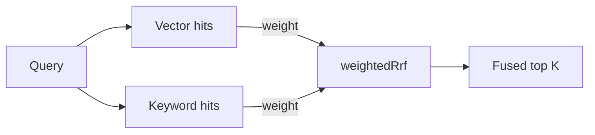

`@ryuhq/sdk/rag` holds the parts of Ryu's retrieval stack that run anywhere: the text splitters,
the metadata filter language, and weighted rank fusion. They follow the same rules as Core, so a
chunking strategy or filter you try locally behaves the same when you send it to a
[Space](/docs/core/spaces-rag).

```typescript
import { matchesFilter, splitText, weightedRrf } from "@ryuhq/sdk/rag";
```

## Split text

`splitText(text, strategy)` returns chunks with metadata (`index`, `headerPath`, `tokenCount`).
The strategy object uses the same JSON as `PUT /api/spaces/:id/chunking`.

```typescript
import { splitText } from "@ryuhq/sdk/rag";

const chunks = splitText(markdown, {
  strategy: "markdown",
  chunk_size: 800,
  chunk_overlap: 100,
});
// chunks[1].metadata.headerPath → ["Guide", "Install"]
```

| Strategy | Behaviour |
|---|---|
| `default` | Paragraph and word packing at 1,000 characters, no overlap. |
| `recursive` | Separator hierarchy (`\n\n`, `\n`, sentence ends, spaces, characters) with `chunk_size` and `chunk_overlap` in characters. `separators` replaces the hierarchy. |
| `markdown` | Header-aware sections, each split recursively; `include_header_path` prefixes the breadcrumb. |
| `token` | Recursive splitting measured with `approxTokenCount`, an approximation of a GPT-style tokenizer. |
| `semantic` | Sentence embeddings with distance breakpoints. Use `splitTextWithEmbedder`. |

The semantic strategy needs embeddings. Pass any function that embeds a batch of strings:

```typescript
import { splitTextWithEmbedder } from "@ryuhq/sdk/rag";

const chunks = await splitTextWithEmbedder(
  text,
  { strategy: "semantic", breakpoint_percentile: 90 },
  (texts) => ctx.rag.embed({ input: texts })
);
```

`validateStrategy` throws a `RangeError` for the configurations Core rejects, such as an overlap
that is not smaller than the chunk size. Character counts are Unicode code points, as in Core.

## Filter metadata

`matchesFilter(filter, metadata)` evaluates a filter against one metadata object.
`validateFilter(filter)` throws a `TypeError` for a filter Core would reject with `400`.

```typescript
import { matchesFilter, type MetadataFilter } from "@ryuhq/sdk/rag";

const filter: MetadataFilter = {
  kind: "page",
  ordinal: { $lt: 3 },
  $or: [{ lang: { $in: ["en", "de"] } }, { $not: { draft: true } }],
};

matchesFilter(filter, { kind: "page", ordinal: 1, lang: "en" }); // true
```

Operators: `$eq`, `$ne`, `$in`, `$nin`, `$gt`, `$gte`, `$lt`, `$lte`, `$exists`, and the
combinators `$and`, `$or`, `$not`. The full rules are in
[Metadata filters](/docs/core/spaces-rag#metadata-filters).

## Fuse rankings

`weightedRrf(lists, key, topK)` merges best-first lists whose scores are not comparable, such as
keyword and vector results, by weighted reciprocal rank.



```typescript
import { weightedRrf } from "@ryuhq/sdk/rag";

const fused = weightedRrf(
  [
    { weight: 0.6, items: vectorHits },
    { weight: 0.4, items: keywordHits },
  ],
  (hit) => hit.id,
  10
);
```

## Search a Space from TypeScript

`@ryuhq/core-client/space-retrieval` calls Core's Space search with every option, and reads or
sets a Space's chunking strategy.

```typescript
import {
  searchSpaceWith,
  setSpaceChunking,
} from "@ryuhq/core-client/space-retrieval";

await setSpaceChunking(target, spaceId, { strategy: "markdown", chunk_size: 800 });

const { matches, queries, warning } = await searchSpaceWith(target, spaceId, {
  query: "how do I install it",
  limit: 5,
  hybrid: { alpha: 0.6 },
  filter: { header_path: "Install" },
  parent: { mode: "window", window: 1 },
  multiQuery: 2,
});
```

`searchRetrieval` and `searchRetrievalDetailed` in `@ryuhq/core-client/retrieval` accept the same
`filter`, `hybrid`, `multiQuery`, `hyde`, and `expansionModel` fields for the unified memory and
Spaces search, and `indexChunk` accepts a `metadata` object for Space chunks.

## In a Runnable

`ctx.rag.retrieve` accepts `filter` and `hybrid`. The SDK validates both before the call and sends
them unchanged to the RAG provider bound to the `rag` capability, so a malformed filter fails in
your code rather than at the provider. See [Primitives](/docs/extend/develop/sdk/primitives#ragclient).
