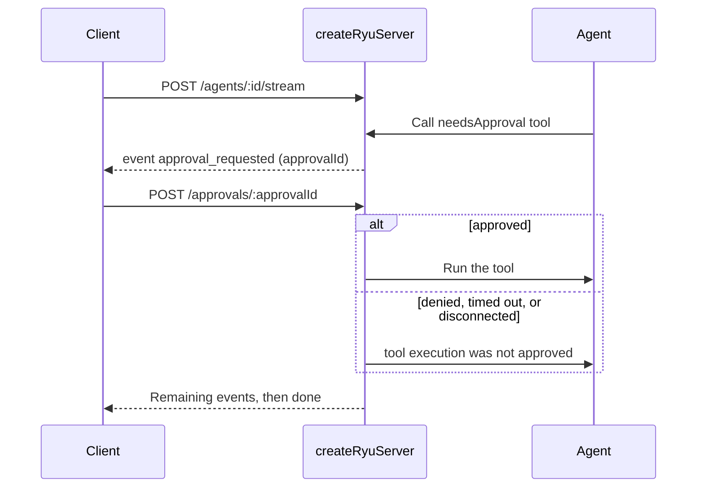

`createRyuServer` from `@ryuhq/sdk/server` turns the agents, workflows, and tools you built with
the TypeScript SDK into an HTTP API. The server is one Web-standard
`fetch(request) => Response` handler, so the same object runs on Node, Bun, Deno, Cloudflare
Workers, Vercel, and Netlify.

`ryu dev --studio` and `ryu build` both serve it; see
[Dev studio](/docs/extend/develop/sdk/studio) and [Build and deploy](/docs/extend/develop/sdk/deploy).

```typescript
import { Agent } from "@ryuhq/sdk/agent";
import { bearerAuth, createRyuServer } from "@ryuhq/sdk/server";
import { serve } from "@ryuhq/sdk/server/node";
import { triage } from "./workflows";
import { weather } from "./tools";

const support = new Agent({
  name: "support",
  model: "your-model-id",
  instructions: "Answer support questions briefly.",
  tools: { weather },
});

const server = createRyuServer({
  agents: { support },
  workflows: { triage },
  tools: { weather },
  auth: bearerAuth(process.env.API_TOKEN),
});

await serve({ fetch: server.fetch, port: 3000 });
```

Agents still send every model call through your node's Gateway (`RYU_GATEWAY_URL`), and remote
Ryu tools still run through Core. The server adds an HTTP surface; it does not change where
inference or governance happens.

## Configuration

| Option | Default | Purpose |
|---|---|---|
| `agents` | none | `Agent` or `AgentNetwork` (including `createSupervisor`) values keyed by route id |
| `workflows` | none | Committed workflows (`createWorkflow(...).commit()`) keyed by route id |
| `tools` | none | Local `defineTool` tools keyed by route id |
| `auth` | none | A hook that receives each API request. Return `true` to allow it, `false` to send 401, or your own `Response`. The studio page itself is static and unguarded |
| `basePath` | `/api` | Prefix for every route |
| `runStore` | in memory, 200 runs | Where run history, traces, and workflow snapshots are kept |
| `runtime` | Gateway client for `RYU_MODEL` | The context handed to tools and workflow steps |
| `approvalTimeoutMs` | 10 minutes | How long a tool approval may wait before it is denied |
| `allowDirectApprovalTools` | `false` (`true` when `studio` is on) | Let `POST /tools/:id/execute` run `needsApproval` tools with no human decision |
| `studio` | `false` | Serve the [dev studio](/docs/extend/develop/sdk/studio) at `/` and `/studio` |
| `info` | `Ryu server` 1.0.0 | The OpenAPI `info` block |

`bearerAuth(token)` accepts `Authorization: Bearer <token>`, compares in constant time, and throws
when the token is empty so a missing secret never leaves the API open.

## Routes

Every route is under `basePath` and returns JSON errors shaped `{ "error": { "code", "message" } }`.

| Method and path | Does |
|---|---|
| `GET /` | List the registered agent, workflow, and tool ids |
| `GET /openapi.json` | The OpenAPI 3.1 document |
| `GET /agents`, `GET /agents/:id` | Describe agents: model, tools, which tools need approval; networks list their members |
| `POST /agents/:id/generate` | Run to completion. Body: `{ "prompt": "…" }` or `{ "messages": [...] }` |
| `POST /agents/:id/stream` | Run and stream events as Server-Sent Events |
| `POST /approvals/:approvalId` | Approve or deny a paused tool call: `{ "approved": true }` or `{ "optionId": "…" }` |
| `GET /workflows`, `GET /workflows/:id` | Describe workflows, with the input schema and the step graph |
| `POST /workflows/:id/start` | Run and return the outcome: `{ "inputData": …, "initialState"?: {…}, "runId"?: "…" }` |
| `POST /workflows/:id/stream` | Run and stream chunks; add `"streamMode": ["events", "values"]` to pick modes |
| `GET /workflows/:id/runs`, `GET /workflows/:id/runs/:runId` | Run history and one run's recorded events |
| `POST /workflows/:id/runs/:runId/resume` | Resume a suspended run: `{ "resumeData": …, "step"?: "…" }` (`/resume/stream` streams it) |
| `POST /workflows/:id/runs/:runId/cancel` | Cancel a running run |
| `GET /tools`, `GET /tools/:id` | Describe tools and their input schemas |
| `POST /tools/:id/execute` | Run a tool: `{ "input": {…} }`. A tool marked `needsApproval` returns 403 `approval_required` unless `allowDirectApprovalTools` is set (the dev studio allows it) |
| `GET /traces`, `GET /traces/:runId` | Recent runs of every kind (`?kind=agent&target=support&limit=20`) and one run's full trace |

Request rules and status codes:

- Send every `POST` as `application/json` (`curl -H 'content-type: application/json' -d …`), even
  when the body is empty. Any other content type returns 415, so a page on another site cannot
  post to the API without a CORS preflight.
- Request bodies are limited to 1 MiB. A larger body returns 413.
- A tool that rejects its input returns 422.
- An agent run that ends in an error returns 500 with its `runId`, so you can open the trace.

### Streaming

`/stream` routes answer with `text/event-stream`. Each frame's `event` names the payload, and
`data` is one JSON line:

```text
event: run
data: {"runId":"3f0c…","agent":"support"}

event: tool_call
data: {"type":"tool_call","id":"call_1","name":"weather","input":{"city":"Oslo"}}

event: tool_result
data: {"type":"tool_result","id":"call_1","name":"weather","output":{"tempC":21}}

event: text
data: {"type":"text","content":"It is 21°C in Oslo."}

event: result
data: {"type":"result","text":"It is 21°C in Oslo.","steps":2}

event: done
data: {"runId":"3f0c…","status":"success"}
```

- Agent streams carry the agent's own events (`text`, `tool_call`, `tool_result`,
  `approval_requested`, `auth_required`, `output_repair`, `result`, `error`, and `handoff` for
  networks).
- Workflow streams send one frame per chunk, named by its mode (`events`, `updates`, `values`),
  then `result` with the outcome.
- Every stream ends with `done`. Idle streams send a keep-alive comment every 15 seconds.

### Tool approvals

When a streamed agent calls a tool declared with `needsApproval: true`, the stream sends
`approval_requested` with an `approvalId` and waits. Post the decision to
`/approvals/:approvalId`.



- An approved call runs.
- A denied call returns `{ "error": "tool execution was not approved" }` to the model, which can
  carry on without it.
- A decision that does not arrive within `approvalTimeoutMs`, or a client that disconnects, counts
  as a denial.

The same applies to every agent the run reaches: members of a network or supervisor and targets of
a `handoff()`. An agent that has its own `approvalHandler` keeps using it.

A `{ "messages": [...] }` body continues a conversation the way a new prompt would, including
following `handoff()` tools.

`/generate` has no channel for a decision, so a run that reaches an approval-gated tool returns
`"status": "paused"` with `approvalRequired` instead. Use `/stream` for approvals.

### Workflow runs and resume

A workflow step that calls `suspend()` ends the run with `"status": "suspended"` and the suspended
steps' payloads. Resume it with `POST /workflows/:id/runs/:runId/resume`.

The server records each run's snapshot in the run store. A resume works even when the original run
object is gone (a different serverless invocation, or a restarted process with a persistent
`runStore`). With the default in-memory store, history lasts for the life of the process.

A resume marks the run as running in the store before it executes. Two cases return 409:

- A second resume of the same run.
- A resume that names a step that is not suspended. The run stays suspended.

### Persisting runs

Implement `RunStore` (`get`, `list`, `save`; each may be async) to keep history and snapshots in
your own database:

```typescript
import type { RunRecord, RunStore } from "@ryuhq/sdk/server";

const runStore: RunStore = {
  get: (id) => db.runs.findOne(id),
  list: ({ kind, target, limit } = {}) => db.runs.findRecent({ kind, target, limit }),
  save: (record: RunRecord) => db.runs.upsert(record.id, record),
};
```

## OpenAPI

`GET /openapi.json` (or `server.openapi()`) returns an OpenAPI 3.1 document with a concrete path
per registered agent, workflow, and tool, so each operation carries its own request schema: a
tool's input schema and a workflow's `inputSchema` converted to JSON Schema. When `auth` is set,
the document declares bearer security.

## Hosting

- **Node or Bun.** `serve({ fetch: server.fetch, port, hostname })` from `@ryuhq/sdk/server/node`
  starts an `http` server (it binds `127.0.0.1` unless you pass `hostname`).
  `toNodeListener(server.fetch)` gives you a `(req, res)` listener for an existing Node server.
- **Hono or another Fetch framework.** Mount the handler:
  `app.all("/api/*", (c) => server.fetch(c.req.raw))`.
- **Serverless and edge.** `ryu build` wraps the server for each vendor. See
  [Build and deploy](/docs/extend/develop/sdk/deploy).

## Project modules

`ryu dev --studio`, `ryu build`, and `resolveRyuServer(module)` load a project entry (default
`src/ryu.ts`) that exports one of:

- a `createRyuServer(...)` result as `default` (or `server`);
- a server config object as `default`;
- named `agents`, `workflows`, and `tools` records.

```typescript
// src/ryu.ts
export const agents = { support };
export const workflows = { triage };
export const tools = { weather };
```

The `workflow` and `multi-agent` [templates](/docs/extend/develop/sdk/tooling#scaffold-a-project)
are laid out this way.
