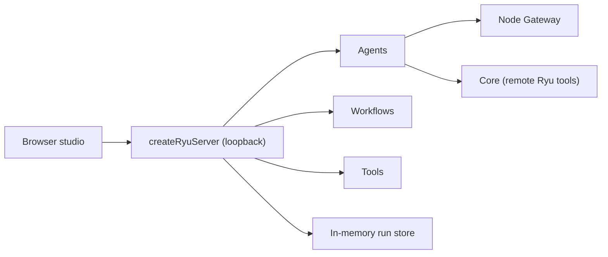

`ryu dev --studio` serves your project's agents, workflows, and tools on loopback with a browser
studio on top. It uses the same [`createRyuServer`](/docs/extend/develop/sdk/server) API you deploy,
so what works in the studio works behind `ryu build`.

```bash
bunx ryu dev --studio            # loads src/ryu.ts
bunx ryu dev --studio app.ts --port 4111 --host 127.0.0.1
```

| Option | Default |
|---|---|
| `[entry]` | `src/ryu.ts`; see [project modules](/docs/extend/develop/sdk/server#project-modules) |
| `--port` | `4111` (`0` picks a free port) |
| `--host` | `127.0.0.1` |

The command prints the studio URL, the API base, and whether your node's Gateway
(`RYU_GATEWAY_URL`, default `http://127.0.0.1:7981`) is reachable. Workflows and tools run without
it. Agent chat needs it, so an unreachable Gateway is a warning, not an error. Press Ctrl+C to stop.

Projects scaffolded with `--template workflow` or `--template multi-agent` run the studio with
`bun dev`.



## What the studio shows

### Agents

Pick an agent or a network and chat. Each reply streams in with its tool calls and their results
inline. Follow-up messages carry the conversation so far.

- When a tool declared with `needsApproval: true` is called, the studio shows the arguments with
  **Approve** and **Deny** buttons. The run waits for your choice.
- Networks also show each handoff between members.

### Workflows

The step graph is drawn from the workflow's stages, with parallel, branch, foreach, and loop stages
shown as groups. Enter the input as JSON and run it.

- Steps light up as they start, finish, suspend, or fail.
- The live state panel follows the run's values.
- A suspended run shows each suspend payload with a form to resume it with `resumeData`.
- The run history below the graph opens any earlier run's trace.

### Tools

See a tool's input schema, execute it with JSON input, and read the output.

### Traces

The studio lists every agent, workflow, and tool run its server handled, newest first. Each entry
shows its input, its output or error, and the ordered events it produced, each stamped with its
offset from the start of the run.

## Where the data lives

Run history and traces are kept in memory for the life of the `ryu dev --studio` process (the
newest 200 runs, up to 2,000 events each) and are discarded when it exits. Nothing is written to
disk or sent anywhere other than your node's Gateway and Core. To keep runs, start your own server
with a persistent [`runStore`](/docs/extend/develop/sdk/server#persisting-runs).

## Who can reach the studio

The studio page loads no third-party scripts and talks only to its own origin. On the default
loopback address:

- It answers only requests addressed to `localhost`, `127.0.0.1`, or `[::1]`.
- It refuses changes (agent runs, approvals, tool runs) sent from any other page's origin, so a
  website open in your browser cannot drive it.

<Callout type="warn">
  Binding another address with `--host` makes the studio reachable from other machines. The command
  prints a warning, and only your server's `auth` hook protects it then.
</Callout>
