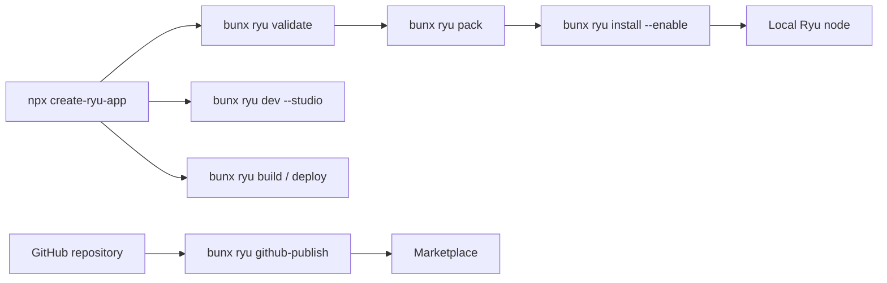

This page covers the tooling that ships with the TypeScript SDK: the `ryu` CLI and the
`create-ryu-app` scaffolder. It is part of the [Ryu SDKs and Libraries](/docs/extend/develop/sdk)
guide.

A typical project moves through these commands:



## The CLI

The `ryu` CLI (`packages/sdk/src/cli.ts`) ships with `@ryuhq/sdk` as the `ryu` bin, so a scaffolded
project runs it with `bunx ryu`.

It is separate from the Ryu terminal client, which installs as `ryu-cli` (see
[the CLI reference](/docs/surfaces/cli/reference)). Portable-package commands such as
`ryu-cli package pack` belong to that client, and `bunx ryu package` points you there.

The SDK CLI has these commands:

| Command | Does |
|---|---|
| `bunx ryu pack <dir>` | validate `<dir>/manifest.json`, emit `<dir>/dist/plugin.bundle.json` |
| `bunx ryu validate <dir>` | check `<dir>/manifest.json` against the SDK schema and the public [JSON Schema](https://ryuhq.com/schemas/plugin.json) without packing |
| `bunx ryu install <bundle-or-dir> [--update] [--enable]` | side-load a packed bundle into a Ryu node |
| `bunx ryu github-publish <url>` | submit a seller-owned GitHub repository/package URL to the Marketplace bridge |
| `bunx ryu agent-plugin <dir>` | emit the Agent Plugins v1 interop pair (`plugin.json` + `mcp.json`) |
| `bunx ryu chatgpt-plugin <dir>` | package declared MCP servers and skills for ChatGPT |
| `bunx ryu dev <entry>` | run a dev-loop module (a `run(messages, model)` generator) locally with an interactive chat loop |
| `bunx ryu dev --studio [entry]` | serve a project's agents, workflows, and tools with the browser [studio](/docs/extend/develop/sdk/studio) |
| `bunx ryu build [entry] --target <t>` | bundle a project for `node`, `docker`, `vercel`, `cloudflare`, or `netlify` ([Build and deploy](/docs/extend/develop/sdk/deploy)) |
| `bunx ryu deploy <target> [entry]` | build, then hand the output to the vendor's own CLI ([Build and deploy](/docs/extend/develop/sdk/deploy)) |

`bunx ryu publish` is deprecated and exits with an error; use `bunx ryu github-publish`.

### pack and validate

`ryu pack` validates against `PluginManifestSchema` and exits non-zero with the failing field path
on any error.

- The emitted bundle preserves declared menu items, views, store tabs, create actions, agent editor
  panels, and hook priorities.
- Host-owned contribution payloads retain their fields through validation.
- Hooks and adapters have their referenced source files inlined before signing.

`ryu validate <dir>` is the authoring-time check. The public JSON Schema is stricter than Core's
parser, so it flags a misspelled hook phase or settings field type that Core would accept and then
never use. It exits non-zero and lists every finding, tagged `[sdk]` or `[json-schema]`.

### install

`ryu install <bundle-or-dir>` posts `dist/plugin.bundle.json` (pass the project directory or the
file) to the node's authenticated `POST /api/plugins/install-bundle`.

- The plugin installs disabled, like a store install.
- `--enable` then calls `POST /api/plugins/<id>/enable`, which validates its grants through the
  Gateway.
- `--update` replaces an already-installed copy of the same id.

The target is `RYU_CORE_URL` (default `http://127.0.0.1:7980`). The bearer is the first of:

1. `RYU_CORE_TOKEN`
2. `RYU_TOKEN`
3. For a loopback URL only, the node's own `node-auth.token` in its data directory (`RYU_DIR`
   relocates it). The local token file is never sent to a remote URL.

### github-publish

`ryu github-publish <url>` submits the GitHub-backed package to the hosted Marketplace
(`https://api.ryuhq.com`). Set `RYU_MARKETPLACE_API_URL`, or `RYU_API_URL`, for a self-hosted
control plane.

- It needs your signed-in Ryu account session as `RYU_AUTH_TOKEN`. API keys and third-party OAuth
  tokens are refused on publishing routes.
- Private repositories return the one-time GitHub App installation URL. Install the app, then set
  `RYU_GITHUB_INSTALLATION_PROOF` to the proof the installation callback returns and run the
  command again.

Most authors submit the same URL through **Publish from GitHub** instead (the Desktop publisher, or
Marketplace → **Sell** on the web). It uses your signed-in session and completes the GitHub App
step for you.

Publishing is governed by the Gateway (grant validation and manifest signing). See
[Marketplace](/docs/extend/develop/extensions/marketplace) for the full publish flow.

### agent-plugin and chatgpt-plugin

`ryu agent-plugin <dir>` runs the same validation, then emits only the Agent Plugins v1 interop
pair derived from the manifest: a `plugin.json` and, when the manifest declares MCP servers, an
`mcp.json`. Agents that speak the Agent Plugins wire format can then use a Ryu plugin without the
full bundle.

An MCP `env` or `headers` value that references the [Secret Vault](/docs/security/secret-vault)
(`secret:NAME`) is left out of `mcp.json`, and the command prints a note naming it. Only Ryu can
resolve that reference, so a host that installs the pair must supply that value itself.

`ryu chatgpt-plugin <dir>` writes a portable OpenAI plugin directory to
`<dir>/dist/chatgpt-plugin/`. It includes plugin metadata, the package's declared MCP connections,
and selected `skills/<slug>/` resources.

- `--skills <slug,...>` chooses up to five skills.
- `--force` replaces an output directory not already managed by this command. Use it only for that.
- Credential-like MCP values are omitted.

See [ChatGPT plugins and MCP extensions](/docs/extend/develop/sdk/chatgpt) for the server SDK, auth
boundary, and OpenAI extension support.

### dev

`ryu dev` resolves the Gateway URL the same way `ModelClient` does (`RYU_GATEWAY_URL` first),
imports your module, and starts a terminal REPL. If the Gateway is unreachable, it prints an error
and exits non-zero. It never falls back to a provider.

The module must export, as `default` or as `runnable`, an object with a `name` and a
`run(messages, model)` generator (`packages/sdk/src/cli/dev.ts`):

- Each turn, `run` receives the chat history and a Gateway-bound `ModelClient`.
- It yields `text`, `tool_call`, `tool_result`, or `error` events.
- A `defineAgent` or `defineWorkflow` result has a different `run(input, ctx)` contract, so
  `ryu dev` cannot drive it directly.

## Scaffold a project

```bash
npx create-ryu-app my-extension
npx create-ryu-app my-extension --template hook-plugin
```

`create-ryu-app` (`packages/create-ryu-app/`) does four things:

1. Copies a template.
2. Stamps your project name into it.
3. Validates the generated `manifest.json` against the manifest schema (the `services` template
   has none).
4. Writes a `package.json` with a `dev` script (plus `pack` for plugin templates).

`--template <name>` (or `--template=<name>`) picks the starter:

| Template | Shape | What you get |
|---|---|---|
| `agent` (default) | Plugin | An `Agent` with one local `defineTool` tool in `src/agent.ts`. It needs only a running node with a routable model: no API key, account connection, or Core agent. |
| `expense-agent` | Plugin | An `Agent` that calls existing Ryu tools with `ryuTool` (Gmail through Composio). Needs a Composio key on the node, a Core agent whose allowlist includes the Gmail actions, and a Gmail sign-in on first run. |
| `workflow` | Plugin | A typed workflow in `src/ryu.ts` with a classify step, an agent draft step, a review step that suspends for human approval, and a send step. `bun dev` opens the [studio](/docs/extend/develop/sdk/studio); `bun run build` runs `ryu build --target node`. |
| `multi-agent` | Plugin | A supervisor (`createSupervisor`) routing between a researcher and a writer in `src/ryu.ts`, with a `needsApproval` publish tool. `bun dev` opens the studio. |
| `action` | Plugin | A governed business action with input/output contracts (`defineAction`) in `src/action.ts`. |
| `hook-plugin` | Plugin | A post-assistant-turn hook (`definePlugin` + `defineTurnHook`) in `src/plugin.ts`. |
| `ryu-app` | Plugin | An interactive in-chat widget (`defineApp` + `src/widget.tsx`) that `ryu pack` bundles into `ui_code`. |
| `companion-plugin` | Plugin | A widget that calls a companion tool, plus a companion panel surface. |
| `app` | App | A self-contained app satellite: `manifest.json` plus a loopback HTTP `sidecar/` reached through the generic ext-proxy. Its `package.json` has `build` and `check-types` instead of `pack`. |
| `adapter` | Plugin | A capability adapter (see [The adapter template](#the-adapter-template)). |
| `services` | Server | Not an extension: a standalone [Hono](https://hono.dev) server on [`@ryuhq/services`](/docs/standalone/sdk). See [The services template](#the-services-template). |

Plugins and apps are compared in [Plugins vs apps](/docs/extend/develop/extensions/plugins-vs-apps).

### The adapter template

`--template adapter` scaffolds a capability adapter:

- an HTTP provider tool
- a `provides` binding with a flat `adapters/<verb>.js` body
- the `tool:execute` and `tool:http-egress:<host>` grants
- golden cases you run with `bun test`

See [Shipping a custom adapter](/docs/core/swappable-layers-adapters#shipping-a-custom-adapter).

### The services template

`--template services` scaffolds a standalone Hono server, not an extension. It includes:

- a Notify publish route
- a Mail send route (a `ryu_` key with `mail:send`)
- Mail and Notify webhook routes verified with `@ryuhq/services/webhooks`

It has no `manifest.json`. Its `package.json` has `dev`, `start`, `test` and `check-types`,
`.env.example` lists the variables it reads, and its `.gitignore` excludes `.env`.

<Callout type="warn">
  `@ryuhq/services` is not yet published to npm, so `bun install` cannot fetch it from the registry
  yet. Inside a Ryu monorepo checkout it resolves only when the project is scaffolded under
  `examples/` and `bun install` runs at the repository root.
</Callout>

## Other SDK notes

`createPrimitives(transport)` builds typed clients for RAG, memory, storage, speech, image,
engines, realtime, durable checkpoints, backups, and background processes. The client methods,
transports, and required grants are documented once on
[SDK Primitives](/docs/extend/develop/sdk/primitives).

Core clients in `@ryuhq/sdk` take the node URL as `baseUrl`. They are `httpPrimitiveTransport`,
`createCoreWorkflowClient`, and the loaders' `core` and `ryuVaultSecret` options. The older name,
`nodeUrl`, still works; passing both with different values throws.

The SDK's stdio MCP client (`packages/sdk/src/mcp/client.ts`) rejects pending requests with
`MCP server closed the connection` when its server exits before it replies.

## Next

<Cards>
  <DocCard href="/docs/extend/develop/extensions/typescript-sdk" />
  <DocCard href="/docs/extend/develop/sdk/client" />
  <DocCard href="/docs/extend/develop/sdk/rust" />
  <DocCard href="/docs/extend/develop/sdk/plugin-api" />
  <DocCard href="/docs/extend/develop/extensions/hooks-lifecycle" />
</Cards>
