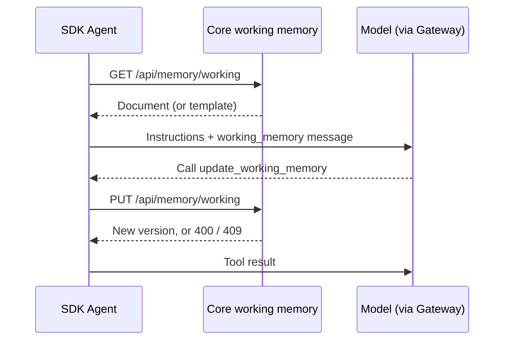

Long-term memory stores many separate facts and recalls the ones that match the current message.
Working memory is a different tool: one small document per conversation (thread) or per resource
(usually a user). The agent keeps it up to date and sees all of it on every turn. Typical contents
are the user's name and preferences, the goal of the current task, and the decisions made so far.

Working memory comes in two modes:

| Mode | Document | How an update applies |
|---|---|---|
| **Template** (default) | Markdown, seeded from a template | The update replaces the whole document |
| **Schema** | A JSON object described by a JSON Schema | The update is a [JSON merge patch](https://www.rfc-editor.org/rfc/rfc7386): objects merge, `null` removes a key. Core validates the result against the schema |

Documents are stored in Core, encrypted at rest like other memory. Each document belongs to the
caller that wrote it. On a node that belongs to an organization, that caller is the verified user,
so another user's thread or resource id never reaches your document. A `thread` id that names an
existing conversation also requires access to that conversation.

## SDK agents

Pass `workingMemory` to an `Agent` that runs its own loop (an agent without `sessionId`):

```typescript
import { Agent } from "@ryuhq/sdk";

const agent = new Agent({
  name: "concierge",
  model: "your-model-id",
  instructions: "Help the user plan trips.",
  workingMemory: {
    scope: "resource", // or "thread" (default)
    id: currentUser.id, // a thread id for "thread" scope
    template: "# Traveller\n- **Name**:\n- **Home airport**:\n- **Dietary needs**:\n",
  },
});
```

On every model call the agent adds a `<working_memory>` system message after its instructions,
with the current document (or the empty template). It also gets an `update_working_memory` tool:

- In template mode the model sends the complete new Markdown as `content`.
- In schema mode it sends only the changed fields as `data`.



For schema mode, pass a Standard Schema validator (zod 4, valibot, arktype) or a JSON Schema object
that describes an object:

```typescript
import { z } from "zod";

const agent = new Agent({
  name: "support",
  model: "your-model-id",
  workingMemory: {
    id: threadId,
    schema: z
      .object({
        customer: z.string(),
        plan: z.enum(["free", "pro", "team"]),
        openIssues: z.array(z.string()),
      })
      .partial(),
  },
});
```

If a merged update doesn't match the schema, Core rejects it with a 400. The model receives the
validation error as the tool result and can try again.

### From tool code

When `workingMemory` is set, local tools can read and write the same document through
`ctx.memory.working`.

```typescript
import { defineTool } from "@ryuhq/sdk";

const rememberAirport = defineTool({
  id: "remember-airport",
  name: "Remember airport",
  schema: { type: "object", properties: { code: { type: "string" } }, required: ["code"] },
  async run({ code }, ctx) {
    const doc = await ctx.memory?.working?.get();
    const content = (doc?.content ?? "").replace(/- \*\*Home airport\*\*:.*/, `- **Home airport**: ${code}`);
    await ctx.memory?.working?.update({ content, expectedVersion: doc?.version ?? 0 });
    return { ok: true };
  },
});
```

`get()` and `update()` use the agent's configured scope and id unless you pass `{ scope, id }`.
`expectedVersion` makes the write fail with a 409 if someone else changed the document after you
read it. Use `0` to mean "must not exist yet".

Working memory and compaction run in the SDK-owned loop. For an agent with a `sessionId`, Core runs
the turn, so set them on the Core agent instead, as described in [Core agents](#core-agents).

## Compaction

`compaction` keeps a long SDK conversation inside a token budget. When the outgoing transcript
exceeds `threshold` estimated tokens, the older turns are summarized and replaced with one summary
message. The newest turns are sent unchanged:

```typescript
const agent = new Agent({
  name: "researcher",
  model: "your-model-id",
  compaction: {
    threshold: 24_000, // estimated tokens
    model: "a-small-fast-model", // summarizer; defaults to the agent's model
    keepRecent: 8, // newest messages kept verbatim (default 6)
  },
});
```

The kept window always starts at a user message, so a tool call is never separated from its
result. Each summary is cached for the run. If summarization fails, the agent sends the full
transcript for that call. You can supply your own `summarize(messages)` function instead of the
gateway summarizer.

## Core agents

Agents configured in Core set both features in the `memory` block of the agent configuration,
through the agents API or `@ryuhq/core-client`. The desktop agent editor does not show these
fields.

```json
{
  "memory": {
    "working_memory": {
      "scope": "thread",
      "template": "# Task\n- **Goal**:\n- **Decisions**:\n"
    },
    "compaction": {
      "enabled": true,
      "threshold": 16000,
      "model": "a-small-fast-model"
    }
  }
}
```

### working_memory

`working_memory` takes `scope` (`thread` or `resource`), plus a `template` or a `schema`. Set
`"enabled": false` to switch it off without removing the configuration.

- For `thread` scope the document id is the conversation.
- For `resource` scope it is the person chatting, so the document follows them across
  conversations with that agent.
- The agent receives the document on each turn and updates it with the built-in
  `working_memory.update_working_memory` tool.

Working memory is left out of temporary chats, of turns from public or untrusted callers, and of
turns where a member chats in a conversation another member owns.

### compaction

`compaction` overrides the node's [context settings](/docs/start-here/configuration#recall-and-context)
for this agent's turns. Fields you leave out keep the node setting.

| Field | Values | Overrides |
|---|---|---|
| `threshold` | A token count, `"auto"` (the model's context size), or `"off"` | `context.max-tokens` |
| `enabled` | `true` summarizes instead of trimming | `context.auto-compact` |
| `model` | A model id | `context.compact-model` |
| `effort` | A reasoning effort | `context.compact-effort` |

## HTTP and core-client

| Method | Path | Purpose |
|---|---|---|
| `GET` | `/api/memory/working?scope=thread\|resource&id=…` | Read a document (`working_memory` is `null` when none exists) |
| `PUT` | `/api/memory/working?scope=…&id=…` | Create or update. Body: `content`, `data`, `template`, `schema`, `mode`, `replace`, `expected_version` |
| `DELETE` | `/api/memory/working?scope=…&id=…` | Delete a document |

Errors: 400 for an invalid request or schema violation, 403 when the caller lacks memory
permission, 409 when `expected_version` does not match. Deleting a conversation also deletes its
thread working memory.

The same calls are available as typed functions:

```typescript
import {
  getWorkingMemory,
  updateWorkingMemory,
  deleteWorkingMemory,
} from "@ryuhq/core-client/working-memory";

const ref = { scope: "resource", id: "user-1" } as const;
await updateWorkingMemory(target, ref, { data: { plan: "pro" }, schema: { type: "object" } });
const doc = await getWorkingMemory(target, ref); // { mode: "schema", data: { plan: "pro" }, version: 1, … }
```
