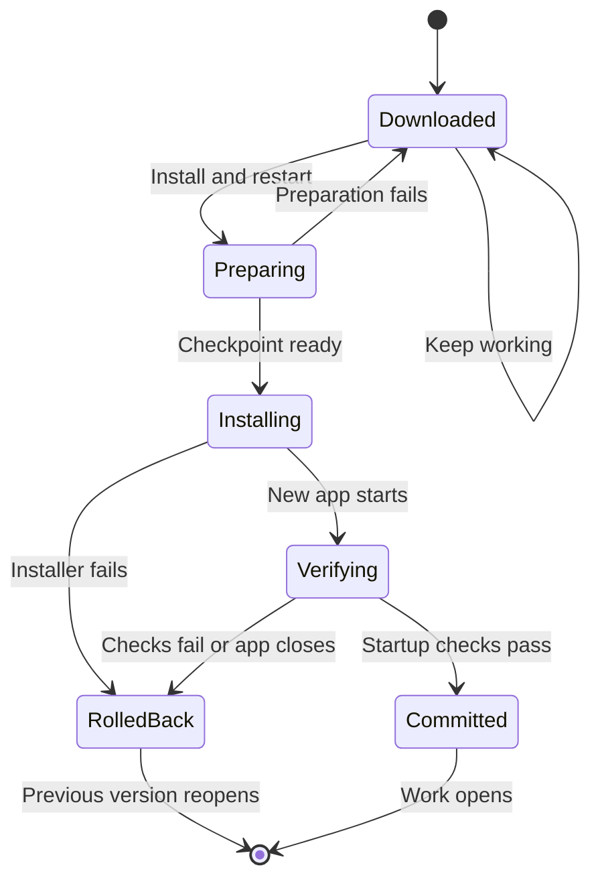

Desktop updates and local runtime updates can affect running work. Downloading an
update does not give permission to install it. Ryu asks before an installation
that needs a restart or stops local execution.

## Choose when to restart

Use **Settings → Advanced → Updates** to review a downloaded update. **Install and
restart** starts the installation flow. If you choose **Keep working** when Ryu
asks to interrupt local work, the current app keeps running and the downloaded
update remains available.

An app update can stop local chats, tools, and workflows while their runtime is
replaced. Work running on a separate remote node continues on that node. Check
the interruption prompt before accepting an update during active work.

## Keep profiles separate

A development profile has its own configuration and runtime state. Use the same
profile for the desktop, its local node, and the execution runtime that serves
your development work. Switching profiles does not transfer a running execution
to the new profile.

Profiles can share one installed desktop application. Updating that application
can require a restart even when a particular profile has no active work. Keep
independent development data separate from everyday data when testing a new
build or an upgrade.

## When update preparation fails

Ryu checks the prepared update before replacing the running app. If preparation
fails, the update remains available for retry and Ryu reports the failure. A
failed preparation does not mean the new version was installed.

Retry from the failure notice or **Install and restart**. Starting a retry clears
the previous install error. If you then choose **Keep working**, the verified
update stays ready for later. A new failed attempt shows its own error.

Recovery preparation needs free disk space for a data checkpoint and rollback
files. Checkpoint retention, cleanup, and the preparation limits are described in
[Recovery checkpoints](/docs/core/updates#recovery-checkpoints).

## Custom distribution feeds

Distribution URLs belong to the packaged application. The default is Ryu's
GitHub release repository (`https://github.com/amajorai/ryu/releases`). A
distribution can set an immutable HTTPS release base in its Tauri configuration.

```json
{
  "plugins": {
    "ryu-distribution": {
      "schemaVersion": 1,
      "releaseBase": "https://releases.example.com/ryu"
    }
  }
}
```

The same base supplies stable, channel, and pinned-version feeds, including the
verified previous package used for recovery.

- Credentials, queries, fragments, and non-HTTPS bases are rejected.
- Renderer requests cannot supply another URL.
- Signature verification and runtime checksums remain required.

## Startup verification and rollback

Use matching application and runtime versions when testing upgrades. A startup
screen alone does not verify an upgrade. Check that the intended profile opens
and its required runtime is ready before resuming work.



### Verifying your update

During a supervised update, the new app shows **Verifying your update** while
its startup checks finish. Your work opens only after the update is committed.

- The checks include the managed Pi engine and its agent bridge. Ryu validates
  their launchers and creates a local test session without sending a prompt to
  a model provider.
- Missing or broken required dependencies prevent commit. First startup can
  take longer when those dependencies need installation.
- If verification stops, the app shows **Update verification stopped** and
  keeps work closed while recovery determines whether it can reopen the
  previous version.

A health acknowledgement by itself does not mean installation has completed.

### Rollback

If the installer fails, including one that exits immediately, or leaves its own
background processes running, Ryu stops those processes, restores the
checkpointed data, and reopens the previous version. The same applies when the
new version closes before its startup checks finish, including any helper
processes it started.

If Ryu reports that an update-owned process could not be stopped, automatic
restoration pauses and the checkpoint stays available, so restoration does not
overwrite data that process may still be writing.

An overridden Pi configuration folder is included in recovery alongside profile
data. If configured runtime folders change while an update is being prepared,
Ryu stops the installation flow and asks you to retry preparation.

See [Auto-Update](/docs/core/updates) for app and node update controls, channels, and
scheduled installation.
