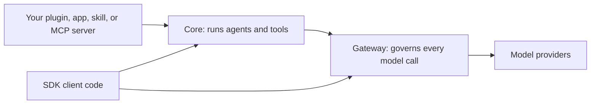

This realm is for developers who build on Ryu. Extensions and integrations use the same Core and
Gateway as built-in features: Core runs agents and tools, and the Gateway controls every model call.
To pick between an MCP server, a `manifest.json` plugin, and the TypeScript SDK, see
[Choose a path](/docs/extend/develop/extensions#choose-a-path).

<Figure name="extend" />

<Cards>
  <DocCard href="/docs/extend/develop" />
  <DocCard href="/docs/extend/integrate" />
  <DocCard href="/docs/extend/mcp" />
  <DocCard href="/docs/extend/skills" />
</Cards>

## Start building

<Cards>
  <DocCard href="/docs/extend/develop/quickstart" />
  <DocCard href="/docs/extend/develop/extensions/plugins-vs-apps" />
  <DocCard href="/docs/extend/develop/api-reference" />
</Cards>

For what is already built, browse the [Apps](/docs/apps) and [Plugins](/docs/plugins) catalogs.
