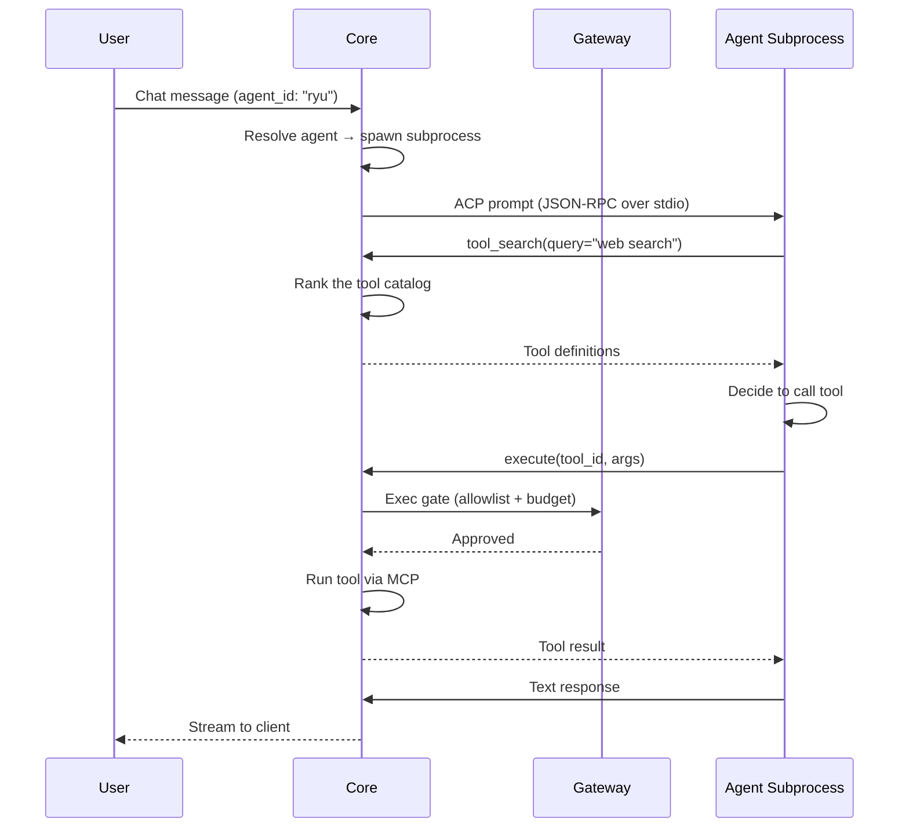
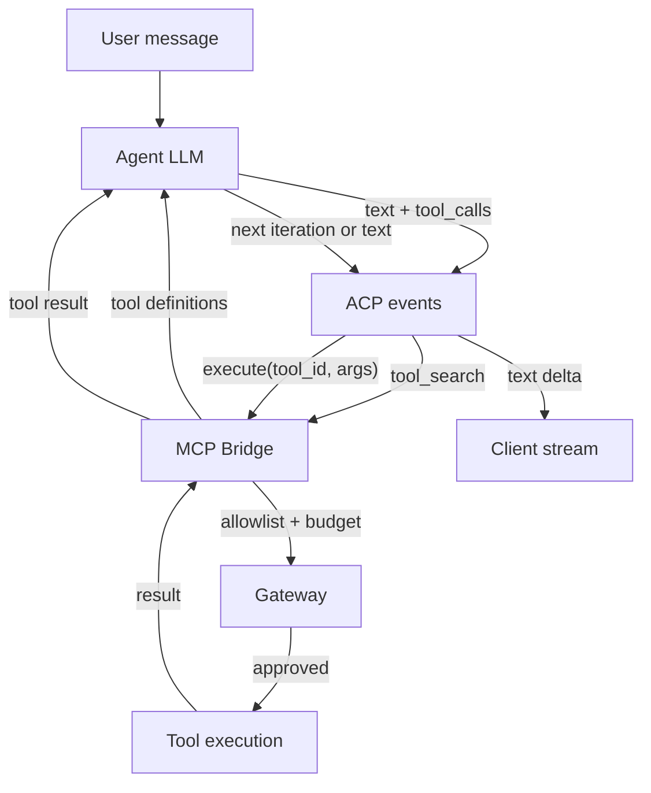
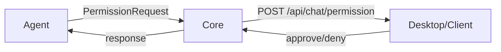
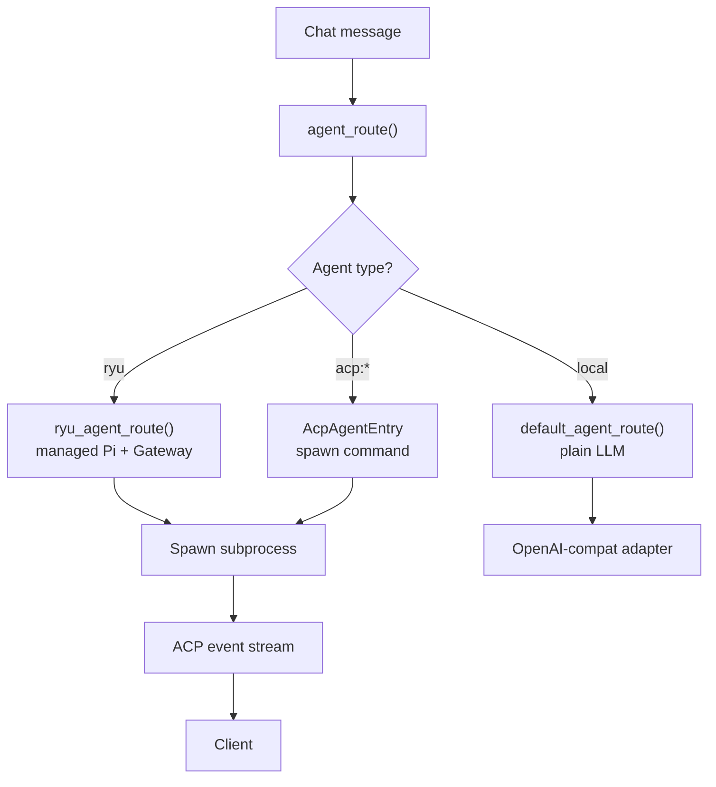

ACP (Agent Client Protocol) is a JSON-RPC protocol between a client and an agent process. Ryu uses
it to run agent subprocesses. Each agent runs in its own process and runs its own tool loop for
reading files, running commands, and editing code. Core turns the agent's session updates into
`AcpEvent` values (`apps/core/src/sidecar/adapters/acp/wire_types.rs`) and streams them to the
client.

This page covers Ryu as the ACP client. To drive Ryu agents from an ACP editor such as Zed, see
[Editors (ACP)](/docs/surfaces/editors).

## How it works

1. Core resolves the agent from the `agent_id` in the chat request.
2. Core spawns the agent's subprocess with its configured command.
3. Core and the agent exchange ACP JSON-RPC messages over stdio. The agent sends session updates
   (text deltas, tool calls, tool results).
4. Core's MCP bridge offers the `tool_search`, `describe`, `execute`, and `resume` meta-tools to the agent.
5. The Gateway governs each model call the agent routes through it (see
   [Gateway egress routing](#gateway-egress-routing)).

## The MCP bridge meta-tools

The MCP bridge (`apps/core/src/sidecar/adapters/mcp_bridge.rs`) offers four meta-tools to every
ACP agent while the tool bridge is on (the default).

| Meta-tool | What it does |
|---|---|
| `tool_search` | Discover tools and Agent Skills by query. Needle 3 ranks by default, with Needle 2 as a rollback and BM25 or semantic fallbacks |
| `describe` | Get detailed info about a specific tool (schema, annotations, examples) |
| `execute` | Call a tool by id with arguments, through the allowlist, budget, and audit |
| `resume` | Resume a parked execution (for long-running tools) |

The agent reaches Ryu tools only through these meta-tools. Its own built-in tools (file edits,
shell commands) run inside the agent process and use the [permission system](#permission-system).

## The tool loop

The agent runs the tool loop.

The loop continues until the agent produces a text response with no tool calls, or the maximum
iterations are reached.

## Gateway egress routing

ACP agents make their own model calls inside their subprocess. Whether those calls go through the
Gateway depends on the agent (`apps/core/src/agent_routing/mod.rs`).

| Mechanism | Agents | How it works |
|---|---|---|
| **Managed config** | `ryu` (managed Pi) | Core writes the Gateway into Pi's `models.json`. Pi ignores `OPENAI_BASE_URL`. |
| **Base-URL injection** | BYO OpenAI-compatible (`acp-exec:` engine) | Core injects `OPENAI_BASE_URL` (the Gateway `/v1`) and `OPENAI_API_KEY` (the Gateway token). The agent's HTTP client routes through the Gateway. |
| **Passthrough proxy** | Claude Code, Codex | The Gateway runs a transparent reverse proxy in the agent's native wire format (Anthropic Messages for Claude Code, OpenAI Responses for Codex with a ChatGPT login). Subscription credentials are forwarded unchanged. |
| **No interception** | Gemini CLI, OpenClaw, Hermes | These agents ignore `OPENAI_BASE_URL` or use their own credential system. Chat egress bypasses the Gateway. Tool egress is still governed via MCP. |

For new and auto-installed routable ACP agents, Gateway routing and the MCP tool bridge start on
by default (`DEFAULT_GATEWAY_ROUTING`).

- The bridge exposes the agent's current enabled tool and skill scope.
- An explicit per-agent `false` preference opts the agent out of routing or of the bridge.

<Callout type="warn">
  Agents in the no-interception row bypass the Gateway for chat. Only their calls to Ryu tools are
  governed.
</Callout>

## The BYO agent path

An agent you add yourself has an `acp-exec:<command>` engine. Core gives it a per-agent Gateway
routing toggle (the `agent-gateway-routing` preference) and a separate tool-bridge toggle (the
`agent-tool-bridge` preference). Both default on. Base-URL injection only changes egress for an
agent that reads `OPENAI_BASE_URL`.

[Build a BYO Agent](/docs/extend/integrate/byo-agent) walks through registration, routing, and
tool access step by step.

## Per-agent launch settings

Each ACP agent, whether from the registry or added by you, has its own launch settings. To change
them, open the agent in **Agents** and use the **Agent launch** section. They cover the same ground
as the per-agent server settings in other ACP editors.

Launch settings decide what program runs, and their environment variables can contain credentials.

- Reading or changing them requires agent management authority and permission to edit the agent.
- Paired clients with read-only access can still browse agents, but cannot retrieve their launch
  settings.
- Ryu encrypts launch settings at rest.

| Setting | What it does |
|---|---|
| Command | Runs this program instead of the default launcher, such as a locally installed adapter. When set, the launch arguments replace the default ones. |
| Launch arguments | Extra arguments, one per line. |
| Environment variables | Extra `NAME=value` pairs for the agent process. |
| Available models | Limits the models the composer offers for this agent. A model pick outside the list is ignored. |
| Default model, mode and options | Used when a turn does not pick its own model, permission mode or option, such as reasoning effort. |

Some agents also get settings that Ryu maps to the variable or flag the agent itself reads
(`apps/core/src/acp_agent_settings.rs`).

| Setting | Claude Code | Codex |
|---|---|---|
| Config directory | `CLAUDE_CONFIG_DIR` | Managed by Ryu |
| CLI executable | `CLAUDE_CODE_EXECUTABLE` | Not applicable |
| Auto-compact off | `DISABLE_AUTO_COMPACT=1` | Not available |
| Auto-compact threshold | `CLAUDE_CODE_AUTO_COMPACT_WINDOW` (100,000 to 1,000,000 tokens) | `-c model_auto_compact_token_limit=<tokens>` |

- Paths must be absolute.
- Variables that Ryu sets itself, such as Gateway routing URLs and credentials and managed config
  directories, always take precedence over these settings.
- A custom Codex command must still be a `codex-acp` executable (its file name must contain
  `codex`), so Ryu's deletion safeguards keep applying.
- New sessions use the settings as soon as you save them.

A custom agent that runs on a registry agent, such as one built on Claude Code, starts with that
agent's settings. Once you save its own settings, later changes to the registry agent no longer
apply to it.

## ACP events

Core maps each ACP session update to one `AcpEvent` and streams it to the client.

| Event | What it carries |
|---|---|
| `Text` | Text delta (assistant response chunk) |
| `UserText` | User message echo |
| `Banner` | Agent notice shown as a data part, not saved as reply text |
| `Thought` | Reasoning or thinking content |
| `Plan` | Agent's plan |
| `ToolCall` | Tool invocation with name and arguments |
| `ToolResult` | Tool execution result |
| `Media` | Image or file attachment |
| `ModeChanged` | Agent mode change |
| `ConfigWarning` | Configuration warning |
| `AvailableCommands` | Commands the agent supports |
| `ConfigOptions` | The agent's session config options |
| `SessionInfo` | Session title or last-activity change |
| `PermissionRequest` | Request for user permission |
| `QuestionRequest` | Structured question for the user, answered through `/api/chat/question` |
| `Usage` | Token usage stats |
| `ToolWidget` | Widget rendering data |
| `ToolSteps` | Steps a child tool reports as it runs |
| `ConfigUpdate` | Advisory config values for the client |
| `AuthNeeded` | The agent needs sign-in; names the agent so the client can offer its auth methods |
| `Error` | Error event |

## Permission system

ACP agents can ask the user for permission through a back-channel.

Each ACP permission request names the tool call and lists the options the agent offers, such as
allow once, allow always, or reject. The client sends the chosen option to
`POST /api/chat/permission`.

### Client capabilities and limits

Ryu acts as the ACP **client** for the agents it launches.

- It offers workspace-scoped `fs/read_text_file` and `fs/write_text_file`.
- It does not host client-side terminals. The `terminal` capability is not advertised, and a
  `terminal/create` request is refused with an explicit "disabled" error (the agent receives a
  placeholder terminal with no output).
- Agents run commands through their own tools, which go through the permission request above.

### Full-access modes

ACP agents choose their own names for the most permissive session mode. In Desktop, options such as
`bypassPermissions`, `danger-full-access`, `Full Access`, `YOLO`, or an equivalent approval-bypass
label are treated as full-access-equivalent.

Selecting one first opens a confirmation warning that explains the file, terminal, internet, and
prompt-injection risks. The mode is not saved until the user confirms.

<Callout type="warn">
  This warning is a client-side guardrail, not a replacement for the agent's permission protocol or
  Core/Gateway policy enforcement.
</Callout>

## Config probe

When Core spawns an ACP agent, it probes the agent's capabilities.

| Probe | What it discovers |
|---|---|
| Modes | Available agent modes, such as code or chat |
| Models | Supported models |
| Config options | Agent-specific configuration |
| Auth methods | How the agent authenticates |
| Agent capabilities | What the agent can do |

Desktop shows this information so users can configure the agent.

## Agent routing

Core picks a route for each chat message in `agent_route()`
(`apps/core/src/sidecar/adapters/adapter_core/route_reach.rs`).

## Agent catalog endpoints

| Method | Path | Purpose |
|---|---|---|
| `GET` | `/api/agents` | List installed agents |
| `GET` | `/api/agents/catalog` | Browse installable agents |
| `POST` | `/api/agents/catalog/install` | Add a catalog agent |
| `POST` | `/api/agents/catalog/uninstall` | Remove a catalog agent |

## Related

<Cards>
  <DocCard href="/docs/start-here/architecture/acp-agents" />
  <DocCard href="/docs/start-here/architecture/ryu-agent" />
  <DocCard href="/docs/gateway/gateway-for-any-agent" />
  <DocCard href="/docs/core/unified-tool-catalog" />
  <DocCard href="/docs/gateway/tools" />
  <DocCard href="/docs/extend/integrate/byo-agent" />
  <DocCard href="/docs/gateway/agent-sync" />
  <DocCard href="/docs/core/agent-teams" />
</Cards>
