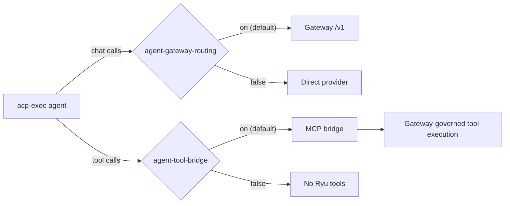

"BYO" (bring your own) means you bring the agent CLI. Ryu provides the session, tools, memory, and
governance. For the protocol details, see [ACP Agent Integration](/docs/extend/integrate/acp-integration).

## Prerequisites

- Ryu Core running on `http://localhost:7980`, and its node token in `RYU_TOKEN`
- Your agent CLI installed, speaking ACP over stdio, and callable from `PATH`
- The CLI reads an OpenAI-compatible base URL (`OPENAI_BASE_URL`), or you accept that its chat
  egress bypasses the Gateway

## Step 1: Register the agent

Create an agent whose engine is your CLI's spawn command.

```bash
curl -X POST http://localhost:7980/api/agents \
  -H "Authorization: Bearer $RYU_TOKEN" \
  -H 'Content-Type: application/json' \
  -d '{
    "name": "My Custom Agent",
    "description": "My custom coding agent",
    "engine": "acp-exec:my-agent --stdio"
  }'
```

The `acp-exec:` prefix marks the rest of the `engine` value as the command Core runs when a user
selects the agent. The response returns the new record under `agent`. Use its `id` as the agent
id in the steps below (shown here as `my-agent`).

`POST /api/agents/catalog/install` is a different route. It installs a built-in catalog agent by
`id` and does not accept a custom command.

## Step 2: Test it locally

Select your agent in the Desktop picker, or send a chat with its `agent_id`.

```bash
curl -X POST http://localhost:7980/api/chat/stream \
  -H "Authorization: Bearer $RYU_TOKEN" \
  -H 'Content-Type: application/json' \
  -d '{
    "messages": [{"role": "user", "content": "Hello from my agent!"}],
    "agent_id": "my-agent"
  }'
```

The response is an SSE stream in the Vercel AI SDK format.

## Step 3: Use the Gateway routing default

If your agent reads `OPENAI_BASE_URL`, the Gateway governs its model calls by default. Core injects
`OPENAI_BASE_URL=http://localhost:7981/v1` and `OPENAI_API_KEY=<gateway-token>` into the agent's
spawn environment.

The `agent-gateway-routing` preference holds a JSON object that maps agent ids to booleans. A
missing entry means on. Read it, or write an explicit `false` to keep direct provider egress for
one agent. The preference value is a string, so the object is JSON-encoded inside it, and a write
replaces the whole map.

```bash
# Read the current routing map
curl http://localhost:7980/api/preferences/agent-gateway-routing \
  -H "Authorization: Bearer $RYU_TOKEN"

# Keep direct provider egress for this agent (explicit opt-out)
curl -X PUT http://localhost:7980/api/preferences/agent-gateway-routing \
  -H "Authorization: Bearer $RYU_TOKEN" \
  -H 'Content-Type: application/json' \
  -d '{ "value": "{\"my-agent\": false}" }'
```

## Step 4: Declare tool access

Your agent uses Ryu tools through the MCP bridge. Set which tools it may use in its tool
allowlist. The bridge offers `tool_search` and `describe` to discover tools, and `execute` to call
them. The Gateway's allowlist governs each call.

The bridge is on by default for every ACP agent. The per-agent `agent-tool-bridge` preference
controls it, with the same JSON-object shape as Step 3 (a missing entry means on).

```bash
# Turn the MCP tool bridge off for one agent (rarely needed)
curl -X PUT http://localhost:7980/api/preferences/agent-tool-bridge \
  -H "Authorization: Bearer $RYU_TOKEN" \
  -H 'Content-Type: application/json' \
  -d '{ "value": "{\"my-agent\": false}" }'
```

The two preferences are independent:

- `agent-gateway-routing` controls chat egress (which model endpoint the agent's chat calls use).
- `agent-tool-bridge` controls tool access (whether Ryu's tools are injected into the session).

You can leave an agent's egress unrouted and still give it Ryu tools, or route its chat without the
bridge.



## Step 5: Package the agent (optional)

To distribute the agent, package it as a plugin with an `agent` runnable and the permission grants
it needs. See [manifest.json](/docs/extend/develop/extensions/plugin-json-manifest) for the schema
and grant names.

## What Ryu provides

When your agent runs inside Ryu, it gets these capabilities with no extra setup.

| Capability | How |
|---|---|
| **Tool access** | MCP bridge, then the unified tool catalog, then Gateway-governed execution |
| **Memory** | Long-term conversation memory via `/api/memory/*` |
| **Spaces/RAG** | Document ingestion and semantic search |
| **Gateway governance** | Firewall, budgets, rate limiting, audit (for routable agents by default) |
| **Skills** | Agent skills loaded on demand via `skills.load` |
| **Sessions** | Conversation persistence across turns |

## Troubleshooting

| Symptom | Fix |
|---|---|
| Agent not showing in picker | Check `GET /api/agents` and confirm the agent exists |
| Tool call returns `is not allowed for this request` | Add the tool's fully qualified id to the Gateway allowlist |
| Chat egress bypasses Gateway | Check for an explicit `false` in `agent-gateway-routing`, or a provider that Core cannot reroute |
| No Ryu tools injected | Check `agent-tool-bridge`. It defaults on, so look for an explicit `false` (Step 4) |
| Agent crashes on spawn | Verify the spawn command works standalone: `my-agent --stdio` |

## Related

<Cards>
  <DocCard href="/docs/extend/integrate/acp-integration" />
  <DocCard href="/docs/start-here/architecture/acp-agents" />
  <DocCard href="/docs/extend/develop/extensions/typescript-sdk" />
  <DocCard href="/docs/extend/develop/extensions/plugin-json-manifest" />
</Cards>
